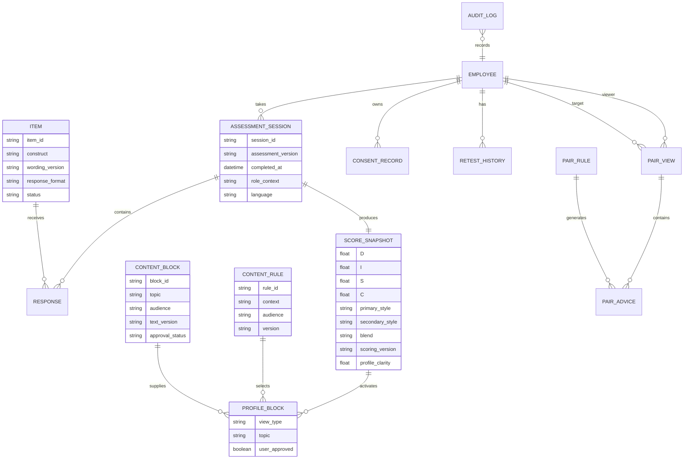
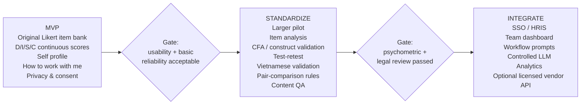
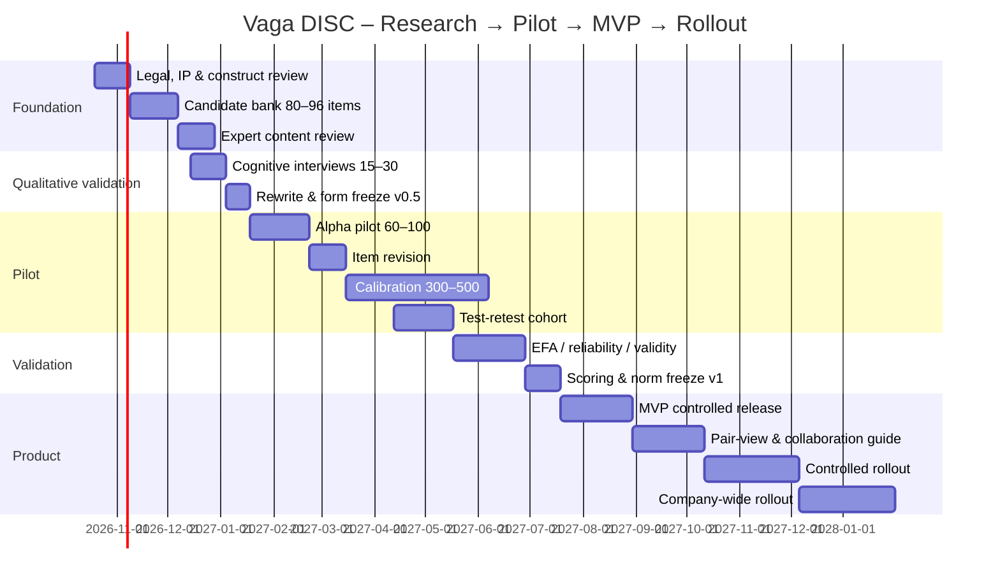
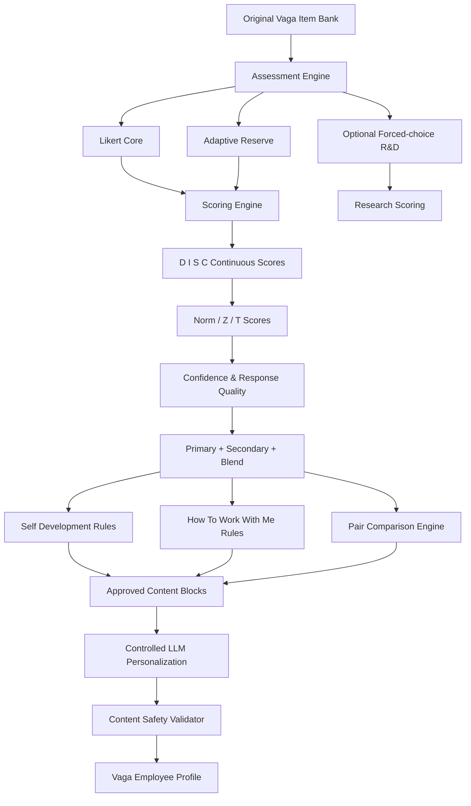
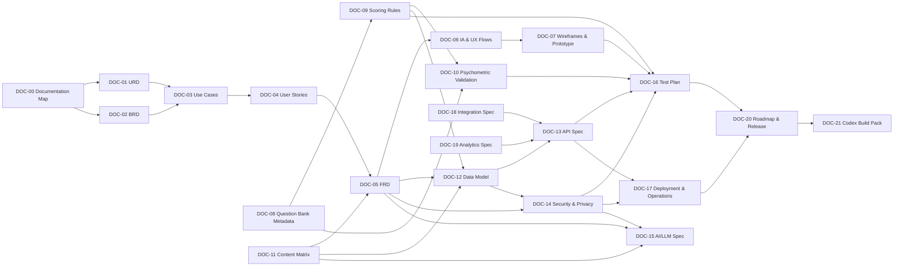
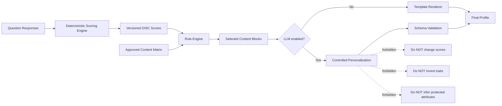
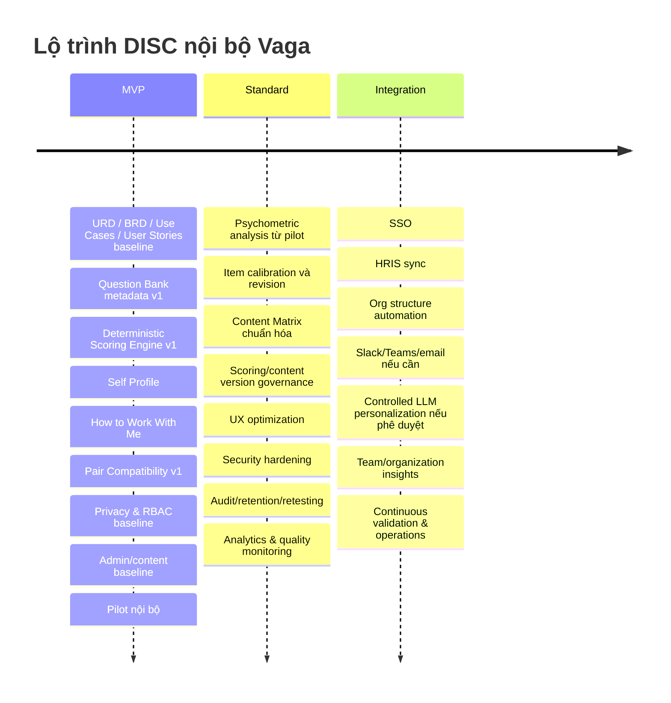
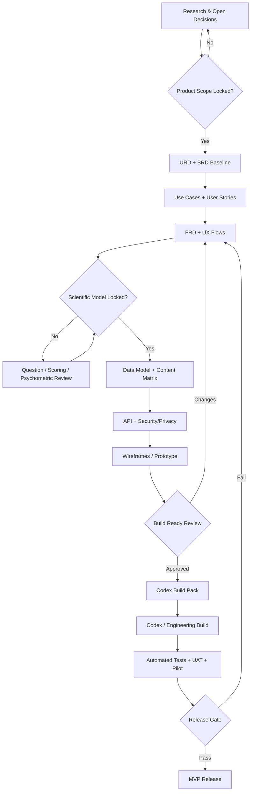

# Toàn bộ nội dung hội thoại & Kế hoạch Nghiên cứu Thiết kế DISC (Vaga DISC)

- **Nguồn**: https://chatgpt.com/share/6ad0f796-8680-83ec-ba45-02e65da8c682

- **Tiêu đề**: Nghiên cứu thiết kế DISC

---


## [Turn 1 — USER (Node 3)]

@Nghiên cứu sâu ## Mục tiêu
Thực hiện nghiên cứu chuyên sâu (Deep Research) về các nền tảng đánh giá DISC hàng đầu thế giới và cơ sở lý thuyết đằng sau, từ đó lập bản kế hoạch thiết kế sản phẩm (Product Blueprint) cho trang DISC nội bộ của Vaga.

Trang nội bộ cần giải quyết trọn vẹn 2 luồng giá trị:
1. **Hướng cá nhân (Self-Awareness & Actionable Growth):** Giúp nhân sự nhận diện đúng điểm mạnh, điểm hạn chế của bản thân; đề xuất các hành động cụ thể để cải thiện hiệu suất công việc và kỹ năng giao tiếp với đồng nghiệp.
2. **Hướng đồng nghiệp/quản lý (Collaboration Guide / "User Manual"):** Khi người khác xem hồ sơ DISC của một nhân sự, họ nắm được ngay cách giao tiếp, phối hợp, giao việc và phản hồi hiệu quả nhất với người đó.

## Bối cảnh & Ràng buộc
- **Phạm vi sử dụng:** Lưu hành nội bộ cho `[SỐ_LƯỢNG_NHÂN_SỰ_DỰ_KIẾN]` nhân sự, ưu tiên tính ứng dụng thực tế trong công việc hàng ngày hơn là báo cáo lý thuyết dài dòng.
- **Yêu cầu nguồn dữ liệu:** Ưu tiên tra cứu trang chủ, tài liệu kỹ thuật (technical reports/research whitepapers) và giao diện thực tế của các nền tảng lớn. Nếu chạy ở môi trường có truy cập web, dẫn nguồn/URL trực tiếp cho từng nhận định; nếu không có web, ghi rõ các mục cần xác minh thực tế và không tự bịa số liệu thống kê hay thông số bản quyền.
- **Ràng buộc pháp lý & đạo đức:**
  - Phân biệt rõ **lý thuyết gốc thuộc phạm vi công cộng (Public Domain)** của William Moulton Marston (1928) với các **bộ câu hỏi, thuật toán chấm điểm và nhãn hiệu thương mại được bảo hộ** (như Everything DiSC® của Wiley, Thomas International, TTI Success Insights, Extended DISC, Crystal Knows, Tony Robbins...). Kế hoạch xây dựng nội bộ tuyệt đối không sao chép nguyên văn bộ câu hỏi có bản quyền.
  - Đưa ra khuyến nghị chống lạm dụng kết quả: không dùng DISC để dán nhãn cố định (stereotyping), thiên vị hoặc làm tiêu chí duy nhất để đánh giá năng lực/sa thải.
- **Trình bày:** Tiếng Việt chuyên nghiệp, cấu trúc rõ ràng bằng bảng biểu và danh sách kiểm (checklist). Nêu rõ kết luận, giả định và bằng chứng cho các đề xuất thiết kế (không xuất chuỗi suy luận nháp nội bộ).

## Nội dung nghiên cứu & Đầu ra yêu cầu

### Phần 1: Giải phẫu cơ sở lý thuyết và cơ chế đánh giá DISC
1. **Nền tảng lý thuyết:**
   - Mô hình 2 trục gốc của Marston: Tốc độ/Hành động (Chủ động vs. Thận trọng) và Môi trường/Mối quan hệ (Hướng công việc/Hoài nghi vs. Hướng con người/Đồng thuận) tạo thành 4 nhóm D (Dominance), I (Influence), S (Steadiness), C (Conscientiousness).
   - Sự phát triển từ 4 nhóm đơn lẻ sang **12 hoặc 16 kiểu kết hợp (Sub-traits/Blends)** (ví dụ: DI, ID, DC, SC, CS...) để tránh kết quả chung chung.
   - Phân biệt **Hành vi tự nhiên (Natural/Core style)** và **Hành vi thích ứng trong công việc (Adapted style)** — giá trị và hạn chế khi áp dụng mô hình 2 đồ thị vào nội bộ.
2. **Cơ chế đặt câu hỏi và chấm điểm (Scoring Mechanics):**
   - So sánh 3 phương pháp phổ biến: **Forced-choice / Ipsative** (chọn 1 từ giống nhất - 1 từ ít giống nhất trong cụm 4 từ), **Likert Scale / Normative** (thang điểm 1–5 hoặc 1–7), và **Adaptive Testing** (thích ứng theo câu trả lời).
   - Bảng so sánh ưu/nhược điểm của từng phương pháp về: thời gian làm bài, độ chính xác, khả năng chống làm giả kết quả (social desirability bias) và mức độ phức tạp khi lập trình cho trang nội bộ.
   - Đề xuất phương pháp chấm điểm khả thi nhất để đội ngũ kỹ thuật nội bộ tự xây dựng hoặc tích hợp.

### Phần 2: Phân tích (Benchmark) các phần mềm & website DISC xuất sắc
Khảo sát và lập bảng so sánh ít nhất 5–6 nền tảng tiêu biểu theo 2 nhóm:
- **Nhóm chuẩn mực đánh giá cá nhân & đội nhóm:** Everything DiSC (Wiley - đặc biệt tính năng Catalyst), Thomas International (PPA), Extended DISC / FinxS, TTI Success Insights.
- **Nhóm ứng dụng giao tiếp & tương tác đồng nghiệp trực tiếp:** Crystal (Crystal Knows), Humantic AI, Cloverleaf, hoặc 16Personalities (tham khảo về mặt UX/UI truyền tải kết quả).

**Bảng so sánh bắt buộc gồm các cột:**
`Tên nền tảng` | `Mô hình câu hỏi & Thời gian test` | `Điểm sáng về UX/UI & Báo cáo cá nhân` | `Tính năng hỗ trợ đồng nghiệp giao tiếp (Comparison/Team view)` | `Bài học rút ra cho trang nội bộ`

### Phần 3: Thiết kế cấu trúc Hồ sơ DISC 2 chiều (Core Product Design)
Thiết kế khung nội dung chi tiết (Content Wireframe) cho 1 hồ sơ nhân sự trên hệ thống nội bộ, tách biệt rõ 2 chế độ xem:

1. **Chế độ Xem Cá Nhân (Private / Self-Development View):**
   - Tóm tắt biểu đồ điểm số (D-I-S-C) và nhóm tính cách chủ đạo (kèm nhóm phụ).
   - **Điểm mạnh cốt lõi** trong công việc và đóng góp cho đội nhóm.
   - **Điểm mù (Blind spots) & Rủi ro khi chịu áp lực cao** (Under stress).
   - **Kế hoạch hành động (Actionable Playbook):** Cấu trúc gợi ý các việc cần làm ngay (Quick wins) và thói quen cần rèn luyện để làm việc hiệu quả hơn và cải thiện giao tiếp với 3 nhóm tính cách còn lại.
2. **Chế độ Xem Công Khai Nội Bộ (Colleague / Public Profile View - "How to work with me"):**
   - Thiết kế dưới dạng **"Hướng dẫn sử dụng nhanh" (1-Minute Cheat Sheet)** khi đồng nghiệp truy cập vào hồ sơ:
     - **Nên (Do's) & Không nên (Don'ts)** khi giao tiếp trực tiếp hoặc nhắn tin.
     - **Cách phối hợp hiệu quả nhất** trong họp hành, giải quyết bất đồng và ra quyết định.
     - **Cách giao việc, phản hồi (Feedback) và ghi nhận (Recognition)** phù hợp với động lực của người này.
   - **Tính năng So sánh cặp (1-on-1 Compatibility View):** Khi Nhân sự A xem hồ sơ của Nhân sự B, hệ thống tự động đối chiếu điểm DISC của A và B để chỉ ra: *Điểm tương đồng*, *Điểm dễ xung đột*, và *3 lời khuyên thực tế để A phối hợp tốt với B*.

### Phần 4: Kế hoạch triển khai xây dựng trang nội bộ (Implementation Roadmap)
1. **Kiến trúc dữ liệu & Logic nội dung (Content Matrix):**
   - Cách tổ chức cơ sở dữ liệu nhận xét (Modular Content Blocks) cho 4 nhóm chính và 12 nhóm kết hợp để không phải viết thủ công hàng trăm báo cáo rời rạc, hoặc cách kết hợp Rule-based scoring với LLM để cá nhân hóa gợi ý hành động mà vẫn kiểm soát được chất lượng.
2. **Quyền riêng tư & Văn hóa doanh nghiệp:**
   - Phân quyền: Phần nào chỉ nhân sự đó thấy (ví dụ: điểm yếu nhạy cảm, mức độ căng thẳng), phần nào hiển thị cho toàn công ty (hướng dẫn giao tiếp tích cực).
   - Cơ chế làm lại bài test (Re-testing cycle: 6–12 tháng/lần hoặc khi đổi vai trò).
3. **Lộ trình xây dựng 3 giai đoạn (MVP -> Chuẩn hóa -> Tích hợp):**
   - Lập bảng gồm: `Giai đoạn` | `Tính năng trọng tâm` | `Nguồn lực cần có` | `Tiêu chí nghiệm thu (Acceptance Criteria)`.


## [Deep Research Report — Node 15] Nghiên cứu nền tảng DISC cho Vaga

# Nghiên cứu chuyên sâu và Product Blueprint cho hệ thống DISC nội bộ Vaga

## Kết luận điều hành

Sau khi đối chiếu nền tảng lý thuyết của William Moulton Marston, tài liệu kỹ thuật của Wiley/Everything DiSC, tài liệu chính thức của Thomas International, Extended DISC/FinxS, TTI Success Insights, Crystal, Cloverleaf và Humantic AI, phương án phù hợp nhất cho Vaga **không phải là sao chép một bài test DISC đang có**, mà là tách sản phẩm thành hai lớp:

**Lớp đo lường** trả lời: *“Tôi có xu hướng hành vi như thế nào?”*  
**Lớp ứng dụng** trả lời: *“Vậy từ ngày mai tôi và đồng nghiệp nên làm gì khác đi?”*

Đây cũng là hướng mà những sản phẩm tốt nhất đang đi: Everything DiSC Catalyst không dừng ở kết quả cá nhân mà đưa tiếp sang “Your Colleagues”, group dynamics và các gợi ý tương tác; Crystal biến kết quả thành những câu hướng dẫn rất ngắn về giao tiếp; Cloverleaf đưa DISC vào team dashboard; Humantic AI đưa lời khuyên giao tiếp tới ngay điểm xảy ra công việc. citeturn18view0turn17view5turn17view6turn17view8

### Đề xuất kiến trúc sản phẩm Vaga

| Quyết định | Khuyến nghị |
|---|---|
| Mục tiêu chính | **Behavioral operating system cho nội bộ**, không phải “bài trắc nghiệm tính cách” |
| Cơ chế MVP | Bộ câu hỏi **Likert 5 mức**, do Vaga tự viết và kiểm định; không sao chép item của hãng khác |
| Mô hình kết quả | Giữ **4 điểm D-I-S-C liên tục** ở tầng dữ liệu; dùng **12 style/blend** ở tầng diễn giải |
| “Natural vs Adapted” | Có thể triển khai, nhưng gọi là **“xu hướng thường thấy” và “điều chỉnh theo vai trò hiện tại”**, không gọi một bên là “con người thật” |
| Hồ sơ cá nhân | Strengths → blind spots → stress → action plan → cách làm việc với D/I/S/C |
| Hồ sơ công khai | **1-Minute User Manual:** giao tiếp, họp, giao việc, feedback, conflict, recognition |
| Pair comparison | So sánh A → B theo **độ khác biệt hành vi**, không tạo “điểm hợp nhau 78%” |
| Engine nội dung | **Rule-based là nguồn sự thật; LLM chỉ cá nhân hóa cách diễn đạt**, không tự phát minh kết luận tâm lý |
| Dữ liệu nhạy cảm | Stress, blind spots, adaptation gap, raw answers: **private mặc định** |
| Chu kỳ làm lại | Full assessment khoảng **12 tháng/lần** hoặc khi thay đổi vai trò đáng kể; không overwrite lịch sử |
| Sử dụng nhân sự | Tuyệt đối không dùng DISC làm tiêu chí duy nhất cho tuyển dụng, thăng chức, đánh giá năng lực hay sa thải |
| Build vs Buy | Nếu Vaga cần độ tin cậy tâm lý đo lường ngay mà không có mẫu hiệu chuẩn đủ lớn: **license assessment + tự xây lớp experience** là đường ngắn và an toàn hơn |

Một điểm cần chỉnh ngay trong brief ban đầu: **“Active/Thoughtful” và “Questioning/Accepting” là cách biểu diễn hiện đại của Everything DiSC chứ không nên ghi là nguyên văn hai trục của Marston năm 1928.** Marston đưa ra bốn phản ứng Dominance, Inducement, Submission, Compliance; quá trình biến lý thuyết này thành assessment xuất hiện sau đó, với Walter Clarke và các thế hệ công cụ kế tiếp. Wiley cũng ghi nhận chính Marston không tạo ra bài đánh giá DiSC. citeturn19view1turn19view2turn18view4

Quan trọng hơn, **không tồn tại một “bài DISC chuẩn duy nhất” mà mọi công ty cùng sử dụng**. Everything DiSC, Thomas PPA, Extended DISC, TTI, Crystal… cùng xuất phát từ họ khái niệm DISC nhưng có questionnaire, scoring, norms, subtype taxonomy và reporting riêng. Vì vậy, độ tin cậy hoặc validity của Wiley **không tự động chuyển sang một bài Vaga DISC tự xây**. citeturn17view0turn17view1turn17view3turn17view5


## Cơ sở lý thuyết và cơ chế đánh giá DISC

### Từ Marston đến DISC hiện đại

William Moulton Marston xuất bản *Emotions of Normal People* năm 1928. Trong đó ông bàn đến bốn kiểu phản ứng mà lịch sử DiSC sau này gọi là Dominance, Inducement, Submission và Compliance. Bản thân Marston không xây dựng questionnaire DiSC thương mại; công cụ đo lường đầu tiên theo hướng này xuất hiện về sau với Walter V. Clarke, rồi Self-Description, Personal Profile System và các phiên bản thương mại khác. citeturn19view1turn19view2turn18view4

Everything DiSC hiện đại trình bày mô hình trên hai chiều liên tục:

- Trục dọc: **Active ↔ Thoughtful**, phản ánh nhanh/chủ động/quyết liệt so với thận trọng/phương pháp/suy xét.
- Trục ngang: **Questioning ↔ Accepting**, phản ánh logic/hoài nghi/thách thức so với hướng con người/tiếp nhận/đồng thuận. citeturn17view0

Từ hai chiều này hình thành bốn vùng D, i, S, C. Nhưng Wiley nhấn mạnh rằng nên xem vòng tròn như một **continuum**, không phải bốn chiếc hộp riêng biệt; mỗi người là một tổ hợp của cả bốn xu hướng. citeturn17view0

Với Vaga, nên dịch hai trục sang ngôn ngữ công việc như sau:

| Trục sản phẩm Vaga | Cực thứ nhất | Cực thứ hai | Câu hỏi thực tế |
|---|---|---|---|
| **Nhịp độ hành động** | Nhanh, chủ động, quyết đoán | Thận trọng, suy xét, có phương pháp | “Bạn thường muốn tiến lên nhanh hay cần đủ thời gian xử lý?” |
| **Cách tiếp cận con người/vấn đề** | Thách thức, logic, chất vấn | Tiếp nhận, đồng thuận, hướng con người | “Bạn thường kiểm chứng/thách thức hay tìm điểm chung trước?” |

Không nên đặt tên trục thứ hai đơn giản là “công việc ↔ con người”, vì điều đó dễ tạo ra kết luận sai rằng C hoặc D “không quan tâm con người”, còn I/S “không quan tâm kết quả”.

### Tại sao cần 12 style thay vì chỉ bốn màu

Everything DiSC hiện sử dụng **12 style**, bởi hai người cùng nằm trong D vẫn có thể rất khác nhau nếu một người nghiêng về i còn người kia nghiêng về C. Wiley nêu ví dụ Di và iD có các sắc thái khác nhau dù đều nằm ở vùng giữa D và i. citeturn17view0

Crystal hiện lại dùng **16 archetype** trên DISC wheel. Trang DISC của Crystal cập nhật tháng 8/2026 công bố 28 câu hỏi, 5 phút và 16 archetype. citeturn17view5

Điều này dẫn tới một kết luận thiết kế quan trọng:

> **12 hoặc 16 không phải chân lý nguyên thủy của Marston. Đó là cách từng nhà cung cấp phân đoạn một không gian hành vi liên tục.**

Vaga nên chọn **12 style** cho lớp UX vì ba lý do:

1. Đủ chi tiết để tránh kết quả “Bạn là D nên quyết đoán”.
2. Dễ học và nhớ hơn hệ 16 style.
3. Có thể giữ điểm D-I-S-C liên tục phía dưới để tránh ép người dùng vào một chiếc hộp.

Một cấu trúc 12 style có thể gồm các vùng đơn và vùng pha lân cận, chẳng hạn D, Di, iD, i, iS, Si, S, SC, CS, C, CD, DC. **Tên gọi cụ thể nên là taxonomy riêng của Vaga**, không nên sao chép tên archetype thương mại của hãng khác.

### Natural/Core và Adapted style: hữu ích nhưng rất dễ bị lạm dụng

Extended DISC phân biệt “Natural Style — Profile II” và “Perceived Need to Adjust — Profile I”. Theo cách giải thích của hãng, Profile II thể hiện phong cách tự nhiên, còn Profile I phản ánh cách người làm bài cảm thấy mình cần điều chỉnh để thành công trong hoàn cảnh hiện tại. citeturn17view4

TTI cũng sử dụng khái niệm natural và adaptive behavioral styles trong sản phẩm của mình. citeturn18view8

Tuy nhiên, Vaga **không nên bê nguyên khái niệm “hard-wired”** của Extended DISC thành một chân lý khoa học. Đây là ngôn ngữ diễn giải của nhà cung cấp, không phải điều được suy ra trực tiếp từ lý thuyết Marston năm 1928. citeturn17view4turn19view2

Khung an toàn hơn:

| Không nên | Nên dùng tại Vaga |
|---|---|
| “Con người thật của bạn” | “Xu hướng bạn thường thấy ở bản thân” |
| “Mặt nạ ở nơi làm việc” | “Cách bạn đang điều chỉnh theo vai trò/bối cảnh hiện tại” |
| “Bạn đang sống sai tính cách” | “Vai trò hiện tại đang đòi hỏi một số hành vi ít tự nhiên hơn với bạn” |
| “Khoảng cách lớn = stress” | “Khoảng cách đáng chú ý; nên dùng như tín hiệu để tự phản tư, không phải chẩn đoán stress” |

**Giá trị của hai đồ thị:** giúp coaching về role-fit, nhu cầu thích nghi, năng lượng và những hành vi đang phải chủ động rèn.

**Rủi ro:** quản lý có thể nhìn chênh lệch rồi suy diễn “nhân viên đang căng thẳng”, “không hợp vai trò”, hoặc “không phải con người thật”.

Vì vậy, nếu Vaga triển khai hai profile, **Adaptation Gap nên private mặc định**.

### Ba cơ chế đặt câu hỏi không thực sự ngang hàng

Một chỉnh sửa kỹ thuật quan trọng: **Adaptive Testing không phải là response format thứ ba giống Forced-choice và Likert.** Nó là cơ chế lựa chọn câu hỏi tiếp theo dựa trên thông tin đã thu được; adaptive testing có thể chạy trên item bank dạng rating/Likert hoặc dạng khác.

Everything DiSC hiện là ví dụ rõ: người làm bài đánh giá các phát biểu hành vi trên **thang năm mức**, đồng thời hệ thống sử dụng **adaptive testing** để bổ sung những item cần thiết nhằm tăng độ chính xác. citeturn18view0turn6view0

| Tiêu chí | Forced-choice / Ipsative | Likert / Normative | Adaptive testing |
|---|---|---|---|
| Ví dụ | 4 từ → chọn “giống nhất” và “ít giống nhất” | “Câu này giống tôi đến mức nào?” 1–5 | Chọn item tiếp theo dựa trên uncertainty/thông tin trước đó |
| UX | Nhanh, buộc phải trade-off | Rất quen thuộc, ít cognitive load | Có thể rất gọn với người dùng |
| So sánh trait | Classical ipsative khó so sánh giữa người | Thuận lợi hơn | Phụ thuộc scoring model nền |
| Social desirability | Khó “chọn tất cả điều tốt” hơn | Dễ nhận ra câu trả lời xã hội mong muốn hơn | Không tự giải quyết faking |
| Độ phức tạp code | Trung bình | **Thấp nhất** | **Cao nhất** |
| Độ phức tạp psychometrics | Cao nếu muốn normative scoring tốt | Thấp–trung bình | Rất cao: item calibration + selection algorithm |
| Phù hợp MVP Vaga | Có thể, nhưng không phải lựa chọn đầu | **Khuyến nghị** | Không nên tự xây ngay |

Thomas PPA minh họa mô hình forced-choice truyền thống: 24 câu/cụm, mỗi cụm bốn từ, người làm chọn từ “most” và “least”, hoàn thành khoảng tám phút. citeturn17view1turn17view2 Extended DISC cũng công bố 24 câu hỏi theo dạng chọn “most” và “least” trong bốn phương án, khoảng mười phút. citeturn17view3

Forced-choice thường được chọn vì người trả lời không thể đánh dấu tất cả đặc điểm có vẻ tích cực. Tuy nhiên, nghiên cứu hiện đại cho thấy câu chuyện phức tạp hơn: một nghiên cứu năm 2024 với 573 người cho thấy graded paired comparisons có mức tăng điểm do “fake” thấp hơn Likert, nhưng không phải lúc nào cũng khôi phục thứ hạng “thật” tốt hơn; conventional forced-choice còn gặp vấn đề về reliability và khả năng so sánh cá nhân nếu sử dụng scoring đơn giản. Các mô hình như Thurstonian IRT giải quyết được một phần, nhưng làm hệ thống phức tạp hơn rất nhiều. citeturn18view7

### Phương án scoring nên dùng cho Vaga

**MVP đề xuất: Likert 5 mức + questionnaire do Vaga sở hữu + scoring minh bạch.**

Ví dụ thang:

> 1 — Rất không giống tôi  
> 2 — Khá không giống tôi  
> 3 — Tùy tình huống  
> 4 — Khá giống tôi  
> 5 — Rất giống tôi

Khuyến nghị ban đầu là **40–48 item**, khoảng 10–12 item cho mỗi dimension. Đây là **design hypothesis**, chưa phải con số đã được “validate” cho Vaga.

Mỗi item phải đáp ứng:

- chỉ mô tả **một hành vi**;
- ưu tiên tình huống nơi làm việc;
- tránh từ trực tiếp như “quyết đoán”, “lãnh đạo tốt”, “cầu toàn”, vì người trả lời dễ đoán mục đích;
- có positive/reverse keyed items;
- không viết D, I, S, C trong câu hỏi;
- tránh câu có phương án “rõ ràng tốt về đạo đức”;
- tất cả wording phải là tác phẩm mới của Vaga.

Scoring sơ bộ:

```text
Response 1..5

Với reverse-keyed item:
score = 6 - response

Raw_D = mean(items keyed D)
Raw_I = mean(items keyed I)
Raw_S = mean(items keyed S)
Raw_C = mean(items keyed C)
```

Sau pilot, nên chuẩn hóa theo mẫu hiệu chuẩn:

```text
z_trait = (raw_trait - mean_calibration) / sd_calibration
```

Không nên hiển thị “percentile 92” cho nhân viên nếu Vaga chưa có một normative sample thích hợp. Một con số 0–100 do tuyến tính hóa đơn thuần **không phải percentile**.

Việc xác định blend cũng không nên đơn giản là “lấy hai số lớn nhất”. Nên hiệu chuẩn threshold bằng dữ liệu pilot. Nếu hai trait đứng đầu quá gần nhau, hiển thị blend; nếu khác biệt lớn, dùng style chính. Nếu hai trait đối diện trên mô hình tạo ra pattern khó diễn giải, hệ thống nên giữ profile đa chiều thay vì cưỡng ép gán type.

**Adaptive testing chỉ nên vào giai đoạn sau**, khi Vaga có item bank đủ lớn, dữ liệu hiệu chuẩn và người có chuyên môn psychometrics. Everything DiSC có thể sử dụng adaptive testing vì Wiley có một hệ thống assessment và validation riêng; không thể sao chép logic bề mặt rồi gọi một questionnaire nội bộ là CAT đã kiểm định. citeturn18view0turn6view0


## Benchmark các nền tảng DISC và ứng dụng giao tiếp hàng đầu

Bảng dưới đây tập trung vào điều Vaga thực sự có thể học được thay vì chỉ so “ai có nhiều tính năng hơn”.

| Tên nền tảng | Mô hình câu hỏi & Thời gian test | Điểm sáng UX/UI & Báo cáo cá nhân | Hỗ trợ đồng nghiệp / Comparison / Team | Bài học cho Vaga |
|---|---|---|---|---|
| **Everything DiSC / Wiley + Catalyst** | Behavioral statements, **Likert 5 mức + adaptive testing**; số item thay đổi tùy adaptive path, trang chính thức được rà soát không đưa một thời lượng cố định. citeturn18view0turn6view0 | 12 style, circumplex map; narrative cá nhân; chuyển nhanh từ “biết mình” sang action. citeturn17view0 | Catalyst có **Your Colleagues**, real-time interaction tips, group plotting và communication situations. Comparison Report so sánh hai người về similarities/differences và gợi ý thực tế. citeturn18view0turn6view2 | **Benchmark số một cho Vaga:** assessment → self profile → colleague → group → action. Không để report kết thúc tại “Bạn là style gì?”. |
| **Thomas International PPA** | **24 câu**, các cụm bốn từ, chọn most/least; khoảng **8 phút**. citeturn17view1turn17view2 | Kết quả tập trung workplace behavior: communication, leadership, work style; assessment rất nhanh. citeturn17view1 | Dùng trong management, coaching, onboarding, team communication. Thomas nhấn mạnh kết quả là xu hướng, không phải nhãn cố định. citeturn17view9 | UX bài test ngắn; wording hướng công việc. Quan trọng nhất: **đừng biến DISC thành kết luận năng lực**. |
| **Extended DISC / FinxS** | **24 câu**, chọn most/least trong bốn lựa chọn; khoảng **10 phút**. citeturn17view3 | Điểm khác biệt rõ là **Natural Profile II + Adjusted Profile I**. citeturn17view4 | Dùng profile để hiểu khác biệt và điều chỉnh hành vi với người khác. citeturn17view4 | Học kiến trúc 2-context profile, nhưng **không dùng “hard-wired” như chân lý**. Context gap nên private. |
| **TTI Success Insights** | Talent Insights kết hợp assessment hành vi và motivators; nguồn chính thức TTI nêu mỗi phần khoảng **15 phút** trong cấu hình được mô tả. Báo cáo hành vi có natural/adaptive styles. citeturn18view8 | Điểm mạnh là không coi DISC là toàn bộ con người: TTI kết hợp behavior với Driving Forces và các “sciences” khác. citeturn18view8turn18view9 | Report cung cấp communication tips, strengths, potential conflicts, ideal environment. citeturn18view8 | **DISC không đủ để suy đoán năng lực/motivator.** Thiết kế Vaga phải nói rõ phạm vi đo. |
| **Crystal** | Hiện công bố **28 câu, khoảng 5 phút**; dạng short behavioral statements; **16 archetypes**. citeturn17view5 | Rất mạnh về microcopy: graph → archetype → traits → communication style → cụm “one thing to remember”. citeturn17view5 | Kết quả hướng mạnh tới “how to read everyone else”, cách giao tiếp và làm việc với style khác. citeturn17view5 | Đây là benchmark tốt nhất cho **1-Minute Cheat Sheet**: câu ngắn, hành động được ngay, ít lý thuyết. |
| **Cloverleaf** | DISC là một trong các assessment nằm trong platform; tài liệu công khai được rà soát không nêu ổn định số câu/thời gian test để có thể khẳng định chính xác. | Không chỉ show profile; đưa assessment vào coaching workflow và team dashboard. citeturn17view6 | Có shared team dashboard, nhìn DISC results trên toàn team, collaboration styles và team coaching insights. citeturn17view6 | **Team view phải là sản phẩm riêng**, không phải bảng liệt kê “team có 4 D, 5 I…”. |
| **Humantic AI** | Khác nhóm trên: dùng Personality AI thay vì yêu cầu mọi người làm questionnaire truyền thống; sản phẩm công bố DISC + OCEAN và 36 behavioral dimensions. citeturn17view8 | Đưa insight vào messaging/playbook thay vì yêu cầu user mở báo cáo dài. citeturn17view8 | Advice được contextualize theo người đối diện và hoàn cảnh tương tác. citeturn17view8 | **Học workflow integration, không nên học phương pháp suy đoán nhân viên mà không có consent.** Với nội bộ, self-report minh bạch an toàn hơn. |

### Những pattern đáng sao chép ở cấp ý tưởng

**Pattern của Catalyst:** “Tôi là ai?” → “Người kia khác tôi thế nào?” → “Tôi nên điều chỉnh gì trong tình huống này?”. Đây gần như chính xác hai luồng giá trị Vaga đang cần. citeturn18view0

**Pattern của Crystal:** không bắt người dùng đọc mười trang mới rút ra được cách nói chuyện. Ví dụ profile hiện ngay những hướng dẫn dạng “lead with the takeaway”, “keep it quick and direct”. Vaga nên học **cấu trúc thông tin**, tuyệt đối không sao chép wording. citeturn17view5

**Pattern của Cloverleaf:** DISC chỉ thực sự tạo ra network effect khi hồ sơ của các thành viên cùng nằm trong một team workspace. citeturn17view6

**Pattern của Humantic:** lời khuyên hiệu quả nhất khi xuất hiện **ngay trước hoặc trong một tương tác**, chứ không phải sáu tháng sau khi nhân viên đã quên bài test. citeturn17view8

### Những thứ Vaga không nên sao chép

Không nên xây “bốn chiếc hộp màu”; không nên viết “D = lãnh đạo”, “S = hỗ trợ”, “C = back office”; không nên dự đoán performance từ DISC; không nên cho HR một ranking “DISC tốt nhất”; không nên dùng score làm job fit tự động.

Thomas hiện cũng cảnh báo trực tiếp rằng quản lý không nên gắn nhãn kiểu “high-C nên không thích nghi được” bởi hành vi thay đổi theo vai trò, văn hóa team, workload, confidence và stress. citeturn17view9 TTI cũng nói DISC chỉ đo các **xu hướng hành vi phổ biến**, không đo kỹ năng, giá trị, EQ, cognitive ability, education hay ethics. citeturn17view10


## Product Blueprint cho hồ sơ DISC hai chiều

### Nguyên tắc UX trung tâm

Một nhân sự chỉ nên mất khoảng **60 giây để lấy được giá trị đầu tiên** từ một profile công khai.

Không thiết kế profile theo logic:

> biểu đồ → định nghĩa D → định nghĩa I → định nghĩa S → định nghĩa C → 10 đoạn lý thuyết.

Thiết kế theo logic:

> **“Bạn cần làm việc với Trang lúc 14:00 chiều nay. Đây là ba điều bạn cần biết.”**

### Chế độ cá nhân: Private / Self-Development View

#### Khối Hero

Hiển thị:

**Style chính:** DI  
**Style phụ:** D  
**Tóm tắt một câu:**  
“Bạn thường tạo động lực bằng tốc độ, mục tiêu và năng lượng tương tác; khi áp lực tăng, xu hướng quyết định quá nhanh có thể tăng.”

Bên cạnh:

- D / I / S / C dưới dạng bốn thanh ngang;
- vị trí trên DISC map;
- ngày assessment;
- assessment version;
- nút “Tôi thấy kết quả này giống mình đến mức nào?”;
- tooltip: “Đây là xu hướng hành vi, không phải năng lực hay giá trị con người.”

Không nên dùng radar chart làm biểu đồ chính. Bốn thanh ngang giúp người dùng đọc được mức tương đối dễ hơn, đặc biệt trên mobile.

#### Khối “Tôi phát huy tốt nhất khi…”

Không chỉ liệt kê tính từ.

Mỗi strength card gồm ba tầng:

| Strength | Biểu hiện quan sát được | Giá trị cho team |
|---|---|---|
| Quyết định nhanh | Có thể chốt hướng khi dữ liệu đã đủ | Tránh team mắc kẹt trong thảo luận |
| Tạo động lực | Năng lượng thể hiện rõ trong trao đổi | Giúp team tăng nhịp trong giai đoạn cần momentum |
| Định hướng kết quả | Hay hỏi “đích cuối là gì?” | Giữ thảo luận bám mục tiêu |
| Dám xử lý bất đồng | Không né vấn đề khó | Đẩy vấn đề ra ánh sáng sớm |

Sau mỗi điểm mạnh có dòng **“Khi dùng quá mức…”**. Ví dụ:

> “Quyết định nhanh” → khi quá mức có thể thành “kết luận trước khi người khác đủ thời gian phản biện”.

Cấu trúc này tốt hơn “strength/weakness”, vì cùng một behavior có thể hữu ích hoặc gây hại tùy mức độ và bối cảnh.

#### Khối Blind Spots & Under Stress

Private mặc định.

Cấu trúc:

**Trigger → Phản ứng dễ xuất hiện → Người khác có thể cảm nhận → Recovery move**

Ví dụ đối với profile D/I cao:

| Trigger | Phản ứng dễ xuất hiện | Impact | Recovery |
|---|---|---|---|
| Quyết định bị kéo dài | Đẩy nhanh/chốt thay | Người S/C có thể cảm thấy bị bỏ qua | Hỏi “còn rủi ro nào đủ lớn để thay đổi quyết định?” |
| Feedback vòng vo | Mất kiên nhẫn | Người nói có thể thu mình | Tách “điểm chính” và “dữ liệu hỗ trợ” |
| Quá nhiều chi tiết | Cắt ngang | Có thể bỏ qua dependency quan trọng | Yêu cầu 3 dữ liệu quyết định thay vì bỏ toàn bộ chi tiết |

Điểm quan trọng: **không viết “Bạn trở nên hung hăng”, “Bạn thao túng”, “Bạn thụ động”… như một kết luận nhân cách**. Luôn viết theo hành vi có thể quan sát và thay đổi.

#### Actionable Playbook

Đây nên là phần lớn giá trị của Self View.

**Quick wins — hôm nay**

> Trước khi chốt một quyết định có tác động nhiều người, hỏi thêm một câu:  
> **“Ai nhìn thấy rủi ro mà tôi đang bỏ sót?”**

**Thí nghiệm trong tuần**

> Trong hai cuộc họp tới, để người C/S phát biểu trước khi bạn đưa ra giải pháp của mình.

**Thói quen 30 ngày**

> Mỗi thứ Sáu chọn một tình huống giao tiếp không hiệu quả và ghi: Trigger → Hành vi của tôi → Impact → Điều chỉnh lần sau.

**Action commitment**

Người dùng chỉ chọn tối đa 1–2 behavior để cải thiện:

```text
Trong 30 ngày tới, tôi sẽ:
[✓] Hỏi ít nhất 1 quan điểm trái chiều trước quyết định lớn.
[ ] Tóm tắt yêu cầu bằng văn bản sau cuộc họp.
[ ] Dành 5 phút chuẩn bị feedback thay vì feedback tức thời.
```

Không giao cho nhân viên 12 “điểm phải sửa”; quá nhiều insight không tạo ra behavior change.

#### “Cách tôi thích nghi với D, I, S, C”

Ví dụ với người đang có xu hướng D cao:

| Khi làm việc với | Điều chỉnh nên thử |
|---|---|
| D | Vào thẳng mục tiêu, ranh giới quyết định và quyền sở hữu; tránh biến bất đồng thành cuộc thi thắng/thua |
| I | Chừa không gian brainstorm nhưng kết thúc bằng owner + deadline |
| S | Giảm tốc độ khi có thay đổi; nói rõ điều gì giữ nguyên và cho thời gian xử lý |
| C | Đưa tiêu chí, dữ liệu, definition of done; tránh gây áp lực phải quyết trước khi dữ liệu thiết yếu rõ |

Đây nên là **action matrix**, không phải “mô tả các nhóm DISC”.

### Chế độ công khai: Colleague / “How to work with me”

Trang đầu phải đủ dùng mà không cần scroll quá sâu.

#### One-Minute Cheat Sheet

**TRANG VAGA — How to work with me**

**Nhịp làm việc:** Nhanh ◉●●●○ Chậm  
**Ra quyết định:** Quyết nhanh ◉●●○○ Phân tích lâu  
**Giao tiếp:** Trực tiếp ◉●●●○ Ngoại giao  
**Chi tiết:** Big picture ◉●●○○ Detail  
**Thay đổi:** Thích thử nhanh ◉●●●○ Cần ổn định

Sau đó:

| ✅ Nên | ❌ Tránh |
|---|---|
| Nói rõ mục tiêu ngay từ đầu | Mở đầu quá dài trước khi vào vấn đề |
| Đưa 2–3 phương án và recommendation | Đưa 12 lựa chọn không có đề xuất |
| Cho quyền chủ động trong phạm vi rõ | Micro-management |
| Feedback thẳng, cụ thể, gần thời điểm xảy ra | Feedback mơ hồ kiểu “em cần tốt hơn” |
| Khi phản biện, đưa dữ kiện hoặc impact | Phản đối mà không nói lý do |

**Điểm bắt buộc:** profile owner phải có nút **“Chỉnh theo thực tế của tôi”**.

Ví dụ hệ thống sinh:

> “Ưa feedback trực tiếp.”

Nhân viên có thể chỉnh:

> “Tôi thích feedback trực tiếp, nhưng với vấn đề nhạy cảm hãy trao đổi 1:1, không nói giữa cuộc họp.”

DISC trở thành **khởi đầu cho đối thoại**, không phải một AI “biết người này hơn chính họ”.

### Meeting Playbook

Một khung cố định cho mọi profile:

**Trước cuộc họp**
- Tôi cần agenda trước hay có thể improvise?
- Tôi cần data hay executive summary?
- Tôi muốn quyền quyết định nào rõ trước?

**Trong cuộc họp**
- Nhịp độ phù hợp.
- Cách mời phát biểu.
- Cách phản biện.

**Kết thúc**
- Tôi muốn summary dạng nào?
- Owner/deadline cần cụ thể đến đâu?

### Conflict Playbook

Không viết “D xung đột với S”. Viết:

> **Khi Trang muốn quyết nhanh nhưng Lan cần thêm thời gian kiểm chứng:**  
> Rủi ro không nằm ở việc một người “đúng” và người kia “sai”, mà ở khác biệt về ngưỡng dữ liệu cần thiết trước quyết định.

Đề xuất protocol:

> Trang nêu deadline quyết định → Lan nêu tối đa ba rủi ro cần kiểm chứng → thống nhất dữ liệu “đủ để quyết” → chốt.

### Delegation Playbook

Hệ thống nên trả lời sáu câu:

**Why? → Outcome? → Autonomy? → Constraints? → Deadline? → Check-in?**

Ví dụ:

> “Khi giao việc cho tôi: hãy nói đích cần đạt và deadline trước; cho tôi quyền tự chọn cách triển khai; chỉ định rõ những ràng buộc không được vi phạm.”

### Feedback và Recognition

Không gộp hai thứ.

**Feedback preference:**
- trực tiếp hay cần dẫn bối cảnh;
- verbal hay written follow-up;
- evidence-first hay impact-first;
- ngay lập tức hay sau khi có thời gian xử lý.

**Recognition preference:**
- public/private;
- kết quả/nỗ lực/chất lượng;
- autonomy/trust/title/opportunity học hỏi.

Lưu ý: “động lực” không nên suy thẳng từ DISC. TTI cũng phân biệt behaviors và motivators thành các cấu phần riêng. citeturn18view8turn17view10 Vì vậy recognition recommendations của Vaga nên là **behavioral hypothesis + personal confirmation**, không phải “D được thúc đẩy bởi quyền lực”.

### Pair Comparison: A → B

Đây có tiềm năng trở thành tính năng có giá trị sử dụng hàng ngày cao nhất.

Không tạo:

> “Trang và Lan: compatibility 62%.”

Con số này tạo ảo giác về độ chính xác, dễ bị dùng để tuyển team và dễ biến thành stereotyping.

Thay bằng:

### Bạn và Lan

**Điểm giống nhau**

> Cả hai đều có xu hướng ưu tiên kết quả và trao đổi khá trực tiếp.

**Khác biệt có thể tạo ma sát**

> Bạn thường sẵn sàng quyết với ít dữ liệu hơn; Lan có xu hướng muốn kiểm chứng tiêu chí và rủi ro trước.

**Ba điều Trang nên làm với Lan**

**Trước khi giao việc:**  
Đưa definition of done và các constraint quan trọng.

**Khi cần quyết nhanh:**  
Nói rõ deadline quyết định và hỏi: “Hai dữ kiện nào còn thiếu có thể làm mình thay đổi quyết định?”

**Khi bất đồng:**  
Đừng diễn giải câu hỏi chi tiết của Lan thành sự chống đối; yêu cầu Lan phân loại “must know” và “nice to know”.

Everything DiSC đã dùng logic comparison giữa hai người để làm rõ similarities, differences, possible challenges và practical tips; đây là tiền lệ sản phẩm rất sát mục tiêu của Vaga. citeturn19view2turn6view2

### Logic pairwise không cần viết 144 báo cáo

Nếu có 12 style thì có **144 cặp có hướng A → B**. Viết tay 144 report đã tốn kém; nếu sau này lên 16 style sẽ thành 256.

Không cần làm vậy.

Pair engine nên dựa vào **dimension deltas**:

```text
delta_D = A.D - B.D
delta_I = A.I - B.I
delta_S = A.S - B.S
delta_C = A.C - B.C
```

Sau đó map sang những “interaction tensions” có ý nghĩa:

```text
PACE
DECISION SPEED
SOCIAL ENERGY
DETAIL NEED
CHALLENGE / ACCEPTANCE
CHANGE PREFERENCE
STRUCTURE NEED
```

Ví dụ rule:

```text
IF A_decision_speed >> B_decision_speed
THEN friction = "A may push before B feels sufficiently informed"

Advice_to_A:
- state the decision deadline
- distinguish must-have data from optional data
- allow a defined review window
```

Như vậy advice thực sự dựa vào **khoảng cách hành vi**, không phải câu sáo rỗng “D nên nhẹ nhàng với S”.


## Kiến trúc dữ liệu, Content Matrix và lớp AI

### Tách Assessment Engine khỏi Content Engine

Kiến trúc đề xuất:

```text
Assessment
    ↓
Response data
    ↓
Scoring Engine
    ↓
Continuous D-I-S-C scores
    ↓
Style / Blend Interpreter
    ↓
Profile Snapshot
    ↓
Content Rule Engine
    ├── Self View
    ├── Public View
    ├── Pair View
    └── Team View
              ↓
       Optional LLM Layer
              ↓
    Contextualized language
```

**Không để LLM chấm DISC từ đầu.**

Scoring phải deterministic, versioned và có thể audit.

### Các entity dữ liệu cốt lõi

| Entity | Dữ liệu chính |
|---|---|
| `assessment_version` | version, item bank, scoring config, effective date |
| `item` | text, trait, key_direction, context, language, review status |
| `response` | employee_id, item_id, response, timestamp |
| `score_snapshot` | D/I/S/C raw, standardized scores, scoring version |
| `style_profile` | primary style, secondary/blend, confidence/ambiguity |
| `context_profile` | usual-style / current-role style nếu triển khai |
| `content_block` | category, trait, blend, context, audience, approved_copy |
| `pair_rule` | dimension, delta band, direction, tension, recommended_action |
| `profile_override` | nội dung người dùng tự chỉnh |
| `visibility_setting` | field nào public/private/manager-visible |
| `action_commitment` | hành vi đã chọn, start/end, self-check |
| `consent_log` | policy version, consent timestamp |
| `audit_log` | ai truy cập/thay đổi dữ liệu nhạy cảm |
| `content_source` | nguồn/evidence/reviewer/version |

### Content Matrix thay vì report viết tay

Một content block nên có cấu trúc:

```json
{
  "id": "feedback_high_D_01",
  "dimension": "D",
  "range": "high",
  "context": "feedback_receive",
  "audience": "colleague",
  "claim_type": "behavioral_preference",
  "headline": "Đi thẳng vào điểm chính",
  "do": [
    "Nêu hành vi cụ thể",
    "Nói impact",
    "Đề xuất điều chỉnh rõ"
  ],
  "dont": [
    "Vòng vo quá lâu",
    "Biến feedback thành đánh giá con người"
  ],
  "evidence_level": "approved_internal",
  "version": "1.2"
}
```

Khi profile là DI:

```text
Output =
base_D
+ modifier_I
+ DI_blend
+ context(feedback)
+ personal_override
```

Không cần viết riêng “báo cáo DI 25 trang”.

### Content taxonomy đề xuất

Các block tối thiểu:

| Nhóm | Context |
|---|---|
| Self | strengths |
| Self | strength_overused |
| Self | blind_spot |
| Self | stress_trigger |
| Self | recovery |
| Self | quick_win |
| Self | 30_day_habit |
| Colleague | direct_conversation |
| Colleague | chat/email |
| Colleague | meeting |
| Colleague | decision |
| Colleague | conflict |
| Manager | delegation |
| Manager | feedback |
| Manager | recognition |
| Pair | similarity |
| Pair | potential_friction |
| Pair | adaptation_tip |

Với bốn traits × mức low/mid/high × khoảng 15 context, team có thể tạo một library có cấu trúc thay vì hàng trăm narrative report nguyên khối.

### LLM nên đứng ở đâu

LLM rất phù hợp để biến:

```text
D high
I medium-high
C low-medium
A→B: A faster than B
Context: delegating a new campaign
```

thành:

> “Khi giao chiến dịch này cho Lan, hãy bắt đầu bằng outcome và deadline, sau đó nói rõ ba tiêu chuẩn không được phá vỡ. Tránh ép Lan quyết cách làm ngay trong cuộc họp nếu vẫn còn dữ kiện cần kiểm chứng.”

Nhưng LLM **không được phép tự suy ra**:

> “Lan lo âu.”  
> “Lan không phù hợp làm quản lý.”  
> “Trang có EQ thấp.”  
> “Hai người không hợp nhau.”

TTI chỉ rõ DISC không đo EQ, cognitive ability, ethics hay skills; Thomas cũng nhấn mạnh đây không phải một phép đo hoàn chỉnh về khả năng, tiềm năng hay performance. citeturn17view10turn17view9

### Kiến trúc AI an toàn

```text
Approved facts / scores
        +
Approved content blocks
        +
Context entered by user
        ↓
     LLM
        ↓
Policy validator
        ↓
Final advice
```

LLM prompt phải chứa các guardrail:

```text
Do not diagnose.
Do not infer ability.
Do not infer ethics.
Do not infer mental health.
Do not recommend hiring/firing/promotion.
Do not describe styles as fixed.
Use tendency language: "có xu hướng", "có thể", "trong bối cảnh".
Only use facts supplied in approved_context.
```

Đồng thời lưu:

```text
content_version
prompt_version
model_version
rule_ids_used
```

để khi một lời khuyên có vấn đề, Vaga truy ngược được nó sinh ra từ đâu.

### Quality gates cho assessment tự xây

Trước khi gọi sản phẩm là “validated”, Vaga cần tách ít nhất bốn lớp kiểm định:

**Content validity:** item có thực sự đo behavioral construct định đo không?

**Internal consistency:** các item trong cùng dimension có nhất quán không?

**Test–retest:** một người làm lại trong điều kiện gần nhau có ra pattern tương đối ổn định không?

**Construct validity:** cấu trúc dữ liệu có thực sự phù hợp với mô hình Vaga tuyên bố không?

Technical report của Everything DiSC, chẳng hạn, công bố các phân tích reliability và test–retest trên chính instrument của Wiley; đó là bằng chứng cho **instrument của Wiley**, không phải bằng chứng cho mọi questionnaire mang chữ DISC. citeturn6view1turn18view1

Đây là nguyên tắc quan trọng nhất trong dự án:

> **Vaga có thể sử dụng mô hình DISC làm framework, nhưng một bộ câu hỏi mới phải tạo bằng chứng đo lường của riêng nó.**


## Quyền riêng tư, pháp lý và chống lạm dụng

### Ranh giới giữa lý thuyết và tài sản thương mại

*Emotions of Normal People* được xuất bản năm 1928. Tại Hoa Kỳ, Copyright Office hiện xác nhận các tác phẩm xuất bản tại Mỹ trước ngày 1/1/1931 đã vào public domain. citeturn19view0turn19view1

Đối với Việt Nam, Điều 27 Luật Sở hữu trí tuệ hiện hành quy định với phần lớn tác phẩm văn học không thuộc các nhóm đặc thù, quyền tài sản kéo dài suốt đời tác giả và 50 năm sau năm tác giả chết; tuy nhiên, với một tác phẩm nước ngoài cụ thể, việc áp dụng còn cần xét điều ước quốc tế và tình trạng pháp lý tương ứng. citeturn15search2turn15search8

Vì vậy chính sách an toàn cho Vaga là:

**Có thể:** nghiên cứu các khái niệm hành vi, tự xây taxonomy, tự viết questionnaire và nội dung diễn giải.

**Không nên:** copy bộ câu hỏi, bảng scoring, report prose, visual identity, subtype name độc quyền, technical manual hoặc algorithm của Everything DiSC®, Thomas, Extended DISC®, TTI, Crystal…

Copyright và trademark là hai loại quyền khác nhau: copyright bảo hộ biểu đạt/tác phẩm, còn trademark bảo hộ dấu hiệu xác định nguồn thương mại. U.S. Copyright Office cũng phân biệt rõ hai nhóm quyền này. citeturn19view0

Vì vậy tên sản phẩm nên là một thương hiệu riêng, ví dụ:

> **Vaga Workstyle**  
> *Behavioral collaboration framework inspired by DISC principles*

thay vì thiết kế logo, wheel hoặc naming dễ làm người dùng hiểu rằng đây là sản phẩm được Wiley/Thomas chứng nhận.

**Đây là khuyến nghị sản phẩm/IP, không phải ý kiến pháp lý chính thức; trước khi phát hành rộng hoặc thương mại hóa, nên rà soát trademark/copyright tại Việt Nam.**

### Ma trận quyền truy cập

| Dữ liệu | Chính nhân sự | Đồng nghiệp | Quản lý trực tiếp | HR/Admin |
|---|---:|---:|---:|---:|
| Style công khai | ✓ | ✓ | ✓ | ✓ |
| How to work with me | ✓ | ✓ | ✓ | ✓ |
| Do/Don't | ✓ | ✓ | ✓ | ✓ |
| Meeting/feedback preferences | ✓ | ✓ | ✓ | ✓ |
| Personal edits | ✓ | ✓ | ✓ | ✓ |
| Điểm D/I/S/C chính xác | ✓ | Tùy chọn | Tùy chọn | Hạn chế |
| Raw answers | ✓/export | ✗ | ✗ | Chỉ role đặc biệt |
| Blind spots chi tiết | ✓ | ✗ | Theo opt-in | ✗ mặc định |
| Under-stress profile | ✓ | ✗ | Theo opt-in | ✗ mặc định |
| Natural/Adapted gap | ✓ | ✗ | Theo opt-in | ✗ mặc định |
| Action plan cá nhân | ✓ | ✗ | Theo opt-in coaching | ✗ |
| Lịch sử profile | ✓ | ✗ | ✗ | Hạn chế |
| Team aggregate | — | Theo quyền | ✓ | ✓ |

Nguyên tắc nên là:

> **Public = thông tin giúp người khác phối hợp tốt hơn.  
> Private = thông tin có thể bị dùng để đánh giá người đó.**

### Không thiết kế “manager surveillance”

Một manager không cần biết:

> “Nhân viên A có stress gap 32 điểm.”

Manager cần biết:

> “Khi thay đổi deadline, hãy nói rõ điều gì thay đổi, điều gì không đổi và cho người này thời gian kiểm tra impact.”

Một hệ thống DISC tốt nên **chuyển dữ liệu nhạy cảm thành hướng dẫn phối hợp tích cực**, thay vì chia sẻ nguyên dữ liệu nhạy cảm.

### Chính sách chống stereotyping

Checklist bắt buộc trước khi launch:

- [ ] Mọi profile có câu “Đây là xu hướng hành vi, không phải nhãn cố định”.
- [ ] Không có style nào được gọi là tốt/xấu, mạnh/yếu hơn style khác.
- [ ] Không có mapping “D = leader”, “S = non-leader”.
- [ ] Không hiển thị compatibility score.
- [ ] Không xếp hạng nhân sự theo DISC.
- [ ] Không lọc promotion hoặc termination theo style.
- [ ] Không dự đoán EQ, IQ, ethics, competence từ DISC.
- [ ] Nhân sự được xem và chỉnh phần “How to work with me”.
- [ ] Nội dung public mang tính hỗ trợ, không phơi bày “weakness”.
- [ ] Manager training phải hoàn thành trước khi được dùng team view.

Thomas hiện công khai cảnh báo chống việc đóng khung một high-C là người “không chịu được thay đổi” và nhấn mạnh hành vi có thể thay đổi theo bối cảnh. citeturn17view9 Đây nên trở thành nguyên tắc sản phẩm của Vaga, không chỉ là disclaimer cuối trang.

### Chu kỳ retest

TTI hiện đề xuất best practice làm lại DISC khoảng **một năm một lần hoặc sau biến cố lớn**. citeturn18view10

Đề xuất Vaga:

**Full assessment:** 12 tháng/lần.

**Retest sớm:** khi nhân sự chuyển vai trò/phòng ban hoặc thay đổi đáng kể phạm vi công việc; nên để người đó có một khoảng thời gian thích nghi trước khi retest.

**Không overwrite:** profile mới tạo thành snapshot mới.

Ví dụ:

```text
Profile history

Oct 2026  | Marketing Director | DI
Oct 2027  | Marketing Director | Di
Mar 2028  | Business Unit Head | D
```

Sự thay đổi không được diễn giải là “test trước sai” hoặc “tính cách thay đổi hoàn toàn”; nó trở thành dữ liệu để nhân sự phản tư về context và hành vi.

Có thể thêm **quarterly behavioral pulse** rất ngắn thay vì bắt toàn công ty làm lại 40–48 câu mỗi quý.


## Lộ trình triển khai từ MVP đến hệ thống tích hợp

### Kiến trúc sản phẩm cuối cùng

```text
                           VAGA WORKSTYLE

                         Assessment Engine
                               │
                      D / I / S / C scores
                               │
             ┌─────────────────┴─────────────────┐
             │                                   │
        SELF PROFILE                       COLLABORATION
             │                                   │
   ┌─────────┼──────────┐             ┌──────────┼──────────┐
Strengths  Blind spots  Growth      Public     Pair       Team
             │                    User Manual   View       View
             │                                   │
             └────────────── Action Layer ───────┘
                               │
                  Meeting / Chat / Feedback /
                 Conflict / Delegation / Decision
                               │
                        Optional AI Coach
```

### Lộ trình ba giai đoạn

| Giai đoạn | Tính năng trọng tâm | Nguồn lực cần có | Tiêu chí nghiệm thu |
|---|---|---|---|
| **MVP — Discover & Collaborate** | Questionnaire Vaga v1; scoring D-I-S-C; 12-style interpreter; Private Self Profile; public “How to Work With Me”; Do/Don't; meeting/feedback/delegation cards; basic A→B comparison; permissions | Product Owner/HR; chuyên gia psychometrics hoặc psychologist tư vấn; UX/UI; FE; BE; QA; người phụ trách privacy/security | 100% item là original; scoring versioned; không field private nào lộ qua public API; user hoàn thành được assessment end-to-end; public profile đọc được trong ~1 phút; pair view sinh được similarities + friction + 3 actions; user có thể override public preferences |
| **Chuẩn hóa — Validate & Scale** | Pilot và item analysis; refine item bank; reliability/construct checks; Content Matrix; role-context profile; history/retest; manager/team view; owner feedback loop; pair rules mở rộng; content governance | Psychometrician; HR/L&D; data analyst; product; engineering; content designer; security | Loại/revise item kém; mọi psychological claim có source/version; assessment version migration rõ; team view không dùng ranking; private/public ACL penetration-tested; usefulness score nội bộ đạt ngưỡng Vaga đặt trước; mọi recommendation pass human QA |
| **Tích hợp — Embed in Daily Work** | SSO/HRIS; Slack/Teams/intranet cards; “before meeting” collaboration tips; LLM grounded personalization; manager coaching; anonymous organization insights; API | Platform engineer; AI engineer; security/privacy; HRIS owner; Product/L&D; data governance | AI chỉ sử dụng approved blocks; output có traceable rule/source IDs; automated red-team không tạo hiring/firing/diagnostic advice; employee visibility controls hoạt động xuyên các integration; audit log đầy đủ; adoption được đo bằng repeated use chứ không chỉ test completion |

Thời lượng cụ thể của mỗi giai đoạn phụ thuộc `[SỐ_LƯỢNG_NHÂN_SỰ_DỰ_KIẾN]`, năng lực engineering hiện tại và quyết định **build assessment hay license assessment**. Không nên chốt timeline giả định khi chưa có ba dữ liệu đó.

### Acceptance Criteria chi tiết cho MVP

#### Assessment

- [ ] 100% câu hỏi được Vaga tự biên soạn và có ownership rõ.
- [ ] Mỗi item có trait, key direction, version và reviewer.
- [ ] Không để câu hỏi lộ style đang đo.
- [ ] Có consent trước khi bắt đầu.
- [ ] Có “save and resume”.
- [ ] Có quality flag cho response bất thường nhưng không tự kết luận “người dùng nói dối”.
- [ ] Raw score và normalized score được lưu tách biệt.
- [ ] Kết quả luôn kèm assessment version.

#### Self View

- [ ] Có D-I-S-C chart.
- [ ] Có primary + secondary/blend.
- [ ] Có ít nhất ba strength-to-contribution cards.
- [ ] Có “strength overused”.
- [ ] Có stress trigger → impact → recovery.
- [ ] Có Quick Win.
- [ ] Có 30-day habit.
- [ ] Có action với cả D/I/S/C.
- [ ] Có personal action commitment.

#### Public View

- [ ] Người khác lấy được 3 thông tin quan trọng trong <60 giây ở usability test.
- [ ] Có Do/Don't.
- [ ] Có Direct conversation / Chat.
- [ ] Có Meeting.
- [ ] Có Conflict.
- [ ] Có Delegation.
- [ ] Có Feedback.
- [ ] Có Recognition.
- [ ] Employee được sửa preference.
- [ ] Không hiển thị blind spots/private stress data.

#### Pair View

- [ ] Có similarities.
- [ ] Có behavioral differences.
- [ ] Có potential friction phrased neutrally.
- [ ] Có đúng 3 contextual actions.
- [ ] Không có compatibility percentage.
- [ ] Không có “good match/bad match”.
- [ ] Recommendation có thể truy về pair rule.
- [ ] A→B và B→A được coi là hai advice khác nhau.

### Mô hình Build vs Buy nên quyết ngay từ đầu

Có hai con đường thực tế.

| | **License measurement + Vaga experience** | **Vaga tự xây measurement** |
|---|---|---|
| Ra mắt | Nhanh hơn | Chậm hơn |
| Psychometric risk | Thấp hơn nếu vendor phù hợp | Cao hơn ban đầu |
| IP questionnaire | Phụ thuộc license | Vaga sở hữu |
| Tùy biến UX | Phụ thuộc API/export nhưng collaboration layer vẫn tự xây được | Toàn quyền |
| Chi phí dài hạn | License/user | Research + maintenance |
| Adaptive testing | Có thể có sẵn | Khó tự làm đúng |
| Data control | Phụ thuộc vendor contract | Cao |
| Product differentiation | Chủ yếu ở collaboration layer | Cả measurement + collaboration |
| Khuyến nghị | **Ưu tiên khi workforce tương đối nhỏ hoặc cần launch sớm** | Chọn khi Vaga coi assessment engine là tài sản chiến lược dài hạn và sẵn sàng đầu tư validation |

Với mục tiêu được mô tả trong brief, **lợi thế cạnh tranh của Vaga không nằm ở việc phát minh một thuật toán DISC mới**. Nó nằm ở lớp thứ hai:

> **Biến một profile hành vi thành “hệ điều hành phối hợp” dùng được trong công việc hằng ngày.**

Đó là lý do nên dành nhiều effort sản phẩm hơn cho Public User Manual, Pair View, meeting/feedback/conflict cards và feedback loop thay vì cố làm một CAT phức tạp ngay phiên bản đầu.

### North Star Metric đề xuất

Không dùng:

> “95% nhân viên đã hoàn thành bài DISC.”

Completion chỉ chứng minh họ làm bài.

North Star phù hợp hơn:

> **Tỷ lệ nhân sự sử dụng một insight DISC để chuẩn bị hoặc điều chỉnh một tương tác công việc thực tế trong 30 ngày gần nhất.**

Các metric phụ:

| Nhóm | Metric |
|---|---|
| Activation | % hoàn thành test và xem ít nhất 1 action |
| Collaboration | % mở profile đồng nghiệp trước cuộc họp/1:1 |
| Pair | Pair View opens / active employee / month |
| Behavior | % nhân viên chọn ít nhất một action commitment |
| Utility | “Lời khuyên này có giúp tôi xử lý tình huống tốt hơn?” |
| Trust | % nhân viên cho rằng profile “khá/rất giống tôi” |
| Safety | số complaint về labeling/misuse |
| Learning | % public profile được employee cá nhân hóa |
| Retention | repeated use tháng 2–3 sau assessment |

### Product Backlog ưu tiên

**P0 — bắt buộc trước launch:** original questionnaire hoặc licensed instrument; scoring; Self Profile; Public User Manual; ACL/privacy; pair comparison basic; anti-label language; employee override.

**P1 — tạo adoption:** meeting card, chat/email card, manager delegation/feedback guide, action commitment, search employee, recent colleagues.

**P2 — tạo network effect:** team map, team friction patterns, pre-meeting tips, integration vào intranet/Slack/Teams.

**P3 — AI:** contextual coach grounded trên approved content; chỉ triển khai khi content matrix và safety evaluation đã ổn định.

### Product principle nên đặt ngay trên tài liệu thiết kế

> **DISC không trả lời “người này giỏi đến đâu”. Nó giúp trả lời “người này thường hành xử thế nào, và chúng ta có thể điều chỉnh cách làm việc với nhau ra sao”.**

Thomas cảnh báo rằng DISC không nên bị biến thành nhãn cố định; TTI cũng giới hạn phạm vi DISC vào behavioral tendencies; Everything DiSC xây Catalyst quanh việc thích nghi với đồng nghiệp chứ không chỉ “biết type của mình”. Ba điểm này hội tụ thành định hướng phù hợp nhất cho Vaga: **từ profiling sang behavioral action**. citeturn17view9turn17view10turn18view0

Về mặt sản phẩm, kết quả tốt nhất không phải là nhân viên nói:

> “Tôi là DI.”

Mà là:

> **“Tôi biết mình có xu hướng quyết nhanh. Khi làm với một người cần nhiều dữ kiện hơn, tôi biết cần thay đổi cách giao việc, cách chốt quyết định và cách phản hồi như thế nào.”**

Đó mới là điểm mà DISC bắt đầu tạo ra giá trị vận hành thực sự cho Vaga.

---


### [ASSISTANT RESPONSE (Node 19)]

Đã khởi động **Deep Research: Nghiên cứu DISC và thiết kế Product Blueprint cho hệ thống nội bộ Vaga**.

Nghiên cứu sẽ tập trung vào 4 phần: cơ sở khoa học và phương pháp đánh giá DISC; đối chiếu các nền tảng hàng đầu thế giới; thiết kế hồ sơ nhân sự với hai chế độ xem; và lộ trình triển khai từ MVP đến tích hợp.

Báo cáo sẽ ưu tiên tài liệu chính thức, bằng chứng có thể kiểm chứng, bảng so sánh, wireframe nội dung, logic dữ liệu, tiêu chí nghiệm thu và các biện pháp bảo vệ quyền riêng tư.

**Deep Research sẽ tiếp tục thực hiện và cập nhật kết quả trực tiếp trong giao diện nghiên cứu.**

---


## [Turn 2 — USER (Node 20)]

@Nghiên cứu sâu  Tiếp tục tìm kiếm, tổng hợp các tài liệu cần thiết làm nguồn dữ liệu cho ứng dụng DISC này


## [Deep Research Report — Node 27] Nguồn dữ liệu cho DISC nội bộ

# Bộ nguồn nghiên cứu và kế hoạch xác minh để xây dựng sản phẩm DISC nội bộ cho Vaga

## Tóm tắt điều hành

Qua đối chiếu tài liệu gốc, nghiên cứu học thuật, technical manual của các hãng và giao diện sản phẩm hiện hành, có năm kết luận quan trọng cho Vaga.

**Thứ nhất, cần tách “lý thuyết DISC” khỏi “bài test DISC thương mại”.** William Moulton Marston trình bày lý thuyết về hành vi và cảm xúc trong *Emotions of Normal People* năm 1928; ông không để lại một bộ câu hỏi DISC hiện đại, hệ thống scoring hay nền tảng báo cáo giống các sản phẩm hiện nay. Everything DiSC®, Thomas PPA, TTI Success Insights, Extended DISC®/FinxS® là các cách vận hành hóa sau này, với câu hỏi, thuật toán, norm, nội dung báo cáo và thương hiệu riêng. citeturn25search0turn23view1

**Thứ hai, bằng chứng khoa học phải được đánh giá theo từng instrument cụ thể, không thể nói chung rằng “DISC đã được chứng minh X%”.** Nghiên cứu độc lập trực tiếp về DISC tương đối mỏng so với các mô hình như Big Five. Nghiên cứu peer-reviewed đáng chú ý của Martinussen, Richardsen và Vårum cho thấy phiên bản DISCUS ipsative và normative không tương đương và khuyến nghị thận trọng khi dùng dữ liệu ipsative cho đánh giá tâm lý; bốn thang DISCUS cũng có quan hệ với tổ hợp các đặc điểm Big Five chứ không phải bốn trait hoàn toàn độc lập. citeturn16search4

**Thứ ba, use case Vaga đang chọn — self-awareness, communication và collaboration — phù hợp hơn nhiều so với dùng DISC để tuyển dụng hoặc dự báo hiệu suất.** Chính TTI hiện công khai rằng bằng chứng của DISC hỗ trợ hiểu phong cách giao tiếp, tạo ngôn ngữ chung trong đội nhóm và coaching, nhưng **không hỗ trợ việc dùng DISC đơn độc để dự báo job performance hoặc loại ứng viên**; Thomas cũng cảnh báo không dùng DISC như tiêu chí duy nhất cho tuyển dụng/thăng chức. citeturn23view4turn23view1

**Thứ tư, với sản phẩm tự xây dựng, lựa chọn an toàn và khả thi nhất cho MVP là item bank hoàn toàn do Vaga tự phát triển theo dạng rating/Likert, sau đó kiểm định psychometric; không nên sao chép forced-choice blocks của các hãng.** Everything DiSC hiện sử dụng behavioral statements trên thang năm mức kết hợp adaptive testing; trong khi Thomas và TTI có các dạng forced-choice/forced-rank. Nghiên cứu phương pháp cho thấy forced-choice có thể giảm một số response bias, nhưng scoring kiểu ipsative cổ điển tạo ra các vấn đề thống kê; Thurstonian IRT có thể khắc phục nhiều vấn đề nhưng phức tạp đáng kể hơn để xây dựng đúng. citeturn23view3turn22view1turn25search2turn25search9

**Thứ năm, “moat” của Vaga không nên nằm ở việc tái tạo một bài DISC thương mại, mà ở lớp ứng dụng sau assessment:** hồ sơ hai chiều, “How to work with me”, pair comparison, hướng dẫn feedback/giao việc, action playbook, team view và tích hợp vào workflow. Catalyst, Cloverleaf và Crystal đều cho thấy giá trị thực tế nằm ở việc đưa insight vào tương tác giữa người với người thay vì dừng ở một PDF cá nhân. citeturn23view2turn24search2turn24search8

**Khuyến nghị quyết định sản phẩm:** xây một **“Vaga Behavioral Profile — DISC-informed”** độc lập, với item bank, scoring, nội dung và UX do Vaga sở hữu; chỉ dùng các vendor như benchmark. Nếu muốn sử dụng chính xác assessment/scoring của Wiley, Thomas, TTI hoặc Extended DISC thì đi theo con đường license/API/enterprise agreement, không reverse-engineer.

## Thư mục nguồn ưu tiên

Các nguồn dưới đây được sắp theo mức độ hữu ích cho quyết định sản phẩm. “Must-have” nghĩa là nên đọc trước khi thiết kế assessment hoặc data model; “Verify” nghĩa là cần xác minh phiên bản 2026 hoặc hỏi trực tiếp vendor; “Optional” chủ yếu phục vụ benchmark UX.

| Nhóm | Title | Author / Org | Năm | Loại | URL | Phát hiện chính / lý do cần đọc | Ưu tiên |
|---|---|---|---:|---|---|---|---|
| Lý thuyết gốc | *Emotions of Normal People* | William Moulton Marston | 1928 | Sách gốc | https://archive.org/details/emotionsofnormal0000mars | Nguồn gốc lý thuyết về các phản ứng cảm xúc/hành vi mà các hệ DISC sau này kế thừa. Quan trọng để phân biệt lý thuyết Marston với assessment thương mại hiện đại. citeturn25search0 | **Must-have** |
| Lý thuyết gốc | *Emotions of Normal People* — bản/reprint có metadata “originally published 1928” | Marston / Google Books | 1928 | Sách / metadata | https://books.google.com/books?q=%22Emotions+of+Normal+People%22+Marston | Dùng để đối chiếu edition, mục lục và thuật ngữ; không mặc định rằng quyền đối với mọi bản scan/reprint/translation giống bản gốc. citeturn25search0turn25search28 | Verify |
| Nghiên cứu độc lập | *Validation of an ipsative personality measure (DISCUS)* | Monica Martinussen, Astrid M. Richardsen, Helge W. Vårum | 2001 | Peer-reviewed paper, *Scandinavian Journal of Psychology* | https://pubmed.ncbi.nlm.nih.gov/11771810/ ; DOI: https://doi.org/10.1111/1467-9450.00253 | N=103; normative và ipsative DISCuS không tương đương; tác giả khuyến nghị thận trọng với ipsative scoring trong validation; bốn dimension liên hệ với tổ hợp Big Five. Đây là một trong các nguồn độc lập quan trọng nhất cho DISC. citeturn16search4 | **Must-have** |
| Nghiên cứu độc lập / AI | *An external stability audit framework to test the validity of personality prediction in AI hiring* | Rhea et al. | 2022 | Peer-reviewed paper, *Data Mining and Knowledge Discovery* | https://doi.org/10.1007/s10618-022-00861-0 | Audit Humantic AI và Crystal cho thấy bất ổn đáng kể theo nguồn/format đầu vào; rất quan trọng nếu Vaga từng nghĩ tới suy đoán DISC tự động từ CV, email, LinkedIn hay text thay vì self-report. citeturn17search3turn17search2 | **Must-have** |
| Wiley | *Everything DiSC Assessment Research Report* | Wiley / Everything DiSC | 2013 | Technical research report | https://www.discprofile.com/CMS/media/doc/ed/research/at-report.pdf | Mô tả architecture của assessment: behavioral statements trên thang năm mức, tám scales D, Di, i, iS, S, SC, C, CD; báo cáo vendor cung cấp evidence reliability/validity và Comparison Report. Đây là tài liệu tham chiếu kỹ thuật, nhưng là **vendor research**, không phải independent peer review. citeturn14view0turn15view0turn15view1 | **Must-have** |
| Wiley | Everything DiSC Workplace / Catalyst | Wiley | 2026, trang hiện hành | Product/UX + method | https://www.everythingdisc.com/build-better-relationships | Assessment hiện dùng thang năm mức và adaptive testing; Catalyst giữ profile lâu dài, kết nối đồng nghiệp/team và cung cấp interaction tips theo thời gian thực. Đây là benchmark sát nhất với hai luồng giá trị Vaga muốn xây. citeturn23view3 | **Must-have** |
| Wiley | Everything DiSC main product / Catalyst “Working Together” | Wiley | 2026 | UX sample | https://www.everythingdisc.com/ | Hiển thị blend styles như Di, CS, iD; profile dạng narrative; Catalyst kết nối profile với colleagues và đưa lời khuyên trong workflow. citeturn23view2 | **Must-have** |
| Wiley | Sample Reports / Comparison Report | Wiley / DiSC Profile | hiện hành | Report sample | https://www.discprofile.com/fac-sup/disc-fac-tools/sample-reports | Nguồn nên benchmark trực tiếp cho cấu trúc report và two-person comparison; **chỉ nghiên cứu cấu trúc, không sao chép wording/layout**. | **Must-have** |
| Wiley | *Productive Conflict Research Report Addendum* | Wiley | 2018 | Technical addendum | https://www.discprofile.com/CMS/media/doc/ed/manual/productive-conflict-addendum.pdf | Ví dụ hữu ích về quy trình xây dựng và validation item. Tài liệu chứa copyrighted sample items; đây chính là lý do Vaga không nên lấy các câu hỏi trong manual để tạo bank riêng. citeturn14view2 | Optional |
| Thomas | Personal Profile Analysis — PPA | Thomas International | 2026, trang hiện hành | Product / assessment description | https://www.thomas.co/assessments/personal-profile-analysis-ppa | Thomas cho biết assessment hoàn thành dưới khoảng 8 phút và PPA được đưa vào quy trình từ assessment đến coaching/succession; hãng công bố assessment được audit theo tiêu chí liên quan BPS/EFPA. citeturn23view0 | **Must-have** |
| Thomas | *What Is DISC Personality Testing? The Complete Guide* | Thomas International | 2026 | Official methodology/use guide | https://www.thomas.co/resources/type/hr-blog/what-disc-personality-testing-complete-guide | Rất hữu ích cho product governance: Thomas định vị DISC là behavioral assessment và cảnh báo không dùng đơn độc cho tuyển dụng/thăng chức. citeturn23view1 | **Must-have** |
| Thomas | *What Are Different Types of Psychometric Tests?* / PPA response format | Thomas International | hiện hành | Official methodology | https://www.thomas.co/uk/resources/type/hr-blog/what-are-different-types-psychometric-tests | Nguồn chính thức để xác minh cấu trúc forced-choice của PPA. Cần hỏi Thomas để có technical manual/scoring details đầy đủ nếu định tích hợp hoặc benchmark sâu. | Verify |
| Thomas | PPA Technical Manual / scoring & norm documentation | Thomas International | — | Technical manual | **Vendor access/contact required** | Bản technical manual chi tiết không được xác nhận là tài liệu public trong nghiên cứu này. Cần yêu cầu reliability, test-retest, construct validity, norm sample, Vietnamese adaptation và license terms trực tiếp từ Thomas. | **Verify** |
| TTI | *Behaviors Technical Manual / Style Insights* | TTI Success Insights | 2020/2021 | Technical manual | https://images.ttisi.com/wp-content/uploads/research/2022/03/31140409/R4techman_2020_v1.pdf | Manual 258 trang mô tả item analysis, reliability, validity, test-retest, forced-rank format và cultural adaptation. TTI ghi rõ 24 frames dạng four-item forced-rank; manual cũng cảnh báo validity/norm của một ngôn ngữ không tự động chuyển sang adaptation khác. citeturn21view0turn22view0turn22view1 | **Must-have** |
| TTI | DISC Assessment current product page | TTI Success Insights | 2026 | Official product/method | https://www.ttisi.com/assessments/disc/ | Có Natural và Adapted graphs; communication Do's/Don'ts; ideal environment. Quan trọng hơn, chính TTI nói DISC alone không chứng minh khả năng dự báo job performance hay dùng để screen in/out. citeturn23view4 | **Must-have** |
| TTI | *TTI Technical Reports Compendium* | TTI Success Insights | 2019 | Technical report compendium | https://images.ttisi.com/wp-content/uploads/2019/05/02094711/tech_report_compendium.pdf | Bổ sung các nghiên cứu reliability/validity cũ và lịch sử phương pháp. Nên dùng như vendor evidence, không coi là independent replication. citeturn21view1 | Optional |
| Extended DISC | Our Methodology | Extended DISC | hiện hành | Official methodology | https://www.extendeddisc.org/company/our-methodology/ | Benchmark quan trọng cho cách hãng phân biệt natural style và perceived/adjusted style. Các thuật ngữ như “natural/hard-wired” nên được xem là **framing của vendor**, không nên biến thành tuyên bố sinh học của Vaga. | **Must-have** |
| Extended DISC | FAQ / Validation claims | Extended DISC | 2026 | Vendor validation summary | https://www.extendeddisc.org/company/faq/ | Hãng công bố re-validation quốc tế, validity checks, nhiều ngôn ngữ và GDPR compliance. Các số liệu này là vendor claims nên cần lấy validation report gốc trước khi đưa vào quyết định kỹ thuật. citeturn23view5 | **Verify** |
| Extended DISC / FinxS | *How to Use FinxS Playground* | Extended DISC / FinxS | 2016 | UX/report guide PDF | https://www.extendeddisc.org/wp-content/uploads/2016/11/How-to-Use-FinxS-Playground.pdf | Có natural/adjusted views, people maps và multi-person/team maps; rất hữu ích cho team UX benchmark, nhưng không nên sao chép map/diamond/trade dress. citeturn15view3 | Optional |
| Crystal | Free DISC Personality Test | Crystal | 2026 | Assessment + UX sample | https://www.crystalknows.com/disc-personality-test | Hiện quảng bá 28 câu, khoảng 5 phút, graph và nhiều subtype; rất mạnh về concise copy và “how to communicate/work with” hơn là báo cáo tâm lý dài. citeturn24search0 | **Must-have UX** |
| Crystal | Meetings / communication insights | Crystal | hiện hành | Workflow UX | https://www.crystalknows.com/why-crystal/meetings | Benchmark ý tưởng đưa “cheat sheet” đến đúng thời điểm trước/cuộc họp thay vì buộc người dùng mở report dài. citeturn24search8 | **Must-have UX** |
| Humantic AI | Personality Insights / API | Humantic AI | 2026 | Product/API UX | https://humantic.ai/product/personality-ai-platform ; https://humantic.ai/solutions/personality-ai-api | Benchmark tốt cho actionable communication recommendations và “insight in the flow of work”; **không nên dùng làm bằng chứng rằng suy đoán DISC từ dữ liệu số là đủ tin cậy** do nghiên cứu độc lập 2022 nêu vấn đề stability. citeturn24search9turn24search22turn17search3 | Verify / UX only |
| Cloverleaf | Thinking Styles Comparison / Team Dashboard | Cloverleaf | 2026 | Team/pair UX | https://help.cloverleaf.me/en/articles/3382358-how-do-i-compare-thinking-styles-between-teammates | Cho phép đối chiếu communication, conflict và work styles giữa hai thành viên. Đây gần như trực tiếp là benchmark cho Compatibility View của Vaga. citeturn24search2turn24search6 | **Must-have UX** |
| Cloverleaf | DISC Assessment / shared team dashboards | Cloverleaf | hiện hành | Product UX | https://cloverleaf.me/assessments/disc/ | Team-level view, collaboration style, coaching insights và shared dashboard. citeturn24search20 | **Must-have UX** |
| 16Personalities | Teams | NERIS Analytics / 16Personalities | hiện hành | UX/content benchmark | https://www.16personalities.com/teams | **Không phải DISC.** Nên xem như benchmark về cách biến personality output thành strengths/weaknesses/team report dễ đọc, không dùng để chứng minh DISC. citeturn24search3 | Optional |

**Nhận xét quan trọng về bằng chứng:** không nên nhập chung các hệ trên thành một “DISC validity score”. Mỗi hãng có item bank, scoring, norm và psychometric evidence khác nhau. Bằng chứng vendor như Wiley/TTI/Extended DISC hữu ích để hiểu instrument của họ nhưng phải được ghi là **vendor-produced evidence**; Martinussen et al. là nguồn độc lập trực tiếp quan trọng để cân bằng đánh giá. citeturn16search4turn21view0

**Nguồn phương pháp scoring cần đọc song song:**

| Title | Author/Org | Năm | Loại | URL | Ý nghĩa đối với Vaga | Ưu tiên |
|---|---|---:|---|---|---|---|
| *A Technique for the Measurement of Attitudes* | Rensis Likert | 1932 | Foundational methodology | https://archive.org/details/likert-1932 | Nguồn nền tảng của rating-scale approach. Hữu ích khi Vaga xây item bank độc lập theo dạng “mức độ đồng ý/đúng với tôi”. | **Must-have** |
| *Item Response Modeling of Forced-Choice Questionnaires* | Anna Brown & Alberto Maydeu-Olivares | 2011 | Peer-reviewed methodology | https://doi.org/10.1177/0013164410375112 | Trình bày Thurstonian IRT cho forced-choice; quan trọng nếu sau này Vaga muốn forced-choice mà vẫn muốn normative trait estimates. citeturn25search9turn25search17 | **Must-have** |
| *How IRT Can Solve Problems of Ipsative Data in Forced-Choice Questionnaires* | Brown & Maydeu-Olivares | 2013 | Peer-reviewed methodology, *Psychological Methods* | https://pubmed.ncbi.nlm.nih.gov/23148475/ | Giải thích vì sao classical ipsative scoring gây vấn đề và cách IRT có thể khôi phục absolute trait standing tốt hơn. citeturn25search2 | **Must-have** |
| *A Meta-Analysis of the Faking Resistance of Forced-Choice Personality Inventories* | Martínez et al. | 2021 | Peer-reviewed meta-analysis | https://pmc.ncbi.nlm.nih.gov/articles/PMC8511514/ | Forced-choice có lợi thế nhất định về faking/social desirability, nhưng không có nghĩa cứ forced-choice là measurement tốt; format và scoring model rất quan trọng. citeturn16search2 | **Must-have** |
| *Validation of an ipsative personality measure (DISCUS)* | Martinussen et al. | 2001 | DISC + scoring validation | https://pubmed.ncbi.nlm.nih.gov/11771810/ | Cảnh báo trực tiếp cho DISC: không coi ipsative và normative result là tương đương. citeturn16search4 | **Must-have** |
| *Multidimensional Forced-Choice CAT With Dominance Items* | Lin et al. | 2022 | Adaptive/forced-choice methodology | https://pmc.ncbi.nlm.nih.gov/articles/PMC9972128/ | Cho thấy CAT + multidimensional forced-choice là một bài toán psychometric riêng, không chỉ là “viết if/else để hỏi câu tiếp theo”. citeturn16search5 | Optional / phase later |
| CAT applied psychometric example | Xu et al. | 2020 | Peer-reviewed CAT/IRT | https://www.frontiersin.org/journals/psychology/articles/10.3389/fpsyg.2020.561358/full | Minh họa yêu cầu về calibrated item bank và IRT trước khi CAT thực sự mang ý nghĩa measurement. citeturn25search15 | Optional |
| Everything DiSC adaptive implementation | Wiley | hiện hành | Applied vendor example | https://www.everythingdisc.com/our-story | Wiley mô tả adaptive assessment hỏi thêm câu khi standard assessment còn ambiguity. citeturn18search20 | **Must-have benchmark** |

**Kết luận phương pháp cho Vaga:** tôi khuyến nghị **không bắt đầu bằng classical forced-choice/ipsative**. Bản MVP nên dùng các statement độc lập, wording tự viết, thang năm mức hoặc bảy mức; lưu raw responses, tính continuous D/I/S/C scores trước, sau đó mới suy ra blend. Điều này dễ lập trình, dễ item analysis và dễ validation hơn. Forced-choice + Thurstonian IRT hoặc CAT nên để giai đoạn sau khi Vaga có đủ item bank và dữ liệu calibration. Đây là **khuyến nghị thiết kế suy ra từ các nguồn phương pháp**, không phải quy tắc bắt buộc của DISC. citeturn25search2turn25search9turn16search4

Một điểm đặc biệt quan trọng với Vaga: technical manual TTI nhấn mạnh evidence về norm, reliability và validity của bản gốc **không tự động áp dụng cho adaptation sang ngôn ngữ/văn hóa khác**. Vì vậy không nên dịch một bộ câu tiếng Anh sang tiếng Việt rồi mặc định nó đã được validate. citeturn21view0

## Các template nên trích xuất về cấu trúc và tự viết lại

“Trích xuất” ở đây nên hiểu là **trích xuất pattern thiết kế**, không lấy nguyên câu chữ, scoring key hay visual asset của vendor.

| Template Vaga nên tạo | Prototype / cấu trúc đề xuất | Nguồn benchmark | Rủi ro IP | Rủi ro psychometric / lưu ý |
|---|---|---|---|---|
| **Forced-choice block prototype** | 4 statement hoàn toàn mới → chọn “Giống tôi nhất” và “Ít giống tôi nhất”. Ví dụ thử nghiệm: “Tôi thường thúc đẩy nhóm chốt quyết định”; “Tôi dễ tạo năng lượng cho cuộc trò chuyện”; “Tôi ưu tiên giữ nhịp phối hợp ổn định”; “Tôi thường kiểm tra tiêu chí trước khi chốt.” | Thomas, TTI; Brown & Maydeu-Olivares. citeturn22view1turn25search2 | **Thấp nếu wording hoàn toàn mới; cao nếu lấy word-set/vendor items.** | **Cao.** Bốn statement phải cân bằng social desirability; classical scoring dễ thành ipsative. Đây chỉ là prototype, không phải validated item. |
| **Likert item template** | Statement gắn hành vi quan sát: “Khi thông tin đã đủ, tôi sẵn sàng đề xuất nhóm chốt quyết định dù vẫn còn một số ý kiến khác.” → 1 “Hoàn toàn không đúng với tôi” đến 5 “Rất đúng với tôi”. | Wiley + Likert. citeturn23view3 | Thấp khi tự viết. | Cần pilot, item-total analysis, factor analysis và kiểm tra acquiescence/social desirability. |
| **Natural vs Work-context pair** | Cùng construct nhưng tách context: “Thông thường tôi…” và “Trong vai trò công việc 3 tháng gần đây tôi…”. | TTI natural/adapted; Extended DISC adjusted/natural. citeturn23view4 | Thấp nếu architecture/copy riêng. | Không gọi “core/hard-wired” như sự thật sinh học. Cần chứng minh hai score thực sự đo context difference chứ không chỉ response noise. |
| **DISC score card** | 4 continuous scores + primary tendency + secondary/blend + “độ rõ của profile”; không ép một người vào duy nhất một chữ. | Everything DiSC blend styles; TTI combination interpretation. citeturn23view2turn23view4 | Trung bình nếu bắt chước vòng tròn/dot/map của vendor; thấp nếu Vaga có visual language riêng. | Không biến cut-off tùy ý thành diagnosis. |
| **“How to work with me” 1-minute card** | “Khi nhắn cho tôi” / “Trong họp” / “Khi cần quyết định” / “Khi feedback” / “Khi tôi đang áp lực” / Do / Don’t. | Catalyst, Crystal. citeturn23view3turn24search8 | Thấp nếu copy và layout độc lập. | Nên dựa trên continuous score + user confirmation, không chỉ type label. |
| **Pair Comparison A→B** | “Điểm tương đồng”, “Khoảng cách dễ gây hiểu lầm”, “A nên làm gì trước cuộc họp với B”, “Ba hành động thực tế”. | Wiley Comparison Report; Cloverleaf Thinking Styles Comparison. citeturn15view1turn24search2 | Trung bình nếu sao chép narrative/layout; thấp nếu rule/content riêng. | Advice phải dùng ngôn ngữ xác suất: “có xu hướng/có thể”, không “B luôn…”. |
| **Manager Delegation Card** | `Outcome cần rõ đến đâu` → `Mức autonomy` → `lượng context/detail` → `cadence check-in` → `cách escalation`. | TTI communication/ideal environment; Catalyst. citeturn23view4turn23view3 | Thấp. | Manager không được dùng để loại người khỏi nhiệm vụ chỉ vì DISC. |
| **Feedback & Recognition Card** | “Cách bắt đầu feedback” / “Mức trực diện” / “Cần evidence hay context” / “Recognition riêng tư hay công khai” / “Call-to-action”. | Catalyst / Crystal / Cloverleaf. citeturn23view3turn24search2 | Thấp nếu original copy. | Cho nhân sự chỉnh preference thực tế; self-declared preference nên được ưu tiên hơn suy đoán từ DISC. |
| **Personal Action Playbook** | `Quick win tuần này` → `habit 30 ngày` → `trigger` → `if–then behavior` → `metric` → `reflection`. | Các profile/actionable learning của Everything DiSC. citeturn23view2 | Thấp. | Nên map từ score/rule vào hành vi cụ thể, không phát advice sức khỏe/tâm lý. |
| **Under-pressure private card** | Trigger thường gặp → default reaction → risk → recovery action → “hãy nói với đồng nghiệp thế nào”. Chỉ owner xem mặc định. | Thomas/TTI positioning về response under pressure. citeturn23view1turn23view4 | Thấp khi viết riêng. | **Privacy cao.** Không nên tự động public “điểm yếu khi stress”. |
| **Team distribution view** | Distribution D/I/S/C continuous; team strengths; potential blind spots; “voices potentially underrepresented”. | FinxS team map, Cloverleaf dashboard. citeturn15view3turn24search20 | Trung bình nếu clone diamond/map; thấp với chart riêng. | Không diễn giải “team thiếu D = team yếu”; diversity chart chỉ là conversation aid. |
| **LLM personalization wrapper** | LLM chỉ nhận `{approved scores + approved content blocks + context}` và phải trả output theo schema; không tự tạo trait/diagnosis. | Không sao chép vendor; Vaga-owned architecture. | IP thấp nếu corpus riêng; **privacy/licensing cao nếu gửi vendor-derived content vào model**. | Cần guardrail, versioning, deterministic base rules và human QA. |

Ví dụ **pair snippet hoàn toàn mới** cho thiết kế, không lấy từ report của vendor:

> “Bạn có xu hướng đi đến quyết định nhanh hơn B. Trước cuộc họp, hãy gửi trước mục tiêu và deadline nhưng cho B thời gian chuẩn bị các rủi ro cần lưu ý. Khi bất đồng, hãy tách câu hỏi ‘chúng ta cần quyết định khi nào?’ khỏi câu hỏi ‘còn thông tin nào B cần để yên tâm quyết định?’.”

Cách viết này tốt hơn câu “D phải làm thế này với S” vì nó chuyển từ **nhãn type → khoảng cách hành vi → hành động có thể thực hiện**.

## Checklist pháp lý, quyền riêng tư và đạo đức

Tại Việt Nam, Luật Bảo vệ dữ liệu cá nhân số **91/2025/QH15** đã có hiệu lực từ ngày 1/1/2026; Nghị định **356/2025/NĐ-CP** quy định chi tiết thi hành cũng có hiệu lực cùng ngày. Với dữ liệu người lao động, nguồn Chính phủ nêu yêu cầu lưu trữ theo luật/thỏa thuận và xóa/hủy khi chấm dứt hợp đồng, trừ trường hợp thỏa thuận hoặc pháp luật có quy định khác. Năm 2026 cũng đã có Nghị định 330/2026/NĐ-CP về xử phạt trong lĩnh vực an ninh mạng và bảo vệ dữ liệu cá nhân. citeturn19search0turn19search1turn20search0turn20search12

Do DISC profile có thể ảnh hưởng đến cách một nhân sự được quản lý, giao việc hoặc nhìn nhận, Vaga nên coi đây là **employee personal data có tác động tổ chức đáng kể** và thiết kế theo nguyên tắc privacy-by-design, kể cả trong trường hợp luật sư sau này xác định một số trường dữ liệu không thuộc nhóm nhạy cảm.

### Checklist trước khi code production

- [ ] **Lập IP register** tách rõ: Marston theory; wording do Vaga viết; scoring do Vaga phát triển; vendor material; trademark; icon/graphic; training material.
- [ ] **Không mặc định “public domain theory” đồng nghĩa “mọi tài liệu DISC đều public domain”.** Ý tưởng/lý thuyết gốc và văn bản/ảnh/translation/reprint/report hiện đại là các đối tượng khác nhau. Xác minh trạng thái quyền của edition cụ thể trước khi tái bản đoạn dài hoặc hình ảnh.
- [ ] **Không copy câu hỏi của Everything DiSC, PPA, TTI, Extended DISC, Crystal…** kể cả câu hỏi xuất hiện trong demo, manual hoặc screenshot. Wiley chẳng hạn ghi rõ copyright trên technical material và giới hạn việc reproduce assessment material. citeturn15view0turn14view2
- [ ] **Không reverse-engineer scoring key** từ các assessment thương mại rồi tuyên bố đây là implementation riêng.
- [ ] **Trademark review:** không đặt tên sản phẩm “Everything DiSC”, “Extended DISC”, “FinxS”, “PPA”, “Catalyst”… và không dùng logo/visual nhận diện của họ. Cần kiểm tra riêng quyền sử dụng “DISC/DiSC” tại Việt Nam trước khi đặt tên chính thức.
- [ ] **Clean-room item development:** người viết item Vaga nhận construct definition và behavioral domain, không được giao cho họ bộ câu hỏi thương mại để paraphrase.
- [ ] **Version-control item bank:** mỗi item có ID, author, construct, wording history, translation history, reverse-key flag, psychometric statistics và trạng thái `draft/pilot/active/retired`.
- [ ] **Vietnamese validation riêng.** Không lấy reliability/validity tiếng Anh làm evidence trực tiếp cho bản tiếng Việt; chính technical manual TTI cảnh báo evidence psychometric không tự động transfer giữa adaptation/ngôn ngữ. citeturn21view0
- [ ] **Purpose limitation:** ngay trước khi làm test, giải thích assessment dùng cho self-development/collaboration, không phải chẩn đoán tâm lý.
- [ ] **Không dùng DISC là căn cứ duy nhất cho tuyển dụng, sa thải, thăng chức, xếp hạng performance hoặc lương thưởng.** Đây phù hợp với cảnh báo sử dụng hiện hành của cả Thomas và TTI. citeturn23view1turn23view4
- [ ] **Consent/notice flow:** nêu dữ liệu nào thu, mục đích, ai xem được, retention, pair comparison, LLM processing, vendor/subprocessor nếu có, cơ chế quyền của nhân sự.
- [ ] **Public/private split ngay ở data layer**, không chỉ ẩn ở UI.
- [ ] Mặc định private: raw answers, exact numerical scores nếu nhạy cảm, stress/blind-spots, personal action notes, retest history chi tiết.
- [ ] Mặc định public nội bộ: user-approved “How to work with me”, communication preferences, positive contribution, meeting/feedback guidance.
- [ ] Cho nhân sự **preview và xác nhận public profile** trước khi công bố.
- [ ] Cho nhân sự ghi đè một recommendation bằng preference do họ tự khai, ví dụ: “Tôi thích feedback trực tiếp 1:1”.
- [ ] **Role-based access control:** employee, manager, HR/People, psychometric/admin, system service có quyền khác nhau.
- [ ] **Audit log** cho việc xem/sửa/export các trường nhạy cảm.
- [ ] **Retention/deletion rules** phải xử lý cả database chính, log, backup và vector/LLM store; đặc biệt xây workflow offboarding phù hợp với quy định về dữ liệu người lao động. citeturn20search0
- [ ] Nếu dùng LLM/API ngoài Việt Nam, phải xác minh hợp đồng xử lý dữ liệu, nơi xử lý, retention, model-training opt-out và nghĩa vụ chuyển dữ liệu xuyên biên giới theo luật hiện hành trước khi production.
- [ ] **Không infer DISC ngầm từ email, CV, lịch sử chat, LinkedIn hoặc hành vi số** nếu người lao động không biết rõ và Vaga chưa có validation/đánh giá pháp lý phù hợp. Nghiên cứu độc lập về Humantic/Crystal cho thấy lý do khoa học rất mạnh để thận trọng với cách suy đoán này. citeturn17search3
- [ ] **Không công khai labels mang tính tiêu cực**, ví dụ “khó hợp tác”, “kém quyết đoán”, “nguy cơ xung đột cao”.
- [ ] Mọi copy dùng dạng “có xu hướng”, “có thể phù hợp”, “thử cách…” thay vì “bạn là…”, “người này luôn…”.
- [ ] Có nút “Kết quả này không giống tôi” để thu feedback và phát hiện item/scoring problems.
- [ ] Theo dõi score stability, reliability và distribution theo nhóm; không dùng demographic variables để chỉnh score nếu không có lý do psychometric/pháp lý rõ ràng.
- [ ] **Retest policy không nên được quảng bá như một quy luật khoa học “DISC phải làm lại sau 6 tháng”.** Đề xuất governance cho Vaga: mặc định khoảng **12 tháng**, hoặc sớm hơn khi thay đổi vai trò lớn; 6 tháng có thể dùng khi có intervention/coaching cụ thể cần đo lại adapted work behavior. Giữ lịch sử thay vì overwrite.
- [ ] Khi retest, hiển thị “change may reflect context + true behavioral change + measurement error”, không tự kết luận “tính cách đã thay đổi”.

Điểm cần luật sư sở hữu trí tuệ/DP counsel xác nhận trước go-live là: **quyền sử dụng tên DISC/DiSC tại Việt Nam; classification của behavioral profile trong Luật 91/2025/QH15; consent/lawful processing basis trong quan hệ lao động; transfer to cloud/LLM; retention/offboarding; và wording trong employee policy.** Luật và văn bản hướng dẫn hiện hành nên lấy trực tiếp từ Cổng Chính phủ/Công báo thay vì blog pháp lý thứ cấp. citeturn19search0turn19search2turn19search4

## Kế hoạch tìm kiếm, xác minh và liên hệ vendor

Nên thực hiện theo bốn “workstream”, không tìm kiếm hỗn hợp.

| Workstream | Nơi tra cứu ưu tiên | Query nên dùng | Cần xác minh thực tế | Khi nào phải contact vendor |
|---|---|---|---|---|
| **Marston & lịch sử** | Internet Archive; Google Books; thư viện đại học; Crossref | `"William Moulton Marston" "Emotions of Normal People" 1928`; `"dominance inducement submission compliance" Marston` | Nguyên văn terminology; bản edition; trang/chapter; distinction giữa theory và assessment sau này | Không cần, trừ khi muốn dùng một modern reprint có bản quyền |
| **Independent psychometrics** | PubMed; Crossref; APA PsycNet; Web of Science/Scopus nếu Vaga có access; Google Scholar chỉ để discovery | `"DISC" validity reliability ipsative`; `"DISCUS" Martinussen Richardsen Varum`; `"forced-choice" Thurstonian IRT`; `"personality" faking forced choice meta-analysis` | Peer-reviewed status; sample; instrument cụ thể; reliability type; construct/criterion validity; limitations | Không |
| **Everything DiSC** | everythingdisc.com; discprofile.com; Wiley | `"Everything DiSC" research report PDF`; `"adaptive testing"`; `"Comparison Report"`; `"Catalyst Working Together"` | Assessment phiên bản 2026; current technical manual; item count/routing; reliability; Catalyst permissions; data export/API; DPA; SSO | **Bắt buộc** nếu dùng assessment, scoring, item bank, branded report, Catalyst content hoặc API |
| **Thomas** | thomas.co; BPS test-register references | `"PPA technical manual"`; `"PPA reliability validity"`; `"PPA forced choice 24"`; `"Thomas Assess API"` | Current PPA method; norms; test-retest; Vietnamese availability; API/data export; exact licensing | **Bắt buộc** vì detailed technical/scoring manual không được xác nhận public |
| **TTI** | ttisi.com; images.ttisi.com; TTI research site | `"Style Insights Technical Manual"`; `"natural adapted DISC"`; `"forced rank"` | Technical manual version sau 2020; current item format; Vietnamese norm; API; two-graph license | **Bắt buộc** nếu dùng questionnaire, scoring, natural/adapted methodology implementation hoặc report text |
| **Extended DISC / FinxS** | extendeddisc.org; finxs.com | `"Extended DISC validation report"`; `"Profile I Profile II"`; `"FinxS Playground"` | Lấy actual validation report, không chỉ marketing summary; current 2026 sample size; Vietnamese validation; team/pair API | **Bắt buộc** nếu dùng questionnaire/scoring/Profile I-II/FinxS assets |
| **Crystal** | crystalknows.com; help/product docs | `"Crystal DISC profile"`; `"Crystal communication tips"`; `"Crystal team"` | Current assessment UX; share model; privacy controls; API; exact source of 16 archetypes | Liên hệ nếu muốn API/content; không cần khi chỉ nghiên cứu pattern UX |
| **Humantic AI** | humantic.ai + peer-reviewed external audits | `"Humantic personality AI DISC API"`; `"Humantic Crystal stability audit"` | Input sources, model validation, DPA, retention, stability; đối chiếu vendor claim với Rhea et al. | **Bắt buộc** nếu tích hợp AI inference |
| **Cloverleaf** | cloverleaf.me + help center | `"Thinking Styles Comparison"`; `"Team Dashboard DISC"` | Pair workflow; permissions; manager/team UX; API/data portability | Chỉ khi tích hợp hoặc tái sử dụng proprietary content |
| **16Personalities** | 16personalities.com | `"16Personalities Teams"`; `"team report"` | Chỉ UX/content hierarchy; không coi là DISC validity | Nếu định dùng report copy/assets |
| **Việt Nam — privacy** | chinhphu.vn; vanban.chinhphu.vn; congbao.chinhphu.vn; vbpl.vn | `91/2025/QH15 dữ liệu cá nhân`; `356/2025/NĐ-CP`; `330/2026/NĐ-CP`; `"dữ liệu cá nhân người lao động"` | Hiệu lực hiện tại; employee processing; consent; retention; deletion; cross-border processing; penalties | Dùng legal counsel, không contact vendor |
| **IP / trademark** | Cục SHTT Việt Nam; WIPO Lex; WIPO Global Brand Database | `"DiSC" Wiley trademark`; `"Everything DiSC"`; `"Extended DISC"`; `"FinxS"`; `"Thomas PPA"` | Owner, classes, Vietnam status, scope, logo/wordmark; copyright of each report/item set | Vendor/IP counsel nếu có kế hoạch dùng branding hoặc licensed content |

**Bộ câu hỏi cần gửi cho mọi vendor trước khi mua license/integration:**

1. Phiên bản assessment hiện hành năm 2026 dùng response format nào, bao nhiêu base items và routing/adaptive logic ở mức nào?
2. Technical manual mới nhất là bản nào?
3. Reliability gồm internal consistency và test-retest bao nhiêu, trên population nào?
4. Construct validity đã được kiểm tra bằng CFA/IRT/circumplex/convergent evidence nào?
5. Có criterion validity cho use case nào, và **không được dùng cho use case nào**?
6. Vietnamese version là dịch thuật hay đã có norm/validation riêng?
7. Natural/Adapted scores được tạo từ hai response contexts, transformation hay thuật toán nào? Phần nào proprietary?
8. API trả raw scores, percentile, type, report text hay chỉ PDF?
9. Vaga có quyền lưu raw score và tạo **narrative riêng** từ score licensed không?
10. Có được tạo internal pair-comparison/team view dựa trên scores không?
11. Dữ liệu được host ở đâu, subprocessor nào, retention ra sao?
12. Khi kết thúc hợp đồng, Vaga có tiếp tục sử dụng historical scores không?
13. Có giới hạn số employee/profile/API call không?
14. Có cấm dùng LLM để xử lý score/output của vendor không?
15. Những visual, labels, maps, report sections nào được license và những gì không được derivative-work?

Nếu vendor không cho Vaga quyền **“receive scores → persist scores → generate Vaga-owned content”**, việc tích hợp có thể khiến Vaga phụ thuộc hoàn toàn vào report của họ; đây là điều nên giải quyết trong commercial/legal negotiation trước khi code.

Với nguồn tiếng Việt, ưu tiên cao nhất hiện nay là **pháp luật dữ liệu cá nhân**. Tôi chưa tìm thấy một technical validation report DISC tiếng Việt độc lập, peer-reviewed đủ mạnh để thay thế việc Vaga tự validate adaptation tiếng Việt. Vì vậy, tiếng Việt không chỉ là bài toán translation mà là một workstream psychometric riêng. Cảnh báo của TTI về việc evidence không tự động transfer giữa language adaptations đặc biệt liên quan ở đây. citeturn21view0

## Kiến trúc dữ liệu và roadmap khuyến nghị

Dựa trên nguồn nghiên cứu ở trên, data model nên **tách dữ liệu đo lường khỏi nội dung diễn giải**. Đây là quyết định kiến trúc quan trọng nhất: nếu sau này Vaga sửa scoring model, đổi blend rules hoặc cập nhật copy, không phải thay raw responses và không làm mất historical profile.



Điểm thiết kế cần giữ: **`ScoreSnapshot` phải versioned**. Không nên chỉ lưu `type = DI`; nên lưu các continuous scores và scoring version để sau này có thể tái tạo profile. Blend/type là output dẫn xuất.

`ContentBlock` cũng nên tách khỏi scoring. Ví dụ một người có D cao + S thấp không cần một report 20 trang viết riêng. Engine có thể ghép:

`Base D module`  
+ `secondary I module`  
+ `high D / low S contrast module`  
+ `role = manager module`  
+ `context = feedback module`  
+ `audience = colleague module`.

Cách này giúp Vaga có vài chục đến vài trăm **modular blocks đã QA** thay vì hàng trăm report viết tay.

LLM, nếu có, nên đứng **sau** rule engine:

```text
Validated scores
      ↓
Deterministic rules
      ↓
Approved content blocks
      ↓
LLM: rewrite / prioritize / contextualize
      ↓
Schema & safety validation
      ↓
User-facing profile
```

LLM không nên tự nhìn raw answers rồi “đoán tính cách”. Điều đó vừa khó audit vừa biến một assessment tương đối kiểm soát được thành black-box personality inference — chính nhóm rủi ro mà nghiên cứu Rhea et al. cho thấy cần đặc biệt thận trọng. citeturn17search3

Roadmap ba giai đoạn đề xuất:



| Giai đoạn | Tính năng trọng tâm | Nguồn lực | Tiêu chí nghiệm thu nên đặt |
|---|---|---|---|
| **MVP** | Original item bank; Likert questionnaire; continuous D/I/S/C; primary + secondary; private profile; public “How to work with me”; consent/access control | Product + UX + psychologist/psychometric consultant + backend/frontend + legal review | 100% items có provenance; zero copied vendor items; scoring versioned; public/private permissions test được; người dùng có thể chỉnh public preferences; usability pilot hoàn tất |
| **Standardize** | Item analysis; reliability; factor/construct testing; retest; Vietnamese adaptation; pair rules; manager playbook; team view | Psychometrician/Data Scientist + Product + People/HR + QA | Có technical report nội bộ; loại/rewrite item yếu; documented reliability/validity evidence; pair advice rule traceable; không có stereotype copy; measurement limitations hiển thị rõ |
| **Integrate** | SSO/HRIS; colleague search; contextual reminders; controlled LLM; team analytics; optional commercial assessment API | Platform/infra + Security + Data/AI + Legal/DPO + Product | RBAC/audit/deletion tested; LLM không truy cập dữ liệu vượt quyền; outputs trace được về approved blocks; vendor license/DPA đầy đủ nếu tích hợp; không dùng DISC làm automated employment decision |

Một nguyên tắc cuối cùng nên được coi là **product requirement**, không phải footnote:

> **DISC của Vaga nên trả lời “Tôi nên làm gì khác đi khi làm việc với người này?” chứ không cố trả lời “Người này thực sự là người như thế nào?”.**

Everything DiSC/Catalyst, TTI và Cloverleaf đều đang đẩy giá trị theo hướng communication, collaboration và action; đồng thời các nguồn độc lập/phương pháp cho thấy có lý do rõ ràng để tránh biến DISC thành một công cụ tiên đoán năng lực hoặc “đóng hộp” con người. citeturn23view3turn23view4turn24search2turn16search4

---


### [ASSISTANT RESPONSE (Node 31)]

Đã chuyển yêu cầu bổ sung vào phiên **Deep Research về ứng dụng DISC nội bộ Vaga**.

Nghiên cứu sẽ tiếp tục mở rộng thư viện tài liệu, tập trung vào:

1. **Nguồn lý thuyết và khoa học:** Marston (1928), các nghiên cứu về DISC, độ tin cậy, tính hợp lệ và phương pháp chấm điểm.
2. **Nguồn từ các nền tảng hàng đầu:** Everything DiSC, Thomas PPA, TTI, Extended DISC, Crystal, Humantic AI và Cloverleaf.
3. **Nguồn xây dựng ứng dụng:** Cấu trúc dữ liệu, thuật toán đánh giá, thư viện nội dung hành vi và cá nhân hóa hướng dẫn phối hợp.
4. **Nguồn pháp lý:** Bản quyền, nhãn hiệu, bảo vệ dữ liệu nhân sự và giới hạn sử dụng kết quả DISC.

**Đầu ra bổ sung** là một thư viện nguồn có URL, đơn vị xuất bản, mức độ tin cậy, khả năng sử dụng và liên kết giữa từng nguồn với tính năng cần xây dựng.

Deep Research sẽ cập nhật kế hoạch và tiếp tục nghiên cứu trong giao diện đang mở.

---


## [Turn 3 — USER (Node 32)]

@Nghiên cứu sâu  Tiếp tục xây dựng hoàn thiện bộ câu hỏi cho Vaga


## [Deep Research Report — Node 39] Xây bộ câu hỏi DISC cho Vaga

# Deep Research: Thiết kế bộ câu hỏi DISC nội bộ cho Vaga

## Executive summary

### Kết luận quan trọng nhất

Vaga **không nên sao chép hoặc “Việt hóa” một bài DISC thương mại có sẵn**. Cách an toàn và có khả năng phát triển lâu dài hơn là xây dựng một **Vaga Behavioral DISC Assessment** độc lập, lấy bốn miền hành vi D–I–S–C làm khung khái niệm, nhưng tự viết toàn bộ item tiếng Việt, tự chuẩn hóa trên tập người Việt và tự xây thuật toán chấm điểm. Tác phẩm *Emotions of Normal People* của William Moulton Marston được xuất bản năm 1928; các thuật ngữ nguyên gốc của Marston là **Dominance, Compliance, Submission, Inducement**, chứ không phải nguyên bộ nhãn hiện đại Dominance–Influence–Steadiness–Conscientiousness. citeturn21search9turn9view3

Tại Hoa Kỳ, các tác phẩm xuất bản trước ngày 1/1/1931 hiện đã thuộc public domain; vì vậy ấn bản 1928 của Marston đã hết thời hạn copyright tại Hoa Kỳ. Tuy nhiên, điều đó **không biến các bài đánh giá hiện đại thành public domain**. Everything DiSC®, Thomas PPA, TTI Success Insights, Extended DISC®, Crystal và các sản phẩm khác có câu hỏi, thuật toán, report copy, đồ họa, phần mềm, cơ sở dữ liệu và nhãn hiệu riêng; Wiley còn mô tả trực tiếp thuật toán xác định style/dot location của Everything DiSC là “proprietary”. citeturn22search0turn22search3turn23search23

Về phương pháp đo, tôi khuyến nghị Vaga bắt đầu bằng **Likert/normative 5 mức**. Đây là lựa chọn dễ phát triển, dễ hiệu chuẩn, dễ theo dõi thay đổi theo thời gian và dễ so sánh giữa người với người hơn forced-choice ipsative. Everything DiSC hiện cũng sử dụng các phát biểu hành vi trên thang năm mức kết hợp adaptive testing. citeturn15search6turn23search1

**Adaptive testing không thực sự là một “kiểu câu hỏi” ngang hàng với Likert và Forced-choice.** Adaptive là cơ chế chọn câu tiếp theo dựa trên độ bất định của điểm hiện tại; câu được adaptive chọn vẫn có thể là Likert hoặc forced-choice. Everything DiSC là một ví dụ rõ: thang trả lời năm mức kết hợp cơ chế hỏi thêm khi cần tăng độ chính xác. citeturn15search6turn7view0

Kiến trúc đề xuất cho Vaga:

| Thành phần | Khuyến nghị |
|---|---|
| Ngân hàng phát triển ban đầu | **80–96 item**, khoảng 20–24 item ứng viên/D-I-S-C |
| Form pilot chính | **48–64 item**, khoảng 12–16 item/trục |
| Form MVP sau chuẩn hóa | **32–48 item tính điểm**, tối thiểu mục tiêu 8–12 item tốt/trục |
| Response scale chính | Likert 1–5 |
| Forced-choice | Module nghiên cứu song song, chưa dùng làm điểm chính ở MVP |
| Adaptive | Giai đoạn sau khi có đủ dữ liệu hiệu chuẩn |
| Thời gian UX mục tiêu | Khoảng **8–12 phút**, sau đó điều chỉnh theo dữ liệu thực |
| Style | Hiển thị 4 điểm liên tục + 1 primary + secondary khi đủ rõ |
| Blend | Khuyến nghị **12 style định hướng**, không cần item riêng cho từng blend |
| Natural/Adapted | Nên gọi **Baseline Preference** và **Current Role Adaptation**, tránh khẳng định “hard-wired personality” |
| Retest vận hành | 12 tháng mặc định; 6 tháng khi thay đổi vai trò lớn |
| Mục đích | Self-awareness, communication, collaboration, development |
| Không dùng cho | Chẩn đoán tâm lý, sa thải, đánh giá năng lực chuyên môn hoặc quyết định nhân sự dựa trên DISC duy nhất |

Điểm then chốt về 12/16 kiểu là: **không cần tạo câu hỏi riêng cho DI, ID, SC, CS...**. Blend nên được suy ra từ các điểm liên tục D/I/S/C. Everything DiSC chẳng hạn sử dụng tám standardized scales rồi ánh xạ lên circumplex và các style; thuật toán cụ thể của họ là proprietary. Việc các nhà cung cấp chia thành 4, 8, 12 hay 16 type phần lớn là quyết định về cách biểu diễn/reporting, không phải một định luật khoa học bắt buộc. citeturn7view0turn23search23turn15search7

Tôi đề xuất Vaga **không đưa từ “personality test” lên giao diện chính**. Tên phù hợp hơn là:

> **Vaga Workstyle & Collaboration Profile – Hồ sơ phong cách làm việc và phối hợp**

Điều này phản ánh đúng mục tiêu hơn: đo **khuynh hướng hành vi tự báo cáo trong môi trường công việc**, thay vì tuyên bố đo toàn bộ “tính cách” hoặc tiên đoán năng lực. TTI cũng phân biệt DISC với khả năng nhận thức, kỹ năng và động lực; Thomas nhấn mạnh DISC không nên là bằng chứng duy nhất cho quyết định nhân sự. citeturn15search1turn17search3

---

## Cơ sở lý thuyết, pháp lý và bản đồ nguồn dữ liệu

### Marston là điểm khởi nguồn, không phải một bài DISC hoàn chỉnh

Cuốn *Emotions of Normal People* của William Moulton Marston xuất bản năm 1928 trình bày bốn nhóm phản ứng cảm xúc **Dominance, Compliance, Submission và Inducement**. Mục lục bản gốc cho thấy từng khái niệm được trình bày thành các chương riêng. citeturn21search9turn21search0

Điều này quan trọng vì lịch sử DISC thường bị đơn giản hóa thành:

> “Marston năm 1928 tạo ra bài DISC gồm D, I, S, C.”

Cách nói đó không chính xác. Marston xây lý thuyết; các **instrument đánh giá DISC hiện đại xuất hiện sau này** và có nhiều cách operationalize khác nhau. Vì vậy Vaga hoàn toàn có thể nghiên cứu lại construct hành vi từ nền tảng, nhưng không nên giả định rằng có một “bộ câu hỏi DISC gốc của Marston” để sao chép.

Một cách diễn giải hiện đại phổ biến là hai chiều:

- **nhịp độ/agency**: chủ động, nhanh, quyết đoán ↔ thận trọng, ổn định;
- **orientation đối với môi trường/con người**: questioning/task-focused ↔ accepting/people-focused.

Nhưng Vaga nên coi đây là **khung giả thuyết cần kiểm định**, không phải cấu trúc bắt buộc phải xuất hiện trong dữ liệu Việt Nam.

Everything DiSC hiện sử dụng mô hình circumplex, tám scale D, Di, i, iS, S, SC, C, CD và chia vòng tròn thành các vùng style; đây là operationalization hiện đại của Wiley, không phải nguyên văn mô hình 1928. citeturn7view0turn8view2

### Ranh giới sở hữu trí tuệ cần đặt ngay từ đầu

| Có thể dùng làm nền tảng | Không nên sao chép |
|---|---|
| Ý tưởng chung về bốn miền hành vi | Câu hỏi/adjective sets của Wiley, Thomas, TTI, Extended DISC, Cloverleaf... |
| Tác phẩm Marston 1928 trong phạm vi public domain Hoa Kỳ | Thuật toán scoring của nhà cung cấp |
| Tự định nghĩa construct D/I/S/C dựa trên tài liệu công khai | Bản dịch hoặc paraphrase quá gần câu hỏi thương mại |
| Các phương pháp psychometric như Likert, factor analysis, z-score | Report narrative, style descriptions, comparison text |
| Các nguyên lý UX chung | Icon, wheel, visual identity, archetype names đặc trưng |
| Tự tạo 12 blend dựa trên điểm số Vaga | Thuật toán 12-style/dot-placement proprietary |
| Tự viết action recommendations | Copy “Do/Don't”, coaching content thương mại |

Everything DiSC Research Report ghi rõ quyền tác giả đối với tài liệu và một supplement chính thức gọi thuật toán tạo style/dot location là proprietary. citeturn23search1turn23search23

Ngoài copyright còn có **trademark**. Do đó trong code, tài liệu sản phẩm và giao diện cuối cùng, Vaga không nên đặt tên khiến người dùng hiểu đây là “Everything DiSC”, “Thomas PPA” hay một assessment được nhà cung cấp đó chứng nhận.

Điểm pháp lý thứ hai là **tính lãnh thổ của copyright**. Việc ấn bản 1928 hết copyright tại Hoa Kỳ không đồng nghĩa mọi bản tái bản, bản dịch, hình minh họa hay quyền liên quan đều tự động public domain ở mọi quốc gia. U.S. Copyright Office cũng lưu ý rằng thời hạn và tình trạng copyright phụ thuộc các yếu tố pháp lý cụ thể. citeturn22search0turn22search6

**Đề xuất bắt buộc:** trước rollout chính thức tại Việt Nam, luật sư sở hữu trí tuệ cần rà soát:

- tên sản phẩm;
- cách dùng chữ DISC/DiSC;
- visual wheel;
- provenance của từng item;
- nội dung report;
- điều khoản sử dụng nếu đội sản phẩm từng truy cập assessment thương mại trong quá trình benchmark.

### Bản đồ nguồn ưu tiên

| Nguồn | URL ưu tiên | Dữ liệu nên khai thác | Trạng thái |
|---|---|---|---|
| **Marston – 1928** | `https://archive.org/details/emotionsofnormal032195mbp` | Lý thuyết lịch sử, terminology gốc | Đã xác minh citeturn21search0turn21search3 |
| Google Books – Marston | `https://books.google.com/books?id=TcIZAAAAMAAJ` | Mục lục/chương bản gốc | Đã xác minh citeturn21search9 |
| **Everything DiSC – Wiley** | `https://www.everythingdisc.com/` | Product architecture, Catalyst UX | Đã xác minh citeturn15search0 |
| Wiley Research Report | `https://www.everythingdisc.com/EverythingDiSC/media/SiteFiles/Assets/LeadGenAssets/Everything-DiSC-Research-Report-AT-Revised-20201117.pdf` | Scale structure, adaptive testing, reliability/validity, comparison report | Đã xác minh citeturn23search1 |
| Catalyst | `https://www.everythingdisc.com/learning-that-lasts` | Colleague interaction, real-time recommendations | Đã xác minh citeturn15search3 |
| **Thomas PPA** | `https://www.thomas.co/assessments/personal-profile-analysis-ppa` | 24-item format, administration, application | Đã xác minh citeturn17search0turn23search0 |
| Thomas platform | `https://www.thomas.co/` | Team analytics, relationship guides | Đã xác minh citeturn17search1 |
| **TTI Success Insights DISC** | `https://www.ttisi.com/assessments/disc/` | Behavioral construct positioning | Đã xác minh citeturn15search1 |
| TTI technical manual | `https://images.ttisi.com/wp-content/uploads/research/2022/03/31140409/R4techman_2020_v1.pdf` | Psychometric methodology, reliability/validity, forced-ranking evolution | Đã xác minh citeturn15search19 |
| **Extended DISC** | `https://www.extendeddisc.org/company/our-methodology/` | Natural/adjusted profile, team map | Đã xác minh citeturn15search2 |
| Extended DISC profile QA | `https://www.extendeddisc.org/interpreting-extended-disc-profiles/` | Invalid/inconsistent profiles | Đã xác minh citeturn15search5 |
| **Crystal** | `https://www.crystalknows.com/disc-personality-test` | 28-item/5-min UX, profile presentation | Đã xác minh citeturn23search2 |
| Crystal benchmark | `https://www.crystalknows.com/benchmarks` | Assessment UX, scoring confidence concepts | Đã xác minh; full proprietary scoring không public citeturn16search0 |
| **Humantic AI** | `https://humantic.ai/product/personality-ai-platform` | Contextual recommendations, personality-driven communication | Đã xác minh citeturn16search15 |
| Humantic API | `https://api.humantic.ai/` | Architecture của predictive personality API | Đã xác minh; vendor claims cần đánh giá độc lập citeturn16search19 |
| **Cloverleaf DISC** | `https://cloverleaf.me/assessments/disc/` | Team dashboard, coaching UX | Đã xác minh citeturn16search2 |
| Cloverleaf construct study | `https://cloverleaf.me/blog/disc-assessment-construct-validity/` | Example validation trên forced-choice | Đã xác minh citeturn23search3 |
| **16Personalities** | `https://www.16personalities.com/free-personality-test` | UX benchmark, không phải DISC | Đã xác minh |
| NERIS framework | `https://www.16personalities.com/articles/our-theory` | Continuous spectra + accessible reporting | Đã xác minh citeturn17search2 |
| NERIS reliability | `https://www.16personalities.com/articles/reliability-and-validity` | Cách công khai reliability/validity dễ hiểu | Đã xác minh citeturn18search0 |
| **IPIP** | `https://ipip.ori.org/` | Public-domain Big Five scales để convergent validation | Đã xác minh; IPIP cho phép copy/edit/translate/use citeturn14search0 |

### Benchmark có ý nghĩa trực tiếp cho Vaga

Everything DiSC dùng behavioral statements trên thang năm mức và adaptive testing; Catalyst cho phép người dùng xem đồng nghiệp, strengths, preferences, tendencies và stressors để áp dụng insight trong tương tác thực tế. Đây là benchmark gần nhất với mục tiêu “How to work with me” của Vaga. citeturn15search3turn15search6

Thomas PPA sử dụng 24 câu và quảng bố hoàn thành dưới tám phút; nền tảng Thomas hiện có individual profiles, team analytics và **relationship guides giữa hai người**, rất sát với Pair Compatibility View mà Vaga dự kiến xây. citeturn17search0turn17search1

TTI công khai technical manual chi tiết hơn nhiều nhà cung cấp và phân biệt DISC với cognitive ability, motivation và skills. Đây là nguồn quan trọng để xây guardrails cho Vaga. citeturn15search19turn15search1

Extended DISC sử dụng 24 câu hỏi, tạo “natural” và “adjusted” profiles, đồng thời có cơ chế từ chối tạo profile khi mẫu trả lời không đủ nhất quán. Tuy nhiên, mô tả “hard-wired natural style” là framing của nhà cung cấp; Vaga không nên biến nó thành một khẳng định sinh học nếu chưa có bằng chứng độc lập. citeturn15search2turn15search5turn15search23

Crystal hiện quảng bố 28 câu, khoảng năm phút và dùng 16 archetypes. Giá trị benchmark chính cho Vaga nằm ở **UX dễ đọc và độ phân giải cao hơn bốn nhãn**, không phải ở việc sao chép 16 archetypes. citeturn23search2turn16search0

Cloverleaf cho phép shared team dashboards. Tài liệu nghiên cứu công khai của Cloverleaf mô tả một phiên bản DISC gồm 24 block forced-choice và phân tích dữ liệu trên 48.158 người dùng; đây là nguồn hữu ích để hiểu điểm mạnh và hạn chế của forced-choice nhưng **không phải giấy phép sao chép 24 block đó**. citeturn16search2turn23search3

Humantic AI khác biệt: sản phẩm dự đoán DISC/Big Five từ dữ liệu/ngôn ngữ thay vì nhất thiết yêu cầu bài questionnaire và đưa ra contextual communication advice. Đây là ý tưởng sản phẩm đáng học cho tầng recommendation, nhưng với nhân sự nội bộ Vaga, **không nên tự động suy đoán personality từ email, CV, chat hoặc dữ liệu cá nhân mà không có governance và minh bạch rõ ràng**. citeturn16search17turn16search19

16Personalities không phải DISC. NERIS sử dụng năm continuum; giá trị benchmark của nó là cách giải thích điểm số liên tục, onboarding và report storytelling. Trang reliability của họ công khai alpha 0,75–0,87 trên mẫu 10.000 và test-retest 0,74–0,83 trên 2.900 người cho phiên bản tiếng Anh; các số này **không được chuyển sang DISC Vaga**, chỉ nên học cách công bố evidence minh bạch. citeturn17search2turn18search0

---

## Kiến trúc ngân hàng câu hỏi Vaga

### Định nghĩa construct trước khi viết câu

Vaga nên khóa một **construct dictionary** trước khi viết item.

| Trục | Vaga nên đo | Không nên đồng nhất với |
|---|---|---|
| **D – Drive/Dominance** | xu hướng chủ động, quyết định, đương đầu thách thức, tạo áp lực tiến độ, autonomy | năng lực lãnh đạo, trí thông minh, sự hung hăng |
| **I – Influence** | mức độ chủ động tương tác, biểu đạt, kết nối, gây ảnh hưởng xã hội | EQ, lòng tốt, khả năng bán hàng |
| **S – Steadiness** | nhịp ổn định, kiên trì, kiên nhẫn, preference cho continuity và hỗ trợ | sự thụ động, lòng trung thành tuyệt đối |
| **C – Conscientious/Compliance orientation** | dữ liệu, tiêu chuẩn, logic, độ chính xác, kiểm tra, cấu trúc | Big Five Conscientiousness hoàn toàn tương đương hoặc năng lực chuyên môn |

TTI cũng nhấn mạnh rằng DISC đo hành vi chứ không đo cognitive ability, motivation hay skill set. citeturn15search1

### Số lượng item khuyến nghị

Không tồn tại một con số “tối thiểu khoa học” chung cho mọi DISC instrument. Số item cần thiết phụ thuộc chất lượng item, factor loadings, reliability, target precision và scoring model. Hướng dẫn phát triển scale nhấn mạnh việc tạo pool rộng rồi giảm item bằng content review và psychometric analysis thay vì quyết định độ dài chỉ bằng một con số quy ước. citeturn14search9

**Thiết kế Vaga đề xuất:**

| Giai đoạn | D | I | S | C | Tổng |
|---|---:|---:|---:|---:|---:|
| Candidate bank | 20–24 | 20–24 | 20–24 | 20–24 | 80–96 |
| Pilot form | 12–16 | 12–16 | 12–16 | 12–16 | 48–64 |
| Final MVP | **8–12** | **8–12** | **8–12** | **8–12** | 32–48 |
| Adaptive reserve | +4–6 | +4–6 | +4–6 | +4–6 | 16–24 reserve |

Đây là **design target của Vaga**, không phải tiêu chuẩn bản quyền hoặc công thức của một vendor.

### Không cần câu hỏi riêng cho 12/16 blend

Đây là một quyết định kiến trúc rất quan trọng.

Giả sử một người:

- D = 72;
- I = 69;
- S = 41;
- C = 37.

Ta có thể suy ra “D thiên I” mà không cần một scale “DI” riêng.

Nếu Vaga viết thêm một ngân hàng câu “DI”, “ID”, “SC”… sẽ tạo ra:

1. questionnaire quá dài;
2. construct chồng lấn;
3. nguy cơ circular scoring;
4. số người cần để validation tăng rất mạnh.

Everything DiSC là một ví dụ cho cách giữ scoring liên tục rồi tạo style từ vị trí trên circumplex; hệ thống của họ dùng tám standardized scales trước khi xác định style bằng thuật toán proprietary. citeturn7view0turn23search23

**Khuyến nghị Vaga:** dùng 12 kết quả:

`D | D thiên I | I thiên D | I | I thiên S | S thiên I | S | S thiên C | C thiên S | C | C thiên D | D thiên C`

Đây là taxonomy Vaga tự xây từ bốn trục, **không phải sao chép thuật toán Wiley**.

Nếu thật sự muốn 16 loại, có thể dùng:

- 4 primary đơn;
- 12 tổ hợp primary-secondary có thứ tự.

Tuy nhiên các blend “đối diện” như D–S hoặc I–C chỉ nên xuất hiện nếu dữ liệu thực cho thấy bốn dimensions hoạt động tương đối độc lập. Không nên ép dữ liệu vào 16 type vì một vendor khác dùng 16. TTI cũng công khai rằng thị trường có các cách report 4, 8, 12 hoặc 16 style. citeturn15search7

### Likert/normative là lõi của MVP

Câu hỏi:

> “Trong công việc **thường ngày**, mức độ câu dưới đây đúng với bạn đến đâu?”

Scale:

1. Hoàn toàn không giống tôi  
2. Khá không giống tôi  
3. Tùy tình huống / ở mức trung bình  
4. Khá giống tôi  
5. Rất giống tôi

Ưu điểm:

| Tiêu chí | Likert/normative |
|---|---|
| UX | Rất dễ |
| Scoring | Đơn giản |
| So sánh giữa người | Tốt sau khi có norms |
| Theo dõi retest | Tốt |
| Cronbach alpha/factor analysis | Thuận lợi |
| Development effort | Thấp |
| Social desirability | Có rủi ro |
| Adaptive | Dễ bổ sung |
| Phù hợp MVP | **Cao nhất** |

Everything DiSC cũng dùng behavioral statements trên thang năm mức, cho thấy Likert + adaptive hoàn toàn có thể được sử dụng trong một assessment thương mại trưởng thành. citeturn15search6

### Forced-choice/ipsative

Prompt:

> “Trong bốn câu dưới đây, chọn **MỘT câu giống bạn nhất** và **MỘT câu ít giống bạn nhất** trong bối cảnh công việc thường ngày.”

Ví dụ block tự viết:

A. Tôi nhanh chóng xác định quyết định nào cần được chốt.  
B. Tôi tạo không khí để mọi người dễ trao đổi ý tưởng.  
C. Tôi giữ nhịp làm việc ổn định để cả nhóm theo kịp.  
D. Tôi kiểm tra các tiêu chí quan trọng trước khi hoàn tất.

Mỗi câu phải **gần tương đương về social desirability**. Nếu câu D nghe “giỏi” còn S nghe “yếu”, respondent sẽ đoán đáp án mong muốn.

Nghiên cứu forced-choice hiện đại cho thấy định dạng multidimensional forced-choice có thể giảm một số ảnh hưởng của faking/socially desirable responding, đặc biệt khi alternatives được balance về desirability; nhưng nó **không loại bỏ hoàn toàn faking** và classical ipsative scoring tạo ra các ràng buộc làm khó so sánh giữa người. citeturn14search1turn14search4turn14search16

Vì vậy:

> **Không nên chọn forced-choice chỉ vì cho rằng “không thể fake”.**

### Adaptive là tầng thứ hai, không phải form riêng

Cơ chế proposed:

```text
Bắt đầu
   ↓
8 anchor items / factor
   ↓
Ước lượng D-I-S-C + uncertainty
   ↓
Điểm nào chưa chắc?
   ├── Không → kết thúc
   └── Có → hỏi 2–4 reserve items của factor đó
                ↓
           tính lại uncertainty
                ↓
           stop rule / maximum items
```

Nghiên cứu về multidimensional forced-choice CAT cho thấy adaptive item selection có thể được kết hợp với các constraint như social-desirability balancing, nhưng yêu cầu item bank đã được hiệu chuẩn đủ tốt. citeturn14search19

Do đó Vaga **không nên làm “AI adaptive DISC” ngay từ bản đầu tiên**. Chưa có item parameters thì adaptive chủ yếu là rule-based branching, chưa phải CAT psychometric thực sự.

### Baseline và Adapted nên đo thế nào

Extended DISC phân biệt một natural profile với perceived need to adjust/current adaptation. citeturn15search2

Vaga nên thay wording để tránh khẳng định bản chất bất biến:

**Baseline Work Preference**

> “Khi bạn có quyền tự chọn cách làm việc, bạn thường…”

**Current Role Behavior**

> “Trong vai trò hiện tại, trong khoảng 8–12 tuần gần đây, bạn thường…”

Sau đó:

\[
AdaptationGap_k = Z(Current_k)-Z(Baseline_k)
\]

Không nên diễn giải:

> “Gap lớn = người này đang stress.”

Nó chỉ là **tín hiệu để tự phản tư**. Role requirements, dự án, quản lý, team composition hoặc life context đều có thể tạo gap.

---

## Ngân hàng câu hỏi mẫu Vaga

**Quan trọng:** toàn bộ 64 item dưới đây được thiết kế mới cho báo cáo này. Chúng **không được sao chép từ Everything DiSC, Thomas PPA, TTI, Extended DISC, Crystal, Cloverleaf hay các assessment thương mại khác**.

Chúng mới ở trạng thái **candidate item**. Không câu nào được coi là “validated DISC question” cho tới khi hoàn thành content review, cognitive interview, pilot và psychometric validation.

### Likert candidate bank

| ID | Văn bản câu hỏi VN | Trục | Phương pháp | Hướng điểm | Ghi chú kiểm định |
|---|---|---|---|---|---|
| L-D01 | Khi mục tiêu chưa rõ, tôi thường chủ động đề xuất hướng đi thay vì chờ chỉ dẫn. | D | Likert | Đồng ý → tăng D | Gợi ý; kiểm cross-loading autonomy |
| L-D02 | Khi chậm quyết định có thể làm mất cơ hội, tôi sẵn sàng lựa chọn dù chưa có đầy đủ mọi thông tin. | D | Likert | Đồng ý → tăng D | Gợi ý; kiểm overlap risk tolerance |
| L-D03 | Trong tranh luận công việc, tôi nói thẳng điều tôi cho là cần thay đổi. | D | Likert | Đồng ý → tăng D | Gợi ý; kiểm cultural desirability |
| L-D04 | Tôi thấy thoải mái khi chịu trách nhiệm cuối cùng cho một quyết định khó. | D | Likert | Đồng ý → tăng D | Gợi ý |
| L-D05 | Khi dự án chậm, tôi thường thúc đẩy nhóm chốt bước tiếp theo nhanh hơn. | D | Likert | Đồng ý → tăng D | Gợi ý |
| L-D06 | Tôi thường ưu tiên đạt đồng thuận đầy đủ trước khi chốt phương án, kể cả khi phải chậm lại. | D | Likert | Đồng ý → giảm D | Reverse-pole; kiểm overlap S |
| L-D07 | Tôi thích được cung cấp phạm vi quyết định rõ ràng trước khi tự mình thay đổi hướng công việc. | D | Likert | Đồng ý → giảm D | Reverse-pole; kiểm C |
| L-D08 | Khi gặp sự phản đối mạnh, tôi thường để người khác dẫn dắt quyết định tiếp theo. | D | Likert | Đồng ý → giảm D | Cần kiểm social desirability |
| L-D09 | Tôi sẵn sàng thách thức một cách làm hiện tại nếu tin rằng có phương án tốt hơn. | D | Likert | Đồng ý → tăng D | Gợi ý |
| L-D10 | Trong tình huống có cạnh tranh rõ ràng, tôi thường đặt mục tiêu thắng hoặc dẫn đầu. | D | Likert | Đồng ý → tăng D | Kiểm context/job effect |
| L-I01 | Tôi dễ bắt đầu cuộc trò chuyện với những đồng nghiệp mình chưa quen. | I | Likert | Đồng ý → tăng I | Gợi ý |
| L-I02 | Tôi thường phát triển ý tưởng tốt hơn khi được trao đổi thành tiếng với người khác. | I | Likert | Đồng ý → tăng I | Gợi ý |
| L-I03 | Khi tham gia một nhóm mới, tôi thường chủ động tạo kết nối với mọi người. | I | Likert | Đồng ý → tăng I | Gợi ý |
| L-I04 | Khi muốn thuyết phục người khác, tôi thích dùng ví dụ hoặc câu chuyện để tạo hứng thú. | I | Likert | Đồng ý → tăng I | Kiểm overlap sales experience |
| L-I05 | Sự hào hứng của tôi thường được người khác nhận ra khá rõ. | I | Likert | Đồng ý → tăng I | Gợi ý |
| L-I06 | Tôi thích suy nghĩ kỹ một mình trước khi chia sẻ ý tưởng với cả nhóm. | I | Likert | Đồng ý → giảm I | Neutral reverse-pole |
| L-I07 | Tôi không cần nhiều tương tác xã hội trong ngày để duy trì năng lượng làm việc. | I | Likert | Đồng ý → giảm I | Kiểm extraversion overlap |
| L-I08 | Trong cuộc họp, tôi thường phát biểu khi suy nghĩ của mình đã tương đối hoàn chỉnh. | I | Likert | Đồng ý → giảm I | Kiểm C cross-loading |
| L-I09 | Tôi thường chủ động mở rộng mạng lưới quan hệ phục vụ công việc. | I | Likert | Đồng ý → tăng I | Kiểm role effect |
| L-I10 | Trong trao đổi nhóm, tôi thường chủ động kéo những người ít nói vào cuộc trò chuyện. | I | Likert | Đồng ý → tăng I | Kiểm S/agreeableness cross-loading |
| L-S01 | Tôi có thể duy trì một nhịp làm việc ổn định trong thời gian dài. | S | Likert | Đồng ý → tăng S | Gợi ý |
| L-S02 | Tôi thường kiên nhẫn khi người khác cần thêm thời gian để hiểu hoặc hoàn thành công việc. | S | Likert | Đồng ý → tăng S | Kiểm social desirability |
| L-S03 | Khi có thay đổi lớn, tôi thích có một khoảng thời gian để chuẩn bị cách chuyển đổi. | S | Likert | Đồng ý → tăng S | Gợi ý |
| L-S04 | Khi đã cam kết với một công việc, tôi thường duy trì nó đều đặn cho tới khi hoàn tất. | S | Likert | Đồng ý → tăng S | Kiểm Big Five C overlap |
| L-S05 | Trong nhóm, tôi thường sẵn sàng hỗ trợ để người khác giữ được nhịp công việc. | S | Likert | Đồng ý → tăng S | Kiểm I/Agreeableness |
| L-S06 | Tôi thấy hứng thú khi phải đổi hướng nhiều lần trong cùng một ngày. | S | Likert | Đồng ý → giảm S | Neutral reverse-pole |
| L-S07 | Tôi thích môi trường phải xử lý nhiều thay đổi gấp hơn một môi trường có nhịp ổn định. | S | Likert | Đồng ý → giảm S | Gợi ý |
| L-S08 | Khi kế hoạch đổi đột ngột, tôi thường chuyển sang cách làm mới gần như ngay lập tức. | S | Likert | Đồng ý → giảm S | Kiểm D cross-loading |
| L-S09 | Trong bất đồng, tôi thường nghe hết quan điểm của người khác trước khi phản hồi. | S | Likert | Đồng ý → tăng S | Kiểm social desirability/D |
| L-S10 | Tôi thường chú ý tới việc duy trì quan hệ làm việc ổn định khi giải quyết xung đột. | S | Likert | Đồng ý → tăng S | Kiểm I/Agreeableness |
| L-C01 | Trước khi coi một công việc là hoàn tất, tôi thường kiểm tra lại các tiêu chí quan trọng. | C | Likert | Đồng ý → tăng C | Gợi ý |
| L-C02 | Tôi làm việc tốt hơn khi biết rõ tiêu chuẩn nào sẽ được dùng để đánh giá kết quả. | C | Likert | Đồng ý → tăng C | Gợi ý |
| L-C03 | Trước một kết luận quan trọng, tôi thường tìm dữ liệu hoặc bằng chứng để kiểm chứng. | C | Likert | Đồng ý → tăng C | Gợi ý |
| L-C04 | Tôi thường nhận ra những sai lệch nhỏ mà người khác có thể bỏ qua. | C | Likert | Đồng ý → tăng C | Kiểm self-enhancement |
| L-C05 | Với những công việc quan trọng, tôi thích ghi lại quy trình hoặc các bước cần tuân theo. | C | Likert | Đồng ý → tăng C | Gợi ý |
| L-C06 | Khi thời hạn rất gấp, tôi sẵn sàng bỏ qua một số bước kiểm tra để hoàn thành nhanh hơn. | C | Likert | Đồng ý → giảm C | Kiểm D cross-loading |
| L-C07 | Tôi thấy thoải mái khi bắt đầu công việc dù tiêu chí chất lượng vẫn còn khá mở. | C | Likert | Đồng ý → giảm C | Neutral reverse-pole |
| L-C08 | Tôi thường dựa vào phán đoán ban đầu hơn là dành thời gian kiểm tra lại bằng dữ liệu. | C | Likert | Đồng ý → giảm C | Gợi ý |
| L-C09 | Tôi thường đặt câu hỏi khi một quy trình hoặc yêu cầu chưa có logic rõ ràng. | C | Likert | Đồng ý → tăng C | Kiểm D overlap |
| L-C10 | Trước khi gửi một sản phẩm quan trọng, tôi thường dành thời gian rà soát lần cuối. | C | Likert | Đồng ý → tăng C | Có thể quá desirable; kiểm variance |

### Forced-choice candidate blocks

Mỗi block hiển thị cả bốn câu cùng lúc. Người dùng chọn **Most like me** và **Least like me**.

| ID | Văn bản câu hỏi VN | Trục | Phương pháp | Hướng điểm | Ghi chú kiểm định |
|---|---|---|---|---|---|
| F01-D | Khi nhóm cần tiến lên, tôi thường xác định quyết định nào cần được chốt trước. | D | Forced | Most +D / Least −D | Block F01; desirability matching |
| F01-I | Khi nhóm bắt đầu làm việc, tôi thường tạo không khí để mọi người dễ trao đổi ý tưởng. | I | Forced | Most +I / Least −I | Block F01 |
| F01-S | Khi nhóm có nhiều đầu việc, tôi thường giúp duy trì một nhịp làm việc ổn định. | S | Forced | Most +S / Least −S | Block F01 |
| F01-C | Khi nhóm chuẩn bị hoàn tất, tôi thường kiểm tra những tiêu chí quan trọng. | C | Forced | Most +C / Least −C | Block F01 |
| F02-D | Khi có trở ngại, tôi thích trực tiếp xử lý vấn đề thay vì chờ nó tự được giải quyết. | D | Forced | Most +D / Least −D | Block F02 |
| F02-I | Khi cần huy động mọi người, tôi thường tạo được sự hào hứng quanh mục tiêu chung. | I | Forced | Most +I / Least −I | Block F02 |
| F02-S | Khi công việc gặp khó, tôi thường kiên trì hỗ trợ cho tới khi mọi thứ trở lại ổn định. | S | Forced | Most +S / Least −S | Block F02 |
| F02-C | Khi có vấn đề, tôi thường tìm nguyên nhân từ dữ liệu và các chi tiết liên quan. | C | Forced | Most +C / Least −C | Block F02 |
| F03-D | Trong cuộc họp kéo dài, tôi thường đưa cuộc thảo luận trở lại quyết định cần chốt. | D | Forced | Most +D / Least −D | Block F03 |
| F03-I | Trong cuộc họp im lặng, tôi thường khơi gợi để mọi người trao đổi nhiều hơn. | I | Forced | Most +I / Least −I | Block F03 |
| F03-S | Trong cuộc họp có nhiều quan điểm, tôi thường giúp mọi người có đủ không gian để trình bày. | S | Forced | Most +S / Least −S | Block F03 |
| F03-C | Trong cuộc họp phức tạp, tôi thường làm rõ điều kiện, dữ liệu và rủi ro trước khi chốt. | C | Forced | Most +C / Least −C | Block F03 |
| F04-D | Trước một thay đổi mới, tôi thường muốn thử một hướng khả thi sớm để tạo tiến triển. | D | Forced | Most +D / Least −D | Block F04 |
| F04-I | Trước một thay đổi mới, tôi thường giúp mọi người nhìn thấy điều đáng hào hứng ở phía trước. | I | Forced | Most +I / Least −I | Block F04 |
| F04-S | Trước một thay đổi mới, tôi thường giúp duy trì những điểm ổn định để mọi người thích nghi. | S | Forced | Most +S / Least −S | Block F04 |
| F04-C | Trước một thay đổi mới, tôi thường muốn làm rõ quy trình, điều kiện và rủi ro. | C | Forced | Most +C / Least −C | Block F04 |

### Adaptive reserve candidates

Các item này **không cần xuất hiện với tất cả người dùng**. Chỉ gọi khi một dimension có uncertainty cao hoặc hai scores đứng đầu quá sát nhau.

| ID | Văn bản câu hỏi VN | Trục | Phương pháp | Hướng điểm | Ghi chú kiểm định |
|---|---|---|---|---|---|
| A-D01 | Khi hai phương án đều có rủi ro tương đương, tôi thường chọn một hướng và chịu trách nhiệm triển khai. | D | Adaptive/Likert | Đồng ý → tăng D | Clarification item |
| A-D02 | Nếu quyền quyết định chưa rõ, tôi thường tránh tự đưa ra lựa chọn ảnh hưởng lớn tới người khác. | D | Adaptive/Likert | Đồng ý → giảm D | Clarification item |
| A-I01 | Sau một ngày có nhiều cuộc trao đổi với đồng nghiệp, tôi thường vẫn còn năng lượng cho tương tác tiếp. | I | Adaptive/Likert | Đồng ý → tăng I | Kiểm extraversion overlap |
| A-I02 | Tôi truyền đạt hiệu quả nhất khi có thời gian viết và chỉnh ý trước khi chia sẻ. | I | Adaptive/Likert | Đồng ý → giảm I | Kiểm C cross-loading |
| A-S01 | Tôi có thể duy trì tập trung tốt với một công việc lặp lại nhưng quan trọng. | S | Adaptive/Likert | Đồng ý → tăng S | Kiểm persistence |
| A-S02 | Tôi nhanh chóng mất kiên nhẫn khi tiến độ của nhóm chậm hơn nhịp tôi muốn. | S | Adaptive/Likert | Đồng ý → giảm S | Có thể cross-load D |
| A-C01 | Nếu một con số quan trọng chưa được kiểm chứng, tôi khó coi quyết định là hoàn tất. | C | Adaptive/Likert | Đồng ý → tăng C | Clarification item |
| A-C02 | Khi kết quả tổng thể đã hợp lý, tôi ít khi quay lại kiểm tra các chi tiết nhỏ. | C | Adaptive/Likert | Đồng ý → giảm C | Clarification item |

### Bổ sung ngân hàng lên 80–96 item

64 item trên **không phải ngân hàng final**. Để phát triển nghiêm túc, nên viết thêm 4–8 candidate items cho mỗi dimension trước expert review. Lý do là psychometric validation chắc chắn sẽ loại một số item do:

- ceiling/floor effect;
- item-total correlation thấp;
- cross-loading;
- social desirability quá mạnh;
- khác biệt theo nghề/phòng ban;
- wording khó hiểu;
- redundancy;
- gender/age/managerial-level DIF.

Tư duy đúng là:

> **Viết 100 → pilot 70 → giữ 40**,  
> chứ không phải  
> **viết 40 → buộc phải dùng cả 40**.

---

## Cơ chế chấm điểm và kiểm soát chất lượng câu trả lời

### Scoring Likert cơ bản

Với item thuận:

\[
x_i'=x_i
\]

Với item nghịch trên thang 1–5:

\[
x_i'=6-x_i
\]

Điểm raw của dimension \(k\):

\[
R_k=\frac{1}{n_k}\sum_{i=1}^{n_k}x_i'
\]

với \(k \in \{D,I,S,C\}\).

Để hiển thị UX 0–100:

\[
Score100_k=25(R_k-1)
\]

Như vậy:

- mean = 1 → 0;
- mean = 3 → 50;
- mean = 5 → 100.

**Nhưng 0–100 này chưa phải percentile.**

Ví dụ một nhân sự có:

| Trục | Mean raw | UI score |
|---|---:|---:|
| D | 3,90 | 72,5 |
| I | 3,80 | 70,0 |
| S | 2,80 | 45,0 |
| C | 2,90 | 47,5 |

Không được nói:

> “Bạn D 72,5 nghĩa là cao hơn 72,5% dân số.”

Muốn percentile phải có norm data.

### Chuẩn hóa sau khi có dữ liệu Vaga

Khi Vaga có calibration sample:

\[
z_k=\frac{R_k-\mu_k}{\sigma_k}
\]

Sau đó:

\[
T_k=50+10z_k
\]

Giả sử calibration sample có:

| Trục | Mean norm | SD | User mean | z | T |
|---|---:|---:|---:|---:|---:|
| D | 3,40 | 0,60 | 3,90 | +0,83 | 58,3 |
| I | 3,30 | 0,55 | 3,80 | +0,91 | 59,1 |
| S | 3,60 | 0,50 | 2,80 | −1,60 | 34,0 |
| C | 3,50 | 0,50 | 2,90 | −1,20 | 38,0 |

Lúc này kết luận đáng tin hơn là:

> “I và D là hai xu hướng nổi bật tương đối so với calibration sample; I và D rất sát nhau.”

### Primary và secondary style

**Rule proposal cho pilot — chưa validated:**

1. Sắp xếp bốn z-score từ cao xuống thấp.
2. Top score = candidate primary.
3. Nếu top và second là hai dimensions lân cận trên vòng D–I–S–C–D:
   - nếu chênh lệch \(\Delta z ≤ 0,40\), gán blend;
   - nếu \(\Delta z > 0,40\), gán single-primary.
4. Nếu uncertainty của hai điểm lớn hơn chênh lệch, **không ép label**.
5. Nếu toàn profile gần trung tâm, dùng “Balanced profile” thay vì tạo một type giả tạo.

Ví dụ trên:

\[
\Delta z=0,91-0,83=0,08
\]

I và D là dimensions lân cận, nên rule pilot sẽ gán:

> **Primary: I – Secondary: D**  
> hoặc cách đặt tên Vaga: **I thiên D**.

Ngưỡng 0,40 SD này **là giả định sản phẩm để thử nghiệm**, không phải tiêu chuẩn của Wiley, Thomas hay DISC nói chung.

### Không nên làm “winner takes all”

Một lỗi UX phổ biến:

> D = 51, I = 50 → “Bạn là D”  
> D = 50, I = 51 → “Bạn là I”

Hai profile gần như giống nhau nhưng nhận narrative hoàn toàn khác.

Vaga nên hiển thị:

```text
I  ████████████████  70
D  ███████████████   68
C  ███████████       49
S  ██████████        44

Phong cách nổi bật: I thiên D
Độ phân biệt I–D: thấp
→ Hãy đọc cả hai khuynh hướng.
```

### Scoring forced-choice đơn giản

Với mỗi block:

\[
x_{bk}=
\begin{cases}
+1 & \text{nếu k được chọn Most}\\
-1 & \text{nếu k được chọn Least}\\
0 & \text{nếu không}
\end{cases}
\]

Ví dụ trong bốn block:

| Block | Most | Least |
|---|---|---|
| F01 | D | C |
| F02 | I | S |
| F03 | D | S |
| F04 | C | I |

Tổng:

- D = +2
- I = 0
- S = −2
- C = 0

Nhưng trong mỗi block:

\[
D+I+S+C=0
\]

Do đó điểm bị ràng buộc ipsative.

**Hệ quả:** phương pháp cộng `Most = +1, Least = -1` hợp lý để mô tả **thứ tự tương đối bên trong một người**, nhưng không đủ tốt để tuyên bố:

> “Anh A có D cao hơn chị B.”

Forced-choice hiện đại có thể khắc phục phần nào bằng Thurstonian IRT/MIRT hoặc các scoring model tương tự, nhưng triển khai phức tạp hơn đáng kể. Nghiên cứu hiện đại về multidimensional forced-choice nhấn mạnh đúng vấn đề này. citeturn14search8turn14search12

**Khuyến nghị kỹ thuật:**

> MVP: **Likert normative**  
> R&D: chạy **Forced-choice shadow module** trên 15–25% sample  
> Sau khi có dữ liệu: quyết định có chuyển sang MFC/IRT hay không.

### Adaptive scoring

Ở MVP chưa có IRT, có thể dùng rule-based adaptive:

```text
Administer 32 core items
        ↓
Tính score + độ tin cậy tạm thời
        ↓
Nếu:
- D/I/S/C nào có nhiều inconsistent responses; hoặc
- top 2 cách nhau < 0,30 SD; hoặc
- một scale có missing/uncertainty cao
        ↓
Gọi thêm 2 reserve items cho scale liên quan
        ↓
Tính lại
        ↓
Max 48 scored items
```

Khi đã có mẫu lớn, Vaga có thể chuyển sang IRT/CAT, nơi item selection dựa trên information function thay vì heuristic.

### Social desirability: đừng cố “bẫy” người dùng

Forced-choice có bằng chứng giúp giảm faking trong một số bối cảnh, nhưng không loại bỏ hoàn toàn motivated distortion; nghiên cứu cũng cho thấy khả năng fake phụ thuộc format và cách thiết kế block. citeturn14search1turn14search16turn14search4

Cách mạnh nhất với Vaga nội bộ thực ra là **giảm động cơ phải fake**:

> “Không có phong cách tốt/xấu. Kết quả không được dùng làm căn cứ duy nhất cho tuyển dụng, tăng lương, kỷ luật hoặc sa thải.”

Nếu nhân viên tin D = “leader”, C = “nhân viên”, assessment sẽ bị game ngay cả khi thuật toán rất tinh vi.

### Response Quality / Suspicion Score

Không nên hiển thị từ “gian dối”.

Trong database có thể dùng:

`response_quality_score`

và nội bộ analytics có biến:

`suspicion_score`.

Đề xuất prototype:

\[
Suspicion=
0.40I+
0.20T+
0.15S+
0.15A+
0.10E
\]

Trong đó:

- \(I\): inconsistency;
- \(T\): unusually fast completion;
- \(S\): straightlining/low variance;
- \(A\): contradiction with adaptive confirmation items;
- \(E\): unusual extremity pattern.

Các trọng số trên **hoàn toàn là starting hypothesis**, phải hiệu chuẩn bằng pilot.

#### Inconsistency

Tạo 4–8 pairs đo cùng construct nhưng wording khác, cách nhau ít nhất 12–20 câu.

Ví dụ:

L-D02:

> Tôi sẵn sàng lựa chọn dù chưa đầy đủ mọi thông tin khi chậm trễ có thể làm mất cơ hội.

A-D01:

> Khi hai phương án đều có rủi ro tương đương, tôi thường chọn một hướng và chịu trách nhiệm triển khai.

Không phải exact duplicate.

Có thể tính:

\[
I=\frac{1}{m}\sum \frac{|x_a-x_b|}{4}
\]

#### Speed flag

Không đặt hard rule như:

> “dưới 5 phút = gian lận.”

Sau pilot, lấy distribution completion time theo thiết bị/form length.

Ví dụ:

- dưới percentile 2–5 → speed flag mạnh;
- percentile 5–10 → flag nhẹ;
- còn lại → không flag.

#### Straightlining

Một người trả “4” cho 40 câu không nhất thiết gian lận, nhưng kết hợp với tốc độ cực nhanh + inconsistency cao có thể là low-quality response.

#### Randomization

Khuyến nghị:

- random item order theo constrained randomization;
- không để >2–3 item cùng dimension liên tiếp;
- tách consistency pairs;
- không thay đổi vị trí scale 1–5 ngẫu nhiên;
- với forced-choice, random thứ tự D/I/S/C trong mỗi block;
- không random đến mức phá bối cảnh câu hỏi.

### Decision rule cho quality

Rule prototype:

| Suspicion score | Hành động |
|---:|---|
| 0–34 | Chấp nhận |
| 35–59 | Profile có confidence thấp; khuyến nghị review |
| ≥60 | Khuyến nghị retest |
| Major contradiction | Không tạo definitive style |

**Các thresholds này chỉ là thiết kế pilot.**

Extended DISC cũng có khái niệm invalid profile khi response pattern không đủ nhất quán để xác định style, cho thấy “không trả một type” đôi khi tốt hơn trả một type thiếu tin cậy. citeturn15search5

---

## Kế hoạch kiểm định và chuẩn hóa

### Không nên gọi sản phẩm “validated DISC” ngay khi launch

Một questionnaire tự viết dù dựa trên lý thuyết hợp lý **chưa phải assessment đã được validation**.

Cần tách các mức:

**Alpha**

> “Bản thử nghiệm nội bộ.”

**Beta**

> “Đã pilot, reliability sơ bộ đạt yêu cầu.”

**Validated for Vaga development use**

> Có evidence đủ tốt về structure, reliability, stability và convergent validity cho mục đích self-development/collaboration.

**Không tự động suy ra**

> “Predicts job performance”, “predicts leadership success”, “phù hợp để tuyển dụng”.

TTI lưu ý rằng behavioral preference self-report không đồng nghĩa predictive validity đối với job performance; Thomas cũng cảnh báo DISC không nên dùng một mình cho hiring/promotion decisions. citeturn12view1turn17search3

### Kích thước mẫu đề xuất

Scale-development literature không có một ratio duy nhất áp dụng cho mọi factor analysis; các hướng dẫn thường xem khoảng vài trăm người là vùng hữu ích hơn cho factor analysis, với chất lượng mẫu phụ thuộc số factor, communality, loading và cấu trúc item. Boateng và cộng sự tổng hợp các guideline thường gặp quanh 200–300 và 300–450 cho một số tình huống scale development. citeturn14search9

Do chưa biết `[SỐ_LƯỢNG_NHÂN_SỰ_DỰ_KIẾN]`, tôi đề xuất:

| Giai đoạn | N | Mục tiêu |
|---|---:|---|
| Expert review | 5–8 chuyên gia | Content validity |
| Cognitive interview | 15–30 | Hiểu câu theo đúng nghĩa chưa |
| Alpha pilot | 60–100 | UX, time, confusing items |
| Pilot lớn | 150–250 | Item analysis sơ bộ |
| Calibration | **300–500** | EFA, reliability, norm sơ bộ |
| CFA độc lập lý tưởng | +250–400 | Confirmatory structure |
| Test-retest subset | **100–150** | Stability |
| Convergent subset | **200–300** | Big Five/IPIP comparison |

Pilot nhỏ 30–100 người có thể giúp phát hiện wording/UX/reliability sơ bộ nhưng không nên được dùng như bằng chứng đủ để chuẩn hóa bốn-factor model. Các nghiên cứu về sample size cho alpha cũng cho thấy mức cần thiết thay đổi tùy alpha giả định, số item và precision mục tiêu. citeturn14search5turn14search13

Nếu Vaga chỉ có 50–150 nhân sự:

> **Không nên giả vờ rằng mẫu nội bộ đủ để psychometric validation đầy đủ.**

Ba lựa chọn:

1. coi công cụ là exploratory internal development tool;
2. thu thêm mẫu người đi làm Việt Nam bên ngoài Vaga;
3. hợp tác với một trường đại học/nhóm tâm lý tổ chức để có calibration sample.

### Content validity trước statistical validity

Mỗi candidate item cần được 5–8 reviewers đánh giá:

| Tiêu chí | Câu hỏi |
|---|---|
| Relevance | Có thực sự đo dimension định nghĩa không? |
| Clarity | Người Việt đọc có hiểu một nghĩa không? |
| Specificity | Có nói về hành vi thay vì phẩm chất mơ hồ không? |
| Neutrality | Có “đáp án tốt đẹp hiển nhiên” không? |
| Cross-loading | Có đồng thời đo D và C/S/I không? |
| Role dependence | Người sales và accountant có bị buộc trả lời khác chỉ vì công việc? |
| Cultural bias | Có phản ánh văn hóa hierarchical hơn là trait không? |
| Observability | Có thể liên hệ với hành vi thực tế không? |

### Cognitive interview

Đây là bước Vaga không nên bỏ.

Hỏi respondent sau từng nhóm item:

> “Bạn hiểu câu này là gì?”

> “Bạn nghĩ tới tình huống nào khi trả lời?”

> “Từ nào khiến bạn phân vân?”

> “Bạn trả lời theo con người thật hay theo yêu cầu công việc?”

Ví dụ:

> “Tôi nói thẳng điều cần thay đổi.”

Một người có thể hiểu là **assertiveness**, người khác hiểu là **thiếu lịch sự**. Đây là vấn đề ngôn ngữ/văn hóa không thể giải quyết chỉ bằng Cronbach alpha.

### Item analysis

Cho mỗi item:

- mean/SD;
- percentage chọn mỗi option;
- floor/ceiling;
- corrected item-total correlation;
- inter-item correlations;
- correlation với dimensions khác;
- completion latency;
- missing rate;
- subgroup differences.

Rule screening prototype:

- corrected item-total < khoảng 0,30 → review;
- factor loading yếu → review;
- cross-loading mạnh → rewrite/remove;
- gần như tất cả chọn 4–5 → item quá socially desirable;
- hai item correlation cực cao → redundancy.

Các ngưỡng này là screening heuristics, không phải luật tuyệt đối.

### Internal consistency

Cronbach's alpha đo internal consistency nhưng không tự chứng minh unidimensionality; alpha quá cao cũng có thể phản ánh item redundancy. citeturn14search27

Target đề xuất:

\[
0.70 \le \alpha \le 0.90
\]

cho mỗi scale ở giai đoạn production.

Không nên tối ưu:

> “alpha càng gần 1 càng tốt.”

Ví dụ nếu 12 câu D đều chỉ là:

- tôi quyết đoán;
- tôi ra quyết định;
- tôi quyết định nhanh;
- tôi thích chốt quyết định...

alpha có thể cao nhưng construct coverage nghèo.

### Test-retest

Validation stability không nên chờ 12 tháng.

Đề xuất:

- n = 100–150;
- test–retest interval khoảng **2–4 tuần** cho primary stability analysis;
- thêm một cohort 3–6 tháng nếu Vaga muốn nghiên cứu contextual change.

Cycle 6–12 tháng của ứng dụng là **product re-assessment cycle**, khác với interval dùng để nghiên cứu test-retest reliability.

### Factor structure

Vaga không nên “ra lệnh” cho dữ liệu phải có 4 factor.

Quy trình:

```text
Candidate items
      ↓
EFA
      ↓
4-factor solution có hợp lý?
   ↙         ↓         ↘
Có       Cần chỉnh     Không
↓           ↓           ↓
CFA      rewrite     xem lại construct
```

Nên kiểm tra cả:

- four-factor model;
- correlations D–I–S–C;
- circumplex/circular-order hypothesis;
- second-order/two-axis representation nếu dữ liệu ủng hộ.

Nếu người Việt phản hồi item theo cấu trúc khác với giả định vendor phương Tây thì **sửa model**, không sửa dữ liệu để giữ model.

### Convergent validity bằng nguồn public domain

International Personality Item Pool cho biết các items/scales của IPIP là public domain và có thể copy, sửa, dịch hoặc sử dụng mà không xin phép. Đây là candidate rất tốt để làm external convergent benchmark. citeturn14search0turn14search3

Không cần hỏi lại toàn bộ Big Five dài. Có thể dùng một short form phù hợp và pre-register hypotheses.

Ví dụ giả thuyết cần kiểm tra:

- I có tương quan dương với Extraversion;
- D có liên hệ với assertiveness/extraversion facets;
- S có thể có liên hệ với Agreeableness/stability-related constructs;
- C-DISC có liên hệ nhất định với Conscientiousness nhưng **không được coi là cùng construct**.

IPIP cung cấp nhiều Big Five measures và scale resources chính thức. citeturn14search7turn14search11

### Construct validity

Vaga cần chứng minh ít nhất rằng:

\[
corr(D,D\ items) > corr(D,S/C/I\ unrelated\ items)
\]

và tương tự cho I/S/C.

Cloverleaf đã công khai một ví dụ nghiên cứu construct validity trên DISC forced-choice của họ; có thể dùng tài liệu đó để tham khảo **phương pháp**, nhưng không suy ra rằng questionnaire Vaga sẽ có cùng validity. citeturn23search3

### Criterion validity phù hợp mục đích Vaga

Không lấy “doanh số” hoặc “performance rating” làm criterion ngay từ đầu rồi quảng bố DISC dự đoán hiệu suất.

Các criteria phù hợp hơn:

- self-rated communication effectiveness;
- peer-rated communication clarity;
- conflict friction;
- meeting effectiveness;
- manager–employee communication fit;
- perceived usefulness of feedback;
- team psychological safety/supportive communication;
- adoption of recommended interaction behaviors.

Sau 3–6 tháng có thể kiểm tra:

\[
DISC\ fit/recommendation\ usage \rightarrow collaboration\ outcomes
\]

Đó mới trực tiếp phục vụ mục tiêu sản phẩm.

### Fairness

Khi sample cho phép, kiểm tra:

- giới;
- age cohort;
- managerial/non-managerial;
- sales/operations/creative/finance;
- tenure;
- regional/language group.

Câu hỏi cần đặt không phải:

> “Nam có D cao hơn nữ không?”

mà là:

> “Cùng một latent trait, item này có hoạt động khác bất thường giữa các nhóm không?”

Đó là nền tảng để sau này kiểm Differential Item Functioning.

---

## Bản đồ dữ liệu, quyền riêng tư và governance

### Khung pháp lý Việt Nam hiện tại

Luật Bảo vệ dữ liệu cá nhân năm 2025 đã được Quốc hội thông qua ngày 26/6/2025 và có hiệu lực từ **1/1/2026**. Nghị định 356/2025/NĐ-CP được ban hành ngày 31/12/2025 và có hiệu lực 1/1/2026 để quy định chi tiết một số nội dung và biện pháp thi hành. citeturn19search1turn19search0

Nguồn chính thức cần đưa vào legal review:

`https://vanban.chinhphu.vn/?classid=1&docid=214590&orggroupid=1&pageid=27160`

`https://vanban.chinhphu.vn/?docid=216387&pageid=27160`

Bộ Tư pháp cũng đã công bố tài liệu về quyền của chủ thể dữ liệu sau khi Luật được thông qua. citeturn19search1

**Điểm cần luật sư Việt Nam xác minh trước production:**

- lawful basis/consent phù hợp trong quan hệ lao động;
- DISC responses/result thuộc nhóm dữ liệu cá nhân nào trong trường hợp Vaga;
- nghĩa vụ thông báo mục đích xử lý;
- quyền truy cập, chỉnh sửa, hạn chế/xóa/phản đối theo trường hợp áp dụng;
- retention;
- xử lý bởi bên thứ ba;
- cloud hosting;
- chuyển dữ liệu xuyên biên giới;
- hồ sơ đánh giá tác động;
- xử lý dữ liệu bằng LLM/AI.

Không nên tự kết luận một cách máy móc rằng toàn bộ DISC result là hoặc không phải “dữ liệu cá nhân nhạy cảm” nếu chưa rà đúng điều khoản hiện hành và use case.

### Data model đề xuất

#### `question_item`

| Field | Mục đích |
|---|---|
| item_id | ID ổn định |
| item_version | Phiên bản wording |
| language | vi-VN |
| construct | D/I/S/C |
| facet | decision/assertiveness/etc. |
| method | likert/forced |
| polarity | +/− |
| context | baseline/current-role |
| source_provenance | original_vaga |
| copyright_review | status |
| validation_status | candidate/pilot/retained/retired |
| difficulty/location | sau IRT |
| discrimination | sau IRT |

#### `assessment_session`

| Field | Mục đích |
|---|---|
| session_id | Khóa assessment |
| employee_id | Identity reference |
| form_version | Form nào |
| scoring_version | Algorithm nào |
| started_at/completed_at | Time |
| purpose | development/collaboration |
| context | baseline/current role |
| consent_notice_version | Governance |
| language | Localization |
| role_at_assessment | Context |
| org_unit_at_assessment | Context |

#### `response`

| Field | Mục đích |
|---|---|
| session_id | Parent |
| item_id | Item |
| response | 1–5 |
| forced_choice | most/least/null |
| latency_ms | Quality analysis |
| display_order | QA |
| adaptive_reason | nếu adaptive |
| revision_count | Optional |

#### `score`

```text
D_raw
I_raw
S_raw
C_raw

D_z
I_z
S_z
C_z

D_T
I_T
S_T
C_T

primary_style
secondary_style
blend
confidence
response_quality_score
scoring_version
norm_version
```

#### `norm_set`

```text
norm_version
population_definition
sample_n
collection_period
mean_D / sd_D
mean_I / sd_I
mean_S / sd_S
mean_C / sd_C
subgroup_metadata
validation_report_id
effective_from
```

Đây là phần rất quan trọng: **không hard-code norms trong source code**.

### Versioning là bắt buộc

Giả sử:

- 2027 questionnaire v1;
- 2028 loại 6 câu;
- 2029 chuyển một phần sang adaptive.

Không được so:

> D2027 = 63  
> D2029 = 71  
> → “D tăng 8 điểm.”

trừ khi hai versions đã được equate/linked.

Mỗi kết quả phải gắn:

```text
questionnaire_version
scoring_version
norm_version
content_version
```

### Phân quyền

| Dữ liệu | Nhân sự | Đồng nghiệp | Manager | HR/People Analytics | Psychometric admin |
|---|---:|---:|---:|---:|---:|
| Primary/secondary workstyle | ✓ | ✓/opt-in | ✓ | ✓ | ✓ |
| “How to work with me” | ✓ | ✓ | ✓ | ✓ | ✓ |
| Communication Do/Don't | ✓ | ✓ | ✓ | ✓ | ✓ |
| Raw D/I/S/C numbers | ✓ | Optional | Optional | ✓ | ✓ |
| Blind spots | ✓ | ✗ mặc định | Chia sẻ nếu nhân viên chọn | Restricted | ✓ |
| Under-stress hypotheses | ✓ | ✗ | Opt-in | Restricted | ✓ |
| Raw answers | ✓/download policy | ✗ | ✗ | Restricted | ✓ |
| Response-quality flags | ✓ giải thích trung tính | ✗ | ✗ | Restricted | ✓ |
| Individual history | ✓ | ✗ | ✗/limited | Restricted | ✓ |
| Aggregate team distribution | ✓ | ✓ nếu đủ n | ✓ | ✓ | ✓ |

### Public profile phải tích cực và actionable

Một đồng nghiệp không cần thấy:

> “Trang có điểm D 87, S 22, có nguy cơ thiếu kiên nhẫn.”

Họ cần thấy:

**Làm việc hiệu quả với Trang**

> **Khi trao đổi:** vào thẳng mục tiêu và phương án.

> **Khi cần phản biện:** mang dữ liệu và đề xuất thay thế, không chỉ nêu vấn đề.

> **Khi cần quyết định:** làm rõ deadline và quyền quyết.

> **Khi feedback:** nói trực tiếp, cụ thể, gắn với kết quả.

Đây là khác biệt giữa **psychometric database** và **collaboration product**.

### LLM chỉ nên là tầng diễn đạt

Không nên:

```text
Raw answers
    ↓
GPT
    ↓
"Bạn là DI"
```

Nên:

```text
Validated items
      ↓
Deterministic scoring engine
      ↓
D/I/S/C + confidence + blend
      ↓
Approved content blocks
      ↓
Rule engine
      ↓
LLM personalization
      ↓
Safety/content validator
      ↓
Final narrative
```

LLM không quyết định điểm.

LLM làm:

- viết lời giải thích tự nhiên;
- lựa chọn ví dụ theo chức năng công việc;
- chuyển insight thành action;
- tạo 1-on-1 tips;
- tóm tắt.

Psychometric logic vẫn phải deterministic/versioned/auditable.

### Content matrix để không viết hàng trăm report

Ví dụ database:

```text
content_block
├── D_high
│   ├── strength
│   ├── blind_spot
│   ├── stress
│   ├── feedback
│   └── communication
├── I_high
├── S_high
├── C_high
├── D_low
├── I_low
├── S_low
├── C_low
├── DI_interaction
├── IS_interaction
├── SC_interaction
├── CD_interaction
└── pair_rules
```

Narrative:

\[
Profile = Primary + Secondary + LowDimension + Context + PairRule
\]

Ví dụ:

```text
Primary D
+ Secondary I
+ Low S
+ Manager role
+ A is C-high
=
Customized collaboration advice
```

Như vậy không cần viết 500 reports.

### Pair compatibility không nên dùng “% hợp nhau”

Không nên:

> “A và B tương thích 83%.”

Trừ khi Vaga có empirical outcome model chứng minh 83% có nghĩa gì.

Nên dùng:

```text
Điểm tương đồng
Điểm khác biệt
Possible friction
How A should adapt
How B should adapt
3 actions for next interaction
```

Ví dụ scoring pairwise:

\[
Gap_k=|z_{A,k}-z_{B,k}|
\]

Sau đó rule engine phát hiện:

```text
A.D high + B.C high
→ A ưu tiên tốc độ
→ B ưu tiên bằng chứng/độ chắc chắn
→ friction: speed vs certainty
```

Output:

> **A → B:** Khi muốn B chốt nhanh, hãy gửi 2–3 tiêu chí và dữ liệu quan trọng trước cuộc họp.

Đây chính là dạng product value mà Catalyst, Thomas relationship guides và Cloverleaf team dashboards gợi ý ở cấp UX, dù Vaga phải tự xây nội dung riêng. citeturn15search3turn17search1turn16search2

---

## Lộ trình piloting, MVP và rollout

### Timeline đề xuất

Giả định Vaga bắt đầu từ cuối tháng 10/2026 và có khả năng tiếp cận đủ calibration sample ngoài nội bộ nếu headcount không đủ.



Nếu Vaga có vài trăm đến vài nghìn nhân sự và response rate tốt, timeline calibration có thể nhanh hơn. Nếu headcount chỉ vài chục người, phần calibration phải dựa thêm trên external Vietnamese working-adult sample.

### Các gate bắt buộc

#### Gate trước pilot

- [ ] Construct D/I/S/C được định nghĩa rõ.
- [ ] 80–96 items có provenance.
- [ ] 100% item được đánh dấu `original_vaga`.
- [ ] Không có câu nào dịch/paraphrase từ commercial assessment.
- [ ] 5–8 reviewers hoàn thành content review.
- [ ] Legal/IP review hoàn thành.
- [ ] Privacy notice draft hoàn thành.

#### Gate sau cognitive interview

- [ ] Không còn wording gây hiểu hai nghĩa nghiêm trọng.
- [ ] Người dùng hiểu “usual work behavior” nhất quán.
- [ ] Không có dimension nào bị hiểu thành “tốt/xấu”.
- [ ] Social desirability items mạnh đã rewrite.
- [ ] Vietnamese cultural/context issues được ghi nhận.

#### Gate sau pilot

- [ ] Ít nhất 8 strong retained items/dimension.
- [ ] Internal consistency đạt target đã pre-register.
- [ ] Không scale nào chỉ đạt alpha nhờ item lặp nghĩa.
- [ ] Factor structure có bằng chứng chấp nhận được.
- [ ] Test-retest đủ ổn định cho mục đích development.
- [ ] Response quality rules được recalibrate.
- [ ] Không có major DIF chưa giải thích.
- [ ] Scoring version được freeze.

#### Gate trước rollout

- [ ] Public profile không lộ sensitive/private insights.
- [ ] Raw answers không hiện với manager/colleague.
- [ ] Pair recommendations được human-reviewed.
- [ ] LLM không trực tiếp tính DISC.
- [ ] Prompt/output được logging/versioning phù hợp privacy.
- [ ] Employee có thể xem giải thích “kết quả này có nghĩa gì/không có nghĩa gì”.
- [ ] Có cơ chế contest/correct/comment.
- [ ] Legal review theo Luật Bảo vệ dữ liệu cá nhân 2025 và Nghị định 356/2025/NĐ-CP hoàn thành. citeturn19search0turn19search1

### Retest cycle

Khuyến nghị:

**12 tháng:** full retest thông thường.

**6 tháng:** khi:

- chuyển vai trò lớn;
- trở thành manager;
- chuyển team/mô hình làm việc đáng kể;
- responsibility thay đổi sâu;
- nhân viên muốn cập nhật profile sau một giai đoạn thay đổi.

**Ngay lập tức hoặc sau vài ngày:** chỉ khi session invalid do lỗi kỹ thuật/response-quality nghiêm trọng.

Không nên cho retest liên tục cho tới khi user “ra type mình thích”.

### Final product architecture



### Kiến trúc sản phẩm nên được chia thành ba lớp

**Lớp đo lường**

> “Điểm của người này là gì?”

Hoàn toàn deterministic, versioned, audit được.

**Lớp diễn giải**

> “Điểm đó hàm ý hành vi nào?”

Rule-based + validated content matrix.

**Lớp hành động**

> “Ngày mai tôi nên làm gì khác đi?”

Personalized recommendations + LLM có guardrails.

Tách ba lớp này giúp Vaga có thể thay report/AI mà **không làm thay đổi psychometric score**.

### Definition of Done cho Vaga DISC v1

Sản phẩm chỉ nên được gọi là **Vaga DISC v1 – standardized internal development instrument** khi đạt đồng thời:

| Nhóm | Acceptance criteria |
|---|---|
| IP | 100% scored items có provenance độc lập |
| Content | Expert/cognitive review hoàn tất |
| Scale | ≥8 retained items tốt trên mỗi dimension |
| Reliability | Alpha mục tiêu khoảng 0,70–0,90 cho từng scale |
| Structure | Factor evidence hỗ trợ cấu trúc dùng để scoring |
| Stability | Test-retest đạt mức pre-registered cho development use |
| Validity | Có evidence construct + convergent |
| Quality | Có response-quality protocol |
| Fairness | Có subgroup/DIF screening phù hợp sample |
| UX | Thời gian hoàn thành đạt mục tiêu sau pilot |
| Privacy | Access matrix + retention + logs + legal review |
| Reporting | Hiển thị continuous scores, không chỉ type |
| Ethics | Không dùng làm criterion duy nhất cho people decisions |
| AI | LLM không quyết định psychometric score |
| Governance | Versioning item/scoring/norm/content đầy đủ |

### Quyết định tôi khuyến nghị Vaga chốt ngay

**Chọn normative Likert 5 điểm làm assessment chính.**

Không bắt đầu bằng 24 forced-choice blocks chỉ vì nhiều DISC truyền thống dùng cách đó. MFC là một hướng R&D hợp lý, nhưng scoring đúng cho inter-person comparison phức tạp hơn nhiều; bằng chứng nghiên cứu cho thấy forced-choice có khả năng chống một số loại faking nhưng không phải thuốc chữa bách bệnh. citeturn14search4turn14search8turn14search16

**Viết 80–96 candidate items, mục tiêu giữ lại 40–48.**

Không cố giữ tất cả câu đã viết.

**Không tạo questionnaire riêng cho 12/16 blend.**

Blend là output của bốn continuous scores.

**Hiển thị score trước, type sau.**

Ví dụ:

> D 74 · I 69 · S 42 · C 48  
> **D thiên I**

tốt hơn:

> **“Bạn là kiểu DI.”**

**Không gọi “Natural = bản chất thật/hard-wired”.**

Dùng:

> Baseline Work Preference

và:

> Current Role Adaptation.

**Tách private development profile khỏi public collaboration profile.**

Blind spot/stress/raw answers là private; “How to work with me” mới là public.

**Dùng LLM để cá nhân hóa action, không dùng LLM để tạo điểm.**

**Không dùng DISC để loại người.**

DISC không đo đầy đủ skill, intelligence, motivation, integrity hay actual job performance; các vendor lớn cũng thừa nhận giới hạn của behavioral assessment và khuyến cáo không dùng đơn độc cho people decisions. citeturn15search1turn17search3

### Bộ nguồn học thuật/phương pháp nên đưa vào Research Library của dự án

| Chủ đề | Nguồn | URL |
|---|---|---|
| Theory gốc | Marston, *Emotions of Normal People* | `https://archive.org/details/emotionsofnormal032195mbp` citeturn21search0 |
| Public-domain personality pool | IPIP | `https://ipip.ori.org/` citeturn14search0 |
| Scale development | Boateng et al. | `https://pmc.ncbi.nlm.nih.gov/articles/PMC6004510/` citeturn14search9 |
| Cronbach alpha | Tavakol & Dennick | `https://pmc.ncbi.nlm.nih.gov/articles/PMC4205511/` citeturn14search27 |
| Forced-choice ipsativity | Schulte et al. | `https://pmc.ncbi.nlm.nih.gov/articles/PMC10621689/` citeturn14search12 |
| MFC faking | Frick et al. | `https://pmc.ncbi.nlm.nih.gov/articles/PMC9166892/` citeturn14search1 |
| Forced-choice bank design | Kreitchmann et al. | `https://pmc.ncbi.nlm.nih.gov/articles/PMC9972126/` citeturn14search4 |
| MFC/CAT | Lin et al. | `https://pmc.ncbi.nlm.nih.gov/articles/PMC9972128/` citeturn14search19 |
| MIRT forced-choice review | Nie et al. | `https://pmc.ncbi.nlm.nih.gov/articles/PMC10915382/` citeturn14search8 |
| Faking-resistance meta-analysis | Martínez et al. | `https://pmc.ncbi.nlm.nih.gov/articles/PMC8511514/` citeturn14search16 |
| Pilot/reliability sample size | Bujang et al. | `https://pmc.ncbi.nlm.nih.gov/articles/PMC10912549/` citeturn14search5 |
| IPIP Big Five marker | Official IPIP | `https://ipip.ori.org/new_ipip-50-item-scale.htm` citeturn14search3 |

**Kết luận sản phẩm:** Vaga có đủ cơ sở để tự xây một assessment DISC-inspired hợp pháp và hữu dụng, nhưng lợi thế cạnh tranh sẽ không nằm ở việc “tìm đúng 40 câu DISC”. Nó nằm ở toàn bộ hệ thống: **item bank gốc tiếng Việt → validation → scoring minh bạch → response quality → private self-development → public “How to work with me” → pairwise collaboration → actionable coaching**. Các sản phẩm mạnh trên thị trường đang dịch chuyển chính theo hướng biến assessment từ một báo cáo tĩnh thành một công cụ hỗ trợ tương tác hằng ngày: Catalyst kết nối người dùng với đồng nghiệp và cung cấp interaction tips, Thomas có relationship guides, Cloverleaf có shared team dashboards, còn Crystal/Humantic tập trung mạnh vào personalized communication. citeturn15search3turn17search1turn16search2turn16search15

Vì vậy, **assessment chỉ nên là engine đầu vào; “cách hai con người thực sự làm việc tốt hơn với nhau” mới nên là sản phẩm cốt lõi của Vaga DISC.**

---


### [ASSISTANT RESPONSE (Node 43)]

Đã chuyển yêu cầu vào **Deep Research**, tiếp tục hoàn thiện bộ câu hỏi DISC dành riêng cho ứng dụng Vaga.

Trọng tâm nghiên cứu lần này là tạo ra bộ câu hỏi **nguyên bản, có thể đưa vào ứng dụng và kiểm thử thực tế**, gồm:

1. **Ngân hàng 60–100 câu hỏi dự kiến:** Đo lường bốn nhóm hành vi D, I, S, C, phù hợp ngữ cảnh người Việt.
2. **Thiết kế phương pháp trả lời:** So sánh Forced-choice, Likert và Adaptive để lựa chọn phương án phù hợp.
3. **Hệ thống chấm điểm:** Xác định điểm D–I–S–C, mức độ nổi trội và các kiểu hành vi kết hợp.
4. **Dữ liệu cho ứng dụng:** Mã câu hỏi, đáp án, trọng số, quy tắc tính điểm và cấu trúc dữ liệu cho lập trình.
5. **Quy trình kiểm định:** Đánh giá độ tin cậy, phát hiện câu hỏi kém chất lượng, kiểm tra thiên lệch và hoàn thiện phiên bản chính thức.

**Nguyên tắc quan trọng:** Bộ câu hỏi được xây dựng độc lập, không sao chép bộ trắc nghiệm thương mại có bản quyền. Các quy tắc chấm điểm ban đầu phải được kiểm định trước khi sử dụng để đưa ra kết luận về người dùng.

Deep Research sẽ cập nhật kế hoạch nghiên cứu hiện tại và tiếp tục phát triển bộ câu hỏi Vaga.

---


## [Turn 4 — USER (Node 44)]

@Nghiên cứu sâu Xây dựng bộ tài liệu phân tích, thiết kế chi tiết, đầy đủ (URD, BRD, FRD, User case, User Stories, UI/UX... ) để có thể chuyển sang Codex build ứng dụng này. Tạo cấu trúc và khung mục lục các tài liệu trước rồi mới lần lượt viết chi tiết từng tài liệu. Không viết vắn tắt cho đủ số lượng tài liệu, nếu hết dung lượng trong phiên làm việc thì tạm dừng vào báo tôi để tiếp tục vào phiên sau. 


## [Deep Research Report — Node 50] Bộ tài liệu thiết kế DISC cho Vaga

# Bộ khung tài liệu Phân tích & Thiết kế sản phẩm DISC nội bộ Vaga để chuyển sang Codex Build

## Executive Summary

Mục tiêu của bộ tài liệu này không phải là tạo thêm một “báo cáo DISC dài”, mà là hình thành **một hệ thống tài liệu có khả năng trở thành nguồn sự thật duy nhất — Single Source of Truth — cho Product, UX, Psychometrics, Content, Engineering, QA và Codex** trong quá trình xây dựng ứng dụng DISC nội bộ Vaga.

Qua nghiên cứu các nền tảng hiện hành, có ba bài học quan trọng cần phản ánh trực tiếp vào kiến trúc tài liệu Vaga.

Thứ nhất, sản phẩm DISC hiện đại không nên dừng ở việc trả về một nhãn D/I/S/C. Everything DiSC Catalyst đưa kết quả vào các tình huống làm việc thực tế thông qua hồ sơ cá nhân, “Your Colleagues”, nhóm, các lời khuyên tương tác và tình huống như feedback; Crystal cung cấp individual, pair, group, conflict, onboarding và meeting reports; Cloverleaf tập trung vào quan hệ giữa người với người và “friction/how to resolve it”. Điều này xác nhận rằng **Self Profile + How to Work With Me + Pair Compatibility** nên là ba đối tượng sản phẩm cấp một của Vaga chứ không phải các phần phụ của báo cáo. citeturn17view1turn17view2turn16view7turn16view8

Thứ hai, không tồn tại một “thuật toán DISC chung” mà Vaga có thể đơn giản sao chép. TTI lưu ý rằng các nhà cung cấp DISC khác nhau về questionnaire, validation method, report và methodology; Everything DiSC hiện dùng thang phản hồi năm mức kết hợp adaptive testing và hệ thống tám scale riêng; Thomas PPA sử dụng một thiết kế khác với 24 câu và thời gian dưới tám phút. Vì vậy Vaga phải quản trị **Question Bank, Scoring Rules, Psychometric Validation và Content Matrix thành bốn tài sản độc lập**, có version và provenance rõ ràng. citeturn17view6turn17view1turn16view9

Thứ ba, ranh giới sử dụng phải được thiết kế ngay trong sản phẩm chứ không chỉ ghi ở cuối Terms of Use. Everything DiSC công khai mô tả công cụ của họ là công cụ phát triển và giao tiếp, không nhằm hiring, selection, promotion hay compensation; TTI cũng cảnh báo DISC đo xu hướng hành vi chứ không phải toàn bộ con người và không có một DISC profile “tốt nhất” cho mọi công việc. Trong khi đó một số nhà cung cấp khác, như Thomas, có sản phẩm được định vị cho cả hiring và development. Với mục tiêu Vaga đã xác định, khuyến nghị là lựa chọn **chính sách nội bộ bảo thủ hơn: DISC Vaga chỉ phục vụ self-awareness, development và collaboration; không được là tiêu chí đơn lẻ cho tuyển dụng, thăng chức, xếp hạng hiệu suất, lương thưởng hoặc chấm dứt hợp đồng.** citeturn16view6turn17view6turn16view9

Về pháp lý tại Việt Nam, Luật Bảo vệ dữ liệu cá nhân số 91/2025/QH15 được Quốc hội ban hành ngày 26/06/2025 và có hiệu lực từ 01/01/2026. Vì hệ thống dự kiến lưu dữ liệu định danh nhân viên, câu trả lời assessment, điểm số và suy luận hành vi, **Security & Privacy Spec phải được coi là tài liệu P0/P1 chứ không phải công việc bổ sung sau khi lập trình xong**; việc xác định chính xác loại dữ liệu, căn cứ xử lý, retention và các nghĩa vụ liên quan cần được luật sư Việt Nam kiểm tra trên thiết kế thực tế. citeturn16view0

Bộ hồ sơ đề xuất gồm **22 tài liệu lõi**, cộng các phụ lục pháp lý, psychometric, consent/privacy và nguồn nghiên cứu. Tổng số trang ước lượng khoảng **262–401 trang nếu xuất đầy đủ thành tài liệu**, nhưng đây không phải mục tiêu về độ dài. Với Codex, nhiều phần nên tồn tại dưới dạng machine-readable như `OpenAPI YAML`, `JSON Schema`, `CSV`, `Mermaid`, test fixtures, Gherkin và design tokens thay vì prose.

**Khuyến nghị quyết định kiến trúc quan trọng nhất:** scoring và classification phải **deterministic, versioned, testable**; LLM nếu được dùng chỉ nên đóng vai trò biến các content block đã được phê duyệt thành ngôn ngữ cá nhân hóa, không nên tự suy đoán điểm DISC hoặc tự phát minh đặc điểm tâm lý.

## Kiến trúc bộ tài liệu và nguyên tắc bằng chứng

Bộ tài liệu nên được tổ chức theo chuỗi truy xuất:

**User Need → Business Requirement → Use Case → User Story → Functional Requirement → UI/API/Data → Test Case → Release.**

Riêng “trái tim” của sản phẩm DISC phải có một chuỗi riêng:

**Construct → Question Item → Response → Scoring Version → DISC Dimensions → Style/Blend → Content Rules → Rendered Insight → Action → Validation Evidence.**

Cấu trúc này quan trọng vì Everything DiSC công bố riêng bằng chứng reliability/validity và mô hình scale; ITC có các hướng dẫn riêng cho test use, scoring/analysis/reporting và adaptation; Standards for Educational and Psychological Testing cũng đặt reliability, validity và fairness vào hệ thống đánh giá chất lượng của test. Do đó không nên trộn “logic tính điểm”, “nội dung tư vấn” và “UI hiển thị” vào một tài liệu duy nhất. citeturn18view0turn15search5turn15search13turn16view4

Đối với phiên bản tiếng Việt, việc “dịch một câu hỏi tiếng Anh cho hay” không đủ để gọi là adaptation hợp lệ. ITC Guidelines for Translating and Adapting Tests tổ chức quá trình adaptation quanh các nhóm vấn đề như pre-condition, test development, confirmation, administration, scoring/interpretation và documentation. Điều này là cơ sở để Vaga tách riêng **Question Bank Metadata** và **Psychometric Validation Protocol**. citeturn20view0

**Sơ đồ phụ thuộc tài liệu đề xuất:**



Đây là **dependency model**, không có nghĩa phải đợi một tài liệu “hoàn thiện 100%” mới bắt đầu tài liệu tiếp theo. Phương pháp phù hợp hơn là baseline P0 → review → freeze interface quan trọng → build → version tiếp theo.

Một nguyên tắc nữa cần khóa từ đầu là **không sao chép questionnaire, wording, scoring algorithm, report text, hình ảnh UI hoặc cách trình bày độc quyền từ các nhà cung cấp thương mại**. Marston có công trình *Emotions of Normal People* xuất bản năm 1928 và là nguồn lịch sử của lý thuyết; nhưng các implementation thương mại hiện đại là các tài sản riêng. Trang nghiên cứu của Everything DiSC chẳng hạn xác nhận sản phẩm và nhãn Everything DiSC® thuộc Wiley/đơn vị liên quan và có thông báo bảo hộ nội dung rõ ràng. Việc xác nhận phạm vi public-domain chính xác của từng bản/ấn bản Marston trong từng jurisdiction phải được ghi vào Legal Appendix thay vì mặc định mọi bản scan hay bản tái bản đều tự do tái sử dụng. citeturn19search0turn19search9turn18view2

## Danh mục tài liệu tổng thể

**Quy ước ưu tiên**

| Mức | Ý nghĩa |
|---|---|
| **P0** | Phải có baseline được duyệt trước khi Codex/Engineering xây phần liên quan |
| **P1** | Phải hoàn thiện trước pilot nội bộ hoặc production |
| **P2** | Phục vụ mở rộng, automation và integration; có thể triển khai sau MVP |
| **Conditional** | Chỉ cần khi Vaga quyết định sử dụng khả năng tương ứng, ví dụ LLM/SSO/HRIS |

**Master Document Register**

| Mã | Tài liệu | Ước lượng | Ưu tiên | Owner chính | Artifact quan trọng ngoài PDF/Doc |
|---|---|---:|---|---|---|
| DOC-00 | Documentation Map & Requirements Traceability | 4–6 trang | P0 | Product Owner / BA Lead | Traceability CSV/XLSX |
| DOC-01 | URD – User Requirements Document | 8–12 | P0 | Product Owner / UX Research | Journey map |
| DOC-02 | BRD – Business Requirements Document | 10–15 | P0 | Product Owner / Business Analyst | Business-rule register |
| DOC-03 | Use Case Specification | 12–20 | P0 | Business Analyst | Use-case diagrams / Mermaid |
| DOC-04 | User Stories & Acceptance Criteria | 15–25 | P0 | Product Owner | Backlog CSV/Jira/Notion format, Gherkin |
| DOC-05 | FRD – Functional Requirements Document | 25–40 | P0 | Product + Solution Architect | Functional state diagrams |
| DOC-06 | Information Architecture & UX Flow Spec | 8–12 | P0 | UX Lead | Sitemap, Mermaid/Figma flows |
| DOC-07 | UI/UX Wireframes & Prototype Specification | 20–30 + prototype | P0 | UX/UI Designer | Figma, design tokens, component list |
| DOC-08 | Question Bank Metadata Specification | 8–12 + data | P0 | Psychometric Lead | CSV/XLSX + JSON Schema |
| DOC-09 | Scoring & Classification Rules | 15–25 | P0 | Psychometric Lead + Tech Lead | Formula spec, pseudocode, golden test vectors |
| DOC-10 | Psychometric Validation Protocol | 15–25 | P0 design / P1 evidence | Psychometric Lead | Statistical analysis plan |
| DOC-11 | Modular Behavioral Content Matrix | 12–20 + database | P0 | Content Lead + Psychometric Lead | CSV/JSON content library |
| DOC-12 | Data Model & Data Dictionary | 15–25 | P0 | Solution/Data Architect | Mermaid ERD, SQL/DBML |
| DOC-13 | API Specification | 10–15 | P0 | Backend Lead / Architect | OpenAPI YAML/JSON |
| DOC-14 | Security & Privacy Specification | 18–25 | P0/P1 | Security & Privacy Lead | Threat model, RBAC matrix, data-flow diagram |
| DOC-15 | AI/LLM Personalization Specification | 10–15 | Conditional | AI Lead / Tech Lead | Prompt schemas, eval dataset, guardrail tests |
| DOC-16 | Master Test & Quality Plan | 15–25 | P0/P1 | QA Lead | Test matrix, automated fixtures |
| DOC-17 | Deployment, DevOps & Operations Plan | 10–15 | P1 | DevOps / Tech Lead | CI/CD, runbooks, rollback plan |
| DOC-18 | SSO/HRIS/Enterprise Integration Spec | 10–15 | P2 / Conditional | Solution Architect | Sequence diagrams, field mapping |
| DOC-19 | Product Analytics & Measurement Spec | 8–12 | P1 | Product/Data Analyst | Event taxonomy/data contract |
| DOC-20 | Product Roadmap & Release Plan | 6–10 | P0 | Product Owner / PM | Release matrix |
| DOC-21 | Codex Build Pack & Engineering Handoff | 8–12 | P0 trước build | Tech Lead | Repo spec, ADRs, fixtures, build instructions |
|  | **Tổng envelope** | **~262–401 trang** |  |  | Không tính source code/Figma/data files |

Không nên dùng số trang này như KPI. Đối với Codex, một `OpenAPI.yaml` chính xác, một JSON Schema rõ ràng và một bộ acceptance test tốt có giá trị triển khai cao hơn hàng chục trang mô tả mơ hồ. OpenAPI được thiết kế chính xác cho việc mô tả HTTP APIs và có thể hỗ trợ hiểu interface, sinh client và testing; JSON Schema cung cấp cấu trúc chuẩn cho việc mô tả và kiểm tra JSON data. citeturn16view2turn16view3

**Vai trò tối thiểu được giả định trong các tài liệu:**

| Role | Trách nhiệm cốt lõi |
|---|---|
| Product Owner | Product outcome, scope, priority, final business decision |
| Business Analyst | Requirement quality, business rules, use cases, traceability |
| Psychometric Lead / I-O Psychologist | Construct, item design, scoring, validation, interpretation boundaries |
| UX Research / UX Design | User journeys, IA, interaction, usability |
| UI Designer | Visual system, components, responsive/accessibility |
| Content Lead | Behavioral content library, editorial consistency, Vietnamese language |
| Solution Architect / Tech Lead | System architecture, data/API boundaries, Codex handoff |
| Backend / Frontend Lead | Technical feasibility and implementation contract |
| Security & Privacy Lead | Access, security controls, privacy engineering |
| Legal Counsel | IP, employment/privacy/legal review |
| QA Lead | Functional, regression, scoring and security test strategy |
| Data Analyst | Pilot analysis, telemetry and psychometric datasets |
| DevOps | CI/CD, environments, monitoring, backup and recovery |
| HR / People Ops | Policy, internal rollout, employee communication and governance |

Một người có thể kiêm nhiều role trong đội nhỏ, nhưng **role accountability vẫn nên được phân biệt trên tài liệu**.

## Khung mục lục chi tiết cho từng tài liệu

Bảng dưới đây là **mục lục cần viết ở giai đoạn tiếp theo**, không phải nội dung hoàn chỉnh của URD/BRD/FRD.

| Tài liệu | Mục tiêu | Khung nội dung cần có | Định dạng đầu ra | Owner |
|---|---|---|---|---|
| **DOC-00 Documentation Map & Traceability** | Điều khiển toàn bộ hệ thống tài liệu và tránh requirement bị thất lạc. | Document registry; version/status; glossary; source-of-truth hierarchy; requirement ID convention; dependency map; traceability `URD → BRD → UC → US → FR → API/UI/Data → Test`; change log; decision log. | Markdown/PDF + XLSX/CSV traceability matrix + Mermaid | BA Lead |
| **DOC-01 URD** | Xác định người dùng thực sự cần gì, độc lập với giải pháp kỹ thuật. | Product context; employee persona; manager/colleague persona; HR/admin persona; jobs-to-be-done; pain points; Self View needs; Public Profile needs; Pair Compatibility needs; privacy expectations; accessibility; user-level success criteria; exclusions. | Document + persona table + journey maps | Product / UX |
| **DOC-02 BRD** | Chuyển nhu cầu người dùng thành mục tiêu và quy tắc kinh doanh. | Business objectives; business scope/non-scope; organizational use policy; stakeholder map; process before/after; business rules; governance; success metrics; risks; assumptions; prohibited uses; approval process. | Document + business rule table + RACI | Product / BA |
| **DOC-03 Use Cases** | Mô tả đầy đủ tương tác Actor–System. | Actor catalog; UC “Take Assessment”; “Resume Assessment”; “View My Profile”; “Edit Sharing Preferences”; “View Colleague”; “Compare A↔B”; “Retake Assessment”; “Admin Manage Content”; “Admin Release Scoring Version”; “Export/Delete/Archive”; error and alternative paths. | Use-case tables + Mermaid UML-like diagrams | BA |
| **DOC-04 User Stories & Acceptance Criteria** | Tạo backlog có thể giao trực tiếp cho development/Codex và QA. | Epics; stories theo role; Given/When/Then acceptance criteria; edge cases; priority; dependencies; source requirement ID; design link; test ID; Definition of Ready/Done. | Backlog spreadsheet/JSON/Jira-compatible + Gherkin | Product Owner |
| **DOC-05 FRD** | Mô tả hệ thống phải làm gì ở cấp chức năng. | Authentication/onboarding; consent; assessment engine; save/resume; scoring; Self Profile; Public Profile; Pair Compare; search people; sharing; admin console; content management; scoring versions; retest; notifications; audit; export/deletion; error states; permission rules; NFR cross-references. | Document + state diagrams + rule tables | Product / Architect |
| **DOC-06 IA & UX Flow** | Xác định cấu trúc thông tin và đường đi người dùng trước khi làm UI chi tiết. | Sitemap; navigation hierarchy; assessment flow; result reveal; Self→Action Plan; employee directory→Public Profile; A→B comparison; admin workflows; empty/loading/error/permission paths; mobile adaptations. | Figma/FigJam + Mermaid flowcharts | UX Lead |
| **DOC-07 UI/UX Wireframes & Prototype** | Biến requirements thành giao diện có thể test trước khi code. | Screen inventory; low/high fidelity wireframes; desktop/mobile; component specification; DISC chart; score visualization; “1-Minute Cheat Sheet”; Do/Don't cards; collaboration cards; feedback/delegation/recognition modules; pair comparison; admin UI; states; accessibility; UX copy IDs. | Figma prototype + image exports + component table + design tokens | UX/UI Lead |
| **DOC-08 Question Bank Metadata** | Quản trị question bank như một scientific asset thay vì một danh sách text. | Item ID; version; Vietnamese statement; construct target; dimension; polarity; response scale; context; wording type; author; source/provenance; copyright/license; reviewer; pilot status; inclusion/exclusion; item statistics placeholders; bias/social-desirability review flags; translation/adaptation history. **Không cần viết câu hỏi trong tài liệu kiến trúc này.** | XLSX/CSV database + JSON Schema + data dictionary | Psychometric Lead |
| **DOC-09 Scoring Rules** | Định nghĩa duy nhất cách response trở thành kết quả DISC. | Measurement assumptions; response coding; item key; reverse items nếu có; missing response; raw dimension scores; normalization; intensity bands; style/blend decision rules; tie/low-differentiation cases; validity/confidence indicators; Natural/Adapted logic nếu được chọn; pair-derived variables; versioning; auditability; worked synthetic examples; golden vectors. | Formula tables + pseudocode + JSON config + unit test vectors | Psychometric + Tech Lead |
| **DOC-10 Psychometric Validation Protocol** | Xác định bằng chứng phải có trước khi Vaga tuyên bố assessment đủ tin cậy cho mục đích nội bộ. | Construct definition; content validity; expert review; cognitive interviews; pilot design; item analysis; reliability; test–retest; structural evidence; convergent/discriminant evidence khi khả thi; response bias; fairness; Vietnamese linguistic/cultural review; subgroup analyses; retest/version equivalence; reporting criteria; release gates. | Research protocol + analysis plan + validation checklist | Psychometric Lead |
| **DOC-11 Content Matrix** | Xây một thư viện nội dung modular thay vì viết hàng trăm report cố định. | Content taxonomy; D/I/S/C; blends; intensity; Self/Public/Pair context; strengths; blind spots; under stress; communication; meeting; conflict; decision; delegation; feedback; recognition; quick wins; habits; block IDs; applicability rules; exclusions; tone; evidence/provenance; version; review status; localization. | Master spreadsheet/database + JSON + JSON Schema | Content + Psychometric |
| **DOC-12 Data Model & Dictionary** | Quy định dữ liệu nào tồn tại, ở đâu và có quan hệ thế nào. | Employee; identity; org unit; assessment session; assessment version; item; response; scoring run; dimension score; profile snapshot; content block; profile render; pair comparison; sharing settings; consent; retest; content version; role; permission; audit event; integration mapping; retention status. | Mermaid ERD + DBML/SQL draft + data dictionary | Data/Solution Architect |
| **DOC-13 API Spec** | Tạo contract ổn định giữa frontend, backend, integrations và Codex. | Authentication; employee/profile APIs; assessment session APIs; response submission; scoring; self/public view; compare endpoint; people search; admin/content/scoring version APIs; consent/privacy endpoints; errors; pagination; idempotency; rate limits; audit; versioning; webhook/event interfaces. | **OpenAPI YAML/JSON** + examples + sequence diagrams | Backend / Architect |
| **DOC-14 Security & Privacy Spec** | Bảo vệ dữ liệu nhân sự và giới hạn cách sử dụng kết quả. | Data inventory/classification; data-flow map; privacy roles; RBAC/ABAC; Self/Public/Admin field visibility; raw response protection; encryption; session/auth; SSO assumptions; audit log; secrets; logging/redaction; retention/deletion; backup; breach workflow; employee rights workflow; consent/preferences; vendor risk; threat model; secure SDLC; legal mapping. | Security document + DFD + RBAC matrix + threat model | Security/Privacy |
| **DOC-15 AI/LLM Personalization Spec** | Chỉ cho AI hoạt động trong phạm vi có thể kiểm soát và audit. | Allowed/not-allowed tasks; approved content retrieval; structured input/output; prompt templates; PII minimization; grounding; hallucination policy; safety filters; model/version registry; quality evaluation; deterministic fallback; human review; audit; cost/latency; vendor processing terms. | JSON output schemas + prompt registry + eval cases + architecture diagram | AI/Tech Lead |
| **DOC-16 Test Plan** | Chứng minh hệ thống thực hiện đúng các requirement và scoring. | Requirement coverage; unit; API; integration; E2E; permission tests; scoring golden tests; content-rule tests; privacy tests; security; accessibility; performance; concurrency; browser/mobile; migration; regression; UAT; psychometric release checks; pilot exit criteria. | Test matrix + automated fixtures + Gherkin/E2E cases | QA Lead |
| **DOC-17 Deployment & Operations** | Đảm bảo hệ thống có thể deploy, rollback và vận hành an toàn. | Dev/staging/prod; branching/release; CI/CD; config/secrets; DB migrations; seed/versioned content; deployment; rollback; backup/restore; monitoring; alerting; uptime target; incident runbook; disaster recovery; log retention. | Architecture diagram + pipeline YAML concept + runbook | DevOps |
| **DOC-18 Integration Spec** | Chuẩn bị cho SSO, HRIS và các công cụ làm việc khi đi vào giai đoạn Integration. | Identity source; employee synchronization; SSO protocol; provisioning/deprovisioning; HRIS mapping; org chart; Slack/Teams/email scenarios nếu có; webhook/event flow; retry; reconciliation; source-of-truth rules; offboarding. | Field mapping + API/sequence diagrams | Architect |
| **DOC-19 Analytics & Measurement** | Đo adoption và giá trị sản phẩm mà không biến DISC thành công cụ giám sát nhân sự. | Event taxonomy; assessment completion; profile usage; colleague view; comparison usage; action-plan engagement; retest; funnel; cohort; content usefulness feedback; data minimization; aggregation; access; retention; prohibited analytics. | Event dictionary + JSON event schemas + dashboard spec | Product/Data |
| **DOC-20 Roadmap & Release Plan** | Kiểm soát scope MVP → Standard → Integration. | Feature matrix; document gates; resource assumptions; dependencies; pilot; release readiness; go/no-go criteria; deprecation/version plan; backlog beyond scope. | Roadmap table + Mermaid timeline | Product Owner |
| **DOC-21 Codex Build Pack** | Chuyển từ “tài liệu để đọc” thành một package mà coding agent có thể triển khai an toàn. | Repo architecture; README hierarchy; product glossary; source-of-truth paths; coding standards; schema locations; API contracts; migrations; fixtures; mock data; test commands; environment variables; security constraints; ADRs; unresolved decisions; tasks sequenced by dependency; Definition of Done. | Repository-ready Markdown/YAML/JSON + ADR templates + task files | Tech Lead |

**DOC-09 và DOC-10 phải được giữ tách biệt.** Scoring Rules mô tả *hệ thống đang tính như thế nào*; Validation Protocol chứng minh *liệu cách tính đó có tạo ra các diễn giải đủ ổn định, hợp lệ và công bằng cho mục đích được công bố hay không*. Everything DiSC, ví dụ, công khai riêng dữ liệu về internal consistency/test–retest và construct structure thay vì coi việc có thuật toán là bằng chứng validity. citeturn18view0turn18view1

**DOC-11 Content Matrix cũng không được xem là “truth về con người”.** Mỗi block nên là một giả thuyết hành vi/phương thức giao tiếp có điều kiện, với ngôn ngữ như “có xu hướng”, “có thể hiệu quả hơn khi”, thay vì “bạn là…”. Everything DiSC mô tả chính mô hình của họ là descriptive chứ không prescriptive; TTI cũng phản đối việc biến một người thành nhãn “High D” để giải thích mọi hành vi. citeturn18view2turn17view6

**Cấu trúc dữ liệu Content Matrix sơ bộ nên được chuẩn hóa theo logic sau, nhưng chưa viết nội dung block ở bước này:**

```text
content_block
├── block_id
├── version
├── language
├── audience
│   ├── SELF_PRIVATE
│   ├── COLLEAGUE_PUBLIC
│   └── PAIR_COMPARE
├── source_dimension
│   ├── D
│   ├── I
│   ├── S
│   └── C
├── blend
│   └── optional: DI / ID / IS / SI / SC / CS / CD / DC ...
├── intensity_band
├── situation
│   ├── strengths
│   ├── blind_spots
│   ├── under_stress
│   ├── direct_message
│   ├── meeting
│   ├── decision
│   ├── conflict
│   ├── delegation
│   ├── feedback
│   ├── recognition
│   ├── quick_win
│   └── habit
├── applicability_rules
├── exclusion_rules
├── evidence_or_rationale
├── copyright_provenance
├── editorial_status
├── psychometric_review_status
└── effective_from / effective_to
```

Cách tổ chức này cho phép cùng một block được tái sử dụng có kiểm soát thay vì viết thủ công `16 styles × 10 situations × 4 counterpart styles × 3 audiences`. Đây là điểm then chốt để tránh “content explosion”.

**Pair Compatibility không nên được lưu như 256 bài report cố định.** Nên tính từ một tập đặc trưng có cấu trúc, ví dụ:

```text
A_DISC_vector
       +
B_DISC_vector
       +
relationship_context
       ↓
pair_rules_engine
       ↓
shared_tendencies
potential_friction
recommended_adjustments
       ↓
approved_content_blocks
       ↓
pair_profile
```

Crystal hiện coi individual, pair và group reports là các sản phẩm riêng, còn Everything DiSC Catalyst cho người dùng làm việc theo cặp trên “Your Colleagues” và tìm cách làm việc hiệu quả hơn với nhau. Vì thế việc tách `pair_insight` thành entity và feature domain riêng là có cơ sở UX rõ ràng. citeturn16view7turn17view2

**Đề xuất ranh giới LLM:**



NIST AI Risk Management Framework có thể được dùng làm nguồn governance nếu Vaga bật AI/LLM; OWASP cũng đã có AI Security Verification Standard dành cho các hệ thống AI. Đây nên là **conditional governance layer**, không phải lý do để biến MVP thành một hệ thống AI phức tạp ngay từ đầu. citeturn11search23turn11search33

Về application security, OWASP ASVS được thiết kế làm cơ sở kiểm tra các technical security controls của web application và hiện cung cấp requirement IDs có version; do đó DOC-14 và DOC-16 nên tham chiếu trực tiếp đến version cụ thể của ASVS thay vì ghi những yêu cầu chung chung như “website phải an toàn”. citeturn16view1

## Phụ lục bắt buộc và thư viện nguồn

Ngoài 22 tài liệu lõi, nên lập một thư mục `/docs/appendices/` với các phụ lục sau.

| Mã | Phụ lục bắt buộc | Nội dung tối thiểu | Owner |
|---|---|---|---|
| APP-A | Research & Evidence Register | Nguồn; URL; publisher; ngày truy cập; claim được hỗ trợ; loại nguồn; mức tin cậy; license/copyright; tài liệu Vaga sử dụng nguồn này | Research / Psychometric |
| APP-B | IP, Copyright & Trademark Register | Marston; commercial DISC brands; questionnaire provenance; wording provenance; trademark; screenshots; icon/assets; license status; legal decision | Legal |
| APP-C | Psychometric Validation Checklist | Content validity; pilot; reliability; test–retest; structure; bias; fairness; adaptation; documentation; release gate | Psychometric |
| APP-D | Assessment Item Review Form | Item writing; clarity; construct alignment; double-barrel; desirability; cultural bias; translation; review outcome | Psychometric |
| APP-E | Consent / Opt-in Templates | Participation; purpose; sharing preferences; optional colleague visibility; optional AI processing where applicable; withdrawal/contact flow | Legal / Privacy |
| APP-F | Privacy Notice Template | Controller/contact; data categories; purposes; recipients; retention; rights/workflow; security contact; policy version | Privacy / Legal |
| APP-G | Appropriate Use & Anti-Stereotyping Policy | Allowed uses; prohibited uses; “DISC is not performance”; no hiring/termination-only decisions; manager guidance; escalation | HR / Legal |
| APP-H | Data Retention & Deletion Schedule | Data entity; purpose; retention; trigger; deletion/anonymization method; exception; owner | Privacy |
| APP-I | RBAC & Information Visibility Matrix | Employee; colleague; manager; HR; facilitator; admin; tech support; raw responses; scores; self content; public content; audit data | Security |
| APP-J | Threat & Abuse Case Register | Unauthorized viewing; manager coercion; profile scraping; exporting raw scores; identity mismatch; LLM leakage; privilege escalation | Security |
| APP-K | Pilot Research Pack | Participant information; pilot consent; survey; interview guide; usability test; feedback rubric; data-analysis plan | Product/Psychometric |
| APP-L | Glossary & Naming Standard | DISC; dimension; score; style; blend; raw score; normalized score; confidence; profile; public/private; assessment version | BA/Psychometric |

**Nguồn bắt buộc nên đưa vào APP-A ngay từ đầu**

| Nhóm | Nguồn | Vai trò trong thiết kế Vaga | URL chính thức/tham khảo |
|---|---|---|---|
| Nền tảng lý thuyết | William Moulton Marston, *Emotions of Normal People*, 1928 | Historical/theoretical provenance | `https://archive.org/details/emotionsofnormal032195mbp` citeturn19search0 |
| DISC research benchmark | Everything DiSC – Science behind DiSC | Scale, reliability/validity benchmark, blends, adaptive assessment | `https://www.discprofile.com/what-is-disc/research-reliability-and-validity` citeturn18view0turn18view2 |
| Interaction UX | Everything DiSC Catalyst | Self, colleague, groups, workplace interaction | `https://www.everythingdisc.com/learning-that-lasts` citeturn17view1 |
| Pair UX | Everything DiSC Workplace | “Your Colleagues”, working in pairs, action planning | `https://www.everythingdisc.com/build-better-relationships` citeturn17view2 |
| Usage guardrail | Everything DiSC Common Language Playbook | Development/communication vs employment-selection boundary | `https://llms.everythingdisc.com/common-language-program` citeturn16view6 |
| Assessment benchmark | Thomas PPA | Alternative DISC implementation; 24-question/short assessment benchmark | `https://www.thomas.co/assessments/personal-profile-analysis-ppa` citeturn16view9 |
| Pair/report benchmark | Crystal | Individual, pair, group, conflict/team interaction patterns | `https://pages.crystalknows.com/` citeturn16view7 |
| API benchmark | Crystal Personality API | Example of separating profile data and communication playbooks into APIs | `https://www.crystalknows.com/pricing` citeturn17view5 |
| Security benchmark | Crystal Trust Center | Example organization of compliance/security documentation | `https://security.crystalknows.com/` citeturn17view4 |
| Team/relationship UX | Cloverleaf | Relationship intelligence, friction resolution, flow-of-work coaching | `https://cloverleaf.me/` citeturn16view8 |
| Behavioral limits | TTI Success Insights | DISC behavioral—not whole-person—interpretation and anti-stereotyping | `https://www.ttisi.com/blog/5-mistakes-consultants-make-disc-profile/` citeturn17view6 |
| Validation benchmark | Extended DISC | Validation/fairness/privacy claims to investigate comparatively | `https://www.extendeddisc.org/company/faq/` citeturn18view3 |
| Test governance | International Test Commission | Guidelines for test use and scoring/reporting governance | `https://www.intestcom.org/page/28` citeturn15search23 |
| Vietnamese adaptation | ITC Guidelines for Translating and Adapting Tests | Framework for cultural/linguistic adaptation | `https://www.intestcom.org/files/guideline_test_adaptation_2ed.pdf` citeturn20view0 |
| Psychometric standard | APA/AERA/NCME – Standards for Educational and Psychological Testing | Reliability, validity, fairness and test governance reference | `https://www.apa.org/science/programs/testing/standards` citeturn16view4 |
| Vietnam privacy | Luật 91/2025/QH15 | Primary legal baseline for personal data processing in Vietnam | `https://chinhphu.vn/?classid=1&docid=214590&pageid=27160&typegroupid=3` citeturn16view0 |
| Web security | OWASP ASVS | Security requirement IDs and verification baseline | `https://owasp.org/projects/asvs` citeturn16view1 |
| API contract | OpenAPI Initiative | Standard API description | `https://www.openapis.org/` citeturn16view2 |
| Data contract | JSON Schema | Machine-readable validation schemas | `https://json-schema.org/specification` citeturn16view3 |
| AI governance nếu dùng | NIST AI RMF | AI risk governance | `https://www.nist.gov/itl/ai-risk-management-framework` citeturn11search23 |

Đối với **hình ảnh/UI benchmark**, nên tham chiếu URL trang gốc trong Figma Research Board thay vì copy asset vào production. Trang Catalyst có các hình minh họa sample profile, “Your Colleagues” và group performance; Cloverleaf có hình minh họa relationship/team coaching; Crystal có report workspace cho Individual/1:1/Group. Những hình này nên được ghi là **visual research reference, not reusable design assets**. citeturn17view1turn16view8turn16view7

Một phần đặc biệt quan trọng của APP-B phải là **IP provenance cho từng item và từng content block**:

| Trường | Ví dụ ý nghĩa |
|---|---|
| `source_type` | ORIGINAL / PUBLIC_DOMAIN_REFERENCE / LICENSED / RESEARCH_INSPIRED |
| `source_reference` | Mã nguồn trong APP-A |
| `author` | Người soạn câu hỏi/nội dung |
| `created_at` | Ngày tạo |
| `reviewed_by` | Psychometric reviewer |
| `copyright_status` | Đã xác minh / Chờ legal review |
| `commercial_similarity_review` | Đã kiểm tra nguy cơ giống proprietary item |
| `license` | Internal Vaga / khác |
| `legal_notes` | Các hạn chế |
| `version` | Phiên bản nội dung |

Việc này cho phép Vaga về sau chứng minh question bank được xây độc lập thay vì chỉ nói rằng “chúng tôi không sao chép”.

## Giả định, điểm chưa xác định và checklist cần xác minh

Ở thời điểm này có nhiều quyết định ảnh hưởng trực tiếp đến URD/BRD/FRD nhưng chưa có dữ liệu. Không nên tự điền giả định thành requirement chính thức.

**Assumption & Open Decision Register**

| ID | Điểm chưa xác định | Ảnh hưởng | Mức cần quyết định |
|---|---|---|---|
| A-01 | **[SỐ_LƯỢNG_NHÂN_SỰ_DỰ_KIẾN]** chưa cung cấp | Capacity, concurrency, licensing, admin UX, pilot size, analytics | Trước Architecture baseline |
| A-02 | Vaga chỉ dùng trong một công ty hay nhiều công ty/đơn vị? | Tenant model, authorization, schema | Trước Data Model |
| A-03 | Có HRIS hiện hữu không? Hệ thống nào? | Employee sync, org structure, join/leave | Trước Integration spec |
| A-04 | Có SSO không? Google Workspace, Microsoft, OAuth/OIDC/SAML hay username/password? | Authentication, offboarding, security | Trước Security/API |
| A-05 | Email công ty có phải primary employee ID không? | Identity architecture | Trước Data Model |
| A-06 | Nhân sự có bắt buộc làm assessment hay tự nguyện? | Consent, HR policy, user trust | Trước BRD/Privacy |
| A-07 | Người dùng có được lựa chọn “ẩn khỏi colleague view” không? | Product logic, culture, consent | Trước FRD |
| A-08 | Manager có quyền xem nhiều hơn đồng nghiệp hay không? | Privacy/RBAC | Trước FRD/Security |
| A-09 | HR/Admin có được xem raw answers không? | Privacy/security risk | Trước Data Model |
| A-10 | Public profile sẽ hiển thị raw D/I/S/C score hay chỉ collaboration guidance? | Privacy/anti-labeling | Trước UI prototype |
| A-11 | Có dùng Natural/Core và Adapted style không? | Questionnaire/scoring/report/data model | Trước Question Bank design |
| A-12 | Chọn Likert, forced-choice hay hình thức khác? | Item design, scoring, psychometrics | Trước Question Bank |
| A-13 | Có tạo 12, 16 hay continuum/blend model khác? | Classification/content matrix | Trước Scoring Rules |
| A-14 | Có norm sample hay dùng score transformation không phụ thuộc norm? | Psychometrics/scoring | Trước scoring finalization |
| A-15 | Retesting chính thức là 6, 12 tháng hay event-based? | Business rules/version history | Trước FRD |
| A-16 | Khi retest, profile cũ có còn xem được không? | Data/versioning | Trước Data Model |
| A-17 | Pair compatibility dùng score đầy đủ hay style/blend? | Scoring/content rules | Trước Pair Engine |
| A-18 | Có LLM ở MVP không? | Architecture, privacy, cost, testing | Trước FRD freeze |
| A-19 | Nếu có LLM, provider/model/data residency nào? | Security/privacy/vendor contract | Trước AI Spec |
| A-20 | Có gửi dữ liệu nhân viên ra ngoài hệ thống Vaga không? | Privacy/legal architecture | Trước vendor selection |
| A-21 | Hosting cloud nào và region nào? | Privacy/security/DevOps | Trước Deployment |
| A-22 | Có Slack/Microsoft Teams integration không? | Phase Integration | Trước Roadmap phase 3 |
| A-23 | Có mobile app hay responsive web only? | UI/API scope | Trước wireframes |
| A-24 | Ngôn ngữ chỉ tiếng Việt hay Việt + Anh? | Item validation/content localization | Trước Content/Question Bank |
| A-25 | Vaga có psychometrician/I-O psychologist tham gia không? | Scientific validity risk | Trước pilot |
| A-26 | Có sample nhân sự đủ cho pilot và validation không? | Statistical evidence | Trước Psychometric Plan |
| A-27 | “Internal use only” có bao gồm candidate/recruitment không? | Ethics/legal/business scope | Cần khóa trong BRD |
| A-28 | Ai có quyền thay đổi scoring configuration? | Governance/security | Trước Admin FRD |
| A-29 | Ai phê duyệt content behavioral blocks? | Content governance | Trước CMS/admin design |
| A-30 | Có cần export PDF/report không? | Copyright, UX, API/storage | Trước FRD |
| A-31 | Retention raw response bao lâu? | Privacy/database | Legal decision |
| A-32 | Nhân viên nghỉ việc: delete/anonymize/archive? | HRIS/privacy | Legal + HR decision |
| A-33 | Có quyền yêu cầu xóa/sửa/hạn chế chia sẻ nội bộ như thế nào? | Privacy workflow | Legal review |
| A-34 | Mức availability/performance cần thiết là gì? | NFR/deployment | Trước architecture |
| A-35 | Codex sẽ build toàn stack hay hỗ trợ team hiện hữu? | Build Pack granularity | Trước engineering handoff |

**Checklist phải đóng trước khi viết URD/BRD/FRD chi tiết**

- [ ] Xác định `[SỐ_LƯỢNG_NHÂN_SỰ_DỰ_KIẾN]`, số phòng ban và tốc độ tăng trưởng.
- [ ] Xác định single-organization hay multi-tenant.
- [ ] Xác định user roles chính thức: Employee, Manager, HR, Facilitator, Admin, Super Admin.
- [ ] Chốt phạm vi **development/collaboration only** hay còn mục đích nào khác.
- [ ] Ghi thành chính sách rằng DISC không được là tiêu chí duy nhất cho tuyển dụng, thăng chức, đánh giá hiệu suất, lương thưởng hoặc chấm dứt hợp đồng.
- [ ] Chốt Self View, Public View và Pair View là ba experience chính thức.
- [ ] Chốt Public Profile có hiển thị điểm số hay chỉ hướng dẫn làm việc.
- [ ] Chốt manager privilege có khác colleague privilege hay không.
- [ ] Chốt quyền truy cập raw answers.
- [ ] Chốt opt-in/opt-out và sharing preference.
- [ ] Chốt SSO, HRIS và source-of-truth nhân sự.
- [ ] Chốt phương pháp questionnaire ở cấp kiến trúc.
- [ ] Chốt có/không Natural vs Adapted.
- [ ] Chốt style/blend taxonomy mà Vaga muốn kiểm định.
- [ ] Có psychometric lead chịu trách nhiệm chính thức.
- [ ] Hoàn thành IP review đối với question bank hiện có.
- [ ] Mỗi câu hỏi phải có provenance trước pilot.
- [ ] Hoàn thành Content Matrix taxonomy trước viết hàng loạt behavioral copy.
- [ ] Định nghĩa scoring engine độc lập với report renderer.
- [ ] Định nghĩa `scoring_version`, `questionnaire_version`, `content_version` riêng biệt.
- [ ] Thiết kế golden scoring test cases trước production.
- [ ] Chốt quy trình retest và historical profile.
- [ ] Chốt thời hạn lưu raw responses.
- [ ] Thực hiện mapping thiết kế với Luật Bảo vệ dữ liệu cá nhân 91/2025/QH15 cùng luật sư Việt Nam. citeturn16view0
- [ ] Chốt consent/privacy notice text trước pilot.
- [ ] Chốt hosting region, backup và disaster-recovery assumptions.
- [ ] Chốt Security baseline và phiên bản OWASP ASVS áp dụng. citeturn16view1
- [ ] Chốt có/không LLM.
- [ ] Nếu dùng LLM, quyết định rõ **LLM không được chấm điểm hoặc tự sửa DISC classification**.
- [ ] Nếu dùng bên thứ ba cho LLM, review data-processing terms trước gửi dữ liệu thật.
- [ ] Chốt event analytics được phép ghi và những dữ liệu tuyệt đối không ghi vào telemetry.
- [ ] Thiết kế pilot với cả usability testing và psychometric evidence.
- [ ] Đặt wording chính thức: “behavioral tendencies/preferences”, không phải “bản chất con người”.
- [ ] Chốt success metrics của MVP trước khi build.

**Checklist cần xác minh sâu ở vòng nghiên cứu tiếp theo**

- [ ] Xác minh phạm vi public-domain theo jurisdiction đối với từng phiên bản/tái bản *Emotions of Normal People* trước khi tái xuất bản nội dung, dù bản gốc được xuất bản năm 1928. citeturn19search0turn19search9
- [ ] Lập trademark register cho `DISC`, `DiSC`, `Everything DiSC®`, tên style thương mại và các thương hiệu benchmark.
- [ ] So sánh bộ câu hỏi Vaga hiện có với các nguồn thương mại để kiểm tra nguy cơ wording similarity.
- [ ] Xác minh tiêu chí psychometric phù hợp với **mục đích development nội bộ**, không áp dụng máy móc tiêu chuẩn dành cho selection.
- [ ] Xác minh sample-size plan sau khi biết quy mô population/pilot; không đặt con số validation tùy tiện trước đó.
- [ ] Kiểm tra bias văn hóa/ngôn ngữ của các câu hỏi tiếng Việt theo quy trình adaptation có tài liệu hóa; ITC nhấn mạnh cả adaptation, administration, scoring/interpretation và documentation chứ không chỉ translation. citeturn20view0
- [ ] Xác minh loại/căn cứ xử lý và các nghĩa vụ cụ thể đối với từng trường dữ liệu DISC dưới Luật 91/2025/QH15 bằng legal review. citeturn16view0
- [ ] Xác minh nghĩa vụ ngoài Việt Nam nếu hosting, processor hoặc người dùng nằm ở jurisdiction khác.
- [ ] Review screenshots/UI của Catalyst, Crystal, Cloverleaf, Extended DISC và Thomas chỉ để benchmark interaction patterns; không tái sử dụng copyrighted assets hoặc proprietary text. citeturn17view1turn16view7turn16view8turn16view9

Một điểm cần đặc biệt tránh là **“validation by familiarity”**: nhân viên đọc report rồi thấy “đúng với mình” không phải bằng chứng psychometric đủ để xác thực assessment. Chính nguồn nghiên cứu Everything DiSC khi nói về mức người dùng đồng ý với profile cũng lưu ý hiệu ứng Forer; do đó Vaga phải tách “user perceived accuracy” khỏi reliability, structural validity và các bằng chứng khác. citeturn18view0

## Lộ trình tài liệu và sản phẩm từ MVP đến Integration

Lộ trình nên triển khai theo ba giai đoạn, nhưng **Psychometrics, Privacy và IP không được hiểu là việc có thể bỏ qua ở MVP**. MVP vẫn cần baseline an toàn; “Standard” là giai đoạn củng cố bằng chứng và governance sau pilot.



| Giai đoạn | Tài liệu phải đạt baseline | Product scope nên nhắm tới | Exit gate trước giai đoạn sau |
|---|---|---|---|
| **MVP** | DOC-00→14, DOC-16, DOC-20, DOC-21; DOC-15 nếu LLM có trong MVP | Assessment; Self View; Public “How to Work With Me”; Pair Compare; consent/sharing; employee search; admin cơ bản | Functional UAT pass; scoring golden tests pass; privacy/RBAC pass; pilot protocol approved; không có IP blocker |
| **Standard** | DOC-10 có pilot evidence; DOC-11 mature; DOC-14/16/17/19 hoàn thiện | Content personalization tốt hơn; retest; versioning; admin governance; usability; product analytics; security hardening | Psychometric review; privacy/legal sign-off; security acceptance; pilot outcome đạt ngưỡng đã xác định trước |
| **Integration** | DOC-18 và các cập nhật API/Data/Security; DOC-15 nếu bật AI | SSO/HRIS; org sync; workflow integrations; optional LLM; team/organizational insights | Integration reconciliation pass; offboarding verified; AI eval nếu dùng; operational readiness |

Everything DiSC Catalyst và Cloverleaf đều cho thấy giá trị sản phẩm nằm ở việc đưa insight trở lại “flow of work” chứ không chỉ hoàn thành một lần assessment; Catalyst nối profile với colleague/team và tình huống công việc, còn Cloverleaf đưa coaching vào Slack/Teams/email. Vì vậy integration là hướng phát triển hợp lý sau khi scoring, content và privacy đã ổn định, nhưng không nên được đưa vào MVP trước khi chứng minh các luồng Self/Public/Pair thực sự hữu ích cho Vaga. citeturn17view1turn16view8

**Document gate cho Codex nên được thiết kế như sau:**



**Định nghĩa “Build Ready” đề xuất cho Vaga:** Codex chỉ nên nhận một feature để triển khai khi feature đó có requirement ID, user story, acceptance criteria, wireframe hoặc UI rule tương ứng, API/data contract nếu cần, permission rule, analytics rule nếu cần và test scenario. Feature liên quan assessment phải bổ sung `questionnaire_version`/`scoring_version`; feature dùng behavioral copy phải chỉ đến `content_block_id` thay vì hard-code hàng loạt văn bản trong source code.

**Định nghĩa “Release Ready” đề xuất:** ngoài functional pass, mọi thay đổi scoring phải chạy lại golden dataset; thay đổi question bank phải đi qua psychometric review; thay đổi quyền truy cập phải có privacy/security regression; thay đổi content phải đi qua editorial + psychometric review; mọi schema/API breaking change phải có migration/version plan.

Cấu trúc này giúp giải quyết một rủi ro đặc biệt của sản phẩm DISC: **code có thể chạy đúng về mặt kỹ thuật nhưng vẫn sai về mặt đo lường, sai về cách diễn giải hoặc sai về quyền riêng tư**. Vì thế Definition of Done của Vaga không thể chỉ là “API trả HTTP 200”.

Kết luận kiến trúc cho giai đoạn chuẩn bị Codex là:

> **Không lấy “DISC profile page” làm trung tâm kiến trúc. Hãy lấy “versioned behavioral evidence system” làm trung tâm:** questionnaire có provenance → scoring có version → psychometric evidence → content block được duyệt → quyền hiển thị → interaction Self/Public/Pair → test/audit.  
>
> Khi chuỗi này được khóa bằng tài liệu và machine-readable contracts, Codex có thể xây nhanh mà vẫn tránh ba rủi ro lớn nhất: **sao chép tài sản thương mại, đưa ra kết luận tâm lý không được kiểm định, và làm lộ/lạm dụng dữ liệu hành vi của nhân viên.**

---


### [ASSISTANT RESPONSE (Node 54)]

Đã chuyển yêu cầu sang **Deep Research** để xây dựng bộ tài liệu phân tích, thiết kế và đặc tả ứng dụng DISC nội bộ Vaga, phục vụ bàn giao cho Codex lập trình.

Tôi đã nhấn mạnh yêu cầu về trình tự và chất lượng:

**Giai đoạn đầu:** Xây dựng cấu trúc thư mục, danh mục tài liệu, mục lục chi tiết của từng tài liệu, thứ tự thực hiện và mối liên kết giữa các tài liệu. Chưa viết dàn trải nội dung.

**Các giai đoạn tiếp theo:** Lần lượt hoàn thiện từng tài liệu URD, BRD, FRD, Use Cases, User Stories, UI/UX, kiến trúc dữ liệu, API, thuật toán DISC, phân quyền, bảo mật và kiểm thử.

Mỗi tài liệu cần đủ chi tiết để đội phát triển có thể triển khai, kiểm thử và nghiệm thu, đồng thời kế thừa kết quả nghiên cứu DISC và bộ câu hỏi Vaga đã xây dựng.

**Nếu chưa hoàn thành trong một phiên**, nghiên cứu cần dừng tại một mốc rõ ràng, ghi nhận phần đã hoàn thành, phần còn lại và vị trí tiếp tục ở phiên sau — không rút ngắn nội dung để hoàn thành hình thức.

Deep Research đã bắt đầu xử lý yêu cầu này trong giao diện nghiên cứu.

---


## [Turn 5 — USER (Node 55)]

Bắt đầu viết lần lượt từng tài liệu theo kết quả nghiên cứu trên, trả ra thành từng link file Markdown có thể download được.


### [ASSISTANT RESPONSE (Node 64)]

Đã hoàn thành **đợt 01: DOC-00 đến DOC-03**, kèm sổ nguồn nghiên cứu và hướng dẫn bàn giao. Các tài liệu giữ nguyên hệ thống mã trong khung 22 tài liệu đã nghiên cứu. fileciteturn1file0L95-L120

**[Tải toàn bộ đợt 01 — ZIP gồm 6 file Markdown](sandbox:/mnt/data/Vaga_DISC_Tai_lieu_Dot_01_v0.1.0.zip)**

## Các tài liệu đã viết

| Tài liệu | Nội dung chính | Link tải Markdown |
|---|---|---|
| **DOC-00 — Bản đồ tài liệu và quản trị yêu cầu** | Danh mục 22 tài liệu; cấu trúc thư mục; quy ước mã; ma trận truy vết; quy trình thay đổi; **20 quyết định còn mở**; điều kiện chuyển sang thiết kế, lập trình, pilot và phát hành. | **[Tải DOC-00](sandbox:/mnt/data/vaga_disc_docs_dot_01/DOC-00_DOCUMENTATION_MAP.md)** |
| **DOC-01 — URD: Yêu cầu người dùng** | Nhóm người dùng; công việc cần hoàn thành; **42 yêu cầu chi tiết**; trải nghiệm cá nhân, đồng nghiệp và so sánh cặp; hành trình sử dụng; tình huống minh họa; quyền kiểm soát dữ liệu; tiêu chí xác minh với người dùng. | **[Tải DOC-01 — URD](sandbox:/mnt/data/vaga_disc_docs_dot_01/DOC-01_URD.md)** |
| **DOC-02 — BRD: Yêu cầu nghiệp vụ** | Mục tiêu và phạm vi; **16 yêu cầu nghiệp vụ, 36 quy tắc nghiệp vụ**; phân công trách nhiệm; ma trận quyền; vòng đời dữ liệu; chỉ số thành công; **16 rủi ro** và biện pháp kiểm soát; điều kiện nghiệm thu. | **[Tải DOC-02 — BRD](sandbox:/mnt/data/vaga_disc_docs_dot_01/DOC-02_BRD.md)** |
| **DOC-03 — Use Case Specification** | **20 trường hợp sử dụng đầy đủ**. Mỗi trường hợp có tác nhân, điều kiện bắt đầu, luồng chính, luồng thay thế và lỗi, dữ liệu cần kiểm tra, quyền truy cập, nhật ký kiểm toán và tình huống nghiệm thu. | **[Tải DOC-03 — Use Cases](sandbox:/mnt/data/vaga_disc_docs_dot_01/DOC-03_USE_CASES.md)** |
| **APP-A — Sổ nguồn và đối chiếu bằng chứng** | Các báo cáo dự án đã sử dụng; nguồn chính thức đã đối chiếu; liên kết giữa nhận định và yêu cầu; phân biệt dữ kiện, khuyến nghị, giả định; những điểm chưa được kiểm chứng. | **[Tải APP-A — Sổ nguồn](sandbox:/mnt/data/vaga_disc_docs_dot_01/APP-A_RESEARCH_EVIDENCE_REGISTER.md)** |
| **README — Hướng dẫn đọc và bàn giao** | Thứ tự đọc; trạng thái toàn bộ hồ sơ; giới hạn sử dụng với Codex; các quyết định chưa chốt; thông tin cần giữ để tiếp tục tài liệu tiếp theo. | **[Tải README](sandbox:/mnt/data/vaga_disc_docs_dot_01/README.md)** |

DOC-03 bao phủ cả các tình huống dễ bị bỏ sót: mất mạng khi làm bài, hai tab sửa cùng dữ liệu, nộp lặp, thu hồi quyền khi pair đang được tính, kết quả khác phiên bản không thể so sánh, yêu cầu xuất/xóa dữ liệu, phản ánh lạm dụng và nhân viên nghỉ việc.

## Trạng thái bàn giao

**Bốn tài liệu lõi đã viết xong ở mức bản thảo đầy đủ để rà soát — phiên bản `0.1.0 / REVIEW_DRAFT`.** Đã kiểm tra định dạng Markdown, tính đầy đủ và không trùng của các mã yêu cầu, liên kết file nội bộ và tính toàn vẹn của gói ZIP.

Đây **chưa phải toàn bộ gói cho phép Codex xây ứng dụng production**. Các quyết định về quy mô, đăng nhập, hạ tầng, quyền chia sẻ, lưu giữ dữ liệu và kiểm định bộ câu hỏi được ghi rõ là chưa chốt; không tự biến thành cấu hình chính thức.

**Đợt này dừng tại hết DOC-03. Tài liệu tiếp theo là DOC-04 — User Stories & Acceptance Criteria**, chuyển 20 Use Cases thành backlog chi tiết với Epic, User Story, Given/When/Then, phân quyền, ngoại lệ, phụ thuộc và tiêu chí nghiệm thu.

---


## [Turn 6 — USER (Node 65)]

Tiếp tục 


### [ASSISTANT RESPONSE (Node 87)]

Đã hoàn thành **đợt 02: DOC-04 — User Stories & Acceptance Criteria**, kế thừa các mã yêu cầu và 20 Use Cases của đợt trước.

**[Tải toàn bộ đợt 02 — ZIP gồm DOC-04, các file bổ trợ và tài liệu nguồn đợt 01](sandbox:/mnt/data/Vaga_DISC_Tai_lieu_Dot_02_DOC04_v0.1.0.zip)**

## 1. Các file Markdown

| Tài liệu | Nội dung đã viết | Link tải |
|---|---|---|
| **DOC-04 — User Stories & Acceptance Criteria** | **14 Epic, 75 User Stories/Enablers, 375 tiêu chí Given/When/Then**. Mỗi story có mục tiêu, phạm vi, điều kiện trước/sau, hành vi, kiểm tra dữ liệu, phân quyền, nhật ký kiểm toán, phụ thuộc và tình huống nghiệm thu. | **[Tải DOC-04](sandbox:/mnt/data/vaga_disc_docs_dot_02/DOC-04_USER_STORIES.md)** |
| **Ma trận truy vết DOC-04** | Liên kết hai chiều giữa **42 yêu cầu người dùng, 16 yêu cầu nghiệp vụ, 36 quy tắc nghiệp vụ, 20 Use Cases** với các story và tiêu chí chấp nhận; kèm bảng phụ thuộc. | **[Tải ma trận truy vết](sandbox:/mnt/data/vaga_disc_docs_dot_02/DOC-04_TRACEABILITY.md)** |
| **Báo cáo kiểm tra tài liệu** | Kết quả kiểm tra mã định danh, tham chiếu, cấu trúc dữ liệu, liên kết, phụ thuộc và sự đồng bộ giữa Markdown–JSON–Gherkin; nêu rõ phần chưa được kiểm thử. | **[Tải báo cáo kiểm tra](sandbox:/mnt/data/vaga_disc_docs_dot_02/DOC-04_VALIDATION_REPORT.md)** |
| **Checkpoint cho DOC-05** | Đường cơ sở cần giữ, các mã đã cấp, mục lục FRD chi tiết, yêu cầu đặc tả từng chức năng và những quyết định chưa được tự suy đoán. | **[Tải checkpoint DOC-05](sandbox:/mnt/data/vaga_disc_docs_dot_02/CHECKPOINT_DOC-05.md)** |
| **README — Hướng dẫn bàn giao đợt 02** | Danh mục file, thứ tự sử dụng, trạng thái toàn bộ hồ sơ và giới hạn khi đưa tài liệu sang Codex. | **[Tải README](sandbox:/mnt/data/vaga_disc_docs_dot_02/README.md)** |

## 2. Các file có cấu trúc phục vụ bước lập trình

Ngoài Markdown, gói có **[backlog JSON đầy đủ](sandbox:/mnt/data/vaga_disc_docs_dot_02/DOC-04_BACKLOG.json)**, **[375 kịch bản chấp nhận dạng Gherkin](sandbox:/mnt/data/vaga_disc_docs_dot_02/DOC-04_ACCEPTANCE.feature)** và **[42 đặc tả chuẩn bị dữ liệu thử tổng hợp](sandbox:/mnt/data/vaga_disc_docs_dot_02/DOC-04_FIXTURE_SPECIFICATIONS.json)**.

Các file này giúp chuyển yêu cầu thành công việc phát triển và kiểm thử sau khi có FRD, thiết kế giao diện và hợp đồng dữ liệu/API. **Gherkin hiện là đặc tả kịch bản, chưa có phần mã thực thi; dữ liệu thử hiện là mô tả tình huống, chưa phải dữ liệu nạp vào ứng dụng.**

## 3. Những tình huống đã được đặc tả riêng

DOC-04 không chỉ bao phủ luồng sử dụng thuận lợi mà còn tách rõ các tình huống dễ gây lỗi: mất mạng và lưu chưa được xác nhận; hai tab sửa cùng bài; nộp lặp; công bố nhầm phiên bản; thu hồi quyền khi hệ thống đang tạo lời khuyên; làm lại bài nhưng không tự thay manual; phiên bản điểm không tương thích; xuất dữ liệu không lộ người khác; xóa dữ liệu và ngăn xuất hiện lại sau phục hồi backup; nhân viên nghỉ việc nhưng vẫn còn phiên truy cập cũ.

Phần quản trị cũng có quy trình **soạn–duyệt–phát hành–thu hồi** nội dung và bộ đánh giá, cùng cơ chế tiếp nhận phản ánh kín đáo, không tự chuyển khiếu nại tới người bị phản ánh.

## 4. Trạng thái và điểm tiếp tục

**DOC-04 đã viết xong ở mức bản thảo đầy đủ `0.1.0 / REVIEW_DRAFT`, chưa được phê duyệt.** Đã kiểm tra cấu trúc và tính nhất quán của bộ file; chưa triển khai hoặc kiểm thử ứng dụng, chưa thực hiện kiểm định tâm lý đo lường hay rà soát pháp lý.

Hiện có **5/22 tài liệu lõi đã soạn đầy đủ: DOC-00 đến DOC-04**.

**Đợt này dừng tại hết DOC-04. Tài liệu tiếp theo là DOC-05 — FRD**, đặc tả chi tiết từng chức năng, trường dữ liệu, trạng thái, quy tắc chuyển trạng thái, phân quyền, xử lý lỗi, xử lý đồng thời và điều kiện nghiệm thu.

---


## [Turn 7 — USER (Node 88)]

Continue


### [ASSISTANT RESPONSE (Node 97)]

Đã hoàn thành **đợt 03: DOC-05 — FRD, Tài liệu đặc tả yêu cầu chức năng**, kế thừa nguyên mã yêu cầu, Use Cases và User Stories của các đợt trước.

**[Tải toàn bộ đợt 03 — ZIP tích lũy DOC-00 đến DOC-05 và các file bổ trợ](sandbox:/mnt/data/Vaga_DISC_Tai_lieu_Dot_03_DOC05_v0.1.0.zip)**

## 1. Các file Markdown đã viết

| Tài liệu | Nội dung | Link tải |
|---|---|---|
| **DOC-05 — FRD** | **75 chức năng thuộc 16 miền nghiệp vụ**. Mỗi chức năng có đầu vào, đầu ra, điều kiện thực hiện, luồng xử lý, kiểm tra dữ liệu, phân quyền, lỗi, xử lý đồng thời, tác động phụ, nhật ký và tiêu chí kiểm chứng. Kèm **22 yêu cầu phi chức năng**. | **[Tải DOC-05 — FRD](sandbox:/mnt/data/vaga_disc_docs_dot_03/DOC-05_FRD.md)** |
| **Từ điển trường dữ liệu** | **228 trường thuộc 24 nhóm**, có kiểu dữ liệu logic, điều kiện bắt buộc, miền giá trị, giới hạn, nguồn có thẩm quyền cung cấp dữ liệu và quy tắc hiển thị. Bổ sung cấu trúc bản ghi lồng và các ca kiểm tra biên. | **[Tải từ điển trường](sandbox:/mnt/data/vaga_disc_docs_dot_03/DOC-05_FIELD_DICTIONARY.md)** |
| **Máy trạng thái và quy tắc chuyển trạng thái** | **13 máy trạng thái, 92 chuyển trạng thái**, kèm điều kiện cho phép và tác động. Có sơ đồ Mermaid, bảng mô tả và những tình huống hai thao tác xảy ra đồng thời cần kiểm thử. | **[Tải đặc tả trạng thái](sandbox:/mnt/data/vaga_disc_docs_dot_03/DOC-05_STATE_MACHINES.md)** |
| **Ma trận truy vết** | Liên kết hai chiều **UR → BR/BIZ → UC → US/AC → FR**, cùng trường dữ liệu, trạng thái, phụ thuộc, yêu cầu phi chức năng và phép kiểm bổ sung. | **[Tải ma trận truy vết](sandbox:/mnt/data/vaga_disc_docs_dot_03/DOC-05_TRACEABILITY.md)** |
| **Sổ quyết định và nguồn tham chiếu** | **28 đề xuất DEC-021–048**, đối chiếu 12 điểm còn mở từ DOC-04; ghi người cần quyết định, điều kiện áp dụng, chức năng chịu ảnh hưởng và nguồn kỹ thuật tham khảo. | **[Tải sổ quyết định và nguồn](sandbox:/mnt/data/vaga_disc_docs_dot_03/DOC-05_DECISIONS_AND_REFERENCES.md)** |
| **Báo cáo kiểm tra tài liệu** | Kết quả **30 phép kiểm cấu trúc và tính nhất quán** của bộ file; phân biệt rõ kiểm tra tài liệu với kiểm thử ứng dụng. | **[Tải báo cáo kiểm tra](sandbox:/mnt/data/vaga_disc_docs_dot_03/DOC-05_VALIDATION_REPORT.md)** |
| **Checkpoint DOC-06** | Đường cơ sở, mã đã cấp và khung nội dung chi tiết để viết tiếp tài liệu kiến trúc thông tin, điều hướng và luồng trải nghiệm. | **[Tải checkpoint DOC-06](sandbox:/mnt/data/vaga_disc_docs_dot_03/CHECKPOINT_DOC-06.md)** |
| **README đợt 03** | Hướng dẫn đọc, sử dụng bộ file, trạng thái hồ sơ và giới hạn bàn giao cho Codex. | **[Tải README](sandbox:/mnt/data/vaga_disc_docs_dot_03/README.md)** |

Các phụ lục trường dữ liệu, trạng thái và truy vết là **thành phần của cùng DOC-05**, không được tính thành các tài liệu lõi mới.

## 2. Những điểm quan trọng đã được đặc tả sâu

**Bảo toàn dữ liệu khi thao tác:** phân biệt đang lưu và đã được máy chủ xác nhận; phát hiện hai tab sửa cùng phiên bản; nộp lại sau mất mạng không tạo nhiều bản kết quả; công bố manual phải đúng nội dung và phạm vi người dùng đã xem trước.

**Bảo vệ quyền riêng tư xuyên suốt:** kiểm quyền trước đọc điểm để tạo lời khuyên A → B; kiểm lại tại mốc cấp đầu ra; thu hồi quyền trước mốc này phải chặn kết quả đã tính sẵn. Việc nhân viên nghỉ rồi quay lại, khôi phục backup hoặc rollback phần mềm không tự khôi phục quyền chia sẻ đã rút.

**Không nhập nhằng các trạng thái:** chấm xong không đồng nghĩa đủ dữ liệu để phân nhóm, đã được kiểm định hoặc được phép công khai. Tạo file xuất dữ liệu xong cũng chưa đồng nghĩa đã cung cấp dữ liệu cho đúng người.

**Giữ quyền chủ động của nhân viên:** làm lại assessment không tự sửa manual đang công bố; quyền pair không tự chuyển sang kết quả mới nhất; sửa sở thích giao tiếp không làm thay đổi điểm gốc.

## 3. File có cấu trúc để chuyển sang bước kỹ thuật

Có thêm **[registry chức năng, NFR và lỗi](sandbox:/mnt/data/vaga_disc_docs_dot_03/DOC-05_FUNCTIONS.json)**, **[registry trường dữ liệu](sandbox:/mnt/data/vaga_disc_docs_dot_03/DOC-05_FIELDS.json)**, **[registry máy trạng thái](sandbox:/mnt/data/vaga_disc_docs_dot_03/DOC-05_STATE_MACHINES.json)** và **[registry quyết định](sandbox:/mnt/data/vaga_disc_docs_dot_03/DOC-05_DECISIONS.json)**.

Đây là dữ liệu đặc tả có thể đọc bằng máy, **chưa phải OpenAPI, schema cơ sở dữ liệu hoặc mã ứng dụng**. Bộ tài liệu giữ nguyên **375 tiêu chí chấp nhận từ DOC-04**, đồng thời bổ sung **75 phép kiểm ở cấp FRD**, tất cả chưa thực thi trên ứng dụng.

## 4. Trạng thái và điểm tiếp tục

**DOC-05 đã viết xong ở mức `0.1.0 / REVIEW_DRAFT`, chưa được phê duyệt.** Các phép kiểm cấu trúc, tham chiếu, liên kết và tính toàn vẹn file đã đạt; chưa triển khai ứng dụng, chạy kiểm thử phần mềm hoặc thực hiện kiểm định bộ câu hỏi.

Hiện có **6/22 tài liệu lõi đã soạn đầy đủ: DOC-00 đến DOC-05**.

**Đợt này dừng tại hết DOC-05. Tài liệu tiếp theo là DOC-06 — Information Architecture & UX Flow Specification:** cấu trúc thông tin, sitemap, điều hướng theo vai trò và từng luồng sử dụng, bao gồm cả trạng thái trống, lỗi, mất quyền, xung đột và phục hồi.

---


## [Turn 8 — USER (Node 98)]

Continue


### [ASSISTANT RESPONSE (Node 104)]

Đã hoàn thành **đợt 04: DOC-06 — Kiến trúc thông tin và đặc tả luồng UX**, kế thừa các yêu cầu, chức năng, trạng thái và phân quyền của DOC-00 đến DOC-05.

**[Tải toàn bộ đợt 04 — ZIP tích lũy DOC-00 đến DOC-06 và các file bổ trợ](sandbox:/mnt/data/Vaga_DISC_Tai_lieu_Dot_04_DOC06_v0.1.0.zip)**

## 1. Các file Markdown đã viết

| Tài liệu | Nội dung | Link tải |
|---|---|---|
| **DOC-06 — Tài liệu chính** | Kiến trúc thông tin, điều hướng, phân tầng nội dung và **30 luồng UX đầy đủ**, gồm điểm bắt đầu, bước chính, nhánh lỗi, quyền truy cập, xác nhận, kết thúc và phục hồi. | **[Tải DOC-06](sandbox:/mnt/data/vaga_disc_docs_dot_04/DOC-06_IA_UX_FLOWS.md)** |
| **Bản đồ điều hướng** | **49 đích thông tin**, mỗi đích có điều kiện truy cập, nội dung ưu tiên, hành động chính, lối thoát an toàn và liên kết tới chức năng nguồn. Kèm sitemap Mermaid. | **[Tải bản đồ điều hướng](sandbox:/mnt/data/vaga_disc_docs_dot_04/DOC-06_NAVIGATION_MAP.md)** |
| **Ma trận trạng thái giao diện** | **28 tình huống hiển thị và phục hồi**: đang tải, chưa có dữ liệu, đang lưu, chưa rõ đã lưu, mất mạng, xung đột, hết phiên, mất quyền, cần xem lại và lỗi xử lý. | **[Tải ma trận trạng thái](sandbox:/mnt/data/vaga_disc_docs_dot_04/DOC-06_UI_STATE_RECIPES.md)** |
| **Kế hoạch kiểm tra UX** | **30 kịch bản kiểm tra và 90 tiêu chí trải nghiệm**; có mục tiêu, dữ liệu giả cần chuẩn bị, yêu cầu giao cho người thử, tình huống lỗi bổ sung và cách ghi nhận kết quả. | **[Tải kế hoạch kiểm tra UX](sandbox:/mnt/data/vaga_disc_docs_dot_04/DOC-06_USABILITY_TEST_PLAN.md)** |
| **Ma trận truy vết** | Liên kết **75 chức năng, 75 User Stories và 375 tiêu chí chấp nhận nguồn** với luồng, đích điều hướng và tác vụ kiểm tra; đối chiếu thêm 22 yêu cầu phi chức năng. | **[Tải ma trận truy vết](sandbox:/mnt/data/vaga_disc_docs_dot_04/DOC-06_TRACEABILITY.md)** |
| **Sổ quyết định và nguồn** | **12 đề xuất DEC-049–060**, có người cần quyết định, điều kiện áp dụng và phạm vi ảnh hưởng; kèm nguồn W3C/OWASP và giới hạn sử dụng. | **[Tải sổ quyết định và nguồn](sandbox:/mnt/data/vaga_disc_docs_dot_04/DOC-06_DECISIONS_AND_REFERENCES.md)** |
| **Báo cáo kiểm tra tài liệu** | Kết quả **37 phép kiểm cấu trúc và tính nhất quán** của bộ file; phân biệt rõ với kiểm thử ứng dụng và nghiên cứu người dùng. | **[Tải báo cáo kiểm tra](sandbox:/mnt/data/vaga_disc_docs_dot_04/DOC-06_VALIDATION_REPORT.md)** |
| **Checkpoint DOC-07** | Đường cơ sở, mã đã cấp, mục lục và yêu cầu chi tiết để viết tiếp tài liệu màn hình, thành phần giao diện, nội dung hiển thị và nguyên mẫu. | **[Tải checkpoint DOC-07](sandbox:/mnt/data/vaga_disc_docs_dot_04/CHECKPOINT_DOC-07.md)** |
| **README đợt 04** | Hướng dẫn đọc, danh mục file, trạng thái hồ sơ và giới hạn sử dụng khi chuyển sang Codex. | **[Tải README](sandbox:/mnt/data/vaga_disc_docs_dot_04/README.md)** |

Các phụ lục điều hướng, trạng thái, truy vết và kiểm tra UX là **thành phần của DOC-06**, không được tính thành những tài liệu lõi mới.

## 2. Những điểm đã được thiết kế sâu

**Điều hướng theo công việc, không theo nhãn tính cách.** Người dùng có các khu: Tổng quan, Cá nhân, Cách làm việc với tôi, Đồng nghiệp, Riêng tư và dữ liệu. Hỗ trợ và Quản trị xuất hiện theo ngữ cảnh, nhiệm vụ và quyền. Người chưa làm assessment vẫn có đường tự viết manual.

**Phân biệt rõ điều người dùng đang làm với điều hệ thống đã ghi nhận.** Các luồng tách “đã chọn”, “đang lưu”, “đã lưu”, “đã nộp”, “đã công bố” và “chưa rõ thao tác đã thành công hay chưa”. Có cách xử lý khi hai tab sửa cùng dữ liệu, phản hồi cũ đến muộn hoặc người dùng quay lại sau khi phiên hết hạn.

**Giữ đúng quyền khi xem đồng nghiệp và tạo lời khuyên A → B.** Giao diện phân biệt lời khuyên dựa trên DISC, dựa trên sở thích được chia sẻ và hướng dẫn chung. Không biến thiếu dữ liệu thành kết luận “không hợp nhau”; không tiết lộ lý do riêng tư của B khi nội dung không khả dụng.

**Bao phủ cả vòng đời và quản trị.** Có luồng yêu cầu dữ liệu cho người đã nghỉ việc, chuẩn bị và cung cấp bản xuất, sửa/xóa/hạn chế xử lý, phản ánh kín đáo, cấp và thu hồi vai trò, duyệt tài sản, ngừng phiên bản lỗi và xử lý ảnh hưởng tới nội dung đã chia sẻ.

## 3. File có cấu trúc phục vụ bước kỹ thuật

Có thêm **[registry IA/UX dạng JSON](sandbox:/mnt/data/vaga_disc_docs_dot_04/DOC-06_UX_REGISTRY.json)**, **[30 kịch bản kiểm tra dạng JSON](sandbox:/mnt/data/vaga_disc_docs_dot_04/DOC-06_USABILITY_TASKS.json)** và **[JSON Schema kiểm cấu trúc registry](sandbox:/mnt/data/vaga_disc_docs_dot_04/DOC-06_UX_REGISTRY.schema.json)**.

Đây là **dữ liệu đặc tả**, chưa phải cấu hình điều hướng, hệ thống phân quyền hoặc kiểm thử tự động của ứng dụng. **49 đích thông tin không đồng nghĩa 49 màn hình đã dựng**; việc gộp, tách và thiết kế từng màn hình thuộc DOC-07.

## 4. Trạng thái và điểm tiếp tục

**DOC-06 đã viết xong ở mức `0.1.0 / REVIEW_DRAFT`, chưa được phê duyệt.** Bộ file đã qua **37/37 phép kiểm tài liệu**; các file nguồn được đối chiếu hash và giữ nguyên nội dung, gói ZIP đã được kiểm tra tính toàn vẹn.

Chưa dựng Figma hoặc nguyên mẫu giao diện; chưa chạy các kịch bản UX trên người dùng, kiểm thử ứng dụng hay kiểm định bộ câu hỏi.

Hiện có **7/22 tài liệu lõi đã soạn đầy đủ: DOC-00 đến DOC-06**.

**Điểm tiếp tục: DOC-07 — UI/UX Wireframes & Prototype Specification**, gồm danh mục màn hình, bố cục từng màn hình và trạng thái, hệ thống thiết kế, thành phần giao diện, nội dung hiển thị, responsive và khả năng tiếp cận.

---


## [Turn 9 — USER (Node 105)]

Continue 


### [ASSISTANT RESPONSE (Node 115)]

Đã hoàn thành **đợt 05: DOC-07 — UI/UX Wireframes & Prototype Specification**, gồm đặc tả giao diện, hệ thống thành phần, nội dung hiển thị và một nguyên mẫu HTML để thử các tương tác chính.

**[Tải toàn bộ đợt 05 — ZIP tích lũy DOC-00 đến DOC-07 và các file bổ trợ](sandbox:/mnt/data/Vaga_DISC_Tai_lieu_Dot_05_DOC07_v0.1.0.zip)**

## 1. Các tài liệu Markdown

| Tài liệu | Nội dung đã viết | Link tải |
|---|---|---|
| **DOC-07 — Tài liệu chính** | Phạm vi thiết kế; chuyển **49 đích thông tin thành 43 mẫu giao diện**; bố cục, điều hướng, tương tác, responsive, khả năng tiếp cận và điều kiện bàn giao. | **[Tải DOC-07](sandbox:/mnt/data/vaga_disc_docs_dot_05/DOC-07_UI_UX_SPECIFICATION.md)** |
| **Đặc tả từng màn hình** | **43 mẫu giao diện**, mỗi mẫu có bố cục dạng văn bản, trường dữ liệu, hành động và điều kiện thực hiện, trạng thái lỗi/phục hồi, phân quyền, bàn phím/focus, mobile và truy vết về yêu cầu nguồn. Kèm **96 tiêu chí kiểm tra UI**. | **[Tải đặc tả màn hình](sandbox:/mnt/data/vaga_disc_docs_dot_05/DOC-07_SCREEN_SPECIFICATIONS.md)** |
| **Design System và Components** | Màu sắc, kiểu chữ, khoảng cách, lưới bố cục, đường viền, focus và chuyển động; **34 thành phần giao diện** có đặc tả dữ liệu đầu vào, sự kiện, trạng thái, quyền và khả năng tiếp cận. | **[Tải Design System](sandbox:/mnt/data/vaga_disc_docs_dot_05/DOC-07_DESIGN_SYSTEM.md)** |
| **Microcopy — Nội dung giao diện** | **176 nội dung hiển thị** cho hướng dẫn, trạng thái, lỗi, xác nhận, quyền riêng tư và giới hạn diễn giải; có điều kiện sử dụng, màn hình liên quan và biến được phép. Không thay thế câu hỏi khoa học hoặc thông báo pháp lý đã duyệt. | **[Tải Microcopy](sandbox:/mnt/data/vaga_disc_docs_dot_05/DOC-07_MICROCOPY.md)** |
| **Nguyên mẫu và kế hoạch review** | Hướng dẫn sử dụng HTML; những tương tác đã mô phỏng; khác biệt với ứng dụng cần xây; ánh xạ 30 tác vụ UX nguồn; kết quả kiểm tra trình duyệt và kế hoạch thử với người dùng. | **[Tải tài liệu nguyên mẫu](sandbox:/mnt/data/vaga_disc_docs_dot_05/DOC-07_PROTOTYPE_AND_REVIEW.md)** |
| **Ma trận truy vết** | Liên kết NAV, FLOW, FR, User Stories, tiêu chí chấp nhận, quy tắc UX và trạng thái với màn hình, component, trường dữ liệu và tiêu chí UI. | **[Tải ma trận truy vết](sandbox:/mnt/data/vaga_disc_docs_dot_05/DOC-07_TRACEABILITY.md)** |
| **Quyết định và nguồn tham chiếu** | **12 đề xuất DEC-061–072**, có người cần quyết định, điều kiện áp dụng và giới hạn; kèm nguồn W3C/OWASP liên quan. | **[Tải sổ quyết định](sandbox:/mnt/data/vaga_disc_docs_dot_05/DOC-07_DECISIONS_AND_REFERENCES.md)** |
| **Báo cáo kiểm tra** | Kết quả kiểm tra cấu trúc, liên kết, nguồn, độ tương phản và nguyên mẫu; nêu rõ những phần chưa được kiểm thử. | **[Tải báo cáo kiểm tra](sandbox:/mnt/data/vaga_disc_docs_dot_05/DOC-07_VALIDATION_REPORT.md)** |

Các file trên là những thành phần của **cùng DOC-07**, không tính thành nhiều tài liệu lõi để tăng số lượng.

## 2. Nguyên mẫu HTML đã tạo

**[Tải nguyên mẫu giao diện Vaga DISC — HTML](sandbox:/mnt/data/vaga_disc_docs_dot_05/DOC-07_PROTOTYPE.html)**

Nguyên mẫu có hai chế độ: **Atlas** để xem bố cục sơ bộ của 43 mẫu giao diện; và **Mô phỏng** để thử một số tác vụ.

Các tương tác được mô phỏng gồm soạn–lưu–xem trước–công bố–thu hồi manual; xử lý chưa rõ kết quả lưu và xung đột phiên bản; chọn, bỏ chọn và rà soát câu trả lời; phân biệt các chế độ lời khuyên A → B; chọn riêng quyền pair và bản kết quả được phép dùng; nhận dữ liệu qua kênh ngoài phiên; gửi phản ánh và kiểm tra nguyên tắc người soạn không tự duyệt.

**Đây chưa phải ứng dụng hoạt động thật.** HTML sử dụng dữ liệu tổng hợp, không có đăng nhập, API, cơ sở dữ liệu hoặc thuật toán chấm DISC. Các điểm minh họa là số cố định, không tính từ câu trả lời. Những màn hình chưa mô phỏng tương tác vẫn có đặc tả chi tiết trong Markdown.

## 3. Kiểm tra đã thực hiện

Đã hoàn thành **32 phép kiểm tài liệu**, tính lại độ tương phản của **19 cặp màu**, và chạy **23 kiểm tra trên nguyên mẫu bằng Chromium**. Sau khi sửa hiện tượng tràn ngang của một số chú thích dài, đã kiểm tra lại 43 bố cục ở chiều rộng **1440 px và 320 px**.

Các kết quả này **không thay thế** kiểm thử ứng dụng thật, thử nghiệm với nhân viên, kiểm tra trình đọc màn hình đầy đủ, rà soát pháp lý hoặc kiểm định bộ câu hỏi. **375 tiêu chí chấp nhận nguồn, 90 tiêu chí UX và 96 tiêu chí UI mới chưa được đánh dấu đạt trên ứng dụng thật.**

Gói cũng có **[UI Registry dạng JSON](sandbox:/mnt/data/vaga_disc_docs_dot_05/DOC-07_UI_REGISTRY.json)**, **[JSON Schema](sandbox:/mnt/data/vaga_disc_docs_dot_05/DOC-07_UI_REGISTRY.schema.json)** và **[Design Tokens](sandbox:/mnt/data/vaga_disc_docs_dot_05/DOC-07_DESIGN_TOKENS.json)** để hỗ trợ bước triển khai sau.

## 4. Trạng thái và điểm tiếp tục

**Hiện có 8/22 tài liệu lõi đã soạn đầy đủ: DOC-00 đến DOC-07**, đều ở mức `0.1.0 / REVIEW_DRAFT`, chưa được phê duyệt.

**[README hướng dẫn bàn giao đợt 05](sandbox:/mnt/data/vaga_disc_docs_dot_05/README.md)** · **[Checkpoint để tiếp tục DOC-08](sandbox:/mnt/data/vaga_disc_docs_dot_05/CHECKPOINT_DOC-08.md)**

**Điểm tiếp tục là DOC-08 — Question Bank Metadata Specification:** đặc tả ngân hàng câu hỏi, cấu trúc item/block/form/thang trả lời, nguồn gốc và quyền sử dụng, phiên bản, quy trình thẩm định, schema nhập dữ liệu và hợp đồng bàn giao sang bộ chấm điểm.

---


## [Turn 10 — USER (Node 116)]

Continue 


### [ASSISTANT RESPONSE (Node 138)]

Đã hoàn thành **đợt 06: DOC-08 — Question Bank Metadata Specification**, đặc tả ngân hàng câu hỏi, cấu trúc dữ liệu, quy trình thẩm định, nhập dữ liệu và quản trị phiên bản.

**[Tải toàn bộ đợt 06 — ZIP tích lũy DOC-00 đến DOC-08 và các file bổ trợ](sandbox:/mnt/data/Vaga_DISC_Tai_lieu_Dot_06_DOC08_v0.1.0.zip)**

## 1. Các tài liệu Markdown

| Tài liệu | Nội dung đã viết | Link tải |
|---|---|---|
| **DOC-08 — Tài liệu chính** | Mô hình ngân hàng câu hỏi; phân biệt câu hỏi, cụm câu, thang trả lời, bối cảnh, khóa điểm và bộ đề; quy trình thẩm định, phát hành, thu hồi; hợp đồng bàn giao sang bộ chấm điểm. | **[Tải DOC-08](sandbox:/mnt/data/vaga_disc_docs_dot_06/DOC-08_QUESTION_BANK_METADATA.md)** |
| **Từ điển Construct và Facet** | **4 miền hành vi và 16 khía cạnh nội dung đề xuất**, có định nghĩa, phạm vi loại trừ, ánh xạ câu hỏi và vấn đề cần thẩm định. Các khía cạnh này chưa phải thang điểm độc lập đã được kiểm định. | **[Tải từ điển](sandbox:/mnt/data/vaga_disc_docs_dot_06/DOC-08_CONSTRUCT_FACET_DICTIONARY.md)** |
| **Ngân hàng câu hỏi và đối chiếu nguồn** | **64 phát biểu giữ nguyên văn nguồn**. Mỗi câu có mã, nguồn, hướng điểm giả thuyết, ghi chú, vấn đề cần rà soát và câu hỏi phỏng vấn nhận thức. | **[Tải ngân hàng câu hỏi](sandbox:/mnt/data/vaga_disc_docs_dot_06/DOC-08_SOURCE_INVENTORY.md)** |
| **Từ điển metadata và hợp đồng dữ liệu** | Đặc tả từng trường, kiểu dữ liệu, điều kiện bắt buộc, giới hạn, tham chiếu và quyền cung cấp dữ liệu; tách dữ liệu người làm bài với dữ liệu tác giả, bộ chấm điểm và nghiên cứu. | **[Tải đặc tả dữ liệu](sandbox:/mnt/data/vaga_disc_docs_dot_06/DOC-08_METADATA_CONTRACTS.md)** |
| **Nhập dữ liệu, thẩm định và quản trị phiên bản** | Kiểm trước khi nhập; nhập toàn bộ hoặc không nhập; xử lý gửi lặp, xung đột phiên bản; người soạn không tự duyệt; phát hành, ngừng dùng, thu hồi và xử lý ảnh hưởng. Kèm **16 kịch bản kiểm thử dịch vụ chưa thực thi**. | **[Tải quy trình](sandbox:/mnt/data/vaga_disc_docs_dot_06/DOC-08_IMPORT_REVIEW_VERSIONING.md)** |
| **Bộ phiếu thẩm định và chuẩn bị nghiên cứu** | **8 mẫu làm việc** cho câu hỏi, thang/bối cảnh, phỏng vấn nhận thức, cụm forced-choice, quyền sử dụng, bộ đề, thay đổi/thu hồi và yêu cầu phân tích. | **[Tải bộ phiếu](sandbox:/mnt/data/vaga_disc_docs_dot_06/DOC-08_REVIEW_TEMPLATES.md)** |
| **Ma trận truy vết** | **28 yêu cầu metadata**, nối với **22 chức năng, 22 User Stories và 110 tiêu chí chấp nhận nguồn có liên quan**; đối chiếu từng câu với khóa giả thuyết, khía cạnh nội dung và bộ đề. | **[Tải ma trận truy vết](sandbox:/mnt/data/vaga_disc_docs_dot_06/DOC-08_TRACEABILITY.md)** |
| **Sổ quyết định và nguồn tham chiếu** | **12 đề xuất DEC-073–084**, có người cần quyết định, điều kiện áp dụng và phạm vi ảnh hưởng; kèm **8 nguồn phương pháp và kỹ thuật chính thức**, ghi rõ phần đã kiểm chứng. | **[Tải sổ quyết định](sandbox:/mnt/data/vaga_disc_docs_dot_06/DOC-08_DECISIONS_AND_REFERENCES.md)** |
| **Báo cáo kiểm tra** | Kết quả kiểm tra nguồn, cấu trúc, tham chiếu, hợp đồng dữ liệu và công cụ; phân biệt rõ phần đã kiểm với phần chưa được triển khai hoặc thẩm định. | **[Tải báo cáo kiểm tra](sandbox:/mnt/data/vaga_disc_docs_dot_06/DOC-08_VALIDATION_REPORT.md)** |

Các phụ lục trên là thành phần của **cùng DOC-08**, không tính thành nhiều tài liệu lõi.

## 2. Ngân hàng câu hỏi đã được đóng gói thành dữ liệu

Đã đối chiếu **64 phát biểu từ báo cáo nghiên cứu gốc**: **40 câu Likert lõi, 16 phát biểu trong 4 cụm forced-choice và 8 câu Likert dự phòng**. Không chuyển chúng thành “64 câu Likert đã chuẩn hóa”. fileciteturn9file0L263-L350

**[Tải ngân hàng câu hỏi dạng JSON](sandbox:/mnt/data/vaga_disc_docs_dot_06/DOC-08_QUESTION_BANK.json)**

Gói có ba bản ghép phục vụ kiểm tra và thẩm định: **L40** gồm 40 câu lõi; **L48 Static** gồm 40 câu lõi cộng 8 câu dự phòng cố định; **FC04 Research** gồm 4 cụm forced-choice. **Cả ba chưa được phép cấp làm bài cho nhân viên thật**, chưa có công thức chấm, quy tắc xử lý thiếu dữ liệu và quyết định phát hành được phê duyệt.

Có thêm **[JSON Schema của ngân hàng](sandbox:/mnt/data/vaga_disc_docs_dot_06/DOC-08_QUESTION_BANK.schema.json)**, **[ví dụ dữ liệu câu hỏi gửi cho giao diện](sandbox:/mnt/data/vaga_disc_docs_dot_06/DOC-08_QUESTION_VIEW_EXAMPLE.json)** và **[công cụ kiểm metadata](sandbox:/mnt/data/vaga_disc_docs_dot_06/verify_doc08.py)**. Tổng cộng có **11 JSON Schema** với trách nhiệm riêng; đây chưa phải API hoặc cơ sở dữ liệu ứng dụng.

## 3. Kiểm tra đã thực hiện

Đã chạy **79/79 kiểm tra metadata và hợp đồng dữ liệu**, cùng **40/40 kiểm tra cấu trúc tài liệu và truy vết**. Đã đối chiếu hash, giữ nguyên nội dung **71 file nguồn từ đợt trước**, đồng thời kiểm tra tính toàn vẹn của ZIP.

Các trường hợp kiểm tra bao gồm sửa sai nguyên văn hoặc hướng điểm; câu hỏi trỏ nhầm phiên bản; trộn forced-choice vào Likert; thay nhãn thang trong cùng phiên bản; làm lộ khóa điểm trong dữ liệu giao diện; nhầm bỏ đáp án với chọn mức giữa; và đưa trạng thái phê duyệt giả vào tệp nhập.

**Kiểm tra phát hành vẫn trả kết quả chặn**, dù cấu trúc dữ liệu đạt. Chưa có thẩm định chuyên gia, phỏng vấn nhận thức, kiểm định tâm lý đo lường, rà soát bản quyền độc lập hoặc kiểm thử ứng dụng thật.

## 4. Trạng thái và điểm tiếp tục

**Hiện có 9/22 tài liệu lõi đã soạn đầy đủ: DOC-00 đến DOC-08**, ở mức `0.1.0 / REVIEW_DRAFT`, chưa được phê duyệt.

**[README hướng dẫn bàn giao đợt 06](sandbox:/mnt/data/vaga_disc_docs_dot_06/README.md)** · **[Checkpoint DOC-09](sandbox:/mnt/data/vaga_disc_docs_dot_06/CHECKPOINT_DOC-09.md)**

**Điểm tiếp tục: DOC-09 — Scoring & Classification Rules**, đặc tả công thức chấm điểm, câu thuận/nghịch, dữ liệu thiếu, điều kiện không phân loại, cách hiển thị điểm, tương thích phiên bản và bộ dữ liệu kiểm thử có kết quả kỳ vọng được tính độc lập.

---


## [Turn 11 — USER (Node 139)]

Continue 


### [ASSISTANT RESPONSE (Node 161)]

Đã hoàn thành **đợt 07: DOC-09 — Scoring & Classification Rules**, gồm đặc tả chấm điểm, xử lý dữ liệu thiếu, điều kiện phân loại, hợp đồng dữ liệu và bộ kiểm thử tính toán có thể chạy cục bộ.

**[Tải toàn bộ đợt 07 — ZIP tích lũy DOC-00 đến DOC-09 và các file bổ trợ](sandbox:/mnt/data/Vaga_DISC_Tai_lieu_Dot_07_DOC09_v0.1.0.zip)**

## 1. Các tài liệu Markdown

| Tài liệu | Nội dung đã viết | Link tải |
|---|---|---|
| **DOC-09 — Tài liệu chính** | **22 phần**: cấu hình chấm, bản nộp bất biến, câu thuận/nghịch, trọng số, công thức, làm tròn, dữ liệu thiếu, phân loại, trạng thái xử lý, quyền, lịch sử và điều kiện phát hành. | **[Tải DOC-09](sandbox:/mnt/data/vaga_disc_docs_dot_07/DOC-09_SCORING_CLASSIFICATION.md)** |
| **Hợp đồng chấm điểm và dữ liệu** | Đặc tả từng trường của cấu hình, đầu vào, kết quả và dữ liệu hiển thị; kiểm cấu trúc và ý nghĩa; quy tắc số JSON, checksum, **37 mã lỗi cục bộ** và ánh xạ sang FRD. | **[Tải hợp đồng dữ liệu](sandbox:/mnt/data/vaga_disc_docs_dot_07/DOC-09_SCORING_CONTRACTS.md)** |
| **Phân loại, bằng chứng và khả năng so sánh** | Điều kiện không phân nhóm; taxonomy 12 nhãn dự kiến; xử lý điểm hòa/gần nhau; yêu cầu về dữ liệu chuẩn tham chiếu, sai số đo, chất lượng phản hồi và tương thích phiên bản. | **[Tải đặc tả phân loại](sandbox:/mnt/data/vaga_disc_docs_dot_07/DOC-09_CLASSIFICATION_EVIDENCE.md)** |
| **Golden Vectors — Kết quả tính toán kỳ vọng** | **20 bộ đáp án tổng hợp** có tổng điểm kỳ vọng, phép tính từng miền, phân số chính xác, kết quả làm tròn và trạng thái cần trả. Có phương pháp đối chiếu tách khỏi mã chấm chính. | **[Tải bộ kết quả kỳ vọng](sandbox:/mnt/data/vaga_disc_docs_dot_07/DOC-09_GOLDEN_VECTORS.md)** |
| **Tích hợp bộ chấm với ứng dụng** | Khóa bản nộp, xử lý gửi lặp, hàng đợi, quyền xử lý, ghi kết quả, cấp đầu ra, sửa lỗi và thu hồi. Kèm **20 kịch bản kiểm thử dịch vụ**, có điều kiện, thao tác và bằng chứng cần thu. | **[Tải đặc tả tích hợp](sandbox:/mnt/data/vaga_disc_docs_dot_07/DOC-09_RUNTIME_INTEGRATION.md)** |
| **Ma trận truy vết** | **32 yêu cầu chấm điểm SQR**, liên kết với **27 chức năng, 27 User Stories và 135 tiêu chí chấp nhận nguồn có liên quan**; phân biệt kiểm cục bộ với kiểm ứng dụng chưa thực thi. | **[Tải ma trận truy vết](sandbox:/mnt/data/vaga_disc_docs_dot_07/DOC-09_TRACEABILITY.md)** |
| **Quyết định và nguồn tham chiếu** | **14 đề xuất DEC-085–098**, có lý do, phương án khác, người cần quyết định và điều kiện áp dụng; kèm **8 nguồn phương pháp/kỹ thuật** với phạm vi đã đối chiếu. | **[Tải sổ quyết định](sandbox:/mnt/data/vaga_disc_docs_dot_07/DOC-09_DECISIONS_AND_REFERENCES.md)** |
| **Báo cáo kiểm tra** | Kết quả thực chạy của bộ kiểm số học, hợp đồng, cấu trúc tài liệu, truy vết và bảo toàn nguồn; ghi rõ những phần chưa được kiểm thử hoặc thẩm định. | **[Tải báo cáo kiểm tra](sandbox:/mnt/data/vaga_disc_docs_dot_07/DOC-09_VALIDATION_REPORT.md)** |

## 2. Những quy tắc chấm điểm đã được làm rõ

**Trọng số và khóa điểm được tách khỏi nguồn nghiên cứu.** Hai cấu hình thử nghiệm L40 và L48 sử dụng trọng số bằng nhau, khai báo tường minh trong file riêng. Ngân hàng DOC-08 vẫn giữ nguyên trạng thái khóa điểm giả thuyết và trường trọng số chưa được phê duyệt.

**Dữ liệu thiếu không được tự điền.** Bản thử cho phép kết thúc bài còn thiếu câu, nhưng chỉ tính những miền có đủ toàn bộ câu theo form. Miền thiếu trả `null`, không chia lại theo số câu đã trả lời và không tự chọn mức giữa.

**Số học và diễn giải là hai lớp khác nhau.** Phép tính giữ phân số chính xác, chỉ làm tròn ở bước hiển thị. Bốn điểm không bị ép cộng thành 100; điểm trên thang 0–100 không được gọi là phần trăm tính cách.

**Bản chấm hiện tại chưa tự gán nhóm DISC.** `classification`, dữ liệu chuẩn tham chiếu, ước lượng bất định và đánh giá chất lượng phản hồi đều để trống hoặc tắt theo hợp đồng. Tài liệu đã đặc tả điều kiện cần có để mở những phần này sau nghiên cứu, thay vì đưa các ngưỡng chưa có bằng chứng vào mã.

## 3. Mã và dữ liệu có thể chạy để kiểm tra

Gói có **[mã chấm điểm tham chiếu Python](sandbox:/mnt/data/vaga_disc_docs_dot_07/score_doc09_reference.py)**, **[bộ chạy kiểm thử](sandbox:/mnt/data/vaga_disc_docs_dot_07/test_doc09_reference.py)**, **[JSON Schema](sandbox:/mnt/data/vaga_disc_docs_dot_07/DOC-09_SCORING_CONTRACTS.schema.json)** và **[20 Golden Vectors dạng JSON](sandbox:/mnt/data/vaga_disc_docs_dot_07/DOC-09_GOLDEN_VECTORS.json)**.

Hai cấu hình riêng: **[L40](sandbox:/mnt/data/vaga_disc_docs_dot_07/DOC-09_PLAN_L40.json)** và **[L48 tĩnh](sandbox:/mnt/data/vaga_disc_docs_dot_07/DOC-09_PLAN_L48.json)**. L48 không phải bài thích ứng; forced-choice không được trộn vào điểm Likert.

**Đã chạy đạt 87/87 kiểm tra số học và hợp đồng cục bộ**, trong đó có 20 Golden Vectors; đồng thời đạt **43/43 kiểm tra tài liệu, truy vết, nguồn và lệnh chạy**. Đã giữ nguyên nội dung **111 file nguồn của đợt trước** và kiểm tra tính toàn vẹn của ZIP.

Các kết quả này **chưa chứng minh ứng dụng đã hoạt động hoặc bộ DISC đã được kiểm định**. Hai mươi kịch bản tích hợp dịch vụ chưa chạy; các kết quả kỳ vọng chưa được chuyên gia độc lập phê duyệt; chưa có nghiên cứu nhân viên, kiểm định tâm lý đo lường hay rà soát pháp lý hoàn tất.

## 4. Trạng thái và điểm tiếp tục

**Hiện có 10/22 tài liệu lõi đã soạn đầy đủ: DOC-00 đến DOC-09**, ở mức `0.1.0 / REVIEW_DRAFT`, chưa được phê duyệt.

**[README hướng dẫn sử dụng và bàn giao đợt 07](sandbox:/mnt/data/vaga_disc_docs_dot_07/README.md)** · **[Checkpoint DOC-10](sandbox:/mnt/data/vaga_disc_docs_dot_07/CHECKPOINT_DOC-10.md)**

**Điểm tiếp tục: DOC-10 — Psychometric Validation Protocol**, lập kế hoạch thẩm định câu hỏi, phỏng vấn nhận thức, thiết kế mẫu, phân tích thang đo, độ tin cậy, tính công bằng và điều kiện cho phép sử dụng từng loại kết quả.

---


## [Turn 12 — USER (Node 162)]

Continue 


### [ASSISTANT RESPONSE (Node 169)]

Đã hoàn thành **đợt 08: DOC-10 — Psychometric Validation Protocol**, gồm quy trình kiểm định, kế hoạch lấy mẫu và phân tích, bộ biểu mẫu nghiên cứu, hợp đồng dữ liệu và điều kiện cho phép sử dụng từng loại kết quả.

**[Tải toàn bộ đợt 08 — ZIP tích lũy DOC-00 đến DOC-10 và các file bổ trợ](sandbox:/mnt/data/Vaga_DISC_Tai_lieu_Dot_08_DOC10_v0.1.0.zip)**

## 1. Các tài liệu Markdown

| Tài liệu | Nội dung đã viết | Link tải |
|---|---|---|
| **DOC-10 — Quy trình kiểm định chính** | **22 phần**, tổ chức thành **9 nghiên cứu**: thẩm định nội dung, phỏng vấn nhận thức, thử vận hành, phát triển thang, xác nhận độc lập, đo lại, đối chiếu công cụ tham chiếu, tính công bằng và giá trị phối hợp. Có trách nhiệm, điều kiện bắt đầu, dừng và bàn giao. | **[Tải DOC-10](sandbox:/mnt/data/vaga_disc_docs_dot_08/DOC-10_PSYCHOMETRIC_VALIDATION_PROTOCOL.md)** |
| **Kế hoạch lấy mẫu và phân tích** | **18 mô-đun phân tích**: kiểm dữ liệu, phân tích câu hỏi, xử lý thiếu, EFA/CFA, độ tin cậy, sai số, đo lại, hội tụ/phân biệt, tính tương đương, DIF, mô phỏng cỡ mẫu, phân loại, chuẩn tham chiếu và hiệu quả ứng dụng. | **[Tải kế hoạch phân tích](sandbox:/mnt/data/vaga_disc_docs_dot_08/DOC-10_SAMPLING_ANALYSIS_PLAN.md)** |
| **Ma trận bằng chứng và cổng quyết định** | **16 phạm vi diễn giải và 7 cổng quyết định**. Mỗi phạm vi có bằng chứng cần thu, điều kiện xem xét, điều không được suy ra và phương án khi chưa đủ bằng chứng. | **[Tải ma trận bằng chứng](sandbox:/mnt/data/vaga_disc_docs_dot_08/DOC-10_CLAIM_EVIDENCE_GATES.md)** |
| **Bộ công cụ thực địa** | **12 biểu mẫu và hướng dẫn**: chuẩn bị nghiên cứu, tuyển mẫu, lời mời, phỏng vấn nhận thức, ghi nhận vấn đề, thẩm định độc lập, khóa phiên bản, pilot, đo lại, thử tác vụ cộng tác, xử lý sự cố và báo cáo kết quả. | **[Tải bộ công cụ nghiên cứu](sandbox:/mnt/data/vaga_disc_docs_dot_08/DOC-10_FIELDWORK_TOOLKIT.md)** |
| **Hợp đồng dữ liệu nghiên cứu** | **10 đối tượng dữ liệu logic**, có trường, trạng thái, nguồn có thẩm quyền và giới hạn truy cập. Tách danh tính, đáp án nguồn, dữ liệu phân tích, bằng chứng và quyết định phát hành. | **[Tải hợp đồng dữ liệu](sandbox:/mnt/data/vaga_disc_docs_dot_08/DOC-10_RESEARCH_DATA_CONTRACT.md)** |
| **Ma trận truy vết** | **30 yêu cầu kiểm định PVR**, liên kết với các yêu cầu metadata/chấm điểm và **27 chức năng, 27 User Stories, 135 tiêu chí chấp nhận nguồn** có liên quan. Phân biệt truy vết yêu cầu với bằng chứng đã kiểm thử. | **[Tải ma trận truy vết](sandbox:/mnt/data/vaga_disc_docs_dot_08/DOC-10_TRACEABILITY.md)** |
| **Quyết định và nguồn tham chiếu** | **14 đề xuất DEC-099–112**, có lý do, người cần quyết định và điều kiện áp dụng; kèm **15 nguồn phương pháp/kỹ thuật**, ghi rõ nguồn nào đã đọc nội dung và nguồn nào chỉ đối chiếu tóm tắt. | **[Tải sổ quyết định và nguồn](sandbox:/mnt/data/vaga_disc_docs_dot_08/DOC-10_DECISIONS_AND_REFERENCES.md)** |
| **Báo cáo kiểm tra** | Kết quả kiểm tra hợp đồng, cấu trúc tài liệu, liên kết, truy vết và bảo toàn nguồn; nêu rõ những hoạt động nghiên cứu, phê duyệt và kiểm thử ứng dụng chưa thực hiện. | **[Tải báo cáo kiểm tra](sandbox:/mnt/data/vaga_disc_docs_dot_08/DOC-10_VALIDATION_REPORT.md)** |

Các phụ lục trên thuộc **cùng DOC-10**, không tính thành những tài liệu lõi riêng.

## 2. Những điểm quan trọng đã được làm rõ

**Không dùng một kết quả kiểm định để cho phép mọi tính năng.** Tài liệu tách bằng chứng cho điểm từng miền, so sánh giữa các miền, thay đổi theo thời gian, nhãn DISC, chuẩn tham chiếu, nội dung Self và lời khuyên A → B. Mỗi phần có điều kiện cho phép hoặc tiếp tục tắt.

**Không chốt cỡ mẫu bằng một con số chung.** Đã xây các phương án lấy mẫu, yêu cầu mô phỏng và độ chính xác cần đánh giá; tách mẫu phát triển khỏi mẫu xác nhận. Các dải số người trong tài liệu là phương án chuẩn bị, chưa phải cỡ mẫu đã được chứng minh đủ.

**Kiểm riêng tác động của chính sách thiếu câu.** Kế hoạch đo tỷ lệ người không nhận được điểm từng miền, nguyên nhân bỏ câu và khác biệt giữa các nhóm. Các phương án xử lý thiếu trong nghiên cứu không được ghi ngược thành đáp án người dùng hoặc tự thay bộ chấm hiện tại.

**Tách chất lượng bộ câu hỏi khỏi hiệu quả phối hợp.** Có thiết kế nghiên cứu riêng cho manual tự viết và cho giá trị tăng thêm của lời khuyên cá nhân hóa. Các mẫu thực địa và báo cáo đều để trống phần dữ liệu, kết quả, người duyệt và chữ ký chưa có.

## 3. File có cấu trúc và công cụ kiểm tra

Gói có **[Protocol Registry dạng JSON](sandbox:/mnt/data/vaga_disc_docs_dot_08/DOC-10_PROTOCOL_REGISTRY.json)**, **[JSON Schema](sandbox:/mnt/data/vaga_disc_docs_dot_08/DOC-10_PROTOCOL_REGISTRY.schema.json)**, **[khuôn bản ghi bằng chứng chưa thu](sandbox:/mnt/data/vaga_disc_docs_dot_08/DOC-10_EVIDENCE_TEMPLATE.json)** và **[công cụ kiểm hợp đồng `verify_doc10.py`](sandbox:/mnt/data/vaga_disc_docs_dot_08/verify_doc10.py)**.

Đã chạy đạt **49/49 kiểm tra hợp đồng cục bộ** và **22/22 nhóm kiểm tài liệu**. Đã đối chiếu và giữ nguyên nội dung **141 file nguồn của đợt trước**; gói ZIP đã được kiểm tra tính toàn vẹn và hash.

**Đây là kế hoạch kiểm định, chưa phải báo cáo kiểm định đã đạt.** Chưa tuyển mẫu, phỏng vấn hoặc thu đáp án; chưa chạy Monte Carlo, EFA/CFA, omega, ICC, DIF hay nghiên cứu hiệu quả phối hợp. Công cụ kiểm tệp không thực hiện các phân tích này và không cấp quyền dùng bộ đánh giá với nhân viên thật.

## 4. Trạng thái và điểm tiếp tục

**Hiện có 11/22 tài liệu lõi đã soạn đầy đủ: DOC-00 đến DOC-10**, ở mức `0.1.0 / REVIEW_DRAFT`, chưa được phê duyệt.

**[README hướng dẫn bàn giao đợt 08](sandbox:/mnt/data/vaga_disc_docs_dot_08/README.md)** · **[Checkpoint DOC-11](sandbox:/mnt/data/vaga_disc_docs_dot_08/CHECKPOINT_DOC-11.md)**

**Đợt này dừng tại hết DOC-10. Tiếp theo là DOC-11 — Modular Behavioral Content Matrix:** thư viện nội dung hành vi, điểm mạnh, điểm mù, hành động phát triển, hướng dẫn phối hợp, quy tắc chọn nội dung, ưu tiên sở thích do chủ hồ sơ xác nhận và lời khuyên A → B theo đúng quyền và mức bằng chứng.

---


## [Turn 13 — USER (Node 170)]

Continue


### [ASSISTANT RESPONSE (Node 179)]

Đã hoàn thành **đợt 09: DOC-11 — Modular Behavioral Content Matrix**, gồm thư viện nội dung hành vi, hướng dẫn cộng tác, quy tắc chọn nội dung, hợp đồng dữ liệu và công cụ kiểm tra cục bộ.

**[Tải toàn bộ đợt 09 — ZIP tích lũy DOC-00 đến DOC-11 và các file bổ trợ](sandbox:/mnt/data/Vaga_DISC_Tai_lieu_Dot_09_DOC11_v0.1.0.zip)**

## 1. Các tài liệu Markdown

| Tài liệu | Nội dung đã viết | Link tải |
|---|---|---|
| **DOC-11 — Tài liệu chính** | **18 phần** về kiến trúc nội dung, phân loại nguồn, trải nghiệm Self/manual/pair, điều kiện sử dụng, quyền, phiên bản và bàn giao kỹ thuật. | **[Tải DOC-11](sandbox:/mnt/data/vaga_disc_docs_dot_09/DOC-11_MODULAR_BEHAVIORAL_CONTENT.md)** |
| **Thư viện phát triển cá nhân** | **28 thẻ**: 16 thẻ cho bốn miền D/I/S/C, gồm điểm mạnh, rủi ro sử dụng quá mức, hành động ngắn và thói quen; thêm 12 thẻ theo hệ nhãn dự kiến, chưa được phép tự gán cho nhân viên. | **[Tải thư viện Self](sandbox:/mnt/data/vaga_disc_docs_dot_09/DOC-11_SELF_CONTENT_LIBRARY.md)** |
| **Thư viện hướng dẫn cộng tác** | **28 thẻ**: bảy mô-đun tình huống, bảy mẫu manual và 14 gợi ý điều chỉnh theo sở thích cần được chủ hồ sơ xác nhận. Có câu mẫu, điều nên/tránh và câu hỏi hỗ trợ biên tập. | **[Tải thư viện cộng tác](sandbox:/mnt/data/vaga_disc_docs_dot_09/DOC-11_COLLABORATION_CONTENT_LIBRARY.md)** |
| **Thư viện lời khuyên A → B** | **16 cách điều chỉnh có hướng** trong ma trận biên tập 4×4. Mỗi thẻ có hành động dành cho A, điều kiện áp dụng, khác biệt cần làm rõ và giới hạn diễn giải; không có điểm hợp nhau. | **[Tải thư viện pair](sandbox:/mnt/data/vaga_disc_docs_dot_09/DOC-11_PAIR_CONTENT_LIBRARY.md)** |
| **Quy tắc chọn nội dung và pair** | **72 quy tắc**, kèm bảng quyết định chế độ, thứ tự ưu tiên, xử lý xung đột nguồn, giới hạn hành động, chống lặp, chuyển sang hướng dẫn chung và các ví dụ đầu-cuối. | **[Tải đặc tả quy tắc](sandbox:/mnt/data/vaga_disc_docs_dot_09/DOC-11_SELECTION_AND_PAIR_RULES.md)** |
| **Hợp đồng nội dung và dữ liệu** | Từ điển trường cho **10 định nghĩa trong JSON Schema**; ràng buộc liên đối tượng, phiên bản, checksum, phép chiếu dữ liệu và hợp đồng dịch vụ cần hoàn thiện ở các tài liệu sau. | **[Tải hợp đồng dữ liệu](sandbox:/mnt/data/vaga_disc_docs_dot_09/DOC-11_CONTENT_CONTRACTS.md)** |
| **Quản trị, thẩm định và kiểm thử tích hợp** | Quy trình soạn–duyệt–phát hành–thu hồi; bảng tiêu chí thẩm định, **sáu biểu mẫu làm việc** và **18 kịch bản tích hợp dịch vụ chưa thực thi**. | **[Tải tài liệu quản trị](sandbox:/mnt/data/vaga_disc_docs_dot_09/DOC-11_GOVERNANCE_REVIEW.md)** |
| **Ma trận truy vết** | **30 yêu cầu CNR**, liên kết với **31 chức năng, 31 User Stories, 155 tiêu chí chấp nhận nguồn và 27 mẫu UI** có liên quan; đối chiếu từng thẻ với rule và dữ liệu thử. | **[Tải ma trận truy vết](sandbox:/mnt/data/vaga_disc_docs_dot_09/DOC-11_TRACEABILITY.md)** |
| **Quyết định và nguồn tham chiếu** | **14 đề xuất DEC-113–126**, có lý do, người cần quyết định và cổng áp dụng; kèm **sáu nguồn ngoài**, ghi rõ phạm vi đã đối chiếu và giới hạn sử dụng. | **[Tải sổ quyết định và nguồn](sandbox:/mnt/data/vaga_disc_docs_dot_09/DOC-11_DECISIONS_AND_REFERENCES.md)** |
| **Báo cáo kiểm tra** | Kết quả kiểm tra thực chạy, những điểm đã hiệu chỉnh và phần chưa được thẩm định hoặc kiểm thử trên ứng dụng. | **[Tải báo cáo kiểm tra](sandbox:/mnt/data/vaga_disc_docs_dot_09/DOC-11_VALIDATION_REPORT.md)** |

Tổng cộng có **72 thẻ nội dung và 86 đơn vị hành động**. Các phụ lục trên thuộc cùng DOC-11, không được tính thành nhiều tài liệu lõi.

## 2. Những điểm quan trọng đã được đặc tả

**Phân biệt rõ nguồn của lời khuyên.** Nội dung chung, sở thích do chủ hồ sơ xác nhận, gợi ý theo điểm và gợi ý theo nhãn có điều kiện sử dụng khác nhau. Một câu mẫu không tự trở thành “điều nhân viên này mong muốn”; một điểm số cũng không tự cho phép đưa ra mọi nhận xét hành vi.

**Sở thích phải gắn với đúng nội dung được xác nhận.** Đã đặc tả phần mở rộng tùy chọn để liên kết lựa chọn với phiên bản manual, nội dung, tình huống và phạm vi áp dụng. Khi chủ hồ sơ sửa câu chữ, hệ thống không được tiếp tục sử dụng lựa chọn cũ như thể chưa có thay đổi. Phần mở rộng này chưa được coi là dữ liệu hiện hữu hoặc chính sách đã duyệt.

**Giới hạn ba hành động trên toàn kết quả pair.** Thư viện có thể ghép nhiều nguồn, nhưng đầu ra chỉ tối đa ba hành động, không lặp ý. Thiếu căn cứ thì trả ít hơn hoặc chuyển sang hướng dẫn chung, không gọi AI để lấp chỗ trống.

**Thu hồi nội dung không đồng nghĩa sửa lời nhân viên.** Quy trình phân biệt nội dung máy sao chép, nội dung đã được chủ hồ sơ xác nhận và nội dung họ đã chỉnh sửa. Khi phát hiện lỗi, phải xác định đúng bản bị ảnh hưởng, xử lý có thẩm quyền và thông báo; không âm thầm ghi đè manual.

## 3. File máy đọc và công cụ kiểm tra

Gói có **[Content Bank JSON](sandbox:/mnt/data/vaga_disc_docs_dot_09/DOC-11_CONTENT_BANK.json)**, **[Rules JSON](sandbox:/mnt/data/vaga_disc_docs_dot_09/DOC-11_RULES.json)**, **[Bundle phiên bản](sandbox:/mnt/data/vaga_disc_docs_dot_09/DOC-11_BUNDLE.json)** và **[JSON Schema](sandbox:/mnt/data/vaga_disc_docs_dot_09/DOC-11_CONTENT_CONTRACTS.schema.json)**.

Có thêm **[94 trường hợp dữ liệu thử](sandbox:/mnt/data/vaga_disc_docs_dot_09/DOC-11_SELECTION_FIXTURES.json)**, **[bộ chọn tham chiếu Python](sandbox:/mnt/data/vaga_disc_docs_dot_09/select_doc11_reference.py)** và **[bộ chạy kiểm tra](sandbox:/mnt/data/vaga_disc_docs_dot_09/verify_doc11.py)**.

Đã chạy đạt **171/171 kiểm tra metadata và lựa chọn cục bộ**, cùng **37/37 kiểm tra tài liệu, truy vết và bảo toàn nguồn**. Đã giữ nguyên nội dung **165 file nguồn** của đợt trước và kiểm tra tính toàn vẹn của ZIP.

**Các kết quả này chưa chứng minh ứng dụng hoạt động thật hoặc lời khuyên đã có hiệu quả được kiểm chứng.** Bộ chọn chỉ sử dụng dữ liệu tổng hợp; chưa có đăng nhập, cơ sở dữ liệu, kiểm quyền máy chủ hoặc kiểm thử giao dịch thực. Các nhánh nội dung theo điểm/nhãn vẫn bị chặn khi chưa đủ bằng chứng và phê duyệt.

## 4. Trạng thái và điểm tiếp tục

**Hiện có 12/22 tài liệu lõi đã soạn đầy đủ: DOC-00 đến DOC-11**, ở mức `0.1.0 / REVIEW_DRAFT`, chưa được phê duyệt.

**[README hướng dẫn sử dụng đợt 09](sandbox:/mnt/data/vaga_disc_docs_dot_09/README.md)** · **[Checkpoint DOC-12](sandbox:/mnt/data/vaga_disc_docs_dot_09/CHECKPOINT_DOC-12.md)**

**Điểm tiếp tục: DOC-12 — Data Model & Data Dictionary**, đặc tả mô hình dữ liệu, ERD, quan hệ, từ điển trường, ràng buộc, giao dịch, phiên bản, quyền truy cập và vòng đời lưu giữ/xóa dữ liệu.

---


## [Turn 14 — USER (Node 180)]

Continue


### [ASSISTANT RESPONSE (Node 194)]

Đã hoàn thành **đợt 10: DOC-12 — Data Model & Data Dictionary**, gồm mô hình dữ liệu, ERD, từ điển trường, ràng buộc, giao dịch, truy vấn và vòng đời lưu giữ–xóa–phục hồi.

**[Tải toàn bộ đợt 10 — ZIP tích lũy DOC-00 đến DOC-12 và các file bổ trợ](sandbox:/mnt/data/Vaga_DISC_Tai_lieu_Dot_10_DOC12_v0.1.0.zip)**

## 1. Các tài liệu Markdown

| Tài liệu | Nội dung đã viết | Link tải |
|---|---|---|
| **DOC-12 — Tài liệu chính** | **20 phần**, trình bày kiến trúc dữ liệu, trách nhiệm quản lý, các miền nghiệp vụ, quyền truy cập, tính nhất quán, vòng đời và điều kiện bàn giao kỹ thuật. | **[Tải DOC-12](sandbox:/mnt/data/vaga_disc_docs_dot_10/DOC-12_DATA_MODEL.md)** |
| **Từ điển thực thể và trường dữ liệu** | **65 thực thể logic, 529 trường riêng theo miền**; tổng **905 trường khi tính cả trường chung**. Có kiểu, ý nghĩa, null/default, kiểm tra, tham chiếu, nguồn yêu cầu, quyền và chính sách vòng đời. | **[Tải từ điển dữ liệu](sandbox:/mnt/data/vaga_disc_docs_dot_10/DOC-12_DATA_DICTIONARY.md)** |
| **ERD và quan hệ** | **Tám sơ đồ miền dạng Mermaid, 200 quan hệ tham chiếu trực tiếp**; phân biệt quan hệ bắt buộc/tùy chọn, một/nhiều, phạm vi tổ chức và cách xử lý khi xóa. | **[Tải ERD](sandbox:/mnt/data/vaga_disc_docs_dot_10/DOC-12_ERD_AND_RELATIONSHIPS.md)** |
| **Kiểu dữ liệu, payload và phép chiếu** | Đặc tả kiểu nguyên thủy, tham chiếu có loại, phạm vi quyền, manifest, manual, sở thích được xác nhận và dữ liệu nghiên cứu. Có bảng dữ liệu được phép gửi ra cho từng chế độ xem. | **[Tải hợp đồng kiểu và dữ liệu](sandbox:/mnt/data/vaga_disc_docs_dot_10/DOC-12_TYPES_AND_PAYLOADS.md)** |
| **Giao dịch và ràng buộc** | **16 quy trình giao dịch**, có điều kiện, bước xử lý, hậu điều kiện, lỗi và xử lý đồng thời; kèm **44 điều kiện kiểm thử runtime chưa thực thi**. | **[Tải đặc tả giao dịch](sandbox:/mnt/data/vaga_disc_docs_dot_10/DOC-12_TRANSACTIONS_AND_CONSTRAINTS.md)** |
| **Lưu giữ, xóa, phục hồi và migration** | **20 nhóm vòng đời dữ liệu**; cách xóa theo quan hệ phụ thuộc, xử lý phần phải giữ theo nghĩa vụ, ngăn dữ liệu xuất hiện lại sau phục hồi và chuyển đổi schema không làm sai lịch sử. | **[Tải đặc tả vòng đời](sandbox:/mnt/data/vaga_disc_docs_dot_10/DOC-12_LIFECYCLE_MIGRATIONS.md)** |
| **Truy vấn và chỉ mục** | **16 mẫu truy vấn** với nguồn dữ liệu, điều kiện lọc, đầu ra, kiểm quyền, chỉ mục đề xuất và giới hạn. Có phương pháp chuẩn bị dữ liệu đầu vào cho việc tính dung lượng và thử tải. | **[Tải danh mục truy vấn](sandbox:/mnt/data/vaga_disc_docs_dot_10/DOC-12_QUERY_AND_INDEX_CATALOG.md)** |
| **Ma trận truy vết** | **30 yêu cầu DMR**, ánh xạ đầy đủ **228 trường, 75 chức năng, 75 User Stories và 375 tiêu chí chấp nhận nguồn**. Phân biệt dữ liệu lưu bền, dữ liệu tính lại, dữ liệu tạm và phần chưa bật. | **[Tải ma trận truy vết](sandbox:/mnt/data/vaga_disc_docs_dot_10/DOC-12_TRACEABILITY.md)** |
| **Quyết định và nguồn tham chiếu** | **16 đề xuất DEC-127–142**, có lý do, người cần quyết định, cổng áp dụng và giới hạn; kèm **tám nguồn kỹ thuật chính thức** đã đối chiếu. | **[Tải sổ quyết định và nguồn](sandbox:/mnt/data/vaga_disc_docs_dot_10/DOC-12_DECISIONS_AND_REFERENCES.md)** |
| **Báo cáo kiểm tra** | Kết quả kiểm tra thực chạy, những điểm đã hiệu chỉnh, giới hạn của dữ liệu thử và các hoạt động chưa được triển khai hoặc nghiệm thu. | **[Tải báo cáo kiểm tra](sandbox:/mnt/data/vaga_disc_docs_dot_10/DOC-12_VALIDATION_REPORT.md)** |

Các phụ lục trên thuộc **cùng DOC-12**. **65 thực thể logic không đồng nghĩa 65 bảng SQL đã tạo** hoặc bắt buộc phải triển khai thành 65 bảng riêng.

## 2. Những điểm quan trọng đã được làm rõ

**Danh tính không bị nhập nhằng với tên và email.** Mô hình tách mã thành viên ổn định, liên kết đăng nhập và từng lần gia nhập tổ chức. Nhân viên nghỉ rồi quay lại không tự được khôi phục các quyền chia sẻ trước đây.

**Bản nháp, bản công bố và bản nộp được quản lý riêng.** Sửa manual không thay bản đồng nghiệp đang thấy; nộp bài khóa đúng đáp án đã lưu; sửa lỗi chấm tạo kết quả điều chỉnh có nguồn thay vì ghi đè lịch sử.

**Sở thích có mã ngữ nghĩa vẫn là phần mở rộng tùy chọn.** Việc sử dụng mã phải gắn xác nhận của chủ hồ sơ với đúng nội dung, phiên bản, tình huống và phạm vi. Không tự phân tích manual cũ để tạo mã sở thích.

**Thu hồi quyền và cấp đầu ra có đặc tả xử lý đồng thời.** Tài liệu phân biệt kiểm phiên bản quyền, ghi biên nhận và thực sự cấp nội dung. Đồng thời nêu rõ cơ chế nào còn phải xây và kiểm trên hệ thống thật, thay vì coi một trường `epoch` là đã giải quyết được mọi tình huống.

**Lịch lưu giữ chưa được tự gán số ngày.** Mỗi nhóm có tác nhân kích hoạt, trách nhiệm và cách xử lý; thời hạn cùng căn cứ áp dụng vẫn chờ phê duyệt. Giá trị chưa xác định không được hiểu thành quyền giữ dữ liệu vô thời hạn.

## 3. File máy đọc và công cụ kiểm tra

Gói có **[Model JSON](sandbox:/mnt/data/vaga_disc_docs_dot_10/DOC-12_DATA_MODEL.json)**, **[JSON Schema của model](sandbox:/mnt/data/vaga_disc_docs_dot_10/DOC-12_DATA_MODEL.schema.json)**, **[registry quan hệ](sandbox:/mnt/data/vaga_disc_docs_dot_10/DOC-12_RELATIONSHIPS.json)** và **[registry giao dịch](sandbox:/mnt/data/vaga_disc_docs_dot_10/DOC-12_TRANSACTIONS.json)**.

Có thêm **[63 tình huống logic tổng hợp](sandbox:/mnt/data/vaga_disc_docs_dot_10/DOC-12_LOGICAL_FIXTURES.json)** và **[công cụ kiểm `verify_doc12.py`](sandbox:/mnt/data/vaga_disc_docs_dot_10/verify_doc12.py)**.

Đã chạy đạt **25/25 kiểm tra metadata, tệp và truy vết**, cùng **63/63 tình huống kiểm logic cục bộ**. Đã đối chiếu và giữ nguyên nội dung **198 file nguồn** của đợt trước; ZIP đã được kiểm tra tính toàn vẹn và đối chiếu từng file.

**Các kết quả này chưa chứng minh cơ sở dữ liệu hoặc ứng dụng đã hoạt động.** Chưa tạo SQL, API, phân quyền máy chủ; chưa chạy giao dịch đồng thời, thử tải, xóa hay phục hồi dữ liệu trên hạ tầng thật. Bộ dữ liệu thử cũng chưa phải dữ liệu nạp vào ứng dụng.

## 4. Trạng thái và điểm tiếp tục

**Hiện có 13/22 tài liệu lõi đã soạn đầy đủ: DOC-00 đến DOC-12**, ở mức `0.1.0 / REVIEW_DRAFT`, chưa được phê duyệt.

**[README hướng dẫn bàn giao đợt 10](sandbox:/mnt/data/vaga_disc_docs_dot_10/README.md)** · **[Checkpoint DOC-13](sandbox:/mnt/data/vaga_disc_docs_dot_10/CHECKPOINT_DOC-13.md)**

**Điểm tiếp tục: DOC-13 — API Specification**, đặc tả từng thao tác, phương thức và đường dẫn, dữ liệu yêu cầu–phản hồi, kiểm quyền, mã lỗi, xử lý gửi lặp, xung đột phiên bản, phân trang và hợp đồng OpenAPI.

---


## [Turn 15 — USER (Node 195)]

Continue 


### [ASSISTANT RESPONSE (Node 201)]

Đã hoàn thành **đợt 11: DOC-13 — API Specification**, gồm đặc tả từng API, hợp đồng dữ liệu yêu cầu–phản hồi, OpenAPI, xử lý đồng thời, mô hình lỗi và kế hoạch kiểm thử.

**[Tải toàn bộ đợt 11 — ZIP tích lũy DOC-00 đến DOC-13 và các file bổ trợ](sandbox:/mnt/data/Vaga_DISC_Tai_lieu_Dot_11_DOC13_v0.1.0.zip)**

## 1. Các tài liệu Markdown

| Tài liệu | Nội dung đã viết | Link tải |
|---|---|---|
| **DOC-13 — Tài liệu chính** | **22 phần** về kiến trúc API, phiên bản, danh tính, quyền, dữ liệu vận chuyển, các nhóm chức năng và điều kiện bàn giao. | **[Tải DOC-13](sandbox:/mnt/data/vaga_disc_docs_dot_11/DOC-13_API_SPECIFICATION.md)** |
| **Danh mục và đặc tả từng API** | **123 thao tác HTTP**. Mỗi thao tác có phương thức, đường dẫn, quyền, trường đầu vào, dữ liệu được phép trả về, hành vi, lỗi, xử lý gửi lặp, xung đột phiên bản và truy vết nguồn. | **[Tải danh mục API](sandbox:/mnt/data/vaga_disc_docs_dot_11/DOC-13_ENDPOINT_CATALOG.md)** |
| **Hợp đồng dữ liệu** | **152 định nghĩa schema và kiểu dùng chung**, có trường bắt buộc, kiểu, giới hạn, miền giá trị, điều kiện null và các ràng buộc liên trường. Tách rõ dữ liệu gửi lên với dữ liệu được phép đọc. | **[Tải hợp đồng dữ liệu](sandbox:/mnt/data/vaga_disc_docs_dot_11/DOC-13_DATA_CONTRACTS.md)** |
| **Gửi lặp, đồng thời và lỗi** | Quy tắc nhận diện cùng một lệnh, kiểm phiên bản trước khi ghi, phục hồi khi chưa biết lệnh đã thành công hay chưa, ánh xạ lỗi và thứ tự thu hồi quyền–cấp đầu ra. | **[Tải đặc tả xử lý đồng thời](sandbox:/mnt/data/vaga_disc_docs_dot_11/DOC-13_CONCURRENCY_ERRORS.md)** |
| **Hợp đồng dịch vụ nội bộ** | **13 hợp đồng** cho xác thực, chấm điểm, phân giải nội dung, thu hồi quyền, xuất/xóa dữ liệu, nghiên cứu, phát hành và audit. Không mở các tác vụ này thành API CRUD cho trình duyệt. | **[Tải đặc tả dịch vụ nội bộ](sandbox:/mnt/data/vaga_disc_docs_dot_11/DOC-13_INTERNAL_SERVICES.md)** |
| **Ma trận truy vết** | Liên kết **75 chức năng, 75 User Stories và 375 tiêu chí chấp nhận nguồn** với API, dịch vụ, UI và thực thể dữ liệu. Những chức năng thuộc frontend hoặc chưa bật được ghi rõ, không tạo endpoint hình thức. | **[Tải ma trận truy vết](sandbox:/mnt/data/vaga_disc_docs_dot_11/DOC-13_TRACEABILITY.md)** |
| **Kế hoạch kiểm thử hợp đồng** | Phân loại kiểm schema, ví dụ, nguồn và **30 kịch bản kiểm thử tích hợp**: phân quyền, giả mạo workspace, gửi lặp, thu hồi giữa luồng, tải file, nghỉ việc và phục hồi. | **[Tải kế hoạch kiểm thử](sandbox:/mnt/data/vaga_disc_docs_dot_11/DOC-13_CONTRACT_TEST_PLAN.md)** |
| **Quyết định và nguồn tham chiếu** | **18 đề xuất DEC-143–160**, có lý do, phương án khác, người cần quyết định và bằng chứng cần có để chốt; kèm **tám nguồn kỹ thuật chính thức**. | **[Tải sổ quyết định và nguồn](sandbox:/mnt/data/vaga_disc_docs_dot_11/DOC-13_DECISIONS_AND_REFERENCES.md)** |
| **Báo cáo kiểm tra** | Kết quả thực chạy, các lỗi đã sửa, phạm vi kiểm chứng và những phần chưa được kiểm thử. | **[Tải báo cáo kiểm tra](sandbox:/mnt/data/vaga_disc_docs_dot_11/DOC-13_VALIDATION_REPORT.md)** |

Các phụ lục trên thuộc **cùng DOC-13**. **123 thao tác API không đồng nghĩa 123 dịch vụ đã được lập trình.**

## 2. Những điểm quan trọng đã được làm rõ

**Tách quyền sử dụng ứng dụng với quyền yêu cầu dữ liệu.** Người đã nghỉ việc có kênh xác minh, theo dõi yêu cầu và nhận dữ liệu riêng; không phải kích hoạt lại tài khoản nội bộ hoặc được vào danh bạ để thực hiện quyền này.

**Không nhận nguyên hồ sơ rồi tự bỏ các trường nhạy cảm.** Mỗi thao tác chỉ nhận những trường được phép ghi. Dữ liệu trả về cũng có cấu trúc riêng: câu hỏi không kèm khóa chấm; hồ sơ đồng nghiệp không kèm điểm riêng; kết quả pair không kèm vector, nhãn hoặc lý do riêng tư của B.

**Gửi lại lệnh không được khôi phục quyền cũ.** Sau mất mạng, hệ thống cần phân biệt “chưa gửi”, “đã bị từ chối” và “chưa biết đã ghi thành công hay chưa”. Việc tra cứu hoặc gửi lại vẫn phải kiểm quyền hiện hành; không phát lại nội dung riêng chỉ vì trước đó người xem từng có quyền.

**Giữ nguyên độ chính xác của dữ liệu.** Số phiên bản lớn được vận chuyển bằng chuỗi thập phân. Đáp án `3.0` được phân biệt với `3.00000000000000000001`; thao tác bỏ đáp án không biến thành chọn mức giữa. Điểm hiển thị không được đưa ngược vào bộ chấm thay cho giá trị chính xác.

**Tạo xong bản xuất không đồng nghĩa đã giao dữ liệu.** API tách chuẩn bị gói, xác minh khả năng nhận, truyền file và bằng chứng kết luận yêu cầu. Truyền một phần hoặc gói hết hạn có cách xử lý riêng.

## 3. OpenAPI và công cụ kiểm tra

**[Tải hợp đồng OpenAPI 3.1.2](sandbox:/mnt/data/vaga_disc_docs_dot_11/DOC-13_OPENAPI.json)**

Gói có thêm **[JSON Schema của các DTO](sandbox:/mnt/data/vaga_disc_docs_dot_11/DOC-13_DTO_SCHEMAS.json)**, **[API Registry](sandbox:/mnt/data/vaga_disc_docs_dot_11/DOC-13_API_REGISTRY.json)** và **[123 bộ ví dụ dữ liệu](sandbox:/mnt/data/vaga_disc_docs_dot_11/DOC-13_EXAMPLES.json)**.

Hai công cụ cục bộ là **[helper kiểm hợp đồng](sandbox:/mnt/data/vaga_disc_docs_dot_11/contract_doc13.py)** và **[bộ chạy kiểm tra](sandbox:/mnt/data/vaga_disc_docs_dot_11/verify_doc13.py)**.

Đã chạy đạt **744/744 kiểm tra cục bộ**, gồm kiểm metadata, cấu trúc từng operation, ví dụ request/response, trường ngoài danh sách cho phép và các tình huống biên. Đã giữ nguyên nội dung **225 file nguồn** của đợt trước; ZIP được kiểm tra tính toàn vẹn và đối chiếu hash từng file.

**Giới hạn cần giữ rõ:** chưa chạy validator OpenAPI độc lập đầy đủ do không cài được công cụ trong môi trường hiện tại. Chưa có máy chủ HTTP, xác thực, cơ sở dữ liệu hoặc kiểm thử giao dịch thực. **30 kịch bản tích hợp và 375 tiêu chí chấp nhận nguồn vẫn chưa được thực thi trên ứng dụng.** Các kết quả cục bộ không thay kiểm định DISC, rà soát pháp lý hoặc phê duyệt phát hành.

## 4. Trạng thái và điểm tiếp tục

**Hiện có 14/22 tài liệu lõi đã soạn đầy đủ: DOC-00 đến DOC-13**, ở mức `0.1.0 / REVIEW_DRAFT`, chưa được phê duyệt.

**[README hướng dẫn bàn giao đợt 11](sandbox:/mnt/data/vaga_disc_docs_dot_11/README.md)** · **[Checkpoint DOC-14](sandbox:/mnt/data/vaga_disc_docs_dot_11/CHECKPOINT_DOC-14.md)**

**Điểm tiếp tục: DOC-14 — Security & Privacy Specification**, đặc tả mô hình đe dọa, phân quyền theo thao tác và trường dữ liệu, bảo vệ dữ liệu nhân sự, căn cứ xử lý, lưu giữ–xóa–phục hồi, ứng phó sự cố và các điều kiện an toàn trước triển khai.

---


## [Turn 16 — USER (Node 202)]

Continue 


### [ASSISTANT RESPONSE (Node 208)]

Đã hoàn thành **đợt 12: DOC-14 — Security & Privacy Specification**, gồm đặc tả bảo mật, phân quyền, bảo vệ dữ liệu nhân sự, xử lý yêu cầu dữ liệu và ứng phó sự cố.

**[Tải toàn bộ đợt 12 — ZIP tích lũy DOC-00 đến DOC-14 và các file bổ trợ](sandbox:/mnt/data/Vaga_DISC_Tai_lieu_Dot_12_DOC14_v0.1.0.zip)**

## 1. Các tài liệu Markdown

| Tài liệu | Nội dung đã viết | Link tải |
|---|---|---|
| **DOC-14 — Tài liệu chính** | **20 phần** về phạm vi bảo vệ, trách nhiệm, xác thực, phân quyền, mục đích xử lý, bảo vệ dữ liệu, thu hồi, nghiên cứu và điều kiện phát hành. | **[Tải DOC-14](sandbox:/mnt/data/vaga_disc_docs_dot_12/DOC-14_SECURITY_PRIVACY_SPECIFICATION.md)** |
| **Mô hình đe dọa** | Sơ đồ luồng dữ liệu, **12 ranh giới tin cậy và 32 tình huống rủi ro**; có tác hại, biện pháp kiểm soát và rủi ro còn lại cần kiểm chứng. | **[Tải mô hình đe dọa](sandbox:/mnt/data/vaga_disc_docs_dot_12/DOC-14_THREAT_MODEL.md)** |
| **Xác thực và bảo mật API** | Bốn loại phiên; xác minh tăng cường; cookie, CSRF, kiểm nguồn yêu cầu; xử lý dữ liệu đầu vào, hạn mức, nhập tệp, mã hóa, khóa và nhật ký. Các thông số kỹ thuật được ghi rõ là đề xuất. | **[Tải đặc tả xác thực/API](sandbox:/mnt/data/vaga_disc_docs_dot_12/DOC-14_AUTHENTICATION_API_HARDENING.md)** |
| **Ma trận phân quyền** | **123 chính sách theo thao tác API**, gắn với loại phiên, quyền tác vụ, chủ sở hữu, phạm vi tổ chức, mục đích và nguồn dữ liệu. Đối chiếu lớp bảo vệ của **905 trường dữ liệu nguồn**. | **[Tải ma trận quyền](sandbox:/mnt/data/vaga_disc_docs_dot_12/DOC-14_AUTHORIZATION_MATRIX.md)** |
| **Đối chiếu pháp lý và quyền dữ liệu** | **24 mục đối chiếu có nguồn**, **12 hoạt động xử lý**, thời hạn phản hồi–thực hiện–gia hạn, căn cứ xử lý, biểu mẫu thông báo và các điểm cần người phụ trách pháp lý quyết định. | **[Tải đối chiếu pháp lý](sandbox:/mnt/data/vaga_disc_docs_dot_12/DOC-14_PRIVACY_LEGAL_MAPPING.md)** |
| **Lưu giữ, xóa và phục hồi** | **20 nhóm vòng đời dữ liệu**, có thời hạn/điều kiện đề xuất, ngoại lệ giữ lại, cách xóa dữ liệu dẫn xuất và ngăn dữ liệu đã xóa xuất hiện lại sau phục hồi. | **[Tải đặc tả vòng đời](sandbox:/mnt/data/vaga_disc_docs_dot_12/DOC-14_RETENTION_DELETION_RESTORE.md)** |
| **Thu hồi quyền và cấp đầu ra** | Phân biệt mốc thu hồi quyền, quyết định cấp nội dung và thực sự truyền dữ liệu; đặc tả xử lý đồng thời, tác vụ đang chạy, gửi lại lệnh và truyền file một phần. | **[Tải đặc tả thu hồi](sandbox:/mnt/data/vaga_disc_docs_dot_12/DOC-14_REVOCATION_CONSISTENCY.md)** |
| **Quy trình ứng phó sự cố** | Phân mức, tiếp nhận, cô lập, bảo toàn chứng cứ, đánh giá nghĩa vụ thông báo, khắc phục, phục hồi và truy cập khẩn cấp có kiểm soát. | **[Tải quy trình sự cố](sandbox:/mnt/data/vaga_disc_docs_dot_12/DOC-14_INCIDENT_RESPONSE_RUNBOOK.md)** |
| **Kiểm soát và kế hoạch kiểm thử** | **42 yêu cầu kiểm soát SEC14 và 42 kịch bản kiểm thử SIT14**, có điều kiện, thao tác, kết quả kỳ vọng, trách nhiệm và bằng chứng cần thu. | **[Tải kế hoạch kiểm thử](sandbox:/mnt/data/vaga_disc_docs_dot_12/DOC-14_CONTROL_TEST_CATALOG.md)** |
| **Ma trận truy vết** | Liên kết **75 chức năng, 123 API, 65 thực thể và 905 trường** với các kiểm soát, tình huống rủi ro và kiểm thử liên quan. | **[Tải ma trận truy vết](sandbox:/mnt/data/vaga_disc_docs_dot_12/DOC-14_TRACEABILITY.md)** |
| **Quyết định và nguồn tham chiếu** | **20 đề xuất DEC-161–180**, **bốn yêu cầu thay đổi CR14-01–04** và **14 nguồn chính thức**, ghi rõ phần đã đọc và giới hạn áp dụng. | **[Tải sổ quyết định và nguồn](sandbox:/mnt/data/vaga_disc_docs_dot_12/DOC-14_DECISIONS_AND_REFERENCES.md)** |
| **Báo cáo kiểm tra** | Kết quả thực chạy, các điểm đã sửa, kiểm tra bảo toàn nguồn và những phần chưa được triển khai hoặc thẩm định. | **[Tải báo cáo kiểm tra](sandbox:/mnt/data/vaga_disc_docs_dot_12/DOC-14_VALIDATION_REPORT.md)** |

Các phụ lục trên thuộc **cùng DOC-14**, không tính thành những tài liệu lõi riêng.

## 2. Những điểm quan trọng đã được làm rõ

**Quyền quản trị không đồng nghĩa quyền đọc hồ sơ riêng.** Đã tách quyền quản lý danh tính, biên tập, duyệt nội dung, phát hành, xử lý yêu cầu dữ liệu và hỗ trợ. Người có quyền duyệt nội dung không tự được duyệt nâng quyền hoặc đọc câu trả lời của nhân viên.

**Nghỉ việc không chỉ là khóa tài khoản.** Đặc tả đã bổ sung yêu cầu xử lý dữ liệu theo Điều 25 khoản 2 điểm c: xóa, hủy dữ liệu cá nhân của người lao động ngay khi chấm dứt hợp đồng, trừ trường hợp theo thỏa thuận hoặc pháp luật có quy định khác. Vì vậy, thời hạn lưu đề xuất trong ứng dụng không được tự động dùng làm căn cứ giữ mọi hồ sơ sau nghỉ việc. citeturn492933view0

**Thời hạn xử lý quyền dữ liệu được tách theo loại yêu cầu.** Tài liệu phân biệt hạn phản hồi **hai ngày làm việc**, hạn thực hiện, trường hợp cần bên xử lý/bên thứ ba và điều kiện gia hạn. Không dùng một hạn chung cho mọi yêu cầu hoặc đặt lại đồng hồ tùy tiện trong quá trình xác minh. citeturn492933view1turn492933view2

**Thu hồi quyền phải có hiệu lực trên đường cấp dữ liệu.** Đã đặc tả trường hợp nội dung được tính trước khi thu hồi nhưng chưa gửi, tác vụ chấm đang chạy, bản xuất đang truyền và cache chưa cập nhật. Đồng thời giữ rõ giới hạn: ứng dụng không thể hứa thu hồi những dữ liệu đã được giao và lưu bên ngoài hệ thống.

## 3. File máy đọc và kiểm tra đã thực hiện

Có **[registry phân quyền](sandbox:/mnt/data/vaga_disc_docs_dot_12/DOC-14_AUTHORIZATION_REGISTRY.json)**, **[JSON Schema](sandbox:/mnt/data/vaga_disc_docs_dot_12/DOC-14_AUTHORIZATION_REGISTRY.schema.json)**, **[registry bảo vệ trường dữ liệu](sandbox:/mnt/data/vaga_disc_docs_dot_12/DOC-14_FIELD_PROTECTION_REGISTRY.json)**, **[cấu hình bảo mật đề xuất](sandbox:/mnt/data/vaga_disc_docs_dot_12/DOC-14_SECURITY_CONFIG_PROPOSAL.json)** và **[lịch lưu giữ đề xuất](sandbox:/mnt/data/vaga_disc_docs_dot_12/DOC-14_RETENTION_PROPOSALS.json)**.

Bộ công cụ gồm **[mô hình kiểm quyền cục bộ](sandbox:/mnt/data/vaga_disc_docs_dot_12/policy_doc14_reference.py)**, **[53 trường hợp dữ liệu giả](sandbox:/mnt/data/vaga_disc_docs_dot_12/DOC-14_POLICY_FIXTURES.json)** và **[bộ chạy kiểm tra](sandbox:/mnt/data/vaga_disc_docs_dot_12/verify_doc14.py)**.

Đã chạy đạt **24/24 kiểm tra metadata, tài liệu và truy vết**, cùng **53/53 trường hợp quyết định trong mô hình cục bộ**. Đã giữ nguyên nội dung **251 file nguồn** của đợt trước; ZIP được kiểm tra tính toàn vẹn và đối chiếu hash từng file.

**Các kết quả này chưa chứng minh ứng dụng đã an toàn hoặc tuân thủ pháp luật.** Chưa chạy kiểm thử trên máy chủ, cơ sở dữ liệu, hệ thống xác thực, đường truyền hoặc backup thật. **42 kịch bản SIT14, 30 kịch bản IT13 và 375 tiêu chí chấp nhận nguồn vẫn chưa được thực thi trên ứng dụng.**

## 4. Trạng thái và điểm tiếp tục

**Hiện có 15/22 tài liệu lõi đã soạn đầy đủ: DOC-00 đến DOC-14**, ở mức `0.1.0 / REVIEW_DRAFT`, chưa được phê duyệt.

**[README hướng dẫn bàn giao đợt 12](sandbox:/mnt/data/vaga_disc_docs_dot_12/README.md)** · **[Checkpoint DOC-15](sandbox:/mnt/data/vaga_disc_docs_dot_12/CHECKPOINT_DOC-15.md)**

**Điểm tiếp tục: DOC-15 — AI/LLM Personalization Specification**, đặc tả nhiệm vụ AI được phép và bị cấm, dữ liệu đầu vào tối thiểu, hợp đồng đầu ra, chống chỉ dẫn độc hại, đánh giá chất lượng và phương án thay thế khi lỗi. **AI vẫn là phần có điều kiện, chưa được bật trong MVP.**

---


## [Turn 17 — USER (Node 209)]

Continue 


### [ASSISTANT RESPONSE (Node 217)]

Đã hoàn thành **đợt 13: DOC-15 — AI/LLM Personalization Specification**, gồm phạm vi sử dụng AI, hợp đồng dữ liệu, prompt, kiểm soát đầu ra, xử lý lỗi và kế hoạch đánh giá.

**AI vẫn là phần có điều kiện, mặc định tắt; không phải điều kiện bắt buộc để xây MVP.**

**[Tải toàn bộ đợt 13 — ZIP tích lũy DOC-00 đến DOC-15 và các file bổ trợ](sandbox:/mnt/data/Vaga_DISC_Tai_lieu_Dot_13_DOC15_v0.1.0.zip)**

## 1. Các tài liệu Markdown

| Tài liệu | Nội dung đã viết | Link tải |
|---|---|---|
| **DOC-15 — Tài liệu chính** | **22 phần** về mục tiêu, lựa chọn dùng/không dùng AI, kiến trúc, nhiệm vụ, dữ liệu, quyền, kiểm soát đầu ra, vận hành và điều kiện phát hành. | **[Tải DOC-15](sandbox:/mnt/data/vaga_disc_docs_dot_13/DOC-15_AI_LLM_PERSONALIZATION.md)** |
| **Nhiệm vụ và ranh giới dữ liệu** | **Năm nhiệm vụ** có điều kiện bắt đầu, luồng xử lý, đầu vào–đầu ra, bước duyệt, phương án thay thế và những việc bị cấm. | **[Tải đặc tả nhiệm vụ](sandbox:/mnt/data/vaga_disc_docs_dot_13/DOC-15_TASKS_AND_DATA_BOUNDARIES.md)** |
| **Danh mục prompt** | **Năm mẫu prompt nguyên bản**, cùng chỉ dẫn chung; phân biệt chỉ dẫn hệ thống với dữ liệu nguồn, giới hạn tác vụ, cấu trúc đầu ra và quản trị phiên bản. | **[Tải danh mục prompt](sandbox:/mnt/data/vaga_disc_docs_dot_13/DOC-15_PROMPT_CATALOG.md)** |
| **Hợp đồng dữ liệu và kiểm tra** | **11 định nghĩa JSON Schema**, từ điển trường, ràng buộc liên đối tượng, mã tham chiếu nguồn và **15 quy tắc kiểm tra**. Nêu rõ những gì kiểm tự động được và những gì cần người duyệt. | **[Tải hợp đồng dữ liệu](sandbox:/mnt/data/vaga_disc_docs_dot_13/DOC-15_CONTRACTS_AND_VALIDATION.md)** |
| **Trạng thái và phương án khi lỗi** | Luồng xử lý, hết thời gian chờ, chưa biết nhà cung cấp đã xử lý hay chưa, gửi lặp, hạn mức, thu hồi quyền và sử dụng nội dung gốc còn được phép. | **[Tải đặc tả vận hành](sandbox:/mnt/data/vaga_disc_docs_dot_13/DOC-15_RUNTIME_AND_FALLBACK.md)** |
| **Nhà cung cấp, bảo mật và vòng đời dữ liệu** | **20 mục thẩm định nhà cung cấp và 20 tình huống rủi ro**; bảo vệ dữ liệu gửi đi, khóa truy cập, nhật ký, lưu giữ, xóa và cơ chế dừng khẩn cấp. | **[Tải đặc tả bảo mật AI](sandbox:/mnt/data/vaga_disc_docs_dot_13/DOC-15_PROVIDER_SECURITY_LIFECYCLE.md)** |
| **Đánh giá và cổng phát hành** | **32 kịch bản đánh giá mô hình/con người, 32 kịch bản kiểm thử tích hợp**; tiêu chí chấm, phương án đối chứng không AI, chỉ số và **bảy cổng quyết định**. | **[Tải kế hoạch đánh giá](sandbox:/mnt/data/vaga_disc_docs_dot_13/DOC-15_EVALUATION_AND_RELEASE_PLAN.md)** |
| **Ma trận truy vết** | **32 yêu cầu AIR15**, liên kết với **27 chức năng, 27 User Stories và 135 tiêu chí chấp nhận nguồn** có liên quan; chỉ rõ các API/dữ liệu cần đánh giá tác động, không tự sửa hợp đồng cũ. | **[Tải ma trận truy vết](sandbox:/mnt/data/vaga_disc_docs_dot_13/DOC-15_TRACEABILITY.md)** |
| **Quyết định và nguồn tham chiếu** | **16 đề xuất DEC-181–196, sáu yêu cầu thay đổi CR15-01–06 và tám nguồn chính thức**, có trách nhiệm, điều kiện áp dụng và giới hạn kiểm chứng. | **[Tải sổ quyết định và nguồn](sandbox:/mnt/data/vaga_disc_docs_dot_13/DOC-15_DECISIONS_AND_REFERENCES.md)** |
| **Báo cáo kiểm tra** | Kết quả thực chạy, giới hạn của bộ kiểm cục bộ, bảo toàn nguồn và những hoạt động chưa được thực hiện. | **[Tải báo cáo kiểm tra](sandbox:/mnt/data/vaga_disc_docs_dot_13/DOC-15_VALIDATION_REPORT.md)** |

Các phụ lục trên thuộc **cùng DOC-15**, không tính thành những tài liệu lõi riêng.

## 2. Những quyết định thiết kế quan trọng

**Tách hai cách sử dụng AI.** Với nội dung đưa vào trải nghiệm người dùng, phương án đề xuất là AI chỉ **chọn mã của cách diễn đạt đã được duyệt sẵn**; máy chủ lấy câu chữ từ kho nội dung, giữ nguyên hành động, giới hạn và nguồn. Với nội dung AI viết mới, kết quả chỉ là **bản nháp cần biên tập viên hoặc chủ hồ sơ xem lại**, không tự được công bố.

**AI không chấm điểm hoặc suy tính cách.** Không gửi đáp án, khóa điểm, điểm riêng, ghi chú phát triển, phản ánh nội bộ hoặc kho liên hệ nghiên cứu cho mô hình. AI không tạo nhóm DISC, mức căng thẳng, độ tin cậy, điểm hợp nhau hay nhận định năng lực nhân sự.

**Kiểm quyền ở cả hai đường gửi dữ liệu.** Phải kiểm trước khi gửi nội dung sang nhà cung cấp và trước khi trả kết quả cho người dùng. Nếu chỉ quyền AI bị rút, có thể dùng nội dung gốc còn quyền; nếu quyền đối với nguồn đã bị rút, phải chặn cả kết quả AI lẫn bản thay thế lấy từ nguồn đó.

**Sửa manual vẫn do chủ hồ sơ kiểm soát.** Chỉ xử lý đoạn người dùng chủ động chọn; có bước xem dữ liệu gửi đi, so sánh bản gốc–bản sửa và kiểm phiên bản trước khi lưu. Chấp nhận bản sửa không đồng nghĩa công bố manual hoặc cho phép hệ thống tự suy ra mã sở thích.

## 3. File máy đọc và kiểm tra đã thực hiện

Gói có **[Task Registry](sandbox:/mnt/data/vaga_disc_docs_dot_13/DOC-15_TASK_REGISTRY.json)**, **[Prompt Registry](sandbox:/mnt/data/vaga_disc_docs_dot_13/DOC-15_PROMPT_REGISTRY.json)**, **[JSON Schema](sandbox:/mnt/data/vaga_disc_docs_dot_13/DOC-15_CONTRACTS.schema.json)** và **[cấu hình đề xuất — toàn bộ AI đang tắt](sandbox:/mnt/data/vaga_disc_docs_dot_13/DOC-15_CONFIG_PROPOSAL.json)**.

Công cụ đi kèm gồm **[mã tham chiếu kiểm đầu ra](sandbox:/mnt/data/vaga_disc_docs_dot_13/ai_doc15_reference.py)**, **[44 trường hợp luồng giả lập](sandbox:/mnt/data/vaga_disc_docs_dot_13/DOC-15_LOCAL_FIXTURES.json)** và **[bộ chạy kiểm tra](sandbox:/mnt/data/vaga_disc_docs_dot_13/verify_doc15.py)**.

Đã chạy đạt **139/139 kiểm tra cục bộ**: **25 kiểm tra tài liệu và truy vết, 70 kiểm tra hợp đồng dữ liệu, 44 trường hợp luồng giả lập**. Đã giữ nguyên nội dung **282 file nguồn** của đợt trước; ZIP đã được kiểm tra tính toàn vẹn và đối chiếu từng file.

**Giới hạn cần giữ rõ:** chưa gọi nhà cung cấp AI, chưa đánh giá mô hình thực, chưa có người duyệt nội dung và chưa kiểm thử trên ứng dụng. Bộ kiểm còn minh họa trường hợp **câu đúng cấu trúc nhưng bị đảo nghĩa**: kết quả vẫn phải chờ chủ hồ sơ xem lại, không được coi là đã duyệt. Các phép kiểm cục bộ không chứng minh khả năng chống mọi chỉ dẫn độc hại hoặc bảo đảm nội dung luôn chính xác.

## 4. Trạng thái và điểm tiếp tục

**Hiện có 16/22 tài liệu lõi đã soạn đầy đủ: DOC-00 đến DOC-15**, ở mức `0.1.0 / REVIEW_DRAFT`, chưa được phê duyệt.

**[README hướng dẫn bàn giao đợt 13](sandbox:/mnt/data/vaga_disc_docs_dot_13/README.md)** · **[Checkpoint DOC-16](sandbox:/mnt/data/vaga_disc_docs_dot_13/CHECKPOINT_DOC-16.md)**

**Điểm tiếp tục: DOC-16 — Master Test & Quality Plan**, tổng hợp chiến lược kiểm thử toàn ứng dụng, ma trận yêu cầu–kiểm thử, dữ liệu thử, môi trường, quản lý lỗi, bằng chứng nghiệm thu và điều kiện phát hành theo từng nhóm chức năng.

---


## [Turn 18 — USER (Node 218)]

Continue 


### [ASSISTANT RESPONSE (Node 225)]

Đã hoàn thành **đợt 14: DOC-16 — Master Test & Quality Plan**, gồm chiến lược kiểm thử toàn ứng dụng, danh mục ca kiểm thử, ma trận truy vết, quy trình quản lý bằng chứng và điều kiện nghiệm thu theo từng phạm vi sản phẩm.

**[Tải toàn bộ đợt 14 — ZIP tích lũy DOC-00 đến DOC-16 và các file bổ trợ](sandbox:/mnt/data/Vaga_DISC_Tai_lieu_Dot_14_DOC16_v0.1.0.zip)**

## 1. Các tài liệu Markdown

| Tài liệu | Nội dung đã viết | Link tải |
|---|---|---|
| **DOC-16 — Tài liệu chính** | **24 phần** về chiến lược kiểm theo rủi ro, các tầng kiểm thử, trách nhiệm, dữ liệu thử, quản lý lỗi, bằng chứng và điều kiện phát hành. | **[Tải DOC-16](sandbox:/mnt/data/vaga_disc_docs_dot_14/DOC-16_MASTER_TEST_QUALITY_PLAN.md)** |
| **Danh mục ca nghiệm thu** | **375 ca**, giữ nguyên Given/When/Then của 375 tiêu chí nguồn; bổ sung điều kiện chuẩn bị, thao tác, cách quan sát, kết quả cần kiểm, bằng chứng và bước dọn dữ liệu thử. | **[Tải danh mục nghiệm thu](sandbox:/mnt/data/vaga_disc_docs_dot_14/DOC-16_ACCEPTANCE_TEST_CATALOG.md)** |
| **Kiểm thử liên chức năng** | **50 kịch bản chuyên sâu** về phân quyền, hai tab, gửi lặp, chấm điểm, công bố, thu hồi, xuất/xóa dữ liệu, phục hồi và nhánh AI có điều kiện. | **[Tải kịch bản liên chức năng](sandbox:/mnt/data/vaga_disc_docs_dot_14/DOC-16_CROSSCUTTING_TEST_CATALOG.md)** |
| **Ma trận kiểm API và bảo mật** | **123 thao tác API**, với **1.081 mục kiểm bắt buộc theo từng thao tác**: loại phiên, phạm vi tổ chức, chủ sở hữu, quyền tác vụ, dữ liệu, phiên bản, gửi lặp và tải file. | **[Tải ma trận API](sandbox:/mnt/data/vaga_disc_docs_dot_14/DOC-16_API_SECURITY_MATRIX.md)** |
| **Môi trường và dữ liệu thử** | **Tám môi trường logic**; nguồn dữ liệu tổng hợp, tài khoản thử, cách tạo–đặt lại–kiểm tra–xóa dữ liệu; yêu cầu công cụ quan sát và điều khiển các tình huống lỗi. | **[Tải kế hoạch môi trường](sandbox:/mnt/data/vaga_disc_docs_dot_14/DOC-16_ENVIRONMENTS_AND_TEST_DATA.md)** |
| **Khả năng tiếp cận, NFR và UAT** | **22 ca kiểm yêu cầu phi chức năng, 22 nhóm tiêu chí tiếp cận ưu tiên**; kế hoạch thiết bị, trình đọc màn hình, thử tải và nghiệm thu tác vụ với người dùng. | **[Tải kế hoạch NFR/UAT](sandbox:/mnt/data/vaga_disc_docs_dot_14/DOC-16_ACCESSIBILITY_NFR_UAT.md)** |
| **Thực thi, bằng chứng và quản lý lỗi** | Quy trình chạy và ghi nhận; cấu trúc hồ sơ bằng chứng; phân mức lỗi, xác minh bản sửa, kiểm tra hồi quy, xử lý kết quả không ổn định; **tám biểu mẫu làm việc**. | **[Tải quy trình quản lý chất lượng](sandbox:/mnt/data/vaga_disc_docs_dot_14/DOC-16_EXECUTION_EVIDENCE_DEFECTS.md)** |
| **Cổng chất lượng theo phạm vi phát hành** | **Chín phạm vi nghiệm thu**, có điều kiện bắt đầu/kết thúc, bằng chứng, vai trò quyết định và các lỗi bắt buộc chặn phát hành. | **[Tải cổng nghiệm thu](sandbox:/mnt/data/vaga_disc_docs_dot_14/DOC-16_RELEASE_QUALITY_GATES.md)** |
| **Truy vết và khoảng trống** | Đối chiếu **13 nhóm tiêu chí/kiểm thử nguồn**, liên kết **75 chức năng và 375 tiêu chí chấp nhận** với ca kiểm và bối cảnh API/UI/dữ liệu; ghi rõ **12 khoảng trống còn mở**. | **[Tải ma trận truy vết](sandbox:/mnt/data/vaga_disc_docs_dot_14/DOC-16_TRACEABILITY_AND_GAPS.md)** |
| **Quyết định và nguồn tham chiếu** | **14 đề xuất DEC-197–210**, có trách nhiệm, giới hạn và điều kiện áp dụng; kèm **tám nguồn chính thức** với phạm vi đã đối chiếu. | **[Tải sổ quyết định và nguồn](sandbox:/mnt/data/vaga_disc_docs_dot_14/DOC-16_DECISIONS_AND_REFERENCES.md)** |
| **Báo cáo kiểm tra** | Kết quả kiểm thực chạy trên bộ tệp và công cụ cục bộ; các điểm đã sửa, bảo toàn nguồn và những phần chưa có bằng chứng. | **[Tải báo cáo kiểm tra](sandbox:/mnt/data/vaga_disc_docs_dot_14/DOC-16_VALIDATION_REPORT.md)** |

Tổng cộng có **447 đơn vị thiết kế kiểm thử: 375 ca nghiệm thu, 50 kịch bản liên chức năng và 22 ca phi chức năng**. Đây là đặc tả để hiện thực kiểm thử, **không phải 447 bài kiểm tự động đã được lập trình hoặc đã chạy đạt**.

## 2. Những điểm quan trọng đã được làm rõ

**Nghiệm thu theo phạm vi, không bắt mọi tính năng phải hoàn thành cùng lúc.** Phiên bản chỉ dùng manual tự viết, assessment, nội dung theo điểm, pair theo sở thích, pair theo DISC, nghiên cứu và AI có điều kiện riêng. AI chưa sẵn sàng không chặn MVP không AI; nhưng bảo mật, quyền dữ liệu, hỗ trợ và xử lý nghỉ việc vẫn phải đáp ứng trong phạm vi phát hành.

**Không chỉ kiểm phản hồi trên màn hình.** Một API trả lỗi từ chối chưa đủ nếu dữ liệu đã bị đọc, ghi, gửi đi hoặc lưu trong nhật ký. Các ca quan trọng yêu cầu đối chiếu cả dữ liệu trước–sau, tác vụ nền, đường truyền và nhật ký ở đúng nơi thực thi kiểm soát.

**Các tình huống đồng thời có cách dựng và quan sát cụ thể.** Đã đặc tả việc dừng xử lý tại từng mốc để kiểm: hai tab sửa cùng phiên bản; nộp lặp; tiến trình chấm cũ ghi kết quả muộn; thu hồi quyền sau khi đã tính nhưng trước khi gửi; truyền file dở; và phục hồi backup không làm sống lại quyền hoặc dữ liệu đã xóa.

**Bằng chứng phải đúng phiên bản và đúng tầng kiểm thử.** Kết quả kiểm mô hình cục bộ không thay kiểm API thật; kiểm giao diện không thay kiểm định DISC; tệp có cấu trúc hợp lệ không chứng minh người kiểm đã thực hiện. Lỗi nghiêm trọng về quyền, dữ liệu hoặc chấm điểm không được bù bằng tỷ lệ đạt trung bình cao.

## 3. File máy đọc và công cụ kiểm tra

Có **[Master Test Registry](sandbox:/mnt/data/vaga_disc_docs_dot_14/DOC-16_MASTER_TEST_REGISTRY.json)**, **[375 ca nghiệm thu dạng JSON](sandbox:/mnt/data/vaga_disc_docs_dot_14/DOC-16_ACCEPTANCE_TESTS.json)**, **[50 kịch bản liên chức năng](sandbox:/mnt/data/vaga_disc_docs_dot_14/DOC-16_CROSSCUTTING_TESTS.json)** và **[ma trận kiểm API](sandbox:/mnt/data/vaga_disc_docs_dot_14/DOC-16_API_TEST_MATRIX.json)**.

Bộ quản lý bằng chứng gồm **[JSON Schema](sandbox:/mnt/data/vaga_disc_docs_dot_14/DOC-16_QUALITY_CONTRACTS.schema.json)**, **[mẫu hồ sơ chưa chạy](sandbox:/mnt/data/vaga_disc_docs_dot_14/DOC-16_EVIDENCE_TEMPLATE.json)**, **[42 tình huống giả lập để kiểm hồ sơ](sandbox:/mnt/data/vaga_disc_docs_dot_14/DOC-16_EVIDENCE_VALIDATOR_FIXTURES.json)**, **[helper kiểm hồ sơ](sandbox:/mnt/data/vaga_disc_docs_dot_14/quality_doc16_reference.py)** và **[bộ chạy kiểm tra](sandbox:/mnt/data/vaga_disc_docs_dot_14/verify_doc16.py)**.

Đã chạy đạt **86/86 phép kiểm cục bộ** về tài liệu, truy vết, hợp đồng và hồ sơ bằng chứng giả lập. Đã giữ nguyên nội dung **315 file nguồn** của đợt trước; ZIP được kiểm tra tính toàn vẹn và đối chiếu từng file.

**Giới hạn còn nguyên:** chưa chạy ứng dụng, cơ sở dữ liệu, hệ thống xác thực, kiểm thử người dùng, kiểm định tâm lý hoặc nhà cung cấp AI. Validator OpenAPI độc lập cũng chưa chạy vì không cài được công cụ trong môi trường hiện tại. Tất cả ca kiểm thử ứng dụng vẫn giữ **`NOT_RUN`**, không chuyển thành đạt từ kết quả kiểm tệp.

## 4. Trạng thái và điểm tiếp tục

**Hiện có 17/22 tài liệu lõi đã soạn đầy đủ: DOC-00 đến DOC-16**, ở mức `0.1.0 / REVIEW_DRAFT`, chưa được phê duyệt.

**[README hướng dẫn bàn giao đợt 14](sandbox:/mnt/data/vaga_disc_docs_dot_14/README.md)** · **[Checkpoint DOC-17](sandbox:/mnt/data/vaga_disc_docs_dot_14/CHECKPOINT_DOC-17.md)**

**Điểm tiếp tục: DOC-17 — Deployment, DevOps & Operations**, đặc tả môi trường, cấu hình, quy trình build–kiểm thử–triển khai, chuyển đổi cơ sở dữ liệu, rollback, sao lưu–phục hồi, giám sát và các quy trình xử lý sự cố vận hành.

---


## [Turn 19 — USER (Node 226)]

Continue 


### [ASSISTANT RESPONSE (Node 240)]

Đã hoàn thành **đợt 15: DOC-17 — Deployment, DevOps & Operations**, gồm kế hoạch triển khai, quản lý cấu hình, CI/CD, chuyển đổi dữ liệu, rollback, sao lưu–phục hồi, giám sát và các quy trình xử lý sự cố.

**[Tải toàn bộ đợt 15 — ZIP tích lũy DOC-00 đến DOC-17 và các file bổ trợ](sandbox:/mnt/data/Vaga_DISC_Tai_lieu_Dot_15_DOC17_v0.1.0.zip)**

## 1. Các tài liệu Markdown

| Tài liệu | Nội dung đã viết | Link tải |
|---|---|---|
| **DOC-17 — Tài liệu chính** | **20 phần** về kiến trúc triển khai, phạm vi vận hành, trách nhiệm, các luồng phát hành và điều kiện bàn giao. Phân biệt rõ phương án đề xuất với hạ tầng thực tế chưa được lựa chọn. | **[Tải DOC-17](sandbox:/mnt/data/vaga_disc_docs_dot_15/DOC-17_DEPLOYMENT_DEVOPS_OPERATIONS.md)** |
| **Môi trường và cấu hình** | **Chín môi trường logic và 53 mục cấu hình**, có kiểu dữ liệu, giá trị mặc định an toàn, người chịu trách nhiệm, điều kiện kiểm tra và giới hạn sử dụng. | **[Tải đặc tả môi trường](sandbox:/mnt/data/vaga_disc_docs_dot_15/DOC-17_ENVIRONMENTS_CONFIGURATION.md)** |
| **CI/CD và phát hành** | **13 giai đoạn**, từ khóa đầu vào, kiểm mã và hợp đồng đến đóng gói, duyệt, triển khai và kiểm tra sau phát hành. Có quan hệ phụ thuộc, bằng chứng cần thu và điều kiện dừng. | **[Tải quy trình CI/CD](sandbox:/mnt/data/vaga_disc_docs_dot_15/DOC-17_CICD_RELEASE.md)** |
| **Migration, hàng đợi và tính nhất quán** | Chuyển đổi schema theo từng bước; tương thích giữa phiên bản cũ–mới; xử lý tác vụ lặp, tiến trình cũ ghi muộn, cache và thứ tự thu hồi quyền–cấp dữ liệu. | **[Tải đặc tả migration và xử lý tác vụ](sandbox:/mnt/data/vaga_disc_docs_dot_15/DOC-17_MIGRATION_JOBS_CONSISTENCY.md)** |
| **Sao lưu và phục hồi** | **Sáu nhóm sao lưu và 14 bước phục hồi**, có cách ly môi trường, kiểm tính toàn vẹn, đối chiếu quyền mới nhất, thực thi xóa và kiểm tra trước khi mở lại truy cập. | **[Tải kế hoạch sao lưu–phục hồi](sandbox:/mnt/data/vaga_disc_docs_dot_15/DOC-17_BACKUP_RESTORE.md)** |
| **Giám sát và năng lực phục vụ** | **12 chỉ số vận hành**, cách tính, nguồn quan sát, giới hạn diễn giải, cảnh báo và xử lý khi thiếu dữ liệu giám sát. Có khung tính tải, dung lượng và chi phí, chưa gán số liệu thực tế. | **[Tải kế hoạch giám sát](sandbox:/mnt/data/vaga_disc_docs_dot_15/DOC-17_OBSERVABILITY_CAPACITY.md)** |
| **Runbooks — Quy trình xử lý sự cố** | **18 quy trình với 99 bước cụ thể**. Mỗi quy trình có dấu hiệu kích hoạt, chuẩn bị, thao tác, kết quả cần quan sát, điều kiện dừng, phục hồi và bằng chứng. | **[Tải bộ runbook](sandbox:/mnt/data/vaga_disc_docs_dot_15/DOC-17_OPERATIONAL_RUNBOOKS.md)** |
| **Kế hoạch kiểm thử vận hành** | **32 kịch bản** về triển khai, cấu hình, quyền, tác vụ, migration, phục hồi, giám sát và AI có điều kiện; có dữ liệu chuẩn bị, cách tạo lỗi, quan sát và dọn môi trường. | **[Tải kế hoạch kiểm thử](sandbox:/mnt/data/vaga_disc_docs_dot_15/DOC-17_OPERATIONAL_TEST_PLAN.md)** |
| **Hợp đồng hồ sơ và công cụ** | **Năm định nghĩa JSON Schema** cho hồ sơ triển khai, khuôn bằng chứng phục hồi và các tình huống mô phỏng; quy tắc kiểm dữ liệu, mã lỗi và hướng dẫn chạy công cụ cục bộ. | **[Tải hợp đồng hồ sơ](sandbox:/mnt/data/vaga_disc_docs_dot_15/DOC-17_ARTIFACT_CONTRACTS.md)** |
| **Truy vết và khoảng trống** | **32 yêu cầu OPS17**, liên kết với **32 chức năng, 32 User Stories và 160 tiêu chí chấp nhận nguồn** có liên quan; giữ rõ các khoảng trống chưa có bằng chứng thực hiện. | **[Tải ma trận truy vết](sandbox:/mnt/data/vaga_disc_docs_dot_15/DOC-17_TRACEABILITY_AND_GAPS.md)** |
| **Quyết định và nguồn tham chiếu** | **16 đề xuất DEC-211–226, ba yêu cầu thay đổi CR17 và chín nguồn kỹ thuật chính thức**, có lý do, phương án khác, trách nhiệm và giới hạn áp dụng. | **[Tải sổ quyết định và nguồn](sandbox:/mnt/data/vaga_disc_docs_dot_15/DOC-17_DECISIONS_AND_REFERENCES.md)** |
| **Báo cáo kiểm tra** | Kết quả kiểm thực chạy, điểm đã hiệu chỉnh, kiểm bảo toàn nguồn và những phần chưa được triển khai hoặc nghiệm thu. | **[Tải báo cáo kiểm tra](sandbox:/mnt/data/vaga_disc_docs_dot_15/DOC-17_VALIDATION_REPORT.md)** |

Các phụ lục trên thuộc **cùng DOC-17**. Chín môi trường là chín bối cảnh thiết kế, **không phải chín máy chủ đã được tạo**.

## 2. Những điểm quan trọng đã được làm rõ

**Tách phát hành mã ứng dụng, cấu hình, nội dung và bộ đánh giá.** Triển khai phiên bản ứng dụng mới không tự phê duyệt câu hỏi, đổi thuật toán chấm, bật nhãn DISC hoặc mở quyền chia sẻ. Mỗi loại thay đổi có phiên bản, người duyệt và bằng chứng riêng.

**Rollback không được khôi phục quyền đã bị thu hồi.** Đặc tả phân biệt quay lại mã ứng dụng với quay lại dữ liệu. Quyền hiện hành, dấu vết xóa dữ liệu và các quyết định ngừng sử dụng nội dung phải được bảo toàn, không lấy lại từ cấu hình hoặc bản sao cũ.

**Phục hồi phải an toàn trước khi mở truy cập.** Quy trình không dừng ở “cơ sở dữ liệu đã khởi động”. Phải đối chiếu các sự kiện thu hồi mới nhất, xử lý dữ liệu cần xóa, vô hiệu phiên và tiến trình cũ, kiểm tra các đường cấp dữ liệu rồi mới xem xét mở lại.

**Runbook có đường xử lý riêng cho từng sự cố.** Bao phủ lỗi đăng nhập, cơ sở dữ liệu, cache, hàng đợi, chấm điểm, nội dung bị thu hồi, rò dữ liệu, thao tác chưa rõ kết quả, bản xuất bị ngắt, xóa dữ liệu tồn đọng, nghỉ việc, khóa bí mật, rollback, quá tải và mất giám sát. Nhánh sự cố AI chỉ áp dụng khi được phép; **AI vẫn mặc định tắt**.

## 3. File máy đọc và kiểm tra đã thực hiện

Có **[Operations Registry](sandbox:/mnt/data/vaga_disc_docs_dot_15/DOC-17_OPERATIONS_REGISTRY.json)**, **[cấu hình đề xuất](sandbox:/mnt/data/vaga_disc_docs_dot_15/DOC-17_CONFIG_PROPOSAL.json)**, **[Pipeline Registry](sandbox:/mnt/data/vaga_disc_docs_dot_15/DOC-17_PIPELINE_REGISTRY.json)** và **[Runbook Registry](sandbox:/mnt/data/vaga_disc_docs_dot_15/DOC-17_RUNBOOK_REGISTRY.json)**.

Bộ công cụ gồm **[JSON Schema](sandbox:/mnt/data/vaga_disc_docs_dot_15/DOC-17_OPERATIONS_CONTRACTS.schema.json)**, **[40 tình huống mô phỏng](sandbox:/mnt/data/vaga_disc_docs_dot_15/DOC-17_LOCAL_PLANNING_FIXTURES.json)**, **[helper kiểm kế hoạch](sandbox:/mnt/data/vaga_disc_docs_dot_15/operations_doc17_reference.py)** và **[bộ chạy kiểm tra](sandbox:/mnt/data/vaga_disc_docs_dot_15/verify_doc17.py)**.

Đã chạy đạt **121/121 phép kiểm cục bộ**: **36 kiểm tra metadata, tài liệu, nguồn và truy vết; 45 kiểm tra hợp đồng và lệnh chạy; 40 tình huống logic tổng hợp**. Đã giữ nguyên nội dung **351 file nguồn** của đợt trước; ZIP được kiểm tra tính toàn vẹn và đối chiếu từng file.

**Chưa triển khai hoặc diễn tập trên hạ tầng thật.** Các kết quả trên không chứng minh hệ thống đã đáp ứng bảo mật, thời gian phục hồi hay khả năng chịu tải. **32 kịch bản vận hành mới và 447 đơn vị thiết kế kiểm thử DOC-16 vẫn chưa được thực thi trên ứng dụng.** Công cụ cục bộ luôn giữ `production_authorized=false`, kể cả khi các giả định kiểm tra đều thỏa.

## 4. Trạng thái và điểm tiếp tục

**Hiện có 18/22 tài liệu lõi đã soạn đầy đủ: DOC-00 đến DOC-17**, ở mức `0.1.0 / REVIEW_DRAFT`, chưa được phê duyệt.

**[README hướng dẫn bàn giao đợt 15](sandbox:/mnt/data/vaga_disc_docs_dot_15/README.md)** · **[Checkpoint DOC-18](sandbox:/mnt/data/vaga_disc_docs_dot_15/CHECKPOINT_DOC-18.md)**

**Điểm tiếp tục: DOC-18 — SSO/HRIS/Enterprise Integration**, đặc tả đăng nhập doanh nghiệp, ánh xạ danh tính, cấp–thu hồi tài khoản, đồng bộ nhân sự, xử lý sự kiện và tích hợp bên ngoài. Đây vẫn là phần có điều kiện, chưa giả định Vaga đã lựa chọn hoặc kết nối hệ thống nào.

---


## [Turn 20 — USER (Node 241)]

Continue


### [ASSISTANT RESPONSE (Node 249)]

Đã hoàn thành **đợt 16: DOC-18 — SSO/HRIS/Enterprise Integration**, gồm đặc tả đăng nhập doanh nghiệp, ánh xạ danh tính, đồng bộ nhân sự, cấp–thu hồi tài khoản, đối soát sự kiện và tích hợp thông báo.

**Tích hợp vẫn là phần có điều kiện. Chưa lựa chọn hoặc kết nối bất kỳ nhà cung cấp SSO/HRIS nào của Vaga.**

**[Tải toàn bộ đợt 16 — ZIP tích lũy DOC-00 đến DOC-18 và các file bổ trợ](sandbox:/mnt/data/Vaga_DISC_Tai_lieu_Dot_16_DOC18_v0.1.0.zip)**

## 1. Các tài liệu Markdown

| Tài liệu | Nội dung đã viết | Link tải |
|---|---|---|
| **DOC-18 — Tài liệu chính** | **20 phần** về phạm vi tích hợp, kiến trúc, nguồn dữ liệu có thẩm quyền, vòng đời tài khoản, quyền riêng tư và điều kiện triển khai. Phân biệt phương án không đồng bộ doanh nghiệp với các nhánh tích hợp mở rộng. | **[Tải DOC-18](sandbox:/mnt/data/vaga_disc_docs_dot_16/DOC-18_ENTERPRISE_INTEGRATION.md)** |
| **Danh tính và nguồn thẩm quyền** | **32 ánh xạ trường dữ liệu**, có nguồn sở hữu, quyền ghi, kiểm tra, tác động khi thay đổi và giới hạn cung cấp dữ liệu. Đặc tả liên kết tài khoản, trùng danh tính và thay đổi email. | **[Tải đặc tả danh tính](sandbox:/mnt/data/vaga_disc_docs_dot_16/DOC-18_IDENTITY_AUTHORITY_MAPPING.md)** |
| **Đăng nhập SSO và vòng đời phiên** | Luồng OIDC, PKCE, kiểm token, khóa xác minh, giao dịch đăng nhập, nhiều tài khoản, nhiều đơn vị, đăng xuất và xác minh tăng cường. Có nhánh SAML thay thế với kiểm soát riêng. | **[Tải đặc tả SSO](sandbox:/mnt/data/vaga_disc_docs_dot_16/DOC-18_SSO_PROTOCOL_PROFILE.md)** |
| **Cấp tài khoản và đối soát nhân sự** | Nhân viên mới, đổi thông tin, tạm đình chỉ, nghỉ việc và tái gia nhập; sự kiện lặp, đến muộn, sai thứ tự; lịch có hiệu lực trong tương lai; đồng bộ thiếu trang và nguồn tạm ngừng hoạt động. | **[Tải đặc tả đồng bộ](sandbox:/mnt/data/vaga_disc_docs_dot_16/DOC-18_PROVISIONING_RECONCILIATION.md)** |
| **Profile SCIM có điều kiện** | Hợp đồng riêng cho quản lý tài khoản qua SCIM: danh tính máy, tài nguyên người dùng, tạo–đọc–sửa–xóa, cập nhật nguyên tử, phân trang, bộ lọc, trạng thái `active` và lỗi giao thức. | **[Tải đặc tả SCIM](sandbox:/mnt/data/vaga_disc_docs_dot_16/DOC-18_SCIM_PROFILE.md)** |
| **Hợp đồng connector** | **12 đối tượng dữ liệu logic và 18 thao tác tích hợp đề xuất**, có đầu vào–đầu ra, nguồn thẩm quyền, quy trình, lỗi, xử lý đồng thời và truy vết. Không tự thay đổi 123 API nguồn. | **[Tải hợp đồng connector](sandbox:/mnt/data/vaga_disc_docs_dot_16/DOC-18_CONNECTOR_CONTRACTS.md)** |
| **Kênh bên ngoài và quy trình xử lý sự cố** | Quy tắc thông báo tối thiểu, kiểm quyền trước gửi, xử lý gửi chưa rõ kết quả; **12 runbook với 72 bước**, bao phủ sự cố đăng nhập, đồng bộ, danh tính, quyền, chuyển và ngừng nhà cung cấp. | **[Tải bộ runbook](sandbox:/mnt/data/vaga_disc_docs_dot_16/DOC-18_EXTERNAL_CHANNELS_RUNBOOKS.md)** |
| **Kế hoạch kiểm thử tích hợp** | **48 kịch bản** có điều kiện chuẩn bị, Given/When/Then, thao tác, bằng chứng và cách dọn dữ liệu thử. Phân biệt kiểm mô phỏng với kiểm trên nhà cung cấp và ứng dụng thật. | **[Tải kế hoạch kiểm thử](sandbox:/mnt/data/vaga_disc_docs_dot_16/DOC-18_INTEGRATION_TEST_PLAN.md)** |
| **Hợp đồng công cụ cục bộ** | **Bảy định nghĩa JSON Schema**, quy tắc kiểm dữ liệu và mô hình xử lý sự kiện, đối soát, thông báo; hướng dẫn chạy và giới hạn của công cụ. | **[Tải đặc tả công cụ](sandbox:/mnt/data/vaga_disc_docs_dot_16/DOC-18_LOCAL_TOOL_CONTRACTS.md)** |
| **Truy vết và khoảng trống** | **32 yêu cầu INT18**, liên kết với **21 chức năng, 21 User Stories và 105 tiêu chí chấp nhận nguồn**; xác định vùng ảnh hưởng và những phần còn chờ triển khai, phê duyệt. | **[Tải ma trận truy vết](sandbox:/mnt/data/vaga_disc_docs_dot_16/DOC-18_TRACEABILITY.md)** |
| **Quyết định và nguồn tham chiếu** | **18 đề xuất DEC-227–244, năm yêu cầu thay đổi CR18 và 15 nguồn kỹ thuật chính thức**, có lý do, trách nhiệm, điều kiện áp dụng và giới hạn kiểm chứng. | **[Tải sổ quyết định và nguồn](sandbox:/mnt/data/vaga_disc_docs_dot_16/DOC-18_DECISIONS_AND_REFERENCES.md)** |
| **Báo cáo kiểm tra** | Kết quả thực chạy, các điểm đã hiệu chỉnh, kiểm bảo toàn nguồn và những hoạt động chưa thực hiện. | **[Tải báo cáo kiểm tra](sandbox:/mnt/data/vaga_disc_docs_dot_16/DOC-18_VALIDATION_REPORT.md)** |

Các phụ lục trên thuộc **cùng DOC-18**, không tính thành những tài liệu lõi riêng.

## 2. Những điểm quan trọng đã được làm rõ

**Đăng nhập thành công không tự cấp mọi quyền.** Thiết kế tách bằng chứng xác thực, tư cách nhân viên, quyền tác vụ và lựa chọn chia sẻ. Nhóm trong hệ thống doanh nghiệp không tự biến thành quyền đọc câu trả lời, điểm riêng hoặc ghi chú phát triển.

**Đổi email không tạo người mới; trùng email không tự gộp người.** Liên kết dựa trên định danh ổn định và nguồn đã xác minh. Chuyển nhà cung cấp đăng nhập phải có đối chiếu, phê duyệt và xử lý phiên cũ, không nối tài khoản bằng tên hoặc email cho tiện.

**Lịch nghỉ việc không bị bản đồng bộ thông tin mới làm mất.** Đã tách phiên bản sự kiện, thời điểm có hiệu lực, lịch đang chờ và dấu mốc đã áp dụng. Ví dụ: lịch nghỉ việc đã xác minh cho tuần sau phải còn hiệu lực dù hôm nay hệ thống nhận thêm bản cập nhật chức danh.

**Tái gia nhập không khôi phục chia sẻ cũ.** Đợt làm việc mới có thế hệ quyền mới; không tự mở lại manual, quyền pair hoặc vai trò quản trị. Dữ liệu đã xóa không được dựng lại từ bản đồng bộ hoặc bản sao lưu.

**Thông báo ra ngoài ứng dụng được giới hạn.** Phương án đề xuất ưu tiên lời nhắc chung và đường dẫn kiểm quyền khi mở, không đưa điểm DISC, ghi chú riêng, nội dung phản ánh hoặc hồ sơ đồng nghiệp vào email/chat. Gửi chưa rõ kết quả phải được đối soát trước khi thử lại.

## 3. File máy đọc và kiểm tra đã thực hiện

Có **[Capability Registry](sandbox:/mnt/data/vaga_disc_docs_dot_16/DOC-18_CAPABILITY_REGISTRY.json)**, **[Field Mapping Registry](sandbox:/mnt/data/vaga_disc_docs_dot_16/DOC-18_FIELD_MAPPING_REGISTRY.json)**, **[Operation Registry](sandbox:/mnt/data/vaga_disc_docs_dot_16/DOC-18_OPERATION_REGISTRY.json)** và **[cấu hình đề xuất — các tích hợp chưa bật](sandbox:/mnt/data/vaga_disc_docs_dot_16/DOC-18_CONFIG_PROPOSAL.json)**.

Bộ công cụ gồm **[JSON Schema](sandbox:/mnt/data/vaga_disc_docs_dot_16/DOC-18_INTEGRATION_CONTRACTS.schema.json)**, **[65 tình huống tổng hợp](sandbox:/mnt/data/vaga_disc_docs_dot_16/DOC-18_LOCAL_FIXTURES.json)**, **[mã kiểm kế hoạch tham chiếu](sandbox:/mnt/data/vaga_disc_docs_dot_16/integration_doc18_reference.py)** và **[bộ chạy kiểm tra](sandbox:/mnt/data/vaga_disc_docs_dot_16/verify_doc18.py)**.

Đã chạy đạt **122/122 phép kiểm cục bộ**: **20 kiểm tra tài liệu và truy vết, 34 kiểm tra hợp đồng và xử lý dữ liệu, 65 tình huống mô phỏng, ba kiểm tra lệnh chạy**. Đã giữ nguyên nội dung **384 file nguồn** của đợt trước; ZIP được kiểm tra tính toàn vẹn và đối chiếu từng file.

**Chưa kiểm thử tích hợp thật.** Công cụ không xác minh chữ ký đăng nhập, không kết nối SCIM/HRIS, không gửi thông báo hoặc ghi cơ sở dữ liệu. **48 kịch bản IT18 và 447 đơn vị thiết kế kiểm thử DOC-16 vẫn giữ `NOT_RUN`.** Kết quả cục bộ không thay bằng chứng bảo mật, pháp lý hoặc phê duyệt triển khai.

## 4. Trạng thái và điểm tiếp tục

**Hiện có 19/22 tài liệu lõi đã soạn đầy đủ: DOC-00 đến DOC-18**, ở mức `0.1.0 / REVIEW_DRAFT`, chưa được phê duyệt.

**[README hướng dẫn bàn giao đợt 16](sandbox:/mnt/data/vaga_disc_docs_dot_16/README.md)** · **[Checkpoint DOC-19](sandbox:/mnt/data/vaga_disc_docs_dot_16/CHECKPOINT_DOC-19.md)**

**Điểm tiếp tục: DOC-19 — Product Analytics & Measurement**, đặc tả sự kiện, chỉ số, mẫu số, nhóm phân tích, chất lượng dữ liệu, dashboard và quyền truy cập — đo giá trị ứng dụng mà không biến thành công cụ giám sát hoặc xếp hạng nhân viên.

---


## [Turn 21 — USER (Node 250)]

Continue 


### [ASSISTANT RESPONSE (Node 268)]

Đã hoàn thành **đợt 17: DOC-19 — Product Analytics & Measurement**, gồm đặc tả sự kiện, chỉ số, luồng xử lý dữ liệu, báo cáo tổng hợp, quyền riêng tư và kế hoạch kiểm thử.

**Đo lường sản phẩm vẫn là phần có điều kiện, mặc định tắt; không phải yêu cầu bắt buộc để vận hành MVP.**

**[Tải toàn bộ đợt 17 — ZIP tích lũy DOC-00 đến DOC-19 và các file bổ trợ](sandbox:/mnt/data/Vaga_DISC_Tai_lieu_Dot_17_DOC19_v0.1.0.zip)**

## 1. Các tài liệu Markdown

| Tài liệu | Nội dung đã viết | Link tải |
|---|---|---|
| **DOC-19 — Tài liệu chính** | **20 phần** về mục tiêu đo, câu hỏi sản phẩm, các loại bằng chứng, kiến trúc thu thập–tổng hợp–cung cấp báo cáo và điều kiện sử dụng. | **[Tải DOC-19](sandbox:/mnt/data/vaga_disc_docs_dot_17/DOC-19_PRODUCT_ANALYTICS_MEASUREMENT.md)** |
| **Từ điển sự kiện** | **18 định nghĩa sự kiện và nguồn đo**, có nơi phát, nguồn có thẩm quyền, đơn vị quan sát, trường được phép, loại trừ, chống trùng và giới hạn diễn giải. Tách sự kiện sản phẩm khỏi nguồn nghiên cứu, QA, vận hành và quyền dữ liệu. | **[Tải từ điển sự kiện](sandbox:/mnt/data/vaga_disc_docs_dot_17/DOC-19_EVENT_DICTIONARY.md)** |
| **Từ điển chỉ số** | **17 chỉ số**, mỗi chỉ số có tử số, mẫu số, nhóm quan sát, cửa sổ thời gian, công thức, dữ liệu thiếu, bộ lọc, giới hạn và quyết định sản phẩm cần hỗ trợ. Có ví dụ tính tay bằng dữ liệu tổng hợp. | **[Tải từ điển chỉ số](sandbox:/mnt/data/vaga_disc_docs_dot_17/DOC-19_METRIC_DICTIONARY.md)** |
| **Luồng xử lý và hợp đồng dữ liệu** | **Chín thao tác logic và 11 đối tượng dữ liệu đề xuất**: lập ý định thu thập, tiếp nhận, chống trùng, đối soát, tính chỉ số, duyệt–cấp báo cáo, xóa và phục hồi. | **[Tải hợp đồng dữ liệu](sandbox:/mnt/data/vaga_disc_docs_dot_17/DOC-19_PIPELINE_DATA_CONTRACTS.md)** |
| **Quyền riêng tư và tổng hợp** | Danh tính giả danh có phạm vi, phân quyền, bảo vệ nhóm nhỏ, chống suy ngược qua tổng–phần và nhiều truy vấn; xử lý báo cáo lịch sử khi dữ liệu nguồn bị xóa hoặc rút quyền. | **[Tải đặc tả quyền riêng tư](sandbox:/mnt/data/vaga_disc_docs_dot_17/DOC-19_PRIVACY_AGGREGATION.md)** |
| **Dashboard và nghiên cứu hiệu quả** | **Sáu chế độ xem báo cáo dạng đặc tả văn bản**, có bố cục, đối tượng, trạng thái dữ liệu và giới hạn; kèm thiết kế khảo sát, phương án đối chứng và nghiên cứu giá trị tăng thêm. | **[Tải đặc tả dashboard](sandbox:/mnt/data/vaga_disc_docs_dot_17/DOC-19_DASHBOARDS_EXPERIMENTS.md)** |
| **Chất lượng dữ liệu, vận hành và kiểm thử** | **Sáu quy trình xử lý sự cố và 36 kịch bản kiểm thử tích hợp**, có điều kiện chuẩn bị, thao tác, kết quả kỳ vọng, điểm quan sát và cách dọn dữ liệu thử. | **[Tải kế hoạch kiểm thử](sandbox:/mnt/data/vaga_disc_docs_dot_17/DOC-19_QUALITY_OPERATIONS_TEST_PLAN.md)** |
| **Ma trận truy vết** | **30 yêu cầu ANR19**, liên kết với **19 chức năng, 19 User Stories và 95 tiêu chí chấp nhận nguồn** có liên quan; đối chiếu sang sự kiện, chỉ số và kiểm thử. | **[Tải ma trận truy vết](sandbox:/mnt/data/vaga_disc_docs_dot_17/DOC-19_TRACEABILITY.md)** |
| **Quyết định và nguồn tham chiếu** | **16 đề xuất DEC-245–260, sáu yêu cầu thay đổi CR19 và 10 nguồn chính thức**, có trách nhiệm, điều kiện áp dụng và phạm vi đã đọc. | **[Tải sổ quyết định và nguồn](sandbox:/mnt/data/vaga_disc_docs_dot_17/DOC-19_DECISIONS_AND_REFERENCES.md)** |
| **Hợp đồng công cụ cục bộ** | **Sáu định nghĩa JSON Schema**, phạm vi kiểm dữ liệu, công thức, quy tắc mô phỏng và hướng dẫn chạy. Nêu rõ những phần chưa được hiện thực. | **[Tải đặc tả công cụ](sandbox:/mnt/data/vaga_disc_docs_dot_17/DOC-19_LOCAL_TOOL_CONTRACTS.md)** |
| **Báo cáo kiểm tra** | Kết quả thực chạy, các điểm đã hiệu chỉnh, kiểm bảo toàn nguồn và những hoạt động chưa được thực hiện. | **[Tải báo cáo kiểm tra](sandbox:/mnt/data/vaga_disc_docs_dot_17/DOC-19_VALIDATION_REPORT.md)** |

Các phụ lục trên thuộc **cùng DOC-19**, không tính thành những tài liệu lõi riêng. Sáu chế độ xem là **đặc tả dashboard**, chưa phải dashboard đã được xây dựng.

## 2. Những điểm quan trọng đã được làm rõ

**Đo giá trị ứng dụng, không theo dõi từng nhân viên.** Thiết kế không có bảng xếp hạng hoàn thành assessment, danh sách người từ chối chia sẻ, lịch sử A xem B, điểm DISC, ghi chú riêng hoặc nội dung phản ánh trong dữ liệu phân tích sản phẩm.

**Không có dữ liệu không được hiển thị thành 0%.** Đã phân biệt: chưa thu, đang tắt thu thập, thiếu dữ liệu, chưa đủ thời gian theo dõi, không có mẫu số và số liệu bị ẩn. Khi hệ thống thu thập lỗi, dashboard không được kết luận người dùng không sử dụng tính năng.

**Mẫu số và thời gian theo dõi được khóa rõ.** Hoàn tất bài làm được tính theo bài; sử dụng lặp lại được tính theo người và ngày khác nhau. Bài bắt đầu cuối tháng vẫn cần đủ cửa sổ theo dõi ở tháng sau. Phản hồi “chưa chắc” không bị chuyển thành “không hữu ích”; người trả lời khảo sát không được đại diện mặc nhiên cho toàn bộ nhân sự.

**Ẩn số liệu phải bao phủ cả nhóm báo cáo liên quan.** Không chỉ giấu một ô nhỏ trong khi tổng, phần còn lại, tooltip hoặc bản xuất vẫn cho phép tính ngược. Báo cáo sửa sau khi xóa dữ liệu cũng phải được xem xét cùng những phiên bản đã cung cấp trước đó.

**Lượt xem, mức hữu ích và hiệu quả công việc là ba loại bằng chứng khác nhau.** Tài liệu có phương án nghiên cứu riêng cho việc người dùng hiểu và áp dụng hướng dẫn; không lấy số lượt mở hồ sơ để khẳng định năng suất tăng hoặc DISC chính xác.

## 3. File máy đọc và kiểm tra đã thực hiện

Có **[Event Registry](sandbox:/mnt/data/vaga_disc_docs_dot_17/DOC-19_EVENT_REGISTRY.json)**, **[Metric Registry](sandbox:/mnt/data/vaga_disc_docs_dot_17/DOC-19_METRIC_REGISTRY.json)**, **[Dashboard Registry](sandbox:/mnt/data/vaga_disc_docs_dot_17/DOC-19_DASHBOARD_REGISTRY.json)** và **[cấu hình đề xuất — analytics đang tắt](sandbox:/mnt/data/vaga_disc_docs_dot_17/DOC-19_CONFIG_PROPOSAL.json)**.

Bộ công cụ gồm **[JSON Schema](sandbox:/mnt/data/vaga_disc_docs_dot_17/DOC-19_ANALYTICS_CONTRACTS.schema.json)**, **[73 tình huống tổng hợp](sandbox:/mnt/data/vaga_disc_docs_dot_17/DOC-19_LOCAL_FIXTURES.json)**, **[mã tính toán và kiểm kế hoạch tham chiếu](sandbox:/mnt/data/vaga_disc_docs_dot_17/analytics_doc19_reference.py)** và **[bộ chạy kiểm tra](sandbox:/mnt/data/vaga_disc_docs_dot_17/verify_doc19.py)**.

Đã chạy đạt **163/163 phép kiểm cục bộ**: **17 kiểm tra tài liệu và truy vết, 62 kiểm tra hợp đồng, 73 tình huống tổng hợp, tám kiểm tra tính bất biến và ba kiểm tra lệnh chạy**. Đã giữ nguyên nội dung **416 file nguồn** của đợt trước; ZIP được kiểm tra tính toàn vẹn và đối chiếu từng file.

**Giới hạn:** công cụ mới tính cục bộ bảy chỉ số và mô phỏng một số quyết định theo giả định. Chưa có bộ thu sự kiện, kho dữ liệu, kiểm quyền máy chủ, dịch vụ cấp báo cáo, xóa–phục hồi dữ liệu hoặc nghiên cứu người dùng thật. **36 kịch bản IT19 và 447 đơn vị thiết kế kiểm thử DOC-16 vẫn giữ `NOT_RUN`.** Các ngưỡng bảo vệ nhóm trong tài liệu là đề xuất cần duyệt, không phải chứng nhận dữ liệu đã ẩn danh.

## 4. Trạng thái và điểm tiếp tục

**Hiện có 20/22 tài liệu lõi đã soạn đầy đủ: DOC-00 đến DOC-19**, ở mức `0.1.0 / REVIEW_DRAFT`, chưa được phê duyệt.

**[README hướng dẫn bàn giao đợt 17](sandbox:/mnt/data/vaga_disc_docs_dot_17/README.md)** · **[Checkpoint DOC-20](sandbox:/mnt/data/vaga_disc_docs_dot_17/CHECKPOINT_DOC-20.md)**

**Điểm tiếp tục: DOC-20 — Product Roadmap & Release Plan**, tổng hợp phạm vi từng lần phát hành, thứ tự triển khai, phụ thuộc, nguồn lực theo vai trò, cổng nghiệm thu, rủi ro và kế hoạch bàn giao. Sau đó là **DOC-21 — Codex Build Pack & Engineering Handoff**, tài liệu cuối trong danh mục lõi.

---


## [Turn 22 — USER (Node 269)]

Continue 


### [ASSISTANT RESPONSE (Node 281)]

Đã hoàn thành **đợt 18: DOC-20 — Product Roadmap & Release Plan**, gồm lộ trình triển khai, phạm vi từng lần phát hành, phân rã công việc, phụ thuộc, nguồn lực, điều kiện nghiệm thu và quản lý thay đổi.

**[Tải toàn bộ đợt 18 — ZIP tích lũy DOC-00 đến DOC-20 và các file bổ trợ](sandbox:/mnt/data/Vaga_DISC_Tai_lieu_Dot_18_DOC20_v0.1.0.zip)**

## 1. Các tài liệu Markdown

| Tài liệu | Nội dung đã viết | Link tải |
|---|---|---|
| **DOC-20 — Tài liệu chính** | **16 phần**, tổng hợp mục tiêu hai chiều, sáu giai đoạn, cách chia phạm vi, thứ tự triển khai, nguồn lực, chất lượng và điều kiện bàn giao Codex. | **[Tải DOC-20](sandbox:/mnt/data/vaga_disc_docs_dot_18/DOC-20_PRODUCT_ROADMAP_RELEASE_PLAN.md)** |
| **Ma trận chức năng và phạm vi phát hành** | **12 nhóm chức năng, 14 phương án phát hành và 16 cổng xét duyệt**. Mỗi phương án có phần bắt buộc, phần chưa bật, phụ thuộc, bằng chứng cần có và điều kiện dừng. | **[Tải ma trận phát hành](sandbox:/mnt/data/vaga_disc_docs_dot_18/DOC-20_CAPABILITY_RELEASE_MATRIX.md)** |
| **Phân rã công việc và phụ thuộc** | **33 gói công việc với 50 phần đầu ra có phạm vi riêng**. Mỗi gói có mục tiêu, trách nhiệm, đầu vào, bước triển khai, kiểm tra, tác động dữ liệu, điều kiện dừng và nguồn yêu cầu. Kèm sơ đồ phụ thuộc. | **[Tải WBS và phụ thuộc](sandbox:/mnt/data/vaga_disc_docs_dot_18/DOC-20_WORK_PACKAGES_DEPENDENCIES.md)** |
| **Hợp nhất đường cơ sở thiết kế** | Đối chiếu **24 yêu cầu thay đổi từ các đợt trước**, bốn vấn đề liên tài liệu và **16 khoảng trống còn mở**; xác định phần cần giải quyết cho phạm vi đang chọn và phần có thể hoãn. | **[Tải bảng hợp nhất](sandbox:/mnt/data/vaga_disc_docs_dot_18/DOC-20_BASELINE_RECONCILIATION.md)** |
| **Nguồn lực, ước lượng và đầu tư** | Trách nhiệm theo vai trò; phương án tổ chức đội nhỏ hoặc nhiều luồng song song; tách người soạn–người duyệt; biểu mẫu ước lượng và mô hình chi phí. Không điền ngân sách hoặc thời gian chưa được xác nhận. | **[Tải kế hoạch nguồn lực](sandbox:/mnt/data/vaga_disc_docs_dot_18/DOC-20_RESOURCES_ESTIMATION_INVESTMENT.md)** |
| **Mở sử dụng, thay đổi và ngừng dịch vụ** | Hồ sơ phát hành, kiểm tra trước khi mở, lựa chọn nhóm tham gia, kiểm tra sau triển khai, điều kiện dừng, rollback, sửa lỗi và ngừng dịch vụ; có các mẫu thông báo và biên bản quyết định. | **[Tải kế hoạch triển khai](sandbox:/mnt/data/vaga_disc_docs_dot_18/DOC-20_ROLLOUT_CHANGE_RETIREMENT.md)** |
| **Chỉ số học hỏi và rủi ro** | **Sáu câu hỏi đánh giá giá trị**, 10 chỉ số chọn từ DOC-19 và **14 tình huống rủi ro**, có dấu hiệu phát hiện, kiểm soát, phương án xử lý và trách nhiệm. | **[Tải chỉ số và rủi ro](sandbox:/mnt/data/vaga_disc_docs_dot_18/DOC-20_LEARNING_METRICS_RISKS.md)** |
| **Ma trận truy vết** | Ánh xạ **75 User Stories, 75 chức năng và 375 tiêu chí chấp nhận nguồn** tới đầu mối công việc; giữ nguyên phụ thuộc và tham chiếu kiểm thử DOC-16. | **[Tải ma trận truy vết](sandbox:/mnt/data/vaga_disc_docs_dot_18/DOC-20_TRACEABILITY.md)** |
| **Quyết định và nguồn tham chiếu** | **16 đề xuất DEC-261–276, ba yêu cầu thay đổi CR20 và bảy nguồn chính thức**, có trách nhiệm, điều kiện áp dụng và giới hạn kiểm chứng. | **[Tải sổ quyết định và nguồn](sandbox:/mnt/data/vaga_disc_docs_dot_18/DOC-20_DECISIONS_AND_REFERENCES.md)** |
| **Hợp đồng công cụ lập kế hoạch** | Từ điển registry và khuôn phát hành, quy tắc kiểm dữ liệu, thuật toán xác định phụ thuộc, đầu ra, lỗi và hướng dẫn chạy công cụ cục bộ. | **[Tải đặc tả công cụ](sandbox:/mnt/data/vaga_disc_docs_dot_18/DOC-20_LOCAL_TOOL_CONTRACTS.md)** |
| **Báo cáo kiểm tra** | Kết quả thực chạy, các điểm đã hiệu chỉnh, đối chiếu nguồn, kiểm đóng gói và những hoạt động chưa thực hiện. | **[Tải báo cáo kiểm tra](sandbox:/mnt/data/vaga_disc_docs_dot_18/DOC-20_VALIDATION_REPORT.md)** |

Các phụ lục trên thuộc **cùng DOC-20**. Mười bốn phương án là những phạm vi để lựa chọn, **không phải cam kết phải phát hành 14 phiên bản**.

## 2. Hướng triển khai được đề xuất

**Ra bản “Cách làm việc với tôi” trước, đồng thời chuẩn bị phần tự phát triển.** Bản đầu cho phép tự viết, xem trước, chia sẻ, tìm và thu hồi hướng dẫn cộng tác. Song song là công việc thẩm định câu hỏi, hoàn thiện công cụ đo và chuẩn bị nghiên cứu. Cách chia này không thay mục tiêu cuối bằng một danh bạ đơn thuần.

**Không để các nhánh tùy chọn chặn bản đầu.** Đã kiểm tra đồ thị để bản manual không kéo theo AI, analytics, đồng bộ doanh nghiệp hoặc kiểm định DISC. Bản assessment cũng có đường triển khai riêng, không phải chờ việc phát hành manual hoàn tất.

**Quyền dữ liệu phải đi cùng chức năng ngay từ đầu.** Một phần việc không được coi là hoàn thành chỉ vì đã có giao diện đọc–ghi. Phải có kiểm quyền, xử lý gửi lặp, thu hồi, hỗ trợ, nghỉ việc, xóa và phục hồi phù hợp với dữ liệu mà phần đó sử dụng.

**Mỗi User Story có một đầu mối công việc, nhưng có thể triển khai theo từng phần.** Ví dụ, xử lý yêu cầu dữ liệu cho manual và cho assessment là hai phần đầu ra khác nhau. Hoàn tất phần manual không được tự đánh dấu toàn bộ yêu cầu liên quan assessment là đã xong.

**Chưa ấn định lịch và ngân sách khi thiếu đầu vào.** Tài liệu cung cấp thứ tự, mốc điều kiện, biểu mẫu ước lượng và mô hình chi phí; các ngày cam kết, số người tham gia, giờ công và ngân sách vẫn chưa được tự điền.

## 3. File máy đọc và kiểm tra đã thực hiện

Có **[Roadmap Registry](sandbox:/mnt/data/vaga_disc_docs_dot_18/DOC-20_ROADMAP_REGISTRY.json)**, **[JSON Schema](sandbox:/mnt/data/vaga_disc_docs_dot_18/DOC-20_ROADMAP_REGISTRY.schema.json)**, **[khuôn kế hoạch phát hành](sandbox:/mnt/data/vaga_disc_docs_dot_18/DOC-20_RELEASE_PLAN_TEMPLATE.json)** và **[ma trận hợp nhất thay đổi dạng JSON](sandbox:/mnt/data/vaga_disc_docs_dot_18/DOC-20_BASELINE_RECONCILIATION.json)**.

Bộ công cụ gồm **[16 tình huống lập kế hoạch tổng hợp](sandbox:/mnt/data/vaga_disc_docs_dot_18/DOC-20_LOCAL_PLANNING_CASES.json)**, **[helper kiểm phụ thuộc](sandbox:/mnt/data/vaga_disc_docs_dot_18/roadmap_doc20_reference.py)** và **[bộ chạy kiểm tra](sandbox:/mnt/data/vaga_disc_docs_dot_18/verify_doc20.py)**.

Đã chạy đạt **101/101 phép kiểm cục bộ**: **19 kiểm tra tài liệu và truy vết, 57 kiểm tra hợp đồng, 16 tình huống lập kế hoạch, bốn kiểm tra tính bất biến và năm kiểm tra lệnh chạy**. Đã giữ nguyên nội dung **447 file nguồn** của đợt trước; ZIP được kiểm tra tính toàn vẹn và đối chiếu từng file.

**Các kết quả này không phải bằng chứng ứng dụng đã được xây hoặc được phép phát hành.** Công cụ chỉ tính phụ thuộc, không thực hiện công việc, dự báo lịch hay ký duyệt. Các kiểm thử ứng dụng, nghiên cứu người thật, phê duyệt pháp lý và validator OpenAPI độc lập vẫn chưa được thực hiện.

## 4. Trạng thái và điểm tiếp tục

**Hiện có 21/22 tài liệu lõi đã soạn đầy đủ: DOC-00 đến DOC-20**, ở mức `0.1.0 / REVIEW_DRAFT`, chưa được phê duyệt.

**[README hướng dẫn bàn giao đợt 18](sandbox:/mnt/data/vaga_disc_docs_dot_18/README.md)** · **[Checkpoint DOC-21](sandbox:/mnt/data/vaga_disc_docs_dot_18/CHECKPOINT_DOC-21.md)**

**Điểm tiếp tục: DOC-21 — Codex Build Pack & Engineering Handoff**, tài liệu cuối trong danh mục lõi: tổ chức nguồn cần đọc cho từng nhiệm vụ, cấu trúc repository, hướng dẫn coding agent, thẻ giao việc, hợp đồng, kiểm thử và bằng chứng bàn giao.

---


## [Turn 23 — USER (Node 282)]

Continue


### [ASSISTANT RESPONSE (Node 381)]

Đã hoàn thành **đợt 19: DOC-21 — Codex Build Pack & Engineering Handoff**, tài liệu cuối trong danh mục. **Bộ DOC-00 đến DOC-21 hiện đã đủ 22/22 tài liệu lõi ở mức bản thảo**, kèm nguồn nghiên cứu, hợp đồng dữ liệu, công cụ tham chiếu và hướng dẫn bàn giao.

**[Tải bộ tài liệu đầy đủ — ZIP tích lũy DOC-00 đến DOC-21](sandbox:/mnt/data/Vaga_DISC_Tai_lieu_Dot_19_DOC21_v0.1.0.zip)**

**Điểm bắt đầu sử dụng:** [Hướng dẫn START HERE](sandbox:/mnt/data/vaga_disc_docs_dot_19/DOC-21_START_HERE.md) · **[Prompt giao nhiệm vụ đầu tiên cho Codex](sandbox:/mnt/data/vaga_disc_docs_dot_19/CODEX_START_PROMPT.md)**

## 1. Các tài liệu Markdown của DOC-21

| Tài liệu | Nội dung đã viết | Link tải |
|---|---|---|
| **DOC-21 — Tài liệu chính** | **20 phần** về tổ chức bàn giao, nguồn cần đọc, lựa chọn bản thiết kế để lập trình, cấu trúc repository, nhiệm vụ, hợp đồng, kiểm thử, review và điều kiện phát hành. | **[Tải DOC-21](sandbox:/mnt/data/vaga_disc_docs_dot_19/DOC-21_CODEX_BUILD_PACK.md)** |
| **Bản đồ nguồn và hợp đồng** | Chỉ mục **22 tài liệu lõi**, lộ trình đọc cho **50 phần công việc** và **384 tham chiếu tới đúng đối tượng JSON hoặc khoảng dòng**. Không yêu cầu Codex đọc toàn bộ hàng trăm file cho mỗi nhiệm vụ. | **[Tải bản đồ nguồn](sandbox:/mnt/data/vaga_disc_docs_dot_19/DOC-21_CONTEXT_CONTRACT_MAP.md)** |
| **Baseline và thẩm quyền quyết định** | Phân biệt tài liệu tham khảo, bản thiết kế ứng viên và bản đã được duyệt; xử lý các mâu thuẫn, bảy yêu cầu thay đổi nền tảng và những nhánh có thể hoãn. | **[Tải hướng dẫn baseline](sandbox:/mnt/data/vaga_disc_docs_dot_19/DOC-21_BASELINE_AUTHORITY.md)** |
| **Repository và chỉ dẫn coding agent** | Cấu trúc thư mục đề xuất; ranh giới mã giao diện, nghiệp vụ, adapter, tài sản hạn chế, kiểm thử và bằng chứng; cách bố trí AGENTS.md và phối hợp nhiều nhiệm vụ. | **[Tải hướng dẫn repository](sandbox:/mnt/data/vaga_disc_docs_dot_19/DOC-21_REPOSITORY_AGENT_GUIDE.md)** |
| **Thẻ giao việc chi tiết** | **50 hồ sơ nhiệm vụ**, tương ứng 50 phần đầu ra của 33 gói WP20. Mỗi hồ sơ có mục tiêu, nguồn, phạm vi được sửa, điều kiện trước, bước thực hiện, dữ liệu, phân quyền, ca lỗi, bằng chứng và điểm dừng. | **[Tải 50 thẻ giao việc](sandbox:/mnt/data/vaga_disc_docs_dot_19/DOC-21_TASK_CARDS.md)** |
| **Bootstrap và lệnh thực thi** | Phân biệt **bảy lệnh kiểm gói cục bộ** với **15 vị trí chờ gắn lệnh build/test sản phẩm** sau khi chọn công nghệ. Có cách ghi phiên bản, tác động, kết quả và điều kiện chạy. | **[Tải hướng dẫn lệnh](sandbox:/mnt/data/vaga_disc_docs_dot_19/DOC-21_BOOTSTRAP_COMMANDS.md)** |
| **Bàn giao kiểm thử và CI** | Cách xác định tiêu chí áp dụng cho từng phần việc; dữ liệu thử, bộ quan sát, kiểm thao tác đồng thời, chuyển bộ chấm sang ngôn ngữ khác và thu bằng chứng đúng tầng. | **[Tải hướng dẫn kiểm thử](sandbox:/mnt/data/vaga_disc_docs_dot_19/DOC-21_TEST_CI_ENGINEERING_HANDOFF.md)** |
| **Review, PR và nghiệm thu** | Điều kiện nhận việc và hoàn thành; mẫu bàn giao thay đổi; trách nhiệm người duyệt; xử lý phần bị chặn, phát hành và rollback không khôi phục quyền đã rút. | **[Tải quy trình nghiệm thu](sandbox:/mnt/data/vaga_disc_docs_dot_19/DOC-21_REVIEW_RELEASE_ACCEPTANCE.md)** |
| **Ma trận truy vết** | Liên kết **75 chức năng, 75 User Stories và 375 tiêu chí chấp nhận nguồn** với nhiệm vụ và biến thể công việc. Phân biệt liên kết thiết kế với bằng chứng đã kiểm thử. | **[Tải ma trận truy vết](sandbox:/mnt/data/vaga_disc_docs_dot_19/DOC-21_TRACEABILITY.md)** |
| **Quyết định và nguồn tham chiếu** | **14 đề xuất DEC-277–290, hai yêu cầu thay đổi CR21 và tám nguồn chính thức**, có trách nhiệm, giới hạn và điều kiện áp dụng. | **[Tải sổ quyết định và nguồn](sandbox:/mnt/data/vaga_disc_docs_dot_19/DOC-21_DECISIONS_AND_REFERENCES.md)** |
| **Hợp đồng công cụ cục bộ** | Định dạng registry, cách chọn đoạn nguồn, kiểm đường dẫn và checksum, JSON Schema, mã lỗi, giới hạn đầu ra và cách chạy verifier. | **[Tải đặc tả công cụ](sandbox:/mnt/data/vaga_disc_docs_dot_19/DOC-21_LOCAL_TOOL_CONTRACTS.md)** |
| **Báo cáo kiểm tra** | Kết quả thực chạy, các lỗi phát hiện và đã sửa, phạm vi bảo toàn nguồn cùng những phần chưa được triển khai hoặc kiểm chứng. | **[Tải báo cáo kiểm tra](sandbox:/mnt/data/vaga_disc_docs_dot_19/DOC-21_VALIDATION_REPORT.md)** |

Các phụ lục trên thuộc **cùng DOC-21**, không tính thành những tài liệu lõi riêng.

## 2. Những phần có thể dùng để giao việc cho Codex

**Đã tạo tệp [AGENTS.md](sandbox:/mnt/data/vaga_disc_docs_dot_19/AGENTS.md)** tại thư mục gói, cùng bốn mẫu chỉ dẫn riêng cho giao diện, nghiệp vụ, kiểm thử và vận hành. Nội dung giữ các ranh giới quan trọng: không sửa nguồn lịch sử, không tự ký phê duyệt, không đưa khóa chấm vào giao diện, không sửa kết quả kỳ vọng để test đạt và không tự gọi nhà cung cấp hoặc triển khai.

**Mỗi nhiệm vụ có nguồn đọc cụ thể.** Công cụ hỗ trợ lấy đúng đoạn tài liệu hoặc đối tượng JSON và kiểm checksum trước khi trả nội dung. Khi đoạn vượt giới hạn, công cụ báo lỗi thay vì cắt mất phần ngoại lệ rồi coi đã đọc đủ.

**Ba nhiệm vụ khởi đầu được tách rõ:**

| Nhiệm vụ | Đầu ra cần thực hiện |
|---|---|
| **TASK21-001 — Chuẩn bị baseline** | Bản phạm vi ứng viên, ma trận thay đổi hợp đồng, ghi nhận nguồn đã đọc và danh sách vấn đề cần quyết định. Chưa tạo ứng dụng. |
| **TASK21-002 — Chuẩn bị quyết định kiến trúc** | Phương án công nghệ, cơ sở dữ liệu, định danh, vận hành và kế hoạch thử các rủi ro kỹ thuật. Không tự chọn nhà cung cấp thay người phụ trách. |
| **TASK21-003 — Xây nền kỹ thuật và kiểm thử** | Chỉ bắt đầu sau khi phạm vi và lựa chọn kỹ thuật tương ứng đã được chốt; tạo repository, gắn lệnh thực, kiểm OpenAPI độc lập và dựng môi trường thử tổng hợp. |

Cách chia này cho phép bắt đầu công việc chuẩn bị mà **không phải chờ tất cả quyết định của AI, analytics hoặc tích hợp doanh nghiệp**, nhưng cũng không bỏ qua quyền dữ liệu và các điều kiện an toàn của phần đang xây.

## 3. File máy đọc và công cụ đã kiểm tra

Có **[Task Registry](sandbox:/mnt/data/vaga_disc_docs_dot_19/DOC-21_TASK_REGISTRY.json)**, **[Context Sources](sandbox:/mnt/data/vaga_disc_docs_dot_19/DOC-21_CONTEXT_SOURCES.json)**, **[Variant Routing](sandbox:/mnt/data/vaga_disc_docs_dot_19/DOC-21_VARIANT_ROUTING.json)**, **[Command Registry](sandbox:/mnt/data/vaga_disc_docs_dot_19/DOC-21_COMMAND_REGISTRY.json)** và **[JSON Schema](sandbox:/mnt/data/vaga_disc_docs_dot_19/DOC-21_HANDOFF_CONTRACTS.schema.json)**.

Công cụ gồm **[helper đọc nguồn và nhiệm vụ](sandbox:/mnt/data/vaga_disc_docs_dot_19/handoff_doc21.py)**, **[58 tình huống tổng hợp](sandbox:/mnt/data/vaga_disc_docs_dot_19/DOC-21_LOCAL_FIXTURES.json)** và **[bộ chạy kiểm tra](sandbox:/mnt/data/vaga_disc_docs_dot_19/verify_doc21.py)**.

Đã chạy đạt **114/114 phép kiểm cục bộ**: 14 kiểm tra nguồn, tài liệu và truy vết; 30 kiểm tra hợp đồng và dữ liệu giả mạo; 58 tình huống fixture; 12 kiểm tra lệnh.

Đã giữ nguyên nội dung **475 file nguồn** của đợt trước. Gói ZIP được kiểm tra từng file, giải nén sang vị trí khác và chạy lại bộ kiểm; kết quả vẫn **114/114**, không làm thay đổi tệp trong gói. **[Xem kết quả kiểm đóng gói](sandbox:/mnt/data/Vaga_DISC_Dot_19_DOC21_Package_Verification.json)**.

## 4. Trạng thái cuối bộ tài liệu

**Đã hoàn tất việc soạn 22/22 tài liệu lõi. Chưa hoàn tất ứng dụng.**

Toàn bộ vẫn ở mức `0.1.0 / REVIEW_DRAFT`, chưa được phê duyệt. Chưa có repository sản phẩm, công nghệ được chọn, cơ sở dữ liệu, hệ thống xác thực hoặc lệnh build/test sản phẩm đã chạy. Chưa gọi Codex, chưa chạy validator OpenAPI độc lập, chưa thực hiện kiểm thử ứng dụng hoặc kiểm định DISC trên người thật. **375 tiêu chí chấp nhận và 447 đơn vị thiết kế kiểm thử DOC-16 không được chuyển thành “đạt” từ kết quả kiểm tệp.**

**[README tổng hợp và hướng dẫn sử dụng](sandbox:/mnt/data/vaga_disc_docs_dot_19/README.md)** · **[Checkpoint bắt đầu xây dựng](sandbox:/mnt/data/vaga_disc_docs_dot_19/CHECKPOINT_BUILD_START.md)**

**Điểm bắt đầu tiếp theo là TASK21-001**, dùng **[prompt khởi đầu cho Codex](sandbox:/mnt/data/vaga_disc_docs_dot_19/CODEX_START_PROMPT.md)** để chuẩn bị bản thiết kế ứng viên và các quyết định cần chốt trước khi lập trình.

---


## [Turn 24 — USER (Node 382)]

Thực hiện review, đánh giá, chấm điểm, phản biện chi tiết toàn bộ tài liệu này và đưa ra đề xuất nâng cấp tối ưu nhất.


### [ASSISTANT RESPONSE (Node 516)]

# Kết luận review

**Nên giữ bộ tài liệu này, nhưng phải hợp nhất và thu gọn phạm vi thực thi trước khi giao Codex lập trình. Không nên viết lại từ đầu, cũng không nên yêu cầu Codex xây nguyên toàn bộ 519 tệp như một bản thiết kế cùng có hiệu lực.**

Bộ tài liệu mạnh về **phân tích ngoại lệ, bảo vệ dữ liệu, quản trị phiên bản và giới hạn diễn giải DISC**. Điểm yếu lớn nhất là **nhiều quyết định nền vẫn chưa được chốt, các thay đổi chưa được hợp nhất vào hợp đồng đích, và phần kiểm thử còn chủ yếu ở mức tệp hoặc mô hình cục bộ**. Chính gói bàn giao cuối cũng xác nhận chưa có baseline kỹ thuật được duyệt, lệnh build sản phẩm hoặc kiểm thử ứng dụng thực. fileciteturn27file1L115-L153 fileciteturn27file2L240-L265

## Bộ báo cáo review đã tạo

**[Tải toàn bộ báo cáo, kế hoạch nâng cấp và bằng chứng kiểm tra — ZIP](sandbox:/mnt/data/Vaga_DISC_Review_va_Ke_hoach_Nang_cap_2026-10-15.zip)**

| Tài liệu | Nội dung | Link tải |
|---|---|---|
| **Báo cáo review tổng thể** | Chấm điểm, kết quả kiểm thực chạy, phản biện sản phẩm–khoa học–kỹ thuật và kết luận nâng cấp. | **[Tải Markdown](sandbox:/mnt/data/Vaga_DISC_Review_2026-10-15/01_BAO_CAO_REVIEW_TONG_THE.md)** |
| **Đánh giá chi tiết 22 tài liệu** | Mỗi DOC có điểm, phần nên giữ, vấn đề, đề xuất sửa và điều kiện kiểm lại. | **[Tải Markdown](sandbox:/mnt/data/Vaga_DISC_Review_2026-10-15/02_DANH_GIA_CHI_TIET_22_TAI_LIEU.md)** |
| **Kế hoạch nâng cấp v0.2** | Chín gói công việc, thứ tự thực hiện, trách nhiệm và tiêu chí nghiệm thu. | **[Tải Markdown](sandbox:/mnt/data/Vaga_DISC_Review_2026-10-15/03_KE_HOACH_NANG_CAP_V0_2.md)** |
| **Sổ 28 phát hiện và khuyến nghị** | Mức ưu tiên, bằng chứng, tác động, người phụ trách và cách kiểm tra sau sửa. | **[Tải Markdown](sandbox:/mnt/data/Vaga_DISC_Review_2026-10-15/04_SO_PHAT_HIEN_VA_KHUYEN_NGHI.md)** |

**Tệp nguồn được giữ nguyên.** Đợt này tạo báo cáo và đề xuất, chưa sửa bộ đặc tả gốc hoặc triển khai ứng dụng.

---

# 1. Chấm điểm tổng thể

| Khía cạnh | Điểm/Trạng thái | Ý nghĩa |
|---|---:|---|
| **Chất lượng bộ đặc tả** | **74/100** | Phân tích khá sâu, nhưng cần cải thiện tính nhất quán, tính tập trung và khả năng thực thi. |
| **Mức sẵn sàng giao thẳng để lập trình** | **45/100** | Còn nhiều quyết định và công việc nối hợp đồng trước khi kỹ thuật có thể triển khai mà không tự đoán. |
| **Bằng chứng kiểm định bộ DISC Vaga** | **Chưa được thiết lập** | Không có cơ sở để gán phần trăm độ chính xác. |
| **Mức sẵn sàng sử dụng với nhân viên thật** | **Chưa đủ bằng chứng kết luận** | Cần nghiệm thu kỹ thuật, nội dung, quyền dữ liệu và khoa học theo phạm vi được mở. |

Điểm trên là **nhận định theo rubric công khai**, không phải xác suất đúng hay phần trăm tiến độ ứng dụng. Điểm đặc tả tính chính xác là **73,5/100**, làm tròn thành 74; cách tính nằm trong [bảng điểm có cấu trúc](sandbox:/mnt/data/Vaga_DISC_Review_2026-10-15/review_scores.json).

Tôi không trừ điểm chỉ vì tài liệu chưa chứa ứng dụng đã xây. Tuy nhiên, khi đánh giá lời hứa **“đủ để bàn giao Codex build”**, việc chưa có bản thiết kế hợp nhất, lựa chọn công nghệ và lệnh kiểm sản phẩm là những khoảng trống phải tính riêng.

## Các kiểm tra bổ sung đã thực hiện

| Hạng mục | Kết quả |
|---|---|
| Kiểm kê gói cuối | **519 tệp**. |
| Đối chiếu manifest | **518/518 mục khớp kích thước và checksum**; manifest không tự chứa hash của chính nó. |
| Chạy lại checker DOC-21 | **114/114 đạt**, đúng phạm vi kiểm gói bàn giao. |
| Kiểm số học bằng đáp án tổng hợp mới | **60/60 phép đối chiếu đúng**, gồm L40 và L48. |
| Kiểm OpenAPI tĩnh bổ sung | **123 thao tác, 3.034 tham chiếu nội bộ**; không lỗi trong các phép kiểm đã chạy. |
| Kiểm liên kết Markdown | **50 liên kết hỏng**, đều ở hai README lịch sử, không phải điểm bắt đầu hiện hành. |
| Thử phản ví dụ helper | **Sáu trường hợp cần sửa hoặc làm rõ**, kèm hai đối chứng. |

[Bằng chứng và hướng dẫn tái hiện](sandbox:/mnt/data/Vaga_DISC_Review_2026-10-15/README.md) được đóng gói để đội kỹ thuật kiểm lại.

**Giới hạn review:** đã kiểm toàn vẹn/cấu trúc toàn gói, rà từng nhóm tài liệu lõi và đọc sâu các hợp đồng có rủi ro. Đây không phải xác minh độc lập từng dòng của 519 tệp, mọi URL, mọi điều luật hoặc kiểm thử ứng dụng thật.

---

# 2. Đánh giá từng tài liệu

Điểm dưới đây áp dụng cho **tài liệu cùng các phụ lục/tài sản được bàn giao**, không phải điểm chất lượng của một ứng dụng đã triển khai.

| DOC | Nội dung | Điểm /10 | Phản biện và nâng cấp ưu tiên |
|---|---|---:|---|
| **00** | Bản đồ tài liệu | **7,0** | Quản trị nguồn tốt; cần chỉ mục **nguồn đang có hiệu lực**, không chỉ danh mục lịch sử. |
| **01** | URD | **7,5** | Nhu cầu rõ nhưng còn là giả thuyết; cần quan sát tác vụ thực của nhân viên. |
| **02** | BRD | **7,5** | Giới hạn nghiệp vụ tốt; cần chốt phạm vi bản đầu, trách nhiệm và định nghĩa chỉ số thống nhất. |
| **03** | Use Cases | **8,0** | Bao phủ ngoại lệ tốt; cần gắn các luồng quan trọng với giao dịch và điểm quan sát cụ thể. |
| **04** | User Stories/AC | **7,0** | Truy vết tốt; năm AC mỗi story không bảo đảm đủ rủi ro. Cần xác định tiêu chí áp dụng cho từng phần việc. |
| **05** | FRD | **7,5** | Chi tiết trạng thái và authority; cần hợp nhất các thay đổi từ DOC11/14 trở đi. |
| **06** | IA/UX Flows | **7,5** | Luồng khá đầy đủ; tránh biến 49 đích logic thành quá nhiều mục điều hướng. |
| **07** | UI/UX | **7,0** | Có nguyên mẫu và thành phần; cần thử ba hành trình người dùng hoàn chỉnh, không chỉ atlas. |
| **08** | Ngân hàng câu hỏi | **6,5** | Metadata tốt hơn mức hoàn thiện nội dung; cần xử lý câu nhiễu, mức giữa và bối cảnh trả lời. |
| **09** | Scoring | **8,0** | Số học minh bạch và kiểm mới cho kết quả đúng; cần đánh giá tác động của chính sách thiếu câu. |
| **10** | Kiểm định tâm lý đo lường | **8,0** | Phương pháp thận trọng; cần thu hẹp nghiên cứu theo loại kết luận thực sự muốn cho phép. |
| **11** | Thư viện nội dung | **7,0** | Mô-đun hóa tốt; nhiều thẻ gắn context quá rộng, làm giảm tính phù hợp tình huống. |
| **12** | Data Model | **7,0** | Ranh giới dữ liệu tốt; cần thiết kế vật lý cho scope đầu, không sao chép thành 65 bảng/CRUD. |
| **13** | API | **6,5** | Hợp đồng khá đầy đủ; có khoảng trống validation đơn vị và chưa qua validator OpenAPI độc lập đầy đủ. |
| **14** | Security/Privacy | **8,0** | Thiết kế bảo vệ mạnh; cần kiểm precondition, topology và áp dụng pháp lý vào dataflow thực. |
| **15** | AI/LLM | **7,0** | Ranh giới an toàn tốt; chưa có lý do đủ mạnh để đầu tư ngay ở MVP. |
| **16** | Master Test Plan | **7,0** | Phân tầng bằng chứng đúng; cần giảm lặp, tăng phản ví dụ và gắn test thực thi. |
| **17** | DevOps/Operations | **7,5** | Runbook và vòng đời tốt; cần bind vào hạ tầng, lệnh và diễn tập thực. |
| **18** | Enterprise Integration | **7,5** | Xử lý danh tính sâu; nên chọn đăng nhập tối thiểu trước, hoãn đồng bộ chưa có nhu cầu. |
| **19** | Analytics | **7,5** | Quan tâm quyền riêng tư; cần ít chỉ số hơn, mẫu số rõ và phương án khi nhóm quá nhỏ. |
| **20** | Roadmap | **7,0** | Có nhiều track; cần tách hành động tự chọn khỏi phụ thuộc assessment. |
| **21** | Codex Handoff | **7,0** | Tổ chức giao việc tốt; vẫn thiên về chuẩn bị hơn là gói thực thi ít cần quyết định bổ sung. |

Chi tiết lý do và điều kiện nghiệm thu lại từng DOC nằm trong [báo cáo 22 tài liệu](sandbox:/mnt/data/Vaga_DISC_Review_2026-10-15/02_DANH_GIA_CHI_TIET_22_TAI_LIEU.md).

---

# 3. Phản biện quan trọng nhất: nhiều đặc tả nhưng chưa có một bản thiết kế thống nhất để chạy

## 3.1. Vấn đề không nằm ở việc tài liệu dài

Chị yêu cầu tài liệu đầy đủ, nên viết sâu là đúng. **Điểm cần sửa là sự lặp lại và việc chưa kết thúc các quyết định thiết kế**, không phải đơn thuần giảm số trang.

Ví dụ, gói cuối vẫn yêu cầu làm rõ bảy thay đổi nền về xử lý nghỉ việc, quyền dữ liệu, thẩm quyền duyệt, cấu hình phiên, thu hồi quyền, hồ sơ triển khai và công cụ vận hành. Các thay đổi này đã được mô tả nhưng chưa được hợp nhất vào hợp đồng đích. fileciteturn27file1L115-L153

Nếu giao toàn bộ cho Codex, agent có thể gặp tình huống:

> FRD nói một cách, tài liệu nội dung tinh chỉnh cách khác, tài liệu bảo mật bổ sung điều kiện, nhưng chưa có bản nào được chọn làm hợp đồng thực thi.

**Đề xuất:** giữ nguyên kho tham khảo v0.1, nhưng tạo **baseline v0.2 cho đúng phạm vi đầu tiên**. Mỗi hành vi chỉ có một nguồn có hiệu lực về dữ liệu, quyền, trạng thái và điều kiện nghiệm thu.

Không cần đóng cả 290 quyết định trước khi viết mã thử. Cần đóng **những quyết định ảnh hưởng trực tiếp tới phần đang xây**.

## 3.2. Không nên hiện thực toàn bộ inventory

123 API, 65 thực thể logic và 43 mẫu UI là phạm vi thiết kế tổng. Chúng không đồng nghĩa bản đầu cần đủ từng ấy thành phần.

Tôi đề xuất một ứng dụng mô-đun, cơ sở dữ liệu quan hệ và nguồn quyết định quyền nhất quán để xem xét trong ADR. Đây là **phương án khởi đầu**, chưa phải lựa chọn công nghệ đã được Vaga duyệt.

Không nên khởi đầu bằng nhiều dịch vụ, hệ thống tích hợp rộng hoặc kho analytics riêng khi chưa có nhu cầu và năng lực vận hành được xác nhận. Nhưng tinh gọn phải giảm **phạm vi tính năng**, không giảm kiểm quyền hoặc nghĩa vụ dữ liệu. Nguyên tắc từ chối mặc định và kiểm quyền trên từng request vẫn cần được giữ. citeturn269861search0

---

# 4. Các vấn đề kỹ thuật đã tái hiện, không chỉ nhận xét lý thuyết

## 4.1. Helper API chấp nhận số ngoài miền đã khai báo

Tôi đưa các dữ liệu tổng hợp sau qua helper `contract_doc13.py`:

| Đầu vào | Kết quả thực | Điều cần sửa |
|---|---|---|
| `COUNT = -3` | Được chấp nhận | Số đếm quan sát không được âm. |
| `RAW_MEAN_1_5 = 7` | Được chấp nhận | Trung bình của thang 1–5 không thể bằng 7. |
| `LINEAR_0_100 = 107` | Được chấp nhận | Ngoài miền thang đã khai báo. |
| `COUNT = 2.5` | Được chấp nhận | Cần phân biệt số đếm nguyên với ước lượng có trọng số. |

Trong mã hiện tại, kiểm riêng theo đơn vị mới có cho `CORRELATION` và `PROPORTION`; các đơn vị khác chưa được kiểm tương đương. fileciteturn30file0L70-L76

**Đề xuất:** bổ sung schema phân nhánh theo đơn vị và semantic validation. Khi cần giữ ước lượng bất thường để nghiên cứu, phải tách nó khỏi dữ liệu đủ điều kiện cấp báo cáo.

Đây là **khoảng trống trong helper/hợp đồng đang được review**, không phải khẳng định API production có lỗi, vì chưa có API production.

## 4.2. Snapshot rỗng vẫn có thể cho kết quả “allowed” trong mô hình quyền

Ở nhánh pair dùng DISC, helper kiểm snapshot được chọn có bằng snapshot được cấp quyền không. Khi cả hai phía đều là `null`, phép so vẫn đúng. fileciteturn30file1L118-L125

Phản ví dụ thực chạy trả:

```text
allowed = true
runtime_authorization = false
```

**Cần sửa:** kiểm reference không rỗng, tồn tại, đúng chủ thể, thế hệ và phạm vi grant trước khi so bằng nhau. Trong ứng dụng thật, các dữ kiện này phải do service phân giải, không nhận từ boolean của client.

Đây là thiếu precondition trong **mô hình cục bộ**, chưa phải bằng chứng truy cập trái phép trên hệ thống thật.

## 4.3. Kiểm số học có kết quả tốt, nhưng không thể suy rộng

60 bộ đáp án tổng hợp mới cho kết quả linear-score đúng khi đối chiếu bằng phép tính độc lập. Điều này ủng hộ việc **giữ core số học** và tiếp tục phát triển có kiểm thử.

Tuy nhiên, nó không chứng minh câu hỏi đo đúng D/I/S/C. Tài liệu nguồn cũng phân biệt rõ phép tính đúng với khả năng diễn giải một vector điểm. fileciteturn30file2L187-L199

## 4.4. OpenAPI vẫn còn một cổng chưa đóng

Kiểm tĩnh bổ sung không tìm thấy lỗi trong các tham chiếu, khai báo path parameter và security reference đã kiểm. Nhưng validator OpenAPI độc lập đầy đủ chưa chạy được do môi trường không cài được công cụ.

Không nên đánh dấu cổng này đạt bằng checker tự viết. Hơn nữa, ngay cả các từ khóa `readOnly`/`writeOnly` của schema cũng không tự thay thế kiểm quyền tại server. citeturn665974view2

Toàn bộ dữ liệu phản ví dụ nằm trong [gói bằng chứng](sandbox:/mnt/data/Vaga_DISC_Review_2026-10-15/adversarial_probe_results.json); có [script tái hiện](sandbox:/mnt/data/Vaga_DISC_Review_2026-10-15/reproduce_review.py).

---

# 5. Review bộ câu hỏi: cần giải quyết nội dung trước khi mở rộng số lượng

## 5.1. Một số câu có thể đo nhầm đối tượng

| Câu hỏi | Vấn đề cần thẩm định |
|---|---|
| **L-D07:** muốn biết rõ phạm vi quyết định trước khi thay đổi công việc | Người tuân thủ đúng thẩm quyền có thể bị chấm thành D thấp. |
| **L-C04:** nhận ra sai lệch nhỏ người khác bỏ qua | Có thể đo năng lực tự nhận hoặc so sánh mình với người khác, không chỉ xu hướng hành vi. |
| **L-S01:** có thể duy trì nhịp làm việc ổn định | Pha trộn khả năng, điều kiện công việc và sở thích. |
| **L-I04:** thích thuyết phục bằng câu chuyện | Có thể chịu ảnh hưởng của đào tạo bán hàng hoặc nghề nghiệp. |
| **L-C01 và L-C10:** kiểm tra trước khi hoàn tất/gửi sản phẩm | Có nguy cơ trùng nội dung, làm độ nhất quán tăng mà không tăng độ phủ. |

Các ví dụ trên có trong ngân hàng nguồn. Đây là **giả thuyết về nhiễu cần kiểm**, không phải kết luận thống kê rằng các câu chắc chắn sai. fileciteturn29file0L5-L23 fileciteturn29file1L29-L38

DOC08 đã nhận diện nhiều vấn đề tương tự. Điểm cần nâng cấp là **chuyển từ “đã ghi concern” sang quyết định giữ, sửa hoặc loại có bằng chứng**.

Một hướng viết lại để thử với câu về chủ động là:

> “Trong phạm vi quyền đã được giao, tôi thường tự đề xuất bước tiếp theo khi công việc bị chững.”

Câu mới vẫn cần được thẩm định; không được coi là đã hợp lệ chỉ vì nghe hợp lý hơn.

## 5.2. Mức giữa đang mang hai nghĩa

Nhãn **“Tùy tình huống / ở mức trung bình”** trộn sự thay đổi theo bối cảnh với mức độ giống bản thân. Hai người cùng chọn 3 có thể đang trả lời hai ý khác nhau.

Cách xử lý đúng là thử cách hiểu, chọn thang mới có revision và cập nhật form tương ứng; không sửa nhãn trực tiếp trên giao diện.

Phát triển thang đo cần phân biệt việc xác định miền, phát triển câu, xem xét nội dung, thử cách hiểu và đánh giá thang. Một danh sách câu hỏi hoặc một công thức chấm không thay được các bước đó. citeturn705303view0

## 5.3. Chính sách thiếu câu bảo thủ nhưng có chi phí

Giả sử — **chỉ để minh họa** — mỗi câu có xác suất bỏ trống 2%, độc lập:

- Đủ 10 câu của một miền: `0,98^10 ≈ 81,7%`.
- Đủ cả 40 câu: `0,98^40 ≈ 44,6%`.

Đây không phải tỷ lệ Vaga. Ví dụ cho thấy chính sách yêu cầu đủ mọi câu có thể tạo nhiều kết quả giới hạn. Miền đủ dữ liệu vẫn được tính theo thiết kế hiện tại.

**Không nên tự hạ ngưỡng xuống 80% hoặc điền đáp án giữa.** Cần nghiên cứu các phương án, đánh giá sai số và khác biệt nhóm, rồi chốt policy có phiên bản.

## 5.4. Không cần ép ra 12 nhóm

DOC09 hiện trả `classification=null`, và việc này là đúng với mức bằng chứng hiện có. Nguồn cũng đã nói rõ các miền có thể khác mức dễ đồng ý, nên không thể đơn giản lấy hai điểm raw cao nhất để phân nhóm. fileciteturn30file2L193-L240

**Nâng cấp không có nghĩa bật thêm classifier cho đủ tính năng.** Có thể tạo giá trị bằng sở thích được xác nhận và hành động tự chọn trước; nhãn chỉ được mở khi có lý do sản phẩm và bằng chứng phù hợp.

---

# 6. Review nội dung: cá nhân hóa chưa đủ chọn lọc theo tình huống

Tôi đếm được **44/72 thẻ gắn đủ cả bảy tình huống**. Đây không tự động là lỗi, nhưng làm bộ lọc context ít có khả năng chọn lọc.

Ví dụ, thẻ `CB11-SELF-D-03` nói về **giao việc hoặc xin chốt phương án**, với hành động tách yêu cầu bắt buộc và phần có thể thương lượng. fileciteturn31file0L7-L24 Trong metadata, thẻ này cũng được gắn context ghi nhận.

Cần hỏi:

> Khi người dùng đang muốn ghi nhận một đồng nghiệp, lời khuyên này có thực sự đúng tác vụ không, hay chỉ được chọn vì người đó có đặc trưng D?

**Đề xuất nâng cấp:** mỗi thẻ có tình huống chính, tình huống phụ được lý giải và trường hợp không nên chọn. Bộ kiểm phải có cả “chọn đúng thẻ” và “không chọn thẻ dù mã tính cách phù hợp”.

Thiếu thẻ phù hợp thì trả ít hơn hoặc hướng dẫn chung có nhãn. Không gọi AI để lấp đủ ba lời khuyên.

---

# 7. Đề xuất sản phẩm quan trọng nhất: đưa cả hai luồng giá trị vào bản đầu

## Không nên để toàn bộ Self chờ assessment

Roadmap hiện gộp **Self, hành động riêng, lịch sử và retest** trong WP20-019, rồi phụ thuộc WP20-017 — assessment. fileciteturn31file2L58-L65

Tôi đề xuất tách một phần:

### **Hành động tự phát triển do người dùng tự chọn — không cần điểm DISC**

Người dùng có thể chọn một tình huống muốn cải thiện, viết hành động nhỏ, dấu hiệu tự kiểm và ngày xem lại. Phần này không cần khẳng định người dùng thuộc nhóm nào.

Ví dụ:

> “Trong cuộc họp tuần này, trước khi chốt phương án, tôi sẽ hỏi thêm một ràng buộc mà người khác nhìn thấy. Tôi tự kiểm xem mình đã nghe được điều gì mới.”

Thiết kế dữ liệu hiện có đã hỗ trợ hướng người dùng tự viết qua `ActionInput`; cần rà tiếp precondition của service và quan hệ dữ liệu để tách phụ thuộc đầy đủ, không chỉ đổi giao diện. fileciteturn31file1L33-L53

## Phạm vi bản đầu tôi khuyến nghị

| Luồng | Giá trị giao sớm |
|---|---|
| **Cộng tác** | Viết manual → xem trước → chia sẻ → đồng nghiệp đọc → sửa/thu hồi. |
| **Cá nhân** | Chọn hành động → thực hiện → tự ghi nhận → xem lại/sửa/xóa. |
| **Nền bắt buộc** | Danh tính, quyền, lưu an toàn, hỗ trợ, quyền dữ liệu, nghỉ việc và phục hồi đúng. |
| **Chưa bật** | Nhãn DISC, norms, score-based pair, AI, analytics và đồng bộ doanh nghiệp chưa cần. |

Đây là cách giữ mục tiêu hai chiều mà không đánh đổi tính trung thực khoa học.

---

# 8. Bảo mật và pháp lý: giữ nguyên nguyên tắc, làm rõ cách thực thi

Phần này nên **tinh gọn cơ chế vận hành**, không nới quyền.

**Thứ nhất, review phải đúng loại đối tượng.** Người duyệt nội dung không tự được duyệt tăng quyền; manager không tự được xem Self. Những điều này phải xuất hiện trong policy và service, không chỉ trong bảng mô tả.

**Thứ hai, thu hồi quyền cần điểm thực thi rõ.** Hai lần đọc kiểm quyền hoặc một trường `epoch` chưa tự chứng minh không có khoảng race. Cần một thử nghiệm kỹ thuật trên kiến trúc được chọn, có mốc thu hồi, mốc cấp dữ liệu và quan sát đường truyền.

**Thứ ba, nghỉ việc không chỉ là khóa tài khoản.** Nguồn Chính phủ nêu yêu cầu xóa/hủy dữ liệu người lao động khi chấm dứt hợp đồng, với ngoại lệ theo thỏa thuận hoặc pháp luật. Cơ sở dữ liệu văn bản Bộ Công an hiện ghi Luật 91/2025/QH15 còn hiệu lực. citeturn665974view0turn269861search3

Vì vậy, không thể dùng thời hạn lưu nháp trong tài liệu làm căn cứ giữ mọi kết quả DISC sau nghỉ việc. Cần chốt theo từng loại dữ liệu, căn cứ, ngoại lệ, nơi lưu và khả năng phục hồi. Đây là việc phải rà theo dataflow thực, không thể hoàn tất bằng một chữ ký chung “đã đọc chính sách”.

---

# 9. Lộ trình nâng cấp nên thực hiện

Tôi đã phân loại **28 phát hiện: 5 P0, 18 P1, 5 P2**. P0 là chặn **phạm vi liên quan**, không phải khẳng định có năm lỗ hổng production.

| Thứ tự | Việc cần làm | Điều kiện hoàn thành |
|---|---|---|
| **1. Hợp nhất baseline v0.2** | Chọn manual + hành động tự chọn; xử lý CR nền và nguồn có hiệu lực. | Một hành vi chỉ có một contract áp dụng. |
| **2. Vá các phản ví dụ** | Miền MetricEstimate, snapshot null, precision và kiểm OpenAPI độc lập. | Có test thất bại trước sửa, đạt sau sửa, giữ đối chứng hợp lệ. |
| **3. Chuẩn hóa nội dung** | Rà 44 thẻ context rộng; chọn nội dung bản đầu. | Có ca phù hợp/không phù hợp và review đúng revision. |
| **4. Chọn công nghệ và dựng lát cắt** | Giao diện–server–DB–quyền trên sandbox bằng dữ liệu giả. | Checkout sạch chạy được build/test và một vòng đầu-cuối. |
| **5. Kiểm quyền, xóa, phục hồi** | Thử thu hồi giữa luồng, nghỉ việc–tái gia nhập, backup–restore. | Không hồi sinh quyền/dữ liệu ngoài phương án được phép. |
| **6. Thử tác vụ người dùng** | Soạn manual, tìm chỉ dẫn, chọn hành động riêng. | Người thử làm được và hiểu đúng quyền; có sửa lỗi quan sát. |
| **7. Nghiên cứu DISC song song** | Chọn tự xây/cấp phép; review câu, thang, bối cảnh và kiểm định. | Chỉ mở loại kết luận có bằng chứng tương ứng. |
| **8. Mở rộng có căn cứ** | AI, tích hợp, analytics hoặc nhãn/chuẩn tham chiếu. | Có giá trị tăng thêm, nguồn lực và gate riêng. |

Chưa nên gán ngày hoặc ngân sách khi chưa biết đội thực hiện, stack và phạm vi nghiên cứu. **Ưu tiên không phải thêm tài liệu, mà là hoàn thành một vòng “quyết định → hợp đồng → mã → kiểm thử → bằng chứng”.**

Đối với Codex, nên giữ AGENTS.md ngắn, chỉ rõ nguồn active, lệnh thật và ranh giới được sửa. Theo tài liệu chính thức, Codex nạp chỉ dẫn theo phạm vi thư mục; một tệp AGENTS không khiến mọi tài liệu trong repository tự động được đọc. citeturn665974view1

## Quyết định tôi khuyến nghị chốt

**Giữ bộ 22 tài liệu làm nền tham khảo. Nâng cấp thành baseline v0.2 có phạm vi nhỏ, bổ sung Self tự chọn, sửa các khoảng trống validation, rồi xây một lát cắt thật trên sandbox.**

Đó là phương án tôi đánh giá phù hợp nhất với thông tin hiện có: tận dụng phần phân tích đã làm, giảm chi phí triển khai không cần thiết, giữ hai luồng giá trị và không đánh đổi quyền riêng tư hoặc tính trung thực của kết quả DISC.

**Bước đầu tiên cụ thể là `UPG-V02-BASELINE-001` trong [kế hoạch nâng cấp v0.2](sandbox:/mnt/data/Vaga_DISC_Review_2026-10-15/03_KE_HOACH_NANG_CAP_V0_2.md), không phải viết thêm DOC-22.**

---


## [Turn 25 — USER (Node 517)]

Thực hiện nâng cấp theo phương án trên


### [ASSISTANT RESPONSE (Node 542)]

Đã tạo **gói nâng cấp Vaga v0.2**, gồm bản thiết kế có phạm vi rõ, các bản sửa mã/hợp đồng, nội dung đã chỉnh theo tình huống và **ứng dụng sandbox có server, cơ sở dữ liệu và giao diện**.

**[Tải toàn bộ gói nâng cấp v0.2 — tài liệu, mã nguồn, kiểm thử và nguồn gốc được bảo toàn](sandbox:/mnt/data/Vaga_DISC_v0_2_Nang_cap_va_Sandbox.zip)**

**[Đọc hướng dẫn bắt đầu](sandbox:/mnt/data/Vaga_DISC_v0_2/README.md)** · **[Xem trạng thái xử lý 28 phát hiện](sandbox:/mnt/data/Vaga_DISC_v0_2/docs/07_UPGRADE_STATUS.md)**

**Phạm vi hiện tại: chạy cục bộ bằng dữ liệu giả. Chưa được dùng với nhân viên thật hoặc triển khai lên Internet.**

## 1. Những phần đã nâng cấp thực tế

### Đưa cả hai luồng giá trị vào bản đầu

| Luồng | Đã có trong bản v0.2 |
|---|---|
| **Hướng dẫn cộng tác** | Soạn manual → lưu bản nháp → xem trước → xác nhận công bố → đồng nghiệp đọc phần được phép → sửa nháp hoặc thu hồi chia sẻ. |
| **Phát triển cá nhân** | Tự tạo hành động → xác định tình huống, việc cần làm và dấu hiệu tự kiểm → chọn ngày xem lại → ghi chú riêng → sửa, đánh dấu trạng thái hoặc xóa. **Không cần làm assessment.** |
| **Quyền và vòng đời dữ liệu** | Đăng nhập bằng tài khoản thử, kiểm chủ sở hữu và tổ chức, xử lý hai tab, gửi lặp, thu hồi quyền, nghỉ việc, tiếp nhận yêu cầu dữ liệu và diễn tập sao lưu–phục hồi. |

Ví dụ, An có thể tạo hành động riêng “Hỏi rõ đầu ra trước khi nhận việc”, đồng thời chia sẻ manual về cách chuẩn bị cuộc họp. Bình đọc được manual đã công bố nhưng **không đọc được hành động hoặc ghi chú riêng của An**, kể cả khi biết mã dữ liệu.

Bản thử tập trung vào **21 thao tác HTTP và 15 bảng SQLite**, không hiện thực toàn bộ 123 API và 65 thực thể logic của phạm vi tổng.

### Sửa các lỗi đã tái hiện trong review

| Phản ví dụ | Kết quả sau sửa |
|---|---|
| `COUNT = -3` | Bị từ chối. |
| `COUNT = 2.5` | Bị từ chối đối với số đếm quan sát. |
| `RAW_MEAN_1_5 = 7` | Bị từ chối vì ngoài miền 1–5. |
| `LINEAR_0_100 = 107` | Bị từ chối vì ngoài miền 0–100. |
| Giá trị hiển thị `75.04`, nhưng chữ hiển thị `75,0` | Bị từ chối; hợp đồng khóa giá trị hiển thị đã làm tròn một chữ số thập phân. |
| Bốn tham chiếu snapshot đều `null` nhưng mô hình pair cho phép | Bị chặn; bổ sung kiểm tham chiếu và phân giải đúng chủ thể, tổ chức, thế hệ, hiệu lực và phương pháp. |

Đối chứng **`COUNT = 0` vẫn được chấp nhận**. Không sửa bằng cách từ chối mọi giá trị để làm kiểm thử đạt.

Các bản sửa nằm riêng trong `compat/v0_1_corrected`, có tệp diff trước–sau. **Nhánh pair vẫn chưa được mở thành tính năng của sandbox.**

**[Xem bằng chứng trước–sau của các phản ví dụ](sandbox:/mnt/data/Vaga_DISC_v0_2/quality/evidence/red_green_probes.json)**

### Chỉnh nội dung theo đúng tình huống

Đã thu hẹp phạm vi của **44 thẻ trước đây gắn cả bảy tình huống**, đồng bộ quy tắc lựa chọn và bổ sung tình huống chính, phụ, lý do cùng phản ví dụ cho toàn bộ **72 thẻ**.

Thẻ `CB11-SELF-D-03` về phân biệt yêu cầu bắt buộc và phần được đề xuất không còn được chọn cho tình huống “ghi nhận” chỉ vì có mã D phù hợp.

Đồng thời, đã chuẩn bị **tám phương án sửa câu hỏi**, phương án nhãn thang trả lời và bối cảnh để thẩm định. **Chưa thay chúng vào bộ chấm, chưa coi đây là câu hỏi đã được kiểm định.**

## 2. Bộ tài liệu active v0.2

Bộ 22 tài liệu gốc được giữ trong kho tham khảo. Khi làm việc với bản mới, đội kỹ thuật dùng tập active dưới đây, không phải tự lựa chọn giữa nhiều mô tả khác nhau của cùng một hành vi.

| Tài liệu | Nội dung | Link tải |
|---|---|---|
| **Baseline v0.2** | Phạm vi trong/ngoài, nguồn có hiệu lực, xử lý các thay đổi nền và tám quyết định được phân nhóm. | **[Tải Markdown](sandbox:/mnt/data/Vaga_DISC_v0_2/docs/01_BASELINE_V02.md)** |
| **Chức năng, API và dữ liệu** | Ba hành trình, 21 thao tác HTTP, trường dữ liệu, trạng thái, quyền, gửi lặp và xử lý xung đột. | **[Tải Markdown](sandbox:/mnt/data/Vaga_DISC_v0_2/docs/02_FUNCTIONAL_DATA_API.md)** |
| **Nội dung và câu hỏi** | Ma trận thay đổi 72 thẻ, phản ví dụ, tám câu ứng viên và yêu cầu nghiên cứu tiếp theo. | **[Tải Markdown](sandbox:/mnt/data/Vaga_DISC_v0_2/docs/03_CONTENT_RESEARCH_UPGRADE.md)** |
| **Bảo mật và vòng đời** | Kiểm quyền, thu hồi, xóa, nghỉ việc–tái gia nhập, backup–restore và giới hạn của bản thử. | **[Tải Markdown](sandbox:/mnt/data/Vaga_DISC_v0_2/docs/04_SECURITY_LIFECYCLE.md)** |
| **UX và nghiệm thu** | Ba tác vụ người dùng, hành vi giao diện, tình huống lỗi và kế hoạch thử với người dùng. | **[Tải Markdown](sandbox:/mnt/data/Vaga_DISC_v0_2/docs/05_UX_AND_ACCEPTANCE.md)** |
| **Bàn giao Codex** | Nguồn cần đọc, lệnh thực, nhiệm vụ tiếp theo, quy trình review và ranh giới được sửa. | **[Tải Markdown](sandbox:/mnt/data/Vaga_DISC_v0_2/docs/06_CODEX_HANDOFF.md)** |
| **Trạng thái nâng cấp** | Đối chiếu cả chín gói UP-01–09 và 28 phát hiện RV-001–028: đã làm gì, còn thiếu gì. | **[Tải Markdown](sandbox:/mnt/data/Vaga_DISC_v0_2/docs/07_UPGRADE_STATUS.md)** |
| **Báo cáo kiểm tra** | Kết quả thực chạy, lỗi đã sửa, giới hạn bằng chứng và cách tái hiện. | **[Tải Markdown](sandbox:/mnt/data/Vaga_DISC_v0_2/docs/08_VALIDATION_REPORT.md)** |

Có thêm **[OpenAPI sinh từ mã đang chạy](sandbox:/mnt/data/Vaga_DISC_v0_2/contracts/sandbox.openapi.json)**, **[AGENTS.md](sandbox:/mnt/data/Vaga_DISC_v0_2/AGENTS.md)** và **[nhiệm vụ tiếp theo giao cho Codex](sandbox:/mnt/data/Vaga_DISC_v0_2/CODEX_NEXT_TASK.md)**.

## 3. Kết quả kiểm thử đã thực hiện

| Nhóm kiểm | Kết quả | Phạm vi bằng chứng |
|---|---:|---|
| Hợp đồng và helper đã sửa | **60/60 đạt** | Miền số, precision, tham chiếu và phản ví dụ tổng hợp. |
| Nội dung và context | **184/184 đạt** | Quy tắc chọn/loại và tính nhất quán metadata; không phải thẩm định ý nghĩa bằng người thật. |
| Server ASGI và SQLite | **39/39 đạt** | Quyền, giao dịch, hai tab, gửi lặp, thu hồi, lỗi xóa và phục hồi trong sandbox. |
| Hợp đồng sinh từ mã | **2/2 đạt** | OpenAPI khớp models/routes và tham chiếu nội bộ. |
| **Tổng suite pytest** | **285/285 đạt** | Bốn nhóm trên. |
| HTTP loopback qua tiến trình Uvicorn | **16/16 điểm kiểm đạt** | Một hành trình gọi server thật, không giả lập endpoint. |

Đã kiểm thêm tình huống **SQL DELETE thất bại sau khi ghi dấu xóa**: API không cấp lại nội dung, không báo “đã xóa thành công”; sau khi gỡ lỗi, dữ liệu được xử lý tiếp đúng dấu xóa.

Đã giải nén ZIP sang vị trí mới, chạy lại suite và kiểm hash sau chạy: **285/285 tiếp tục đạt, nguồn không thay đổi**. Đây là kiểm trên bản giải nén với các dependency đã có, **không phải kiểm cài mới toàn bộ môi trường từ Internet**.

**[Xem báo cáo kiểm đóng gói và tái chạy](sandbox:/mnt/data/Vaga_DISC_v0_2_Kiem_tra_dong_goi.json)**

## 4. Những phần chưa được coi là hoàn tất

**Hai bước kiểm công cụ vẫn bị chặn.** Chromium bị chính sách môi trường chặn điều hướng HTTP loopback; validator OpenAPI độc lập chưa cài được do lỗi DNS. Vì vậy, chưa có kết quả E2E trình duyệt, kiểm mobile hoặc conformance OpenAPI độc lập đạt. Có script và báo cáo trạng thái để thực hiện tiếp trong môi trường được phép.

**Quyền dữ liệu mới hoàn thành phần tiếp nhận.** Đã có các loại yêu cầu và phiên RIGHTS, nhưng chưa có quy trình xác minh ngoài ứng dụng, nhân sự xử lý, thời hạn pháp lý, xuất dữ liệu và kết luận hoàn tất.

**Phục hồi mới được kiểm trên SQLite cục bộ.** Đã ngăn phiên, công bố và dữ liệu thuộc phạm vi xóa sống lại qua đường ứng dụng. Tuy nhiên, **bản backup cũ vẫn còn bytes trước khi xóa**; chưa có phương án xóa vật lý, mã hóa, nhiều kho dữ liệu hoặc khôi phục thảm họa cho production.

**Nội dung và DISC vẫn cần thẩm định con người.** Chưa thực hiện nghiên cứu người dùng, review pháp lý/IP, phỏng vấn nhận thức hay kiểm định bộ câu hỏi. Assessment, classifier, norms, nội dung theo điểm, pair, AI, analytics và đồng bộ doanh nghiệp tiếp tục không được mở.

## 5. Cách sử dụng gói

Sau khi chuẩn bị dependency theo **[README](sandbox:/mnt/data/Vaga_DISC_v0_2/README.md)**, chạy:

```bash
python run_sandbox.py init --ack-synthetic-only
python run_sandbox.py serve --ack-synthetic-only
```

Chương trình tạo mật khẩu ngẫu nhiên cho các tài khoản giả và chạy tại:

```text
http://127.0.0.1:8765
```

**519 tệp gốc và 18 tệp review được giữ nguyên byte.** Phần nâng cấp nằm ở thư mục active riêng, có nguồn thẩm quyền và bằng chứng đối chiếu.

**Điểm tiếp tục là xác minh bản v0.2 trên máy kỹ thuật được phép, hoàn tất hai gap validator/trình duyệt, rồi xử lý các điều kiện dùng dữ liệu thật — không phải viết thêm một bộ tài liệu rộng khác.**

---

Here's a quick summary of the conversation:

The conversation details a comprehensive deep research project focused on designing an internal DISC assessment platform for Vaga. It covers the theoretical basis of DISC, benchmarks of leading platforms, detailed product design dividing personal insight and colleague collaboration views, and a clear implementation roadmap emphasizing data architecture, privacy, and phased development. The project prioritizes original question development, complies with legal and ethical considerations, and aims for practical workplace application with clearly structured, thoroughly documented deliverables.

The discussion also includes progressive documentation efforts, with multiple batches of detailed Markdown files completed—ranging from requirements and use cases to user stories and product roadmap—each accompanied by download links. Documentation ensures rigorous traceability, thorough acceptance criteria, and readiness for handoff to development teams, with an organized, phased approach to completing all design and implementation materials.

- Continue detailed review and upgrade proposal
- Summarize key takeaways and priority actions
- Explain primary technical issues in plain language

---
