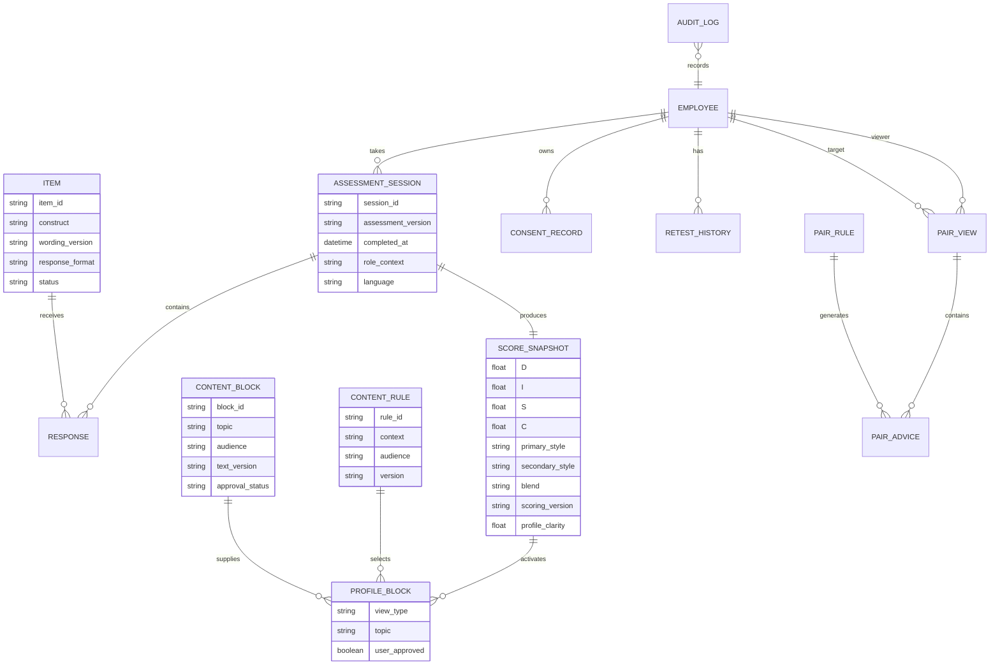
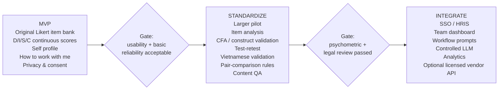

# Deep Research 02: Nguồn dữ liệu khoa học, kỹ thuật & pháp lý cho DISC nội bộ Vaga

- **Plan ID**: `plan-2026-10-14T03:00:00Z-disc-sources`
- **Plan Title**: Nguồn dữ liệu cho DISC nội bộ
- **Started At**: `2026-10-14T12:14:26.710239Z`
- **Completed At**: `2026-10-14T12:22:48.617074Z`

## Yêu cầu đầu vào (Prompt)

@Nghiên cứu sâu  Tiếp tục tìm kiếm, tổng hợp các tài liệu cần thiết làm nguồn dữ liệu cho ứng dụng DISC này

## Kế hoạch nghiên cứu (Deep Research Plan)

- **step-1**: Thu thập tài liệu gốc về lý thuyết Marston và bài báo 1928.
- **step-2**: Tải báo cáo kỹ thuật và whitepapers từ Everything DiSC và Wiley.
- **step-3**: Thu thập tài liệu kỹ thuật từ Thomas, TTI, Extended DISC và FinxS.
- **step-4**: Khảo sát các nền tảng giao tiếp như Crystal, Humantic và Cloverleaf.
- **step-5**: Tổng hợp nghiên cứu phương pháp chấm điểm: forced-choice, Likert, adaptive.

---

# Bộ nguồn nghiên cứu và kế hoạch xác minh để xây dựng sản phẩm DISC nội bộ cho Vaga

## Tóm tắt điều hành

Qua đối chiếu tài liệu gốc, nghiên cứu học thuật, technical manual của các hãng và giao diện sản phẩm hiện hành, có năm kết luận quan trọng cho Vaga.

**Thứ nhất, cần tách “lý thuyết DISC” khỏi “bài test DISC thương mại”.** William Moulton Marston trình bày lý thuyết về hành vi và cảm xúc trong *Emotions of Normal People* năm 1928; ông không để lại một bộ câu hỏi DISC hiện đại, hệ thống scoring hay nền tảng báo cáo giống các sản phẩm hiện nay. Everything DiSC®, Thomas PPA, TTI Success Insights, Extended DISC®/FinxS® là các cách vận hành hóa sau này, với câu hỏi, thuật toán, norm, nội dung báo cáo và thương hiệu riêng. citeturn25search0turn23view1

**Thứ hai, bằng chứng khoa học phải được đánh giá theo từng instrument cụ thể, không thể nói chung rằng “DISC đã được chứng minh X%”.** Nghiên cứu độc lập trực tiếp về DISC tương đối mỏng so với các mô hình như Big Five. Nghiên cứu peer-reviewed đáng chú ý của Martinussen, Richardsen và Vårum cho thấy phiên bản DISCUS ipsative và normative không tương đương và khuyến nghị thận trọng khi dùng dữ liệu ipsative cho đánh giá tâm lý; bốn thang DISCUS cũng có quan hệ với tổ hợp các đặc điểm Big Five chứ không phải bốn trait hoàn toàn độc lập. citeturn16search4

**Thứ ba, use case Vaga đang chọn — self-awareness, communication và collaboration — phù hợp hơn nhiều so với dùng DISC để tuyển dụng hoặc dự báo hiệu suất.** Chính TTI hiện công khai rằng bằng chứng của DISC hỗ trợ hiểu phong cách giao tiếp, tạo ngôn ngữ chung trong đội nhóm và coaching, nhưng **không hỗ trợ việc dùng DISC đơn độc để dự báo job performance hoặc loại ứng viên**; Thomas cũng cảnh báo không dùng DISC như tiêu chí duy nhất cho tuyển dụng/thăng chức. citeturn23view4turn23view1

**Thứ tư, với sản phẩm tự xây dựng, lựa chọn an toàn và khả thi nhất cho MVP là item bank hoàn toàn do Vaga tự phát triển theo dạng rating/Likert, sau đó kiểm định psychometric; không nên sao chép forced-choice blocks của các hãng.** Everything DiSC hiện sử dụng behavioral statements trên thang năm mức kết hợp adaptive testing; trong khi Thomas và TTI có các dạng forced-choice/forced-rank. Nghiên cứu phương pháp cho thấy forced-choice có thể giảm một số response bias, nhưng scoring kiểu ipsative cổ điển tạo ra các vấn đề thống kê; Thurstonian IRT có thể khắc phục nhiều vấn đề nhưng phức tạp đáng kể hơn để xây dựng đúng. citeturn23view3turn22view1turn25search2turn25search9

**Thứ năm, “moat” của Vaga không nên nằm ở việc tái tạo một bài DISC thương mại, mà ở lớp ứng dụng sau assessment:** hồ sơ hai chiều, “How to work with me”, pair comparison, hướng dẫn feedback/giao việc, action playbook, team view và tích hợp vào workflow. Catalyst, Cloverleaf và Crystal đều cho thấy giá trị thực tế nằm ở việc đưa insight vào tương tác giữa người với người thay vì dừng ở một PDF cá nhân. citeturn23view2turn24search2turn24search8

**Khuyến nghị quyết định sản phẩm:** xây một **“Vaga Behavioral Profile — DISC-informed”** độc lập, với item bank, scoring, nội dung và UX do Vaga sở hữu; chỉ dùng các vendor như benchmark. Nếu muốn sử dụng chính xác assessment/scoring của Wiley, Thomas, TTI hoặc Extended DISC thì đi theo con đường license/API/enterprise agreement, không reverse-engineer.

## Thư mục nguồn ưu tiên

Các nguồn dưới đây được sắp theo mức độ hữu ích cho quyết định sản phẩm. “Must-have” nghĩa là nên đọc trước khi thiết kế assessment hoặc data model; “Verify” nghĩa là cần xác minh phiên bản 2026 hoặc hỏi trực tiếp vendor; “Optional” chủ yếu phục vụ benchmark UX.

| Nhóm | Title | Author / Org | Năm | Loại | URL | Phát hiện chính / lý do cần đọc | Ưu tiên |
|---|---|---|---:|---|---|---|---|
| Lý thuyết gốc | *Emotions of Normal People* | William Moulton Marston | 1928 | Sách gốc | https://archive.org/details/emotionsofnormal0000mars | Nguồn gốc lý thuyết về các phản ứng cảm xúc/hành vi mà các hệ DISC sau này kế thừa. Quan trọng để phân biệt lý thuyết Marston với assessment thương mại hiện đại. citeturn25search0 | **Must-have** |
| Lý thuyết gốc | *Emotions of Normal People* — bản/reprint có metadata “originally published 1928” | Marston / Google Books | 1928 | Sách / metadata | https://books.google.com/books?q=%22Emotions+of+Normal+People%22+Marston | Dùng để đối chiếu edition, mục lục và thuật ngữ; không mặc định rằng quyền đối với mọi bản scan/reprint/translation giống bản gốc. citeturn25search0turn25search28 | Verify |
| Nghiên cứu độc lập | *Validation of an ipsative personality measure (DISCUS)* | Monica Martinussen, Astrid M. Richardsen, Helge W. Vårum | 2001 | Peer-reviewed paper, *Scandinavian Journal of Psychology* | https://pubmed.ncbi.nlm.nih.gov/11771810/ ; DOI: https://doi.org/10.1111/1467-9450.00253 | N=103; normative và ipsative DISCuS không tương đương; tác giả khuyến nghị thận trọng với ipsative scoring trong validation; bốn dimension liên hệ với tổ hợp Big Five. Đây là một trong các nguồn độc lập quan trọng nhất cho DISC. citeturn16search4 | **Must-have** |
| Nghiên cứu độc lập / AI | *An external stability audit framework to test the validity of personality prediction in AI hiring* | Rhea et al. | 2022 | Peer-reviewed paper, *Data Mining and Knowledge Discovery* | https://doi.org/10.1007/s10618-022-00861-0 | Audit Humantic AI và Crystal cho thấy bất ổn đáng kể theo nguồn/format đầu vào; rất quan trọng nếu Vaga từng nghĩ tới suy đoán DISC tự động từ CV, email, LinkedIn hay text thay vì self-report. citeturn17search3turn17search2 | **Must-have** |
| Wiley | *Everything DiSC Assessment Research Report* | Wiley / Everything DiSC | 2013 | Technical research report | https://www.discprofile.com/CMS/media/doc/ed/research/at-report.pdf | Mô tả architecture của assessment: behavioral statements trên thang năm mức, tám scales D, Di, i, iS, S, SC, C, CD; báo cáo vendor cung cấp evidence reliability/validity và Comparison Report. Đây là tài liệu tham chiếu kỹ thuật, nhưng là **vendor research**, không phải independent peer review. citeturn14view0turn15view0turn15view1 | **Must-have** |
| Wiley | Everything DiSC Workplace / Catalyst | Wiley | 2026, trang hiện hành | Product/UX + method | https://www.everythingdisc.com/build-better-relationships | Assessment hiện dùng thang năm mức và adaptive testing; Catalyst giữ profile lâu dài, kết nối đồng nghiệp/team và cung cấp interaction tips theo thời gian thực. Đây là benchmark sát nhất với hai luồng giá trị Vaga muốn xây. citeturn23view3 | **Must-have** |
| Wiley | Everything DiSC main product / Catalyst “Working Together” | Wiley | 2026 | UX sample | https://www.everythingdisc.com/ | Hiển thị blend styles như Di, CS, iD; profile dạng narrative; Catalyst kết nối profile với colleagues và đưa lời khuyên trong workflow. citeturn23view2 | **Must-have** |
| Wiley | Sample Reports / Comparison Report | Wiley / DiSC Profile | hiện hành | Report sample | https://www.discprofile.com/fac-sup/disc-fac-tools/sample-reports | Nguồn nên benchmark trực tiếp cho cấu trúc report và two-person comparison; **chỉ nghiên cứu cấu trúc, không sao chép wording/layout**. | **Must-have** |
| Wiley | *Productive Conflict Research Report Addendum* | Wiley | 2018 | Technical addendum | https://www.discprofile.com/CMS/media/doc/ed/manual/productive-conflict-addendum.pdf | Ví dụ hữu ích về quy trình xây dựng và validation item. Tài liệu chứa copyrighted sample items; đây chính là lý do Vaga không nên lấy các câu hỏi trong manual để tạo bank riêng. citeturn14view2 | Optional |
| Thomas | Personal Profile Analysis — PPA | Thomas International | 2026, trang hiện hành | Product / assessment description | https://www.thomas.co/assessments/personal-profile-analysis-ppa | Thomas cho biết assessment hoàn thành dưới khoảng 8 phút và PPA được đưa vào quy trình từ assessment đến coaching/succession; hãng công bố assessment được audit theo tiêu chí liên quan BPS/EFPA. citeturn23view0 | **Must-have** |
| Thomas | *What Is DISC Personality Testing? The Complete Guide* | Thomas International | 2026 | Official methodology/use guide | https://www.thomas.co/resources/type/hr-blog/what-disc-personality-testing-complete-guide | Rất hữu ích cho product governance: Thomas định vị DISC là behavioral assessment và cảnh báo không dùng đơn độc cho tuyển dụng/thăng chức. citeturn23view1 | **Must-have** |
| Thomas | *What Are Different Types of Psychometric Tests?* / PPA response format | Thomas International | hiện hành | Official methodology | https://www.thomas.co/uk/resources/type/hr-blog/what-are-different-types-psychometric-tests | Nguồn chính thức để xác minh cấu trúc forced-choice của PPA. Cần hỏi Thomas để có technical manual/scoring details đầy đủ nếu định tích hợp hoặc benchmark sâu. | Verify |
| Thomas | PPA Technical Manual / scoring & norm documentation | Thomas International | — | Technical manual | **Vendor access/contact required** | Bản technical manual chi tiết không được xác nhận là tài liệu public trong nghiên cứu này. Cần yêu cầu reliability, test-retest, construct validity, norm sample, Vietnamese adaptation và license terms trực tiếp từ Thomas. | **Verify** |
| TTI | *Behaviors Technical Manual / Style Insights* | TTI Success Insights | 2020/2021 | Technical manual | https://images.ttisi.com/wp-content/uploads/research/2022/03/31140409/R4techman_2020_v1.pdf | Manual 258 trang mô tả item analysis, reliability, validity, test-retest, forced-rank format và cultural adaptation. TTI ghi rõ 24 frames dạng four-item forced-rank; manual cũng cảnh báo validity/norm của một ngôn ngữ không tự động chuyển sang adaptation khác. citeturn21view0turn22view0turn22view1 | **Must-have** |
| TTI | DISC Assessment current product page | TTI Success Insights | 2026 | Official product/method | https://www.ttisi.com/assessments/disc/ | Có Natural và Adapted graphs; communication Do's/Don'ts; ideal environment. Quan trọng hơn, chính TTI nói DISC alone không chứng minh khả năng dự báo job performance hay dùng để screen in/out. citeturn23view4 | **Must-have** |
| TTI | *TTI Technical Reports Compendium* | TTI Success Insights | 2019 | Technical report compendium | https://images.ttisi.com/wp-content/uploads/2019/05/02094711/tech_report_compendium.pdf | Bổ sung các nghiên cứu reliability/validity cũ và lịch sử phương pháp. Nên dùng như vendor evidence, không coi là independent replication. citeturn21view1 | Optional |
| Extended DISC | Our Methodology | Extended DISC | hiện hành | Official methodology | https://www.extendeddisc.org/company/our-methodology/ | Benchmark quan trọng cho cách hãng phân biệt natural style và perceived/adjusted style. Các thuật ngữ như “natural/hard-wired” nên được xem là **framing của vendor**, không nên biến thành tuyên bố sinh học của Vaga. | **Must-have** |
| Extended DISC | FAQ / Validation claims | Extended DISC | 2026 | Vendor validation summary | https://www.extendeddisc.org/company/faq/ | Hãng công bố re-validation quốc tế, validity checks, nhiều ngôn ngữ và GDPR compliance. Các số liệu này là vendor claims nên cần lấy validation report gốc trước khi đưa vào quyết định kỹ thuật. citeturn23view5 | **Verify** |
| Extended DISC / FinxS | *How to Use FinxS Playground* | Extended DISC / FinxS | 2016 | UX/report guide PDF | https://www.extendeddisc.org/wp-content/uploads/2016/11/How-to-Use-FinxS-Playground.pdf | Có natural/adjusted views, people maps và multi-person/team maps; rất hữu ích cho team UX benchmark, nhưng không nên sao chép map/diamond/trade dress. citeturn15view3 | Optional |
| Crystal | Free DISC Personality Test | Crystal | 2026 | Assessment + UX sample | https://www.crystalknows.com/disc-personality-test | Hiện quảng bá 28 câu, khoảng 5 phút, graph và nhiều subtype; rất mạnh về concise copy và “how to communicate/work with” hơn là báo cáo tâm lý dài. citeturn24search0 | **Must-have UX** |
| Crystal | Meetings / communication insights | Crystal | hiện hành | Workflow UX | https://www.crystalknows.com/why-crystal/meetings | Benchmark ý tưởng đưa “cheat sheet” đến đúng thời điểm trước/cuộc họp thay vì buộc người dùng mở report dài. citeturn24search8 | **Must-have UX** |
| Humantic AI | Personality Insights / API | Humantic AI | 2026 | Product/API UX | https://humantic.ai/product/personality-ai-platform ; https://humantic.ai/solutions/personality-ai-api | Benchmark tốt cho actionable communication recommendations và “insight in the flow of work”; **không nên dùng làm bằng chứng rằng suy đoán DISC từ dữ liệu số là đủ tin cậy** do nghiên cứu độc lập 2022 nêu vấn đề stability. citeturn24search9turn24search22turn17search3 | Verify / UX only |
| Cloverleaf | Thinking Styles Comparison / Team Dashboard | Cloverleaf | 2026 | Team/pair UX | https://help.cloverleaf.me/en/articles/3382358-how-do-i-compare-thinking-styles-between-teammates | Cho phép đối chiếu communication, conflict và work styles giữa hai thành viên. Đây gần như trực tiếp là benchmark cho Compatibility View của Vaga. citeturn24search2turn24search6 | **Must-have UX** |
| Cloverleaf | DISC Assessment / shared team dashboards | Cloverleaf | hiện hành | Product UX | https://cloverleaf.me/assessments/disc/ | Team-level view, collaboration style, coaching insights và shared dashboard. citeturn24search20 | **Must-have UX** |
| 16Personalities | Teams | NERIS Analytics / 16Personalities | hiện hành | UX/content benchmark | https://www.16personalities.com/teams | **Không phải DISC.** Nên xem như benchmark về cách biến personality output thành strengths/weaknesses/team report dễ đọc, không dùng để chứng minh DISC. citeturn24search3 | Optional |

**Nhận xét quan trọng về bằng chứng:** không nên nhập chung các hệ trên thành một “DISC validity score”. Mỗi hãng có item bank, scoring, norm và psychometric evidence khác nhau. Bằng chứng vendor như Wiley/TTI/Extended DISC hữu ích để hiểu instrument của họ nhưng phải được ghi là **vendor-produced evidence**; Martinussen et al. là nguồn độc lập trực tiếp quan trọng để cân bằng đánh giá. citeturn16search4turn21view0

**Nguồn phương pháp scoring cần đọc song song:**

| Title | Author/Org | Năm | Loại | URL | Ý nghĩa đối với Vaga | Ưu tiên |
|---|---|---:|---|---|---|---|
| *A Technique for the Measurement of Attitudes* | Rensis Likert | 1932 | Foundational methodology | https://archive.org/details/likert-1932 | Nguồn nền tảng của rating-scale approach. Hữu ích khi Vaga xây item bank độc lập theo dạng “mức độ đồng ý/đúng với tôi”. | **Must-have** |
| *Item Response Modeling of Forced-Choice Questionnaires* | Anna Brown & Alberto Maydeu-Olivares | 2011 | Peer-reviewed methodology | https://doi.org/10.1177/0013164410375112 | Trình bày Thurstonian IRT cho forced-choice; quan trọng nếu sau này Vaga muốn forced-choice mà vẫn muốn normative trait estimates. citeturn25search9turn25search17 | **Must-have** |
| *How IRT Can Solve Problems of Ipsative Data in Forced-Choice Questionnaires* | Brown & Maydeu-Olivares | 2013 | Peer-reviewed methodology, *Psychological Methods* | https://pubmed.ncbi.nlm.nih.gov/23148475/ | Giải thích vì sao classical ipsative scoring gây vấn đề và cách IRT có thể khôi phục absolute trait standing tốt hơn. citeturn25search2 | **Must-have** |
| *A Meta-Analysis of the Faking Resistance of Forced-Choice Personality Inventories* | Martínez et al. | 2021 | Peer-reviewed meta-analysis | https://pmc.ncbi.nlm.nih.gov/articles/PMC8511514/ | Forced-choice có lợi thế nhất định về faking/social desirability, nhưng không có nghĩa cứ forced-choice là measurement tốt; format và scoring model rất quan trọng. citeturn16search2 | **Must-have** |
| *Validation of an ipsative personality measure (DISCUS)* | Martinussen et al. | 2001 | DISC + scoring validation | https://pubmed.ncbi.nlm.nih.gov/11771810/ | Cảnh báo trực tiếp cho DISC: không coi ipsative và normative result là tương đương. citeturn16search4 | **Must-have** |
| *Multidimensional Forced-Choice CAT With Dominance Items* | Lin et al. | 2022 | Adaptive/forced-choice methodology | https://pmc.ncbi.nlm.nih.gov/articles/PMC9972128/ | Cho thấy CAT + multidimensional forced-choice là một bài toán psychometric riêng, không chỉ là “viết if/else để hỏi câu tiếp theo”. citeturn16search5 | Optional / phase later |
| CAT applied psychometric example | Xu et al. | 2020 | Peer-reviewed CAT/IRT | https://www.frontiersin.org/journals/psychology/articles/10.3389/fpsyg.2020.561358/full | Minh họa yêu cầu về calibrated item bank và IRT trước khi CAT thực sự mang ý nghĩa measurement. citeturn25search15 | Optional |
| Everything DiSC adaptive implementation | Wiley | hiện hành | Applied vendor example | https://www.everythingdisc.com/our-story | Wiley mô tả adaptive assessment hỏi thêm câu khi standard assessment còn ambiguity. citeturn18search20 | **Must-have benchmark** |

**Kết luận phương pháp cho Vaga:** tôi khuyến nghị **không bắt đầu bằng classical forced-choice/ipsative**. Bản MVP nên dùng các statement độc lập, wording tự viết, thang năm mức hoặc bảy mức; lưu raw responses, tính continuous D/I/S/C scores trước, sau đó mới suy ra blend. Điều này dễ lập trình, dễ item analysis và dễ validation hơn. Forced-choice + Thurstonian IRT hoặc CAT nên để giai đoạn sau khi Vaga có đủ item bank và dữ liệu calibration. Đây là **khuyến nghị thiết kế suy ra từ các nguồn phương pháp**, không phải quy tắc bắt buộc của DISC. citeturn25search2turn25search9turn16search4

Một điểm đặc biệt quan trọng với Vaga: technical manual TTI nhấn mạnh evidence về norm, reliability và validity của bản gốc **không tự động áp dụng cho adaptation sang ngôn ngữ/văn hóa khác**. Vì vậy không nên dịch một bộ câu tiếng Anh sang tiếng Việt rồi mặc định nó đã được validate. citeturn21view0

## Các template nên trích xuất về cấu trúc và tự viết lại

“Trích xuất” ở đây nên hiểu là **trích xuất pattern thiết kế**, không lấy nguyên câu chữ, scoring key hay visual asset của vendor.

| Template Vaga nên tạo | Prototype / cấu trúc đề xuất | Nguồn benchmark | Rủi ro IP | Rủi ro psychometric / lưu ý |
|---|---|---|---|---|
| **Forced-choice block prototype** | 4 statement hoàn toàn mới → chọn “Giống tôi nhất” và “Ít giống tôi nhất”. Ví dụ thử nghiệm: “Tôi thường thúc đẩy nhóm chốt quyết định”; “Tôi dễ tạo năng lượng cho cuộc trò chuyện”; “Tôi ưu tiên giữ nhịp phối hợp ổn định”; “Tôi thường kiểm tra tiêu chí trước khi chốt.” | Thomas, TTI; Brown & Maydeu-Olivares. citeturn22view1turn25search2 | **Thấp nếu wording hoàn toàn mới; cao nếu lấy word-set/vendor items.** | **Cao.** Bốn statement phải cân bằng social desirability; classical scoring dễ thành ipsative. Đây chỉ là prototype, không phải validated item. |
| **Likert item template** | Statement gắn hành vi quan sát: “Khi thông tin đã đủ, tôi sẵn sàng đề xuất nhóm chốt quyết định dù vẫn còn một số ý kiến khác.” → 1 “Hoàn toàn không đúng với tôi” đến 5 “Rất đúng với tôi”. | Wiley + Likert. citeturn23view3 | Thấp khi tự viết. | Cần pilot, item-total analysis, factor analysis và kiểm tra acquiescence/social desirability. |
| **Natural vs Work-context pair** | Cùng construct nhưng tách context: “Thông thường tôi…” và “Trong vai trò công việc 3 tháng gần đây tôi…”. | TTI natural/adapted; Extended DISC adjusted/natural. citeturn23view4 | Thấp nếu architecture/copy riêng. | Không gọi “core/hard-wired” như sự thật sinh học. Cần chứng minh hai score thực sự đo context difference chứ không chỉ response noise. |
| **DISC score card** | 4 continuous scores + primary tendency + secondary/blend + “độ rõ của profile”; không ép một người vào duy nhất một chữ. | Everything DiSC blend styles; TTI combination interpretation. citeturn23view2turn23view4 | Trung bình nếu bắt chước vòng tròn/dot/map của vendor; thấp nếu Vaga có visual language riêng. | Không biến cut-off tùy ý thành diagnosis. |
| **“How to work with me” 1-minute card** | “Khi nhắn cho tôi” / “Trong họp” / “Khi cần quyết định” / “Khi feedback” / “Khi tôi đang áp lực” / Do / Don’t. | Catalyst, Crystal. citeturn23view3turn24search8 | Thấp nếu copy và layout độc lập. | Nên dựa trên continuous score + user confirmation, không chỉ type label. |
| **Pair Comparison A→B** | “Điểm tương đồng”, “Khoảng cách dễ gây hiểu lầm”, “A nên làm gì trước cuộc họp với B”, “Ba hành động thực tế”. | Wiley Comparison Report; Cloverleaf Thinking Styles Comparison. citeturn15view1turn24search2 | Trung bình nếu sao chép narrative/layout; thấp nếu rule/content riêng. | Advice phải dùng ngôn ngữ xác suất: “có xu hướng/có thể”, không “B luôn…”. |
| **Manager Delegation Card** | `Outcome cần rõ đến đâu` → `Mức autonomy` → `lượng context/detail` → `cadence check-in` → `cách escalation`. | TTI communication/ideal environment; Catalyst. citeturn23view4turn23view3 | Thấp. | Manager không được dùng để loại người khỏi nhiệm vụ chỉ vì DISC. |
| **Feedback & Recognition Card** | “Cách bắt đầu feedback” / “Mức trực diện” / “Cần evidence hay context” / “Recognition riêng tư hay công khai” / “Call-to-action”. | Catalyst / Crystal / Cloverleaf. citeturn23view3turn24search2 | Thấp nếu original copy. | Cho nhân sự chỉnh preference thực tế; self-declared preference nên được ưu tiên hơn suy đoán từ DISC. |
| **Personal Action Playbook** | `Quick win tuần này` → `habit 30 ngày` → `trigger` → `if–then behavior` → `metric` → `reflection`. | Các profile/actionable learning của Everything DiSC. citeturn23view2 | Thấp. | Nên map từ score/rule vào hành vi cụ thể, không phát advice sức khỏe/tâm lý. |
| **Under-pressure private card** | Trigger thường gặp → default reaction → risk → recovery action → “hãy nói với đồng nghiệp thế nào”. Chỉ owner xem mặc định. | Thomas/TTI positioning về response under pressure. citeturn23view1turn23view4 | Thấp khi viết riêng. | **Privacy cao.** Không nên tự động public “điểm yếu khi stress”. |
| **Team distribution view** | Distribution D/I/S/C continuous; team strengths; potential blind spots; “voices potentially underrepresented”. | FinxS team map, Cloverleaf dashboard. citeturn15view3turn24search20 | Trung bình nếu clone diamond/map; thấp với chart riêng. | Không diễn giải “team thiếu D = team yếu”; diversity chart chỉ là conversation aid. |
| **LLM personalization wrapper** | LLM chỉ nhận `{approved scores + approved content blocks + context}` và phải trả output theo schema; không tự tạo trait/diagnosis. | Không sao chép vendor; Vaga-owned architecture. | IP thấp nếu corpus riêng; **privacy/licensing cao nếu gửi vendor-derived content vào model**. | Cần guardrail, versioning, deterministic base rules và human QA. |

Ví dụ **pair snippet hoàn toàn mới** cho thiết kế, không lấy từ report của vendor:

> “Bạn có xu hướng đi đến quyết định nhanh hơn B. Trước cuộc họp, hãy gửi trước mục tiêu và deadline nhưng cho B thời gian chuẩn bị các rủi ro cần lưu ý. Khi bất đồng, hãy tách câu hỏi ‘chúng ta cần quyết định khi nào?’ khỏi câu hỏi ‘còn thông tin nào B cần để yên tâm quyết định?’.”

Cách viết này tốt hơn câu “D phải làm thế này với S” vì nó chuyển từ **nhãn type → khoảng cách hành vi → hành động có thể thực hiện**.

## Checklist pháp lý, quyền riêng tư và đạo đức

Tại Việt Nam, Luật Bảo vệ dữ liệu cá nhân số **91/2025/QH15** đã có hiệu lực từ ngày 1/1/2026; Nghị định **356/2025/NĐ-CP** quy định chi tiết thi hành cũng có hiệu lực cùng ngày. Với dữ liệu người lao động, nguồn Chính phủ nêu yêu cầu lưu trữ theo luật/thỏa thuận và xóa/hủy khi chấm dứt hợp đồng, trừ trường hợp thỏa thuận hoặc pháp luật có quy định khác. Năm 2026 cũng đã có Nghị định 330/2026/NĐ-CP về xử phạt trong lĩnh vực an ninh mạng và bảo vệ dữ liệu cá nhân. citeturn19search0turn19search1turn20search0turn20search12

Do DISC profile có thể ảnh hưởng đến cách một nhân sự được quản lý, giao việc hoặc nhìn nhận, Vaga nên coi đây là **employee personal data có tác động tổ chức đáng kể** và thiết kế theo nguyên tắc privacy-by-design, kể cả trong trường hợp luật sư sau này xác định một số trường dữ liệu không thuộc nhóm nhạy cảm.

### Checklist trước khi code production

- [ ] **Lập IP register** tách rõ: Marston theory; wording do Vaga viết; scoring do Vaga phát triển; vendor material; trademark; icon/graphic; training material.
- [ ] **Không mặc định “public domain theory” đồng nghĩa “mọi tài liệu DISC đều public domain”.** Ý tưởng/lý thuyết gốc và văn bản/ảnh/translation/reprint/report hiện đại là các đối tượng khác nhau. Xác minh trạng thái quyền của edition cụ thể trước khi tái bản đoạn dài hoặc hình ảnh.
- [ ] **Không copy câu hỏi của Everything DiSC, PPA, TTI, Extended DISC, Crystal…** kể cả câu hỏi xuất hiện trong demo, manual hoặc screenshot. Wiley chẳng hạn ghi rõ copyright trên technical material và giới hạn việc reproduce assessment material. citeturn15view0turn14view2
- [ ] **Không reverse-engineer scoring key** từ các assessment thương mại rồi tuyên bố đây là implementation riêng.
- [ ] **Trademark review:** không đặt tên sản phẩm “Everything DiSC”, “Extended DISC”, “FinxS”, “PPA”, “Catalyst”… và không dùng logo/visual nhận diện của họ. Cần kiểm tra riêng quyền sử dụng “DISC/DiSC” tại Việt Nam trước khi đặt tên chính thức.
- [ ] **Clean-room item development:** người viết item Vaga nhận construct definition và behavioral domain, không được giao cho họ bộ câu hỏi thương mại để paraphrase.
- [ ] **Version-control item bank:** mỗi item có ID, author, construct, wording history, translation history, reverse-key flag, psychometric statistics và trạng thái `draft/pilot/active/retired`.
- [ ] **Vietnamese validation riêng.** Không lấy reliability/validity tiếng Anh làm evidence trực tiếp cho bản tiếng Việt; chính technical manual TTI cảnh báo evidence psychometric không tự động transfer giữa adaptation/ngôn ngữ. citeturn21view0
- [ ] **Purpose limitation:** ngay trước khi làm test, giải thích assessment dùng cho self-development/collaboration, không phải chẩn đoán tâm lý.
- [ ] **Không dùng DISC là căn cứ duy nhất cho tuyển dụng, sa thải, thăng chức, xếp hạng performance hoặc lương thưởng.** Đây phù hợp với cảnh báo sử dụng hiện hành của cả Thomas và TTI. citeturn23view1turn23view4
- [ ] **Consent/notice flow:** nêu dữ liệu nào thu, mục đích, ai xem được, retention, pair comparison, LLM processing, vendor/subprocessor nếu có, cơ chế quyền của nhân sự.
- [ ] **Public/private split ngay ở data layer**, không chỉ ẩn ở UI.
- [ ] Mặc định private: raw answers, exact numerical scores nếu nhạy cảm, stress/blind-spots, personal action notes, retest history chi tiết.
- [ ] Mặc định public nội bộ: user-approved “How to work with me”, communication preferences, positive contribution, meeting/feedback guidance.
- [ ] Cho nhân sự **preview và xác nhận public profile** trước khi công bố.
- [ ] Cho nhân sự ghi đè một recommendation bằng preference do họ tự khai, ví dụ: “Tôi thích feedback trực tiếp 1:1”.
- [ ] **Role-based access control:** employee, manager, HR/People, psychometric/admin, system service có quyền khác nhau.
- [ ] **Audit log** cho việc xem/sửa/export các trường nhạy cảm.
- [ ] **Retention/deletion rules** phải xử lý cả database chính, log, backup và vector/LLM store; đặc biệt xây workflow offboarding phù hợp với quy định về dữ liệu người lao động. citeturn20search0
- [ ] Nếu dùng LLM/API ngoài Việt Nam, phải xác minh hợp đồng xử lý dữ liệu, nơi xử lý, retention, model-training opt-out và nghĩa vụ chuyển dữ liệu xuyên biên giới theo luật hiện hành trước khi production.
- [ ] **Không infer DISC ngầm từ email, CV, lịch sử chat, LinkedIn hoặc hành vi số** nếu người lao động không biết rõ và Vaga chưa có validation/đánh giá pháp lý phù hợp. Nghiên cứu độc lập về Humantic/Crystal cho thấy lý do khoa học rất mạnh để thận trọng với cách suy đoán này. citeturn17search3
- [ ] **Không công khai labels mang tính tiêu cực**, ví dụ “khó hợp tác”, “kém quyết đoán”, “nguy cơ xung đột cao”.
- [ ] Mọi copy dùng dạng “có xu hướng”, “có thể phù hợp”, “thử cách…” thay vì “bạn là…”, “người này luôn…”.
- [ ] Có nút “Kết quả này không giống tôi” để thu feedback và phát hiện item/scoring problems.
- [ ] Theo dõi score stability, reliability và distribution theo nhóm; không dùng demographic variables để chỉnh score nếu không có lý do psychometric/pháp lý rõ ràng.
- [ ] **Retest policy không nên được quảng bá như một quy luật khoa học “DISC phải làm lại sau 6 tháng”.** Đề xuất governance cho Vaga: mặc định khoảng **12 tháng**, hoặc sớm hơn khi thay đổi vai trò lớn; 6 tháng có thể dùng khi có intervention/coaching cụ thể cần đo lại adapted work behavior. Giữ lịch sử thay vì overwrite.
- [ ] Khi retest, hiển thị “change may reflect context + true behavioral change + measurement error”, không tự kết luận “tính cách đã thay đổi”.

Điểm cần luật sư sở hữu trí tuệ/DP counsel xác nhận trước go-live là: **quyền sử dụng tên DISC/DiSC tại Việt Nam; classification của behavioral profile trong Luật 91/2025/QH15; consent/lawful processing basis trong quan hệ lao động; transfer to cloud/LLM; retention/offboarding; và wording trong employee policy.** Luật và văn bản hướng dẫn hiện hành nên lấy trực tiếp từ Cổng Chính phủ/Công báo thay vì blog pháp lý thứ cấp. citeturn19search0turn19search2turn19search4

## Kế hoạch tìm kiếm, xác minh và liên hệ vendor

Nên thực hiện theo bốn “workstream”, không tìm kiếm hỗn hợp.

| Workstream | Nơi tra cứu ưu tiên | Query nên dùng | Cần xác minh thực tế | Khi nào phải contact vendor |
|---|---|---|---|---|
| **Marston & lịch sử** | Internet Archive; Google Books; thư viện đại học; Crossref | `"William Moulton Marston" "Emotions of Normal People" 1928`; `"dominance inducement submission compliance" Marston` | Nguyên văn terminology; bản edition; trang/chapter; distinction giữa theory và assessment sau này | Không cần, trừ khi muốn dùng một modern reprint có bản quyền |
| **Independent psychometrics** | PubMed; Crossref; APA PsycNet; Web of Science/Scopus nếu Vaga có access; Google Scholar chỉ để discovery | `"DISC" validity reliability ipsative`; `"DISCUS" Martinussen Richardsen Varum`; `"forced-choice" Thurstonian IRT`; `"personality" faking forced choice meta-analysis` | Peer-reviewed status; sample; instrument cụ thể; reliability type; construct/criterion validity; limitations | Không |
| **Everything DiSC** | everythingdisc.com; discprofile.com; Wiley | `"Everything DiSC" research report PDF`; `"adaptive testing"`; `"Comparison Report"`; `"Catalyst Working Together"` | Assessment phiên bản 2026; current technical manual; item count/routing; reliability; Catalyst permissions; data export/API; DPA; SSO | **Bắt buộc** nếu dùng assessment, scoring, item bank, branded report, Catalyst content hoặc API |
| **Thomas** | thomas.co; BPS test-register references | `"PPA technical manual"`; `"PPA reliability validity"`; `"PPA forced choice 24"`; `"Thomas Assess API"` | Current PPA method; norms; test-retest; Vietnamese availability; API/data export; exact licensing | **Bắt buộc** vì detailed technical/scoring manual không được xác nhận public |
| **TTI** | ttisi.com; images.ttisi.com; TTI research site | `"Style Insights Technical Manual"`; `"natural adapted DISC"`; `"forced rank"` | Technical manual version sau 2020; current item format; Vietnamese norm; API; two-graph license | **Bắt buộc** nếu dùng questionnaire, scoring, natural/adapted methodology implementation hoặc report text |
| **Extended DISC / FinxS** | extendeddisc.org; finxs.com | `"Extended DISC validation report"`; `"Profile I Profile II"`; `"FinxS Playground"` | Lấy actual validation report, không chỉ marketing summary; current 2026 sample size; Vietnamese validation; team/pair API | **Bắt buộc** nếu dùng questionnaire/scoring/Profile I-II/FinxS assets |
| **Crystal** | crystalknows.com; help/product docs | `"Crystal DISC profile"`; `"Crystal communication tips"`; `"Crystal team"` | Current assessment UX; share model; privacy controls; API; exact source of 16 archetypes | Liên hệ nếu muốn API/content; không cần khi chỉ nghiên cứu pattern UX |
| **Humantic AI** | humantic.ai + peer-reviewed external audits | `"Humantic personality AI DISC API"`; `"Humantic Crystal stability audit"` | Input sources, model validation, DPA, retention, stability; đối chiếu vendor claim với Rhea et al. | **Bắt buộc** nếu tích hợp AI inference |
| **Cloverleaf** | cloverleaf.me + help center | `"Thinking Styles Comparison"`; `"Team Dashboard DISC"` | Pair workflow; permissions; manager/team UX; API/data portability | Chỉ khi tích hợp hoặc tái sử dụng proprietary content |
| **16Personalities** | 16personalities.com | `"16Personalities Teams"`; `"team report"` | Chỉ UX/content hierarchy; không coi là DISC validity | Nếu định dùng report copy/assets |
| **Việt Nam — privacy** | chinhphu.vn; vanban.chinhphu.vn; congbao.chinhphu.vn; vbpl.vn | `91/2025/QH15 dữ liệu cá nhân`; `356/2025/NĐ-CP`; `330/2026/NĐ-CP`; `"dữ liệu cá nhân người lao động"` | Hiệu lực hiện tại; employee processing; consent; retention; deletion; cross-border processing; penalties | Dùng legal counsel, không contact vendor |
| **IP / trademark** | Cục SHTT Việt Nam; WIPO Lex; WIPO Global Brand Database | `"DiSC" Wiley trademark`; `"Everything DiSC"`; `"Extended DISC"`; `"FinxS"`; `"Thomas PPA"` | Owner, classes, Vietnam status, scope, logo/wordmark; copyright of each report/item set | Vendor/IP counsel nếu có kế hoạch dùng branding hoặc licensed content |

**Bộ câu hỏi cần gửi cho mọi vendor trước khi mua license/integration:**

1. Phiên bản assessment hiện hành năm 2026 dùng response format nào, bao nhiêu base items và routing/adaptive logic ở mức nào?
2. Technical manual mới nhất là bản nào?
3. Reliability gồm internal consistency và test-retest bao nhiêu, trên population nào?
4. Construct validity đã được kiểm tra bằng CFA/IRT/circumplex/convergent evidence nào?
5. Có criterion validity cho use case nào, và **không được dùng cho use case nào**?
6. Vietnamese version là dịch thuật hay đã có norm/validation riêng?
7. Natural/Adapted scores được tạo từ hai response contexts, transformation hay thuật toán nào? Phần nào proprietary?
8. API trả raw scores, percentile, type, report text hay chỉ PDF?
9. Vaga có quyền lưu raw score và tạo **narrative riêng** từ score licensed không?
10. Có được tạo internal pair-comparison/team view dựa trên scores không?
11. Dữ liệu được host ở đâu, subprocessor nào, retention ra sao?
12. Khi kết thúc hợp đồng, Vaga có tiếp tục sử dụng historical scores không?
13. Có giới hạn số employee/profile/API call không?
14. Có cấm dùng LLM để xử lý score/output của vendor không?
15. Những visual, labels, maps, report sections nào được license và những gì không được derivative-work?

Nếu vendor không cho Vaga quyền **“receive scores → persist scores → generate Vaga-owned content”**, việc tích hợp có thể khiến Vaga phụ thuộc hoàn toàn vào report của họ; đây là điều nên giải quyết trong commercial/legal negotiation trước khi code.

Với nguồn tiếng Việt, ưu tiên cao nhất hiện nay là **pháp luật dữ liệu cá nhân**. Tôi chưa tìm thấy một technical validation report DISC tiếng Việt độc lập, peer-reviewed đủ mạnh để thay thế việc Vaga tự validate adaptation tiếng Việt. Vì vậy, tiếng Việt không chỉ là bài toán translation mà là một workstream psychometric riêng. Cảnh báo của TTI về việc evidence không tự động transfer giữa language adaptations đặc biệt liên quan ở đây. citeturn21view0

## Kiến trúc dữ liệu và roadmap khuyến nghị

Dựa trên nguồn nghiên cứu ở trên, data model nên **tách dữ liệu đo lường khỏi nội dung diễn giải**. Đây là quyết định kiến trúc quan trọng nhất: nếu sau này Vaga sửa scoring model, đổi blend rules hoặc cập nhật copy, không phải thay raw responses và không làm mất historical profile.



Điểm thiết kế cần giữ: **`ScoreSnapshot` phải versioned**. Không nên chỉ lưu `type = DI`; nên lưu các continuous scores và scoring version để sau này có thể tái tạo profile. Blend/type là output dẫn xuất.

`ContentBlock` cũng nên tách khỏi scoring. Ví dụ một người có D cao + S thấp không cần một report 20 trang viết riêng. Engine có thể ghép:

`Base D module`  
+ `secondary I module`  
+ `high D / low S contrast module`  
+ `role = manager module`  
+ `context = feedback module`  
+ `audience = colleague module`.

Cách này giúp Vaga có vài chục đến vài trăm **modular blocks đã QA** thay vì hàng trăm report viết tay.

LLM, nếu có, nên đứng **sau** rule engine:

```text
Validated scores
      ↓
Deterministic rules
      ↓
Approved content blocks
      ↓
LLM: rewrite / prioritize / contextualize
      ↓
Schema & safety validation
      ↓
User-facing profile
```

LLM không nên tự nhìn raw answers rồi “đoán tính cách”. Điều đó vừa khó audit vừa biến một assessment tương đối kiểm soát được thành black-box personality inference — chính nhóm rủi ro mà nghiên cứu Rhea et al. cho thấy cần đặc biệt thận trọng. citeturn17search3

Roadmap ba giai đoạn đề xuất:



| Giai đoạn | Tính năng trọng tâm | Nguồn lực | Tiêu chí nghiệm thu nên đặt |
|---|---|---|---|
| **MVP** | Original item bank; Likert questionnaire; continuous D/I/S/C; primary + secondary; private profile; public “How to work with me”; consent/access control | Product + UX + psychologist/psychometric consultant + backend/frontend + legal review | 100% items có provenance; zero copied vendor items; scoring versioned; public/private permissions test được; người dùng có thể chỉnh public preferences; usability pilot hoàn tất |
| **Standardize** | Item analysis; reliability; factor/construct testing; retest; Vietnamese adaptation; pair rules; manager playbook; team view | Psychometrician/Data Scientist + Product + People/HR + QA | Có technical report nội bộ; loại/rewrite item yếu; documented reliability/validity evidence; pair advice rule traceable; không có stereotype copy; measurement limitations hiển thị rõ |
| **Integrate** | SSO/HRIS; colleague search; contextual reminders; controlled LLM; team analytics; optional commercial assessment API | Platform/infra + Security + Data/AI + Legal/DPO + Product | RBAC/audit/deletion tested; LLM không truy cập dữ liệu vượt quyền; outputs trace được về approved blocks; vendor license/DPA đầy đủ nếu tích hợp; không dùng DISC làm automated employment decision |

Một nguyên tắc cuối cùng nên được coi là **product requirement**, không phải footnote:

> **DISC của Vaga nên trả lời “Tôi nên làm gì khác đi khi làm việc với người này?” chứ không cố trả lời “Người này thực sự là người như thế nào?”.**

Everything DiSC/Catalyst, TTI và Cloverleaf đều đang đẩy giá trị theo hướng communication, collaboration và action; đồng thời các nguồn độc lập/phương pháp cho thấy có lý do rõ ràng để tránh biến DISC thành một công cụ tiên đoán năng lực hoặc “đóng hộp” con người. citeturn23view3turn23view4turn24search2turn16search4
