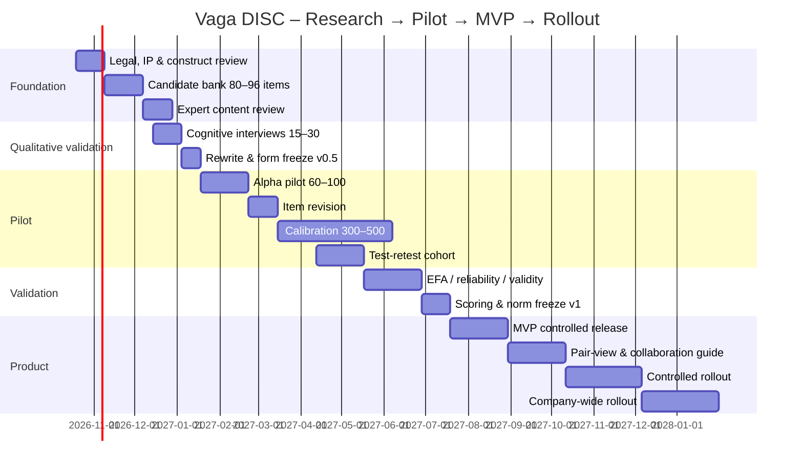
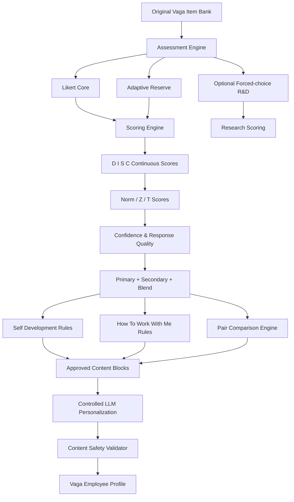

# Deep Research 03: Xây dựng hoàn thiện bộ câu hỏi DISC 64 items cho Vaga

- **Plan ID**: `plan-2026-10-14T03:00:00Z-vaga-disc-qbank`
- **Plan Title**: Xây bộ câu hỏi DISC cho Vaga
- **Started At**: `2026-10-14T12:40:29.669459Z`
- **Completed At**: `2026-10-14T12:52:22.583990Z`

## Yêu cầu đầu vào (Prompt)

@Nghiên cứu sâu  Tiếp tục xây dựng hoàn thiện bộ câu hỏi cho Vaga

## Kế hoạch nghiên cứu (Deep Research Plan)

- **step-1**: Thu thập mẫu câu hỏi DISC từ tài liệu công khai và nghiên cứu học thuật
- **step-2**: Phân loại câu hỏi theo phương pháp Forced-choice, Likert và Adaptive
- **step-3**: Thiết kế ngân hàng câu hỏi sơ bộ cho từng trục và 12 kiểu kết hợp
- **step-4**: Xây quy tắc chấm điểm và chuyển đổi sang biểu đồ D-I-S-C
- **step-5**: Soạn kế hoạch kiểm thử, chống làm giả và chu kỳ retest

---

# Deep Research: Thiết kế bộ câu hỏi DISC nội bộ cho Vaga

## Executive summary

### Kết luận quan trọng nhất

Vaga **không nên sao chép hoặc “Việt hóa” một bài DISC thương mại có sẵn**. Cách an toàn và có khả năng phát triển lâu dài hơn là xây dựng một **Vaga Behavioral DISC Assessment** độc lập, lấy bốn miền hành vi D–I–S–C làm khung khái niệm, nhưng tự viết toàn bộ item tiếng Việt, tự chuẩn hóa trên tập người Việt và tự xây thuật toán chấm điểm. Tác phẩm *Emotions of Normal People* của William Moulton Marston được xuất bản năm 1928; các thuật ngữ nguyên gốc của Marston là **Dominance, Compliance, Submission, Inducement**, chứ không phải nguyên bộ nhãn hiện đại Dominance–Influence–Steadiness–Conscientiousness. citeturn21search9turn9view3

Tại Hoa Kỳ, các tác phẩm xuất bản trước ngày 1/1/1931 hiện đã thuộc public domain; vì vậy ấn bản 1928 của Marston đã hết thời hạn copyright tại Hoa Kỳ. Tuy nhiên, điều đó **không biến các bài đánh giá hiện đại thành public domain**. Everything DiSC®, Thomas PPA, TTI Success Insights, Extended DISC®, Crystal và các sản phẩm khác có câu hỏi, thuật toán, report copy, đồ họa, phần mềm, cơ sở dữ liệu và nhãn hiệu riêng; Wiley còn mô tả trực tiếp thuật toán xác định style/dot location của Everything DiSC là “proprietary”. citeturn22search0turn22search3turn23search23

Về phương pháp đo, tôi khuyến nghị Vaga bắt đầu bằng **Likert/normative 5 mức**. Đây là lựa chọn dễ phát triển, dễ hiệu chuẩn, dễ theo dõi thay đổi theo thời gian và dễ so sánh giữa người với người hơn forced-choice ipsative. Everything DiSC hiện cũng sử dụng các phát biểu hành vi trên thang năm mức kết hợp adaptive testing. citeturn15search6turn23search1

**Adaptive testing không thực sự là một “kiểu câu hỏi” ngang hàng với Likert và Forced-choice.** Adaptive là cơ chế chọn câu tiếp theo dựa trên độ bất định của điểm hiện tại; câu được adaptive chọn vẫn có thể là Likert hoặc forced-choice. Everything DiSC là một ví dụ rõ: thang trả lời năm mức kết hợp cơ chế hỏi thêm khi cần tăng độ chính xác. citeturn15search6turn7view0

Kiến trúc đề xuất cho Vaga:

| Thành phần | Khuyến nghị |
|---|---|
| Ngân hàng phát triển ban đầu | **80–96 item**, khoảng 20–24 item ứng viên/D-I-S-C |
| Form pilot chính | **48–64 item**, khoảng 12–16 item/trục |
| Form MVP sau chuẩn hóa | **32–48 item tính điểm**, tối thiểu mục tiêu 8–12 item tốt/trục |
| Response scale chính | Likert 1–5 |
| Forced-choice | Module nghiên cứu song song, chưa dùng làm điểm chính ở MVP |
| Adaptive | Giai đoạn sau khi có đủ dữ liệu hiệu chuẩn |
| Thời gian UX mục tiêu | Khoảng **8–12 phút**, sau đó điều chỉnh theo dữ liệu thực |
| Style | Hiển thị 4 điểm liên tục + 1 primary + secondary khi đủ rõ |
| Blend | Khuyến nghị **12 style định hướng**, không cần item riêng cho từng blend |
| Natural/Adapted | Nên gọi **Baseline Preference** và **Current Role Adaptation**, tránh khẳng định “hard-wired personality” |
| Retest vận hành | 12 tháng mặc định; 6 tháng khi thay đổi vai trò lớn |
| Mục đích | Self-awareness, communication, collaboration, development |
| Không dùng cho | Chẩn đoán tâm lý, sa thải, đánh giá năng lực chuyên môn hoặc quyết định nhân sự dựa trên DISC duy nhất |

Điểm then chốt về 12/16 kiểu là: **không cần tạo câu hỏi riêng cho DI, ID, SC, CS...**. Blend nên được suy ra từ các điểm liên tục D/I/S/C. Everything DiSC chẳng hạn sử dụng tám standardized scales rồi ánh xạ lên circumplex và các style; thuật toán cụ thể của họ là proprietary. Việc các nhà cung cấp chia thành 4, 8, 12 hay 16 type phần lớn là quyết định về cách biểu diễn/reporting, không phải một định luật khoa học bắt buộc. citeturn7view0turn23search23turn15search7

Tôi đề xuất Vaga **không đưa từ “personality test” lên giao diện chính**. Tên phù hợp hơn là:

> **Vaga Workstyle & Collaboration Profile – Hồ sơ phong cách làm việc và phối hợp**

Điều này phản ánh đúng mục tiêu hơn: đo **khuynh hướng hành vi tự báo cáo trong môi trường công việc**, thay vì tuyên bố đo toàn bộ “tính cách” hoặc tiên đoán năng lực. TTI cũng phân biệt DISC với khả năng nhận thức, kỹ năng và động lực; Thomas nhấn mạnh DISC không nên là bằng chứng duy nhất cho quyết định nhân sự. citeturn15search1turn17search3

---

## Cơ sở lý thuyết, pháp lý và bản đồ nguồn dữ liệu

### Marston là điểm khởi nguồn, không phải một bài DISC hoàn chỉnh

Cuốn *Emotions of Normal People* của William Moulton Marston xuất bản năm 1928 trình bày bốn nhóm phản ứng cảm xúc **Dominance, Compliance, Submission và Inducement**. Mục lục bản gốc cho thấy từng khái niệm được trình bày thành các chương riêng. citeturn21search9turn21search0

Điều này quan trọng vì lịch sử DISC thường bị đơn giản hóa thành:

> “Marston năm 1928 tạo ra bài DISC gồm D, I, S, C.”

Cách nói đó không chính xác. Marston xây lý thuyết; các **instrument đánh giá DISC hiện đại xuất hiện sau này** và có nhiều cách operationalize khác nhau. Vì vậy Vaga hoàn toàn có thể nghiên cứu lại construct hành vi từ nền tảng, nhưng không nên giả định rằng có một “bộ câu hỏi DISC gốc của Marston” để sao chép.

Một cách diễn giải hiện đại phổ biến là hai chiều:

- **nhịp độ/agency**: chủ động, nhanh, quyết đoán ↔ thận trọng, ổn định;
- **orientation đối với môi trường/con người**: questioning/task-focused ↔ accepting/people-focused.

Nhưng Vaga nên coi đây là **khung giả thuyết cần kiểm định**, không phải cấu trúc bắt buộc phải xuất hiện trong dữ liệu Việt Nam.

Everything DiSC hiện sử dụng mô hình circumplex, tám scale D, Di, i, iS, S, SC, C, CD và chia vòng tròn thành các vùng style; đây là operationalization hiện đại của Wiley, không phải nguyên văn mô hình 1928. citeturn7view0turn8view2

### Ranh giới sở hữu trí tuệ cần đặt ngay từ đầu

| Có thể dùng làm nền tảng | Không nên sao chép |
|---|---|
| Ý tưởng chung về bốn miền hành vi | Câu hỏi/adjective sets của Wiley, Thomas, TTI, Extended DISC, Cloverleaf... |
| Tác phẩm Marston 1928 trong phạm vi public domain Hoa Kỳ | Thuật toán scoring của nhà cung cấp |
| Tự định nghĩa construct D/I/S/C dựa trên tài liệu công khai | Bản dịch hoặc paraphrase quá gần câu hỏi thương mại |
| Các phương pháp psychometric như Likert, factor analysis, z-score | Report narrative, style descriptions, comparison text |
| Các nguyên lý UX chung | Icon, wheel, visual identity, archetype names đặc trưng |
| Tự tạo 12 blend dựa trên điểm số Vaga | Thuật toán 12-style/dot-placement proprietary |
| Tự viết action recommendations | Copy “Do/Don't”, coaching content thương mại |

Everything DiSC Research Report ghi rõ quyền tác giả đối với tài liệu và một supplement chính thức gọi thuật toán tạo style/dot location là proprietary. citeturn23search1turn23search23

Ngoài copyright còn có **trademark**. Do đó trong code, tài liệu sản phẩm và giao diện cuối cùng, Vaga không nên đặt tên khiến người dùng hiểu đây là “Everything DiSC”, “Thomas PPA” hay một assessment được nhà cung cấp đó chứng nhận.

Điểm pháp lý thứ hai là **tính lãnh thổ của copyright**. Việc ấn bản 1928 hết copyright tại Hoa Kỳ không đồng nghĩa mọi bản tái bản, bản dịch, hình minh họa hay quyền liên quan đều tự động public domain ở mọi quốc gia. U.S. Copyright Office cũng lưu ý rằng thời hạn và tình trạng copyright phụ thuộc các yếu tố pháp lý cụ thể. citeturn22search0turn22search6

**Đề xuất bắt buộc:** trước rollout chính thức tại Việt Nam, luật sư sở hữu trí tuệ cần rà soát:

- tên sản phẩm;
- cách dùng chữ DISC/DiSC;
- visual wheel;
- provenance của từng item;
- nội dung report;
- điều khoản sử dụng nếu đội sản phẩm từng truy cập assessment thương mại trong quá trình benchmark.

### Bản đồ nguồn ưu tiên

| Nguồn | URL ưu tiên | Dữ liệu nên khai thác | Trạng thái |
|---|---|---|---|
| **Marston – 1928** | `https://archive.org/details/emotionsofnormal032195mbp` | Lý thuyết lịch sử, terminology gốc | Đã xác minh citeturn21search0turn21search3 |
| Google Books – Marston | `https://books.google.com/books?id=TcIZAAAAMAAJ` | Mục lục/chương bản gốc | Đã xác minh citeturn21search9 |
| **Everything DiSC – Wiley** | `https://www.everythingdisc.com/` | Product architecture, Catalyst UX | Đã xác minh citeturn15search0 |
| Wiley Research Report | `https://www.everythingdisc.com/EverythingDiSC/media/SiteFiles/Assets/LeadGenAssets/Everything-DiSC-Research-Report-AT-Revised-20201117.pdf` | Scale structure, adaptive testing, reliability/validity, comparison report | Đã xác minh citeturn23search1 |
| Catalyst | `https://www.everythingdisc.com/learning-that-lasts` | Colleague interaction, real-time recommendations | Đã xác minh citeturn15search3 |
| **Thomas PPA** | `https://www.thomas.co/assessments/personal-profile-analysis-ppa` | 24-item format, administration, application | Đã xác minh citeturn17search0turn23search0 |
| Thomas platform | `https://www.thomas.co/` | Team analytics, relationship guides | Đã xác minh citeturn17search1 |
| **TTI Success Insights DISC** | `https://www.ttisi.com/assessments/disc/` | Behavioral construct positioning | Đã xác minh citeturn15search1 |
| TTI technical manual | `https://images.ttisi.com/wp-content/uploads/research/2022/03/31140409/R4techman_2020_v1.pdf` | Psychometric methodology, reliability/validity, forced-ranking evolution | Đã xác minh citeturn15search19 |
| **Extended DISC** | `https://www.extendeddisc.org/company/our-methodology/` | Natural/adjusted profile, team map | Đã xác minh citeturn15search2 |
| Extended DISC profile QA | `https://www.extendeddisc.org/interpreting-extended-disc-profiles/` | Invalid/inconsistent profiles | Đã xác minh citeturn15search5 |
| **Crystal** | `https://www.crystalknows.com/disc-personality-test` | 28-item/5-min UX, profile presentation | Đã xác minh citeturn23search2 |
| Crystal benchmark | `https://www.crystalknows.com/benchmarks` | Assessment UX, scoring confidence concepts | Đã xác minh; full proprietary scoring không public citeturn16search0 |
| **Humantic AI** | `https://humantic.ai/product/personality-ai-platform` | Contextual recommendations, personality-driven communication | Đã xác minh citeturn16search15 |
| Humantic API | `https://api.humantic.ai/` | Architecture của predictive personality API | Đã xác minh; vendor claims cần đánh giá độc lập citeturn16search19 |
| **Cloverleaf DISC** | `https://cloverleaf.me/assessments/disc/` | Team dashboard, coaching UX | Đã xác minh citeturn16search2 |
| Cloverleaf construct study | `https://cloverleaf.me/blog/disc-assessment-construct-validity/` | Example validation trên forced-choice | Đã xác minh citeturn23search3 |
| **16Personalities** | `https://www.16personalities.com/free-personality-test` | UX benchmark, không phải DISC | Đã xác minh |
| NERIS framework | `https://www.16personalities.com/articles/our-theory` | Continuous spectra + accessible reporting | Đã xác minh citeturn17search2 |
| NERIS reliability | `https://www.16personalities.com/articles/reliability-and-validity` | Cách công khai reliability/validity dễ hiểu | Đã xác minh citeturn18search0 |
| **IPIP** | `https://ipip.ori.org/` | Public-domain Big Five scales để convergent validation | Đã xác minh; IPIP cho phép copy/edit/translate/use citeturn14search0 |

### Benchmark có ý nghĩa trực tiếp cho Vaga

Everything DiSC dùng behavioral statements trên thang năm mức và adaptive testing; Catalyst cho phép người dùng xem đồng nghiệp, strengths, preferences, tendencies và stressors để áp dụng insight trong tương tác thực tế. Đây là benchmark gần nhất với mục tiêu “How to work with me” của Vaga. citeturn15search3turn15search6

Thomas PPA sử dụng 24 câu và quảng bố hoàn thành dưới tám phút; nền tảng Thomas hiện có individual profiles, team analytics và **relationship guides giữa hai người**, rất sát với Pair Compatibility View mà Vaga dự kiến xây. citeturn17search0turn17search1

TTI công khai technical manual chi tiết hơn nhiều nhà cung cấp và phân biệt DISC với cognitive ability, motivation và skills. Đây là nguồn quan trọng để xây guardrails cho Vaga. citeturn15search19turn15search1

Extended DISC sử dụng 24 câu hỏi, tạo “natural” và “adjusted” profiles, đồng thời có cơ chế từ chối tạo profile khi mẫu trả lời không đủ nhất quán. Tuy nhiên, mô tả “hard-wired natural style” là framing của nhà cung cấp; Vaga không nên biến nó thành một khẳng định sinh học nếu chưa có bằng chứng độc lập. citeturn15search2turn15search5turn15search23

Crystal hiện quảng bố 28 câu, khoảng năm phút và dùng 16 archetypes. Giá trị benchmark chính cho Vaga nằm ở **UX dễ đọc và độ phân giải cao hơn bốn nhãn**, không phải ở việc sao chép 16 archetypes. citeturn23search2turn16search0

Cloverleaf cho phép shared team dashboards. Tài liệu nghiên cứu công khai của Cloverleaf mô tả một phiên bản DISC gồm 24 block forced-choice và phân tích dữ liệu trên 48.158 người dùng; đây là nguồn hữu ích để hiểu điểm mạnh và hạn chế của forced-choice nhưng **không phải giấy phép sao chép 24 block đó**. citeturn16search2turn23search3

Humantic AI khác biệt: sản phẩm dự đoán DISC/Big Five từ dữ liệu/ngôn ngữ thay vì nhất thiết yêu cầu bài questionnaire và đưa ra contextual communication advice. Đây là ý tưởng sản phẩm đáng học cho tầng recommendation, nhưng với nhân sự nội bộ Vaga, **không nên tự động suy đoán personality từ email, CV, chat hoặc dữ liệu cá nhân mà không có governance và minh bạch rõ ràng**. citeturn16search17turn16search19

16Personalities không phải DISC. NERIS sử dụng năm continuum; giá trị benchmark của nó là cách giải thích điểm số liên tục, onboarding và report storytelling. Trang reliability của họ công khai alpha 0,75–0,87 trên mẫu 10.000 và test-retest 0,74–0,83 trên 2.900 người cho phiên bản tiếng Anh; các số này **không được chuyển sang DISC Vaga**, chỉ nên học cách công bố evidence minh bạch. citeturn17search2turn18search0

---

## Kiến trúc ngân hàng câu hỏi Vaga

### Định nghĩa construct trước khi viết câu

Vaga nên khóa một **construct dictionary** trước khi viết item.

| Trục | Vaga nên đo | Không nên đồng nhất với |
|---|---|---|
| **D – Drive/Dominance** | xu hướng chủ động, quyết định, đương đầu thách thức, tạo áp lực tiến độ, autonomy | năng lực lãnh đạo, trí thông minh, sự hung hăng |
| **I – Influence** | mức độ chủ động tương tác, biểu đạt, kết nối, gây ảnh hưởng xã hội | EQ, lòng tốt, khả năng bán hàng |
| **S – Steadiness** | nhịp ổn định, kiên trì, kiên nhẫn, preference cho continuity và hỗ trợ | sự thụ động, lòng trung thành tuyệt đối |
| **C – Conscientious/Compliance orientation** | dữ liệu, tiêu chuẩn, logic, độ chính xác, kiểm tra, cấu trúc | Big Five Conscientiousness hoàn toàn tương đương hoặc năng lực chuyên môn |

TTI cũng nhấn mạnh rằng DISC đo hành vi chứ không đo cognitive ability, motivation hay skill set. citeturn15search1

### Số lượng item khuyến nghị

Không tồn tại một con số “tối thiểu khoa học” chung cho mọi DISC instrument. Số item cần thiết phụ thuộc chất lượng item, factor loadings, reliability, target precision và scoring model. Hướng dẫn phát triển scale nhấn mạnh việc tạo pool rộng rồi giảm item bằng content review và psychometric analysis thay vì quyết định độ dài chỉ bằng một con số quy ước. citeturn14search9

**Thiết kế Vaga đề xuất:**

| Giai đoạn | D | I | S | C | Tổng |
|---|---:|---:|---:|---:|---:|
| Candidate bank | 20–24 | 20–24 | 20–24 | 20–24 | 80–96 |
| Pilot form | 12–16 | 12–16 | 12–16 | 12–16 | 48–64 |
| Final MVP | **8–12** | **8–12** | **8–12** | **8–12** | 32–48 |
| Adaptive reserve | +4–6 | +4–6 | +4–6 | +4–6 | 16–24 reserve |

Đây là **design target của Vaga**, không phải tiêu chuẩn bản quyền hoặc công thức của một vendor.

### Không cần câu hỏi riêng cho 12/16 blend

Đây là một quyết định kiến trúc rất quan trọng.

Giả sử một người:

- D = 72;
- I = 69;
- S = 41;
- C = 37.

Ta có thể suy ra “D thiên I” mà không cần một scale “DI” riêng.

Nếu Vaga viết thêm một ngân hàng câu “DI”, “ID”, “SC”… sẽ tạo ra:

1. questionnaire quá dài;
2. construct chồng lấn;
3. nguy cơ circular scoring;
4. số người cần để validation tăng rất mạnh.

Everything DiSC là một ví dụ cho cách giữ scoring liên tục rồi tạo style từ vị trí trên circumplex; hệ thống của họ dùng tám standardized scales trước khi xác định style bằng thuật toán proprietary. citeturn7view0turn23search23

**Khuyến nghị Vaga:** dùng 12 kết quả:

`D | D thiên I | I thiên D | I | I thiên S | S thiên I | S | S thiên C | C thiên S | C | C thiên D | D thiên C`

Đây là taxonomy Vaga tự xây từ bốn trục, **không phải sao chép thuật toán Wiley**.

Nếu thật sự muốn 16 loại, có thể dùng:

- 4 primary đơn;
- 12 tổ hợp primary-secondary có thứ tự.

Tuy nhiên các blend “đối diện” như D–S hoặc I–C chỉ nên xuất hiện nếu dữ liệu thực cho thấy bốn dimensions hoạt động tương đối độc lập. Không nên ép dữ liệu vào 16 type vì một vendor khác dùng 16. TTI cũng công khai rằng thị trường có các cách report 4, 8, 12 hoặc 16 style. citeturn15search7

### Likert/normative là lõi của MVP

Câu hỏi:

> “Trong công việc **thường ngày**, mức độ câu dưới đây đúng với bạn đến đâu?”

Scale:

1. Hoàn toàn không giống tôi  
2. Khá không giống tôi  
3. Tùy tình huống / ở mức trung bình  
4. Khá giống tôi  
5. Rất giống tôi

Ưu điểm:

| Tiêu chí | Likert/normative |
|---|---|
| UX | Rất dễ |
| Scoring | Đơn giản |
| So sánh giữa người | Tốt sau khi có norms |
| Theo dõi retest | Tốt |
| Cronbach alpha/factor analysis | Thuận lợi |
| Development effort | Thấp |
| Social desirability | Có rủi ro |
| Adaptive | Dễ bổ sung |
| Phù hợp MVP | **Cao nhất** |

Everything DiSC cũng dùng behavioral statements trên thang năm mức, cho thấy Likert + adaptive hoàn toàn có thể được sử dụng trong một assessment thương mại trưởng thành. citeturn15search6

### Forced-choice/ipsative

Prompt:

> “Trong bốn câu dưới đây, chọn **MỘT câu giống bạn nhất** và **MỘT câu ít giống bạn nhất** trong bối cảnh công việc thường ngày.”

Ví dụ block tự viết:

A. Tôi nhanh chóng xác định quyết định nào cần được chốt.  
B. Tôi tạo không khí để mọi người dễ trao đổi ý tưởng.  
C. Tôi giữ nhịp làm việc ổn định để cả nhóm theo kịp.  
D. Tôi kiểm tra các tiêu chí quan trọng trước khi hoàn tất.

Mỗi câu phải **gần tương đương về social desirability**. Nếu câu D nghe “giỏi” còn S nghe “yếu”, respondent sẽ đoán đáp án mong muốn.

Nghiên cứu forced-choice hiện đại cho thấy định dạng multidimensional forced-choice có thể giảm một số ảnh hưởng của faking/socially desirable responding, đặc biệt khi alternatives được balance về desirability; nhưng nó **không loại bỏ hoàn toàn faking** và classical ipsative scoring tạo ra các ràng buộc làm khó so sánh giữa người. citeturn14search1turn14search4turn14search16

Vì vậy:

> **Không nên chọn forced-choice chỉ vì cho rằng “không thể fake”.**

### Adaptive là tầng thứ hai, không phải form riêng

Cơ chế proposed:

```text
Bắt đầu
   ↓
8 anchor items / factor
   ↓
Ước lượng D-I-S-C + uncertainty
   ↓
Điểm nào chưa chắc?
   ├── Không → kết thúc
   └── Có → hỏi 2–4 reserve items của factor đó
                ↓
           tính lại uncertainty
                ↓
           stop rule / maximum items
```

Nghiên cứu về multidimensional forced-choice CAT cho thấy adaptive item selection có thể được kết hợp với các constraint như social-desirability balancing, nhưng yêu cầu item bank đã được hiệu chuẩn đủ tốt. citeturn14search19

Do đó Vaga **không nên làm “AI adaptive DISC” ngay từ bản đầu tiên**. Chưa có item parameters thì adaptive chủ yếu là rule-based branching, chưa phải CAT psychometric thực sự.

### Baseline và Adapted nên đo thế nào

Extended DISC phân biệt một natural profile với perceived need to adjust/current adaptation. citeturn15search2

Vaga nên thay wording để tránh khẳng định bản chất bất biến:

**Baseline Work Preference**

> “Khi bạn có quyền tự chọn cách làm việc, bạn thường…”

**Current Role Behavior**

> “Trong vai trò hiện tại, trong khoảng 8–12 tuần gần đây, bạn thường…”

Sau đó:

\[
AdaptationGap_k = Z(Current_k)-Z(Baseline_k)
\]

Không nên diễn giải:

> “Gap lớn = người này đang stress.”

Nó chỉ là **tín hiệu để tự phản tư**. Role requirements, dự án, quản lý, team composition hoặc life context đều có thể tạo gap.

---

## Ngân hàng câu hỏi mẫu Vaga

**Quan trọng:** toàn bộ 64 item dưới đây được thiết kế mới cho báo cáo này. Chúng **không được sao chép từ Everything DiSC, Thomas PPA, TTI, Extended DISC, Crystal, Cloverleaf hay các assessment thương mại khác**.

Chúng mới ở trạng thái **candidate item**. Không câu nào được coi là “validated DISC question” cho tới khi hoàn thành content review, cognitive interview, pilot và psychometric validation.

### Likert candidate bank

| ID | Văn bản câu hỏi VN | Trục | Phương pháp | Hướng điểm | Ghi chú kiểm định |
|---|---|---|---|---|---|
| L-D01 | Khi mục tiêu chưa rõ, tôi thường chủ động đề xuất hướng đi thay vì chờ chỉ dẫn. | D | Likert | Đồng ý → tăng D | Gợi ý; kiểm cross-loading autonomy |
| L-D02 | Khi chậm quyết định có thể làm mất cơ hội, tôi sẵn sàng lựa chọn dù chưa có đầy đủ mọi thông tin. | D | Likert | Đồng ý → tăng D | Gợi ý; kiểm overlap risk tolerance |
| L-D03 | Trong tranh luận công việc, tôi nói thẳng điều tôi cho là cần thay đổi. | D | Likert | Đồng ý → tăng D | Gợi ý; kiểm cultural desirability |
| L-D04 | Tôi thấy thoải mái khi chịu trách nhiệm cuối cùng cho một quyết định khó. | D | Likert | Đồng ý → tăng D | Gợi ý |
| L-D05 | Khi dự án chậm, tôi thường thúc đẩy nhóm chốt bước tiếp theo nhanh hơn. | D | Likert | Đồng ý → tăng D | Gợi ý |
| L-D06 | Tôi thường ưu tiên đạt đồng thuận đầy đủ trước khi chốt phương án, kể cả khi phải chậm lại. | D | Likert | Đồng ý → giảm D | Reverse-pole; kiểm overlap S |
| L-D07 | Tôi thích được cung cấp phạm vi quyết định rõ ràng trước khi tự mình thay đổi hướng công việc. | D | Likert | Đồng ý → giảm D | Reverse-pole; kiểm C |
| L-D08 | Khi gặp sự phản đối mạnh, tôi thường để người khác dẫn dắt quyết định tiếp theo. | D | Likert | Đồng ý → giảm D | Cần kiểm social desirability |
| L-D09 | Tôi sẵn sàng thách thức một cách làm hiện tại nếu tin rằng có phương án tốt hơn. | D | Likert | Đồng ý → tăng D | Gợi ý |
| L-D10 | Trong tình huống có cạnh tranh rõ ràng, tôi thường đặt mục tiêu thắng hoặc dẫn đầu. | D | Likert | Đồng ý → tăng D | Kiểm context/job effect |
| L-I01 | Tôi dễ bắt đầu cuộc trò chuyện với những đồng nghiệp mình chưa quen. | I | Likert | Đồng ý → tăng I | Gợi ý |
| L-I02 | Tôi thường phát triển ý tưởng tốt hơn khi được trao đổi thành tiếng với người khác. | I | Likert | Đồng ý → tăng I | Gợi ý |
| L-I03 | Khi tham gia một nhóm mới, tôi thường chủ động tạo kết nối với mọi người. | I | Likert | Đồng ý → tăng I | Gợi ý |
| L-I04 | Khi muốn thuyết phục người khác, tôi thích dùng ví dụ hoặc câu chuyện để tạo hứng thú. | I | Likert | Đồng ý → tăng I | Kiểm overlap sales experience |
| L-I05 | Sự hào hứng của tôi thường được người khác nhận ra khá rõ. | I | Likert | Đồng ý → tăng I | Gợi ý |
| L-I06 | Tôi thích suy nghĩ kỹ một mình trước khi chia sẻ ý tưởng với cả nhóm. | I | Likert | Đồng ý → giảm I | Neutral reverse-pole |
| L-I07 | Tôi không cần nhiều tương tác xã hội trong ngày để duy trì năng lượng làm việc. | I | Likert | Đồng ý → giảm I | Kiểm extraversion overlap |
| L-I08 | Trong cuộc họp, tôi thường phát biểu khi suy nghĩ của mình đã tương đối hoàn chỉnh. | I | Likert | Đồng ý → giảm I | Kiểm C cross-loading |
| L-I09 | Tôi thường chủ động mở rộng mạng lưới quan hệ phục vụ công việc. | I | Likert | Đồng ý → tăng I | Kiểm role effect |
| L-I10 | Trong trao đổi nhóm, tôi thường chủ động kéo những người ít nói vào cuộc trò chuyện. | I | Likert | Đồng ý → tăng I | Kiểm S/agreeableness cross-loading |
| L-S01 | Tôi có thể duy trì một nhịp làm việc ổn định trong thời gian dài. | S | Likert | Đồng ý → tăng S | Gợi ý |
| L-S02 | Tôi thường kiên nhẫn khi người khác cần thêm thời gian để hiểu hoặc hoàn thành công việc. | S | Likert | Đồng ý → tăng S | Kiểm social desirability |
| L-S03 | Khi có thay đổi lớn, tôi thích có một khoảng thời gian để chuẩn bị cách chuyển đổi. | S | Likert | Đồng ý → tăng S | Gợi ý |
| L-S04 | Khi đã cam kết với một công việc, tôi thường duy trì nó đều đặn cho tới khi hoàn tất. | S | Likert | Đồng ý → tăng S | Kiểm Big Five C overlap |
| L-S05 | Trong nhóm, tôi thường sẵn sàng hỗ trợ để người khác giữ được nhịp công việc. | S | Likert | Đồng ý → tăng S | Kiểm I/Agreeableness |
| L-S06 | Tôi thấy hứng thú khi phải đổi hướng nhiều lần trong cùng một ngày. | S | Likert | Đồng ý → giảm S | Neutral reverse-pole |
| L-S07 | Tôi thích môi trường phải xử lý nhiều thay đổi gấp hơn một môi trường có nhịp ổn định. | S | Likert | Đồng ý → giảm S | Gợi ý |
| L-S08 | Khi kế hoạch đổi đột ngột, tôi thường chuyển sang cách làm mới gần như ngay lập tức. | S | Likert | Đồng ý → giảm S | Kiểm D cross-loading |
| L-S09 | Trong bất đồng, tôi thường nghe hết quan điểm của người khác trước khi phản hồi. | S | Likert | Đồng ý → tăng S | Kiểm social desirability/D |
| L-S10 | Tôi thường chú ý tới việc duy trì quan hệ làm việc ổn định khi giải quyết xung đột. | S | Likert | Đồng ý → tăng S | Kiểm I/Agreeableness |
| L-C01 | Trước khi coi một công việc là hoàn tất, tôi thường kiểm tra lại các tiêu chí quan trọng. | C | Likert | Đồng ý → tăng C | Gợi ý |
| L-C02 | Tôi làm việc tốt hơn khi biết rõ tiêu chuẩn nào sẽ được dùng để đánh giá kết quả. | C | Likert | Đồng ý → tăng C | Gợi ý |
| L-C03 | Trước một kết luận quan trọng, tôi thường tìm dữ liệu hoặc bằng chứng để kiểm chứng. | C | Likert | Đồng ý → tăng C | Gợi ý |
| L-C04 | Tôi thường nhận ra những sai lệch nhỏ mà người khác có thể bỏ qua. | C | Likert | Đồng ý → tăng C | Kiểm self-enhancement |
| L-C05 | Với những công việc quan trọng, tôi thích ghi lại quy trình hoặc các bước cần tuân theo. | C | Likert | Đồng ý → tăng C | Gợi ý |
| L-C06 | Khi thời hạn rất gấp, tôi sẵn sàng bỏ qua một số bước kiểm tra để hoàn thành nhanh hơn. | C | Likert | Đồng ý → giảm C | Kiểm D cross-loading |
| L-C07 | Tôi thấy thoải mái khi bắt đầu công việc dù tiêu chí chất lượng vẫn còn khá mở. | C | Likert | Đồng ý → giảm C | Neutral reverse-pole |
| L-C08 | Tôi thường dựa vào phán đoán ban đầu hơn là dành thời gian kiểm tra lại bằng dữ liệu. | C | Likert | Đồng ý → giảm C | Gợi ý |
| L-C09 | Tôi thường đặt câu hỏi khi một quy trình hoặc yêu cầu chưa có logic rõ ràng. | C | Likert | Đồng ý → tăng C | Kiểm D overlap |
| L-C10 | Trước khi gửi một sản phẩm quan trọng, tôi thường dành thời gian rà soát lần cuối. | C | Likert | Đồng ý → tăng C | Có thể quá desirable; kiểm variance |

### Forced-choice candidate blocks

Mỗi block hiển thị cả bốn câu cùng lúc. Người dùng chọn **Most like me** và **Least like me**.

| ID | Văn bản câu hỏi VN | Trục | Phương pháp | Hướng điểm | Ghi chú kiểm định |
|---|---|---|---|---|---|
| F01-D | Khi nhóm cần tiến lên, tôi thường xác định quyết định nào cần được chốt trước. | D | Forced | Most +D / Least −D | Block F01; desirability matching |
| F01-I | Khi nhóm bắt đầu làm việc, tôi thường tạo không khí để mọi người dễ trao đổi ý tưởng. | I | Forced | Most +I / Least −I | Block F01 |
| F01-S | Khi nhóm có nhiều đầu việc, tôi thường giúp duy trì một nhịp làm việc ổn định. | S | Forced | Most +S / Least −S | Block F01 |
| F01-C | Khi nhóm chuẩn bị hoàn tất, tôi thường kiểm tra những tiêu chí quan trọng. | C | Forced | Most +C / Least −C | Block F01 |
| F02-D | Khi có trở ngại, tôi thích trực tiếp xử lý vấn đề thay vì chờ nó tự được giải quyết. | D | Forced | Most +D / Least −D | Block F02 |
| F02-I | Khi cần huy động mọi người, tôi thường tạo được sự hào hứng quanh mục tiêu chung. | I | Forced | Most +I / Least −I | Block F02 |
| F02-S | Khi công việc gặp khó, tôi thường kiên trì hỗ trợ cho tới khi mọi thứ trở lại ổn định. | S | Forced | Most +S / Least −S | Block F02 |
| F02-C | Khi có vấn đề, tôi thường tìm nguyên nhân từ dữ liệu và các chi tiết liên quan. | C | Forced | Most +C / Least −C | Block F02 |
| F03-D | Trong cuộc họp kéo dài, tôi thường đưa cuộc thảo luận trở lại quyết định cần chốt. | D | Forced | Most +D / Least −D | Block F03 |
| F03-I | Trong cuộc họp im lặng, tôi thường khơi gợi để mọi người trao đổi nhiều hơn. | I | Forced | Most +I / Least −I | Block F03 |
| F03-S | Trong cuộc họp có nhiều quan điểm, tôi thường giúp mọi người có đủ không gian để trình bày. | S | Forced | Most +S / Least −S | Block F03 |
| F03-C | Trong cuộc họp phức tạp, tôi thường làm rõ điều kiện, dữ liệu và rủi ro trước khi chốt. | C | Forced | Most +C / Least −C | Block F03 |
| F04-D | Trước một thay đổi mới, tôi thường muốn thử một hướng khả thi sớm để tạo tiến triển. | D | Forced | Most +D / Least −D | Block F04 |
| F04-I | Trước một thay đổi mới, tôi thường giúp mọi người nhìn thấy điều đáng hào hứng ở phía trước. | I | Forced | Most +I / Least −I | Block F04 |
| F04-S | Trước một thay đổi mới, tôi thường giúp duy trì những điểm ổn định để mọi người thích nghi. | S | Forced | Most +S / Least −S | Block F04 |
| F04-C | Trước một thay đổi mới, tôi thường muốn làm rõ quy trình, điều kiện và rủi ro. | C | Forced | Most +C / Least −C | Block F04 |

### Adaptive reserve candidates

Các item này **không cần xuất hiện với tất cả người dùng**. Chỉ gọi khi một dimension có uncertainty cao hoặc hai scores đứng đầu quá sát nhau.

| ID | Văn bản câu hỏi VN | Trục | Phương pháp | Hướng điểm | Ghi chú kiểm định |
|---|---|---|---|---|---|
| A-D01 | Khi hai phương án đều có rủi ro tương đương, tôi thường chọn một hướng và chịu trách nhiệm triển khai. | D | Adaptive/Likert | Đồng ý → tăng D | Clarification item |
| A-D02 | Nếu quyền quyết định chưa rõ, tôi thường tránh tự đưa ra lựa chọn ảnh hưởng lớn tới người khác. | D | Adaptive/Likert | Đồng ý → giảm D | Clarification item |
| A-I01 | Sau một ngày có nhiều cuộc trao đổi với đồng nghiệp, tôi thường vẫn còn năng lượng cho tương tác tiếp. | I | Adaptive/Likert | Đồng ý → tăng I | Kiểm extraversion overlap |
| A-I02 | Tôi truyền đạt hiệu quả nhất khi có thời gian viết và chỉnh ý trước khi chia sẻ. | I | Adaptive/Likert | Đồng ý → giảm I | Kiểm C cross-loading |
| A-S01 | Tôi có thể duy trì tập trung tốt với một công việc lặp lại nhưng quan trọng. | S | Adaptive/Likert | Đồng ý → tăng S | Kiểm persistence |
| A-S02 | Tôi nhanh chóng mất kiên nhẫn khi tiến độ của nhóm chậm hơn nhịp tôi muốn. | S | Adaptive/Likert | Đồng ý → giảm S | Có thể cross-load D |
| A-C01 | Nếu một con số quan trọng chưa được kiểm chứng, tôi khó coi quyết định là hoàn tất. | C | Adaptive/Likert | Đồng ý → tăng C | Clarification item |
| A-C02 | Khi kết quả tổng thể đã hợp lý, tôi ít khi quay lại kiểm tra các chi tiết nhỏ. | C | Adaptive/Likert | Đồng ý → giảm C | Clarification item |

### Bổ sung ngân hàng lên 80–96 item

64 item trên **không phải ngân hàng final**. Để phát triển nghiêm túc, nên viết thêm 4–8 candidate items cho mỗi dimension trước expert review. Lý do là psychometric validation chắc chắn sẽ loại một số item do:

- ceiling/floor effect;
- item-total correlation thấp;
- cross-loading;
- social desirability quá mạnh;
- khác biệt theo nghề/phòng ban;
- wording khó hiểu;
- redundancy;
- gender/age/managerial-level DIF.

Tư duy đúng là:

> **Viết 100 → pilot 70 → giữ 40**,  
> chứ không phải  
> **viết 40 → buộc phải dùng cả 40**.

---

## Cơ chế chấm điểm và kiểm soát chất lượng câu trả lời

### Scoring Likert cơ bản

Với item thuận:

\[
x_i'=x_i
\]

Với item nghịch trên thang 1–5:

\[
x_i'=6-x_i
\]

Điểm raw của dimension \(k\):

\[
R_k=\frac{1}{n_k}\sum_{i=1}^{n_k}x_i'
\]

với \(k \in \{D,I,S,C\}\).

Để hiển thị UX 0–100:

\[
Score100_k=25(R_k-1)
\]

Như vậy:

- mean = 1 → 0;
- mean = 3 → 50;
- mean = 5 → 100.

**Nhưng 0–100 này chưa phải percentile.**

Ví dụ một nhân sự có:

| Trục | Mean raw | UI score |
|---|---:|---:|
| D | 3,90 | 72,5 |
| I | 3,80 | 70,0 |
| S | 2,80 | 45,0 |
| C | 2,90 | 47,5 |

Không được nói:

> “Bạn D 72,5 nghĩa là cao hơn 72,5% dân số.”

Muốn percentile phải có norm data.

### Chuẩn hóa sau khi có dữ liệu Vaga

Khi Vaga có calibration sample:

\[
z_k=\frac{R_k-\mu_k}{\sigma_k}
\]

Sau đó:

\[
T_k=50+10z_k
\]

Giả sử calibration sample có:

| Trục | Mean norm | SD | User mean | z | T |
|---|---:|---:|---:|---:|---:|
| D | 3,40 | 0,60 | 3,90 | +0,83 | 58,3 |
| I | 3,30 | 0,55 | 3,80 | +0,91 | 59,1 |
| S | 3,60 | 0,50 | 2,80 | −1,60 | 34,0 |
| C | 3,50 | 0,50 | 2,90 | −1,20 | 38,0 |

Lúc này kết luận đáng tin hơn là:

> “I và D là hai xu hướng nổi bật tương đối so với calibration sample; I và D rất sát nhau.”

### Primary và secondary style

**Rule proposal cho pilot — chưa validated:**

1. Sắp xếp bốn z-score từ cao xuống thấp.
2. Top score = candidate primary.
3. Nếu top và second là hai dimensions lân cận trên vòng D–I–S–C–D:
   - nếu chênh lệch \(\Delta z ≤ 0,40\), gán blend;
   - nếu \(\Delta z > 0,40\), gán single-primary.
4. Nếu uncertainty của hai điểm lớn hơn chênh lệch, **không ép label**.
5. Nếu toàn profile gần trung tâm, dùng “Balanced profile” thay vì tạo một type giả tạo.

Ví dụ trên:

\[
\Delta z=0,91-0,83=0,08
\]

I và D là dimensions lân cận, nên rule pilot sẽ gán:

> **Primary: I – Secondary: D**  
> hoặc cách đặt tên Vaga: **I thiên D**.

Ngưỡng 0,40 SD này **là giả định sản phẩm để thử nghiệm**, không phải tiêu chuẩn của Wiley, Thomas hay DISC nói chung.

### Không nên làm “winner takes all”

Một lỗi UX phổ biến:

> D = 51, I = 50 → “Bạn là D”  
> D = 50, I = 51 → “Bạn là I”

Hai profile gần như giống nhau nhưng nhận narrative hoàn toàn khác.

Vaga nên hiển thị:

```text
I  ████████████████  70
D  ███████████████   68
C  ███████████       49
S  ██████████        44

Phong cách nổi bật: I thiên D
Độ phân biệt I–D: thấp
→ Hãy đọc cả hai khuynh hướng.
```

### Scoring forced-choice đơn giản

Với mỗi block:

\[
x_{bk}=
\begin{cases}
+1 & \text{nếu k được chọn Most}\\
-1 & \text{nếu k được chọn Least}\\
0 & \text{nếu không}
\end{cases}
\]

Ví dụ trong bốn block:

| Block | Most | Least |
|---|---|---|
| F01 | D | C |
| F02 | I | S |
| F03 | D | S |
| F04 | C | I |

Tổng:

- D = +2
- I = 0
- S = −2
- C = 0

Nhưng trong mỗi block:

\[
D+I+S+C=0
\]

Do đó điểm bị ràng buộc ipsative.

**Hệ quả:** phương pháp cộng `Most = +1, Least = -1` hợp lý để mô tả **thứ tự tương đối bên trong một người**, nhưng không đủ tốt để tuyên bố:

> “Anh A có D cao hơn chị B.”

Forced-choice hiện đại có thể khắc phục phần nào bằng Thurstonian IRT/MIRT hoặc các scoring model tương tự, nhưng triển khai phức tạp hơn đáng kể. Nghiên cứu hiện đại về multidimensional forced-choice nhấn mạnh đúng vấn đề này. citeturn14search8turn14search12

**Khuyến nghị kỹ thuật:**

> MVP: **Likert normative**  
> R&D: chạy **Forced-choice shadow module** trên 15–25% sample  
> Sau khi có dữ liệu: quyết định có chuyển sang MFC/IRT hay không.

### Adaptive scoring

Ở MVP chưa có IRT, có thể dùng rule-based adaptive:

```text
Administer 32 core items
        ↓
Tính score + độ tin cậy tạm thời
        ↓
Nếu:
- D/I/S/C nào có nhiều inconsistent responses; hoặc
- top 2 cách nhau < 0,30 SD; hoặc
- một scale có missing/uncertainty cao
        ↓
Gọi thêm 2 reserve items cho scale liên quan
        ↓
Tính lại
        ↓
Max 48 scored items
```

Khi đã có mẫu lớn, Vaga có thể chuyển sang IRT/CAT, nơi item selection dựa trên information function thay vì heuristic.

### Social desirability: đừng cố “bẫy” người dùng

Forced-choice có bằng chứng giúp giảm faking trong một số bối cảnh, nhưng không loại bỏ hoàn toàn motivated distortion; nghiên cứu cũng cho thấy khả năng fake phụ thuộc format và cách thiết kế block. citeturn14search1turn14search16turn14search4

Cách mạnh nhất với Vaga nội bộ thực ra là **giảm động cơ phải fake**:

> “Không có phong cách tốt/xấu. Kết quả không được dùng làm căn cứ duy nhất cho tuyển dụng, tăng lương, kỷ luật hoặc sa thải.”

Nếu nhân viên tin D = “leader”, C = “nhân viên”, assessment sẽ bị game ngay cả khi thuật toán rất tinh vi.

### Response Quality / Suspicion Score

Không nên hiển thị từ “gian dối”.

Trong database có thể dùng:

`response_quality_score`

và nội bộ analytics có biến:

`suspicion_score`.

Đề xuất prototype:

\[
Suspicion=
0.40I+
0.20T+
0.15S+
0.15A+
0.10E
\]

Trong đó:

- \(I\): inconsistency;
- \(T\): unusually fast completion;
- \(S\): straightlining/low variance;
- \(A\): contradiction with adaptive confirmation items;
- \(E\): unusual extremity pattern.

Các trọng số trên **hoàn toàn là starting hypothesis**, phải hiệu chuẩn bằng pilot.

#### Inconsistency

Tạo 4–8 pairs đo cùng construct nhưng wording khác, cách nhau ít nhất 12–20 câu.

Ví dụ:

L-D02:

> Tôi sẵn sàng lựa chọn dù chưa đầy đủ mọi thông tin khi chậm trễ có thể làm mất cơ hội.

A-D01:

> Khi hai phương án đều có rủi ro tương đương, tôi thường chọn một hướng và chịu trách nhiệm triển khai.

Không phải exact duplicate.

Có thể tính:

\[
I=\frac{1}{m}\sum \frac{|x_a-x_b|}{4}
\]

#### Speed flag

Không đặt hard rule như:

> “dưới 5 phút = gian lận.”

Sau pilot, lấy distribution completion time theo thiết bị/form length.

Ví dụ:

- dưới percentile 2–5 → speed flag mạnh;
- percentile 5–10 → flag nhẹ;
- còn lại → không flag.

#### Straightlining

Một người trả “4” cho 40 câu không nhất thiết gian lận, nhưng kết hợp với tốc độ cực nhanh + inconsistency cao có thể là low-quality response.

#### Randomization

Khuyến nghị:

- random item order theo constrained randomization;
- không để >2–3 item cùng dimension liên tiếp;
- tách consistency pairs;
- không thay đổi vị trí scale 1–5 ngẫu nhiên;
- với forced-choice, random thứ tự D/I/S/C trong mỗi block;
- không random đến mức phá bối cảnh câu hỏi.

### Decision rule cho quality

Rule prototype:

| Suspicion score | Hành động |
|---:|---|
| 0–34 | Chấp nhận |
| 35–59 | Profile có confidence thấp; khuyến nghị review |
| ≥60 | Khuyến nghị retest |
| Major contradiction | Không tạo definitive style |

**Các thresholds này chỉ là thiết kế pilot.**

Extended DISC cũng có khái niệm invalid profile khi response pattern không đủ nhất quán để xác định style, cho thấy “không trả một type” đôi khi tốt hơn trả một type thiếu tin cậy. citeturn15search5

---

## Kế hoạch kiểm định và chuẩn hóa

### Không nên gọi sản phẩm “validated DISC” ngay khi launch

Một questionnaire tự viết dù dựa trên lý thuyết hợp lý **chưa phải assessment đã được validation**.

Cần tách các mức:

**Alpha**

> “Bản thử nghiệm nội bộ.”

**Beta**

> “Đã pilot, reliability sơ bộ đạt yêu cầu.”

**Validated for Vaga development use**

> Có evidence đủ tốt về structure, reliability, stability và convergent validity cho mục đích self-development/collaboration.

**Không tự động suy ra**

> “Predicts job performance”, “predicts leadership success”, “phù hợp để tuyển dụng”.

TTI lưu ý rằng behavioral preference self-report không đồng nghĩa predictive validity đối với job performance; Thomas cũng cảnh báo DISC không nên dùng một mình cho hiring/promotion decisions. citeturn12view1turn17search3

### Kích thước mẫu đề xuất

Scale-development literature không có một ratio duy nhất áp dụng cho mọi factor analysis; các hướng dẫn thường xem khoảng vài trăm người là vùng hữu ích hơn cho factor analysis, với chất lượng mẫu phụ thuộc số factor, communality, loading và cấu trúc item. Boateng và cộng sự tổng hợp các guideline thường gặp quanh 200–300 và 300–450 cho một số tình huống scale development. citeturn14search9

Do chưa biết `[SỐ_LƯỢNG_NHÂN_SỰ_DỰ_KIẾN]`, tôi đề xuất:

| Giai đoạn | N | Mục tiêu |
|---|---:|---|
| Expert review | 5–8 chuyên gia | Content validity |
| Cognitive interview | 15–30 | Hiểu câu theo đúng nghĩa chưa |
| Alpha pilot | 60–100 | UX, time, confusing items |
| Pilot lớn | 150–250 | Item analysis sơ bộ |
| Calibration | **300–500** | EFA, reliability, norm sơ bộ |
| CFA độc lập lý tưởng | +250–400 | Confirmatory structure |
| Test-retest subset | **100–150** | Stability |
| Convergent subset | **200–300** | Big Five/IPIP comparison |

Pilot nhỏ 30–100 người có thể giúp phát hiện wording/UX/reliability sơ bộ nhưng không nên được dùng như bằng chứng đủ để chuẩn hóa bốn-factor model. Các nghiên cứu về sample size cho alpha cũng cho thấy mức cần thiết thay đổi tùy alpha giả định, số item và precision mục tiêu. citeturn14search5turn14search13

Nếu Vaga chỉ có 50–150 nhân sự:

> **Không nên giả vờ rằng mẫu nội bộ đủ để psychometric validation đầy đủ.**

Ba lựa chọn:

1. coi công cụ là exploratory internal development tool;
2. thu thêm mẫu người đi làm Việt Nam bên ngoài Vaga;
3. hợp tác với một trường đại học/nhóm tâm lý tổ chức để có calibration sample.

### Content validity trước statistical validity

Mỗi candidate item cần được 5–8 reviewers đánh giá:

| Tiêu chí | Câu hỏi |
|---|---|
| Relevance | Có thực sự đo dimension định nghĩa không? |
| Clarity | Người Việt đọc có hiểu một nghĩa không? |
| Specificity | Có nói về hành vi thay vì phẩm chất mơ hồ không? |
| Neutrality | Có “đáp án tốt đẹp hiển nhiên” không? |
| Cross-loading | Có đồng thời đo D và C/S/I không? |
| Role dependence | Người sales và accountant có bị buộc trả lời khác chỉ vì công việc? |
| Cultural bias | Có phản ánh văn hóa hierarchical hơn là trait không? |
| Observability | Có thể liên hệ với hành vi thực tế không? |

### Cognitive interview

Đây là bước Vaga không nên bỏ.

Hỏi respondent sau từng nhóm item:

> “Bạn hiểu câu này là gì?”

> “Bạn nghĩ tới tình huống nào khi trả lời?”

> “Từ nào khiến bạn phân vân?”

> “Bạn trả lời theo con người thật hay theo yêu cầu công việc?”

Ví dụ:

> “Tôi nói thẳng điều cần thay đổi.”

Một người có thể hiểu là **assertiveness**, người khác hiểu là **thiếu lịch sự**. Đây là vấn đề ngôn ngữ/văn hóa không thể giải quyết chỉ bằng Cronbach alpha.

### Item analysis

Cho mỗi item:

- mean/SD;
- percentage chọn mỗi option;
- floor/ceiling;
- corrected item-total correlation;
- inter-item correlations;
- correlation với dimensions khác;
- completion latency;
- missing rate;
- subgroup differences.

Rule screening prototype:

- corrected item-total < khoảng 0,30 → review;
- factor loading yếu → review;
- cross-loading mạnh → rewrite/remove;
- gần như tất cả chọn 4–5 → item quá socially desirable;
- hai item correlation cực cao → redundancy.

Các ngưỡng này là screening heuristics, không phải luật tuyệt đối.

### Internal consistency

Cronbach's alpha đo internal consistency nhưng không tự chứng minh unidimensionality; alpha quá cao cũng có thể phản ánh item redundancy. citeturn14search27

Target đề xuất:

\[
0.70 \le \alpha \le 0.90
\]

cho mỗi scale ở giai đoạn production.

Không nên tối ưu:

> “alpha càng gần 1 càng tốt.”

Ví dụ nếu 12 câu D đều chỉ là:

- tôi quyết đoán;
- tôi ra quyết định;
- tôi quyết định nhanh;
- tôi thích chốt quyết định...

alpha có thể cao nhưng construct coverage nghèo.

### Test-retest

Validation stability không nên chờ 12 tháng.

Đề xuất:

- n = 100–150;
- test–retest interval khoảng **2–4 tuần** cho primary stability analysis;
- thêm một cohort 3–6 tháng nếu Vaga muốn nghiên cứu contextual change.

Cycle 6–12 tháng của ứng dụng là **product re-assessment cycle**, khác với interval dùng để nghiên cứu test-retest reliability.

### Factor structure

Vaga không nên “ra lệnh” cho dữ liệu phải có 4 factor.

Quy trình:

```text
Candidate items
      ↓
EFA
      ↓
4-factor solution có hợp lý?
   ↙         ↓         ↘
Có       Cần chỉnh     Không
↓           ↓           ↓
CFA      rewrite     xem lại construct
```

Nên kiểm tra cả:

- four-factor model;
- correlations D–I–S–C;
- circumplex/circular-order hypothesis;
- second-order/two-axis representation nếu dữ liệu ủng hộ.

Nếu người Việt phản hồi item theo cấu trúc khác với giả định vendor phương Tây thì **sửa model**, không sửa dữ liệu để giữ model.

### Convergent validity bằng nguồn public domain

International Personality Item Pool cho biết các items/scales của IPIP là public domain và có thể copy, sửa, dịch hoặc sử dụng mà không xin phép. Đây là candidate rất tốt để làm external convergent benchmark. citeturn14search0turn14search3

Không cần hỏi lại toàn bộ Big Five dài. Có thể dùng một short form phù hợp và pre-register hypotheses.

Ví dụ giả thuyết cần kiểm tra:

- I có tương quan dương với Extraversion;
- D có liên hệ với assertiveness/extraversion facets;
- S có thể có liên hệ với Agreeableness/stability-related constructs;
- C-DISC có liên hệ nhất định với Conscientiousness nhưng **không được coi là cùng construct**.

IPIP cung cấp nhiều Big Five measures và scale resources chính thức. citeturn14search7turn14search11

### Construct validity

Vaga cần chứng minh ít nhất rằng:

\[
corr(D,D\ items) > corr(D,S/C/I\ unrelated\ items)
\]

và tương tự cho I/S/C.

Cloverleaf đã công khai một ví dụ nghiên cứu construct validity trên DISC forced-choice của họ; có thể dùng tài liệu đó để tham khảo **phương pháp**, nhưng không suy ra rằng questionnaire Vaga sẽ có cùng validity. citeturn23search3

### Criterion validity phù hợp mục đích Vaga

Không lấy “doanh số” hoặc “performance rating” làm criterion ngay từ đầu rồi quảng bố DISC dự đoán hiệu suất.

Các criteria phù hợp hơn:

- self-rated communication effectiveness;
- peer-rated communication clarity;
- conflict friction;
- meeting effectiveness;
- manager–employee communication fit;
- perceived usefulness of feedback;
- team psychological safety/supportive communication;
- adoption of recommended interaction behaviors.

Sau 3–6 tháng có thể kiểm tra:

\[
DISC\ fit/recommendation\ usage \rightarrow collaboration\ outcomes
\]

Đó mới trực tiếp phục vụ mục tiêu sản phẩm.

### Fairness

Khi sample cho phép, kiểm tra:

- giới;
- age cohort;
- managerial/non-managerial;
- sales/operations/creative/finance;
- tenure;
- regional/language group.

Câu hỏi cần đặt không phải:

> “Nam có D cao hơn nữ không?”

mà là:

> “Cùng một latent trait, item này có hoạt động khác bất thường giữa các nhóm không?”

Đó là nền tảng để sau này kiểm Differential Item Functioning.

---

## Bản đồ dữ liệu, quyền riêng tư và governance

### Khung pháp lý Việt Nam hiện tại

Luật Bảo vệ dữ liệu cá nhân năm 2025 đã được Quốc hội thông qua ngày 26/6/2025 và có hiệu lực từ **1/1/2026**. Nghị định 356/2025/NĐ-CP được ban hành ngày 31/12/2025 và có hiệu lực 1/1/2026 để quy định chi tiết một số nội dung và biện pháp thi hành. citeturn19search1turn19search0

Nguồn chính thức cần đưa vào legal review:

`https://vanban.chinhphu.vn/?classid=1&docid=214590&orggroupid=1&pageid=27160`

`https://vanban.chinhphu.vn/?docid=216387&pageid=27160`

Bộ Tư pháp cũng đã công bố tài liệu về quyền của chủ thể dữ liệu sau khi Luật được thông qua. citeturn19search1

**Điểm cần luật sư Việt Nam xác minh trước production:**

- lawful basis/consent phù hợp trong quan hệ lao động;
- DISC responses/result thuộc nhóm dữ liệu cá nhân nào trong trường hợp Vaga;
- nghĩa vụ thông báo mục đích xử lý;
- quyền truy cập, chỉnh sửa, hạn chế/xóa/phản đối theo trường hợp áp dụng;
- retention;
- xử lý bởi bên thứ ba;
- cloud hosting;
- chuyển dữ liệu xuyên biên giới;
- hồ sơ đánh giá tác động;
- xử lý dữ liệu bằng LLM/AI.

Không nên tự kết luận một cách máy móc rằng toàn bộ DISC result là hoặc không phải “dữ liệu cá nhân nhạy cảm” nếu chưa rà đúng điều khoản hiện hành và use case.

### Data model đề xuất

#### `question_item`

| Field | Mục đích |
|---|---|
| item_id | ID ổn định |
| item_version | Phiên bản wording |
| language | vi-VN |
| construct | D/I/S/C |
| facet | decision/assertiveness/etc. |
| method | likert/forced |
| polarity | +/− |
| context | baseline/current-role |
| source_provenance | original_vaga |
| copyright_review | status |
| validation_status | candidate/pilot/retained/retired |
| difficulty/location | sau IRT |
| discrimination | sau IRT |

#### `assessment_session`

| Field | Mục đích |
|---|---|
| session_id | Khóa assessment |
| employee_id | Identity reference |
| form_version | Form nào |
| scoring_version | Algorithm nào |
| started_at/completed_at | Time |
| purpose | development/collaboration |
| context | baseline/current role |
| consent_notice_version | Governance |
| language | Localization |
| role_at_assessment | Context |
| org_unit_at_assessment | Context |

#### `response`

| Field | Mục đích |
|---|---|
| session_id | Parent |
| item_id | Item |
| response | 1–5 |
| forced_choice | most/least/null |
| latency_ms | Quality analysis |
| display_order | QA |
| adaptive_reason | nếu adaptive |
| revision_count | Optional |

#### `score`

```text
D_raw
I_raw
S_raw
C_raw

D_z
I_z
S_z
C_z

D_T
I_T
S_T
C_T

primary_style
secondary_style
blend
confidence
response_quality_score
scoring_version
norm_version
```

#### `norm_set`

```text
norm_version
population_definition
sample_n
collection_period
mean_D / sd_D
mean_I / sd_I
mean_S / sd_S
mean_C / sd_C
subgroup_metadata
validation_report_id
effective_from
```

Đây là phần rất quan trọng: **không hard-code norms trong source code**.

### Versioning là bắt buộc

Giả sử:

- 2027 questionnaire v1;
- 2028 loại 6 câu;
- 2029 chuyển một phần sang adaptive.

Không được so:

> D2027 = 63  
> D2029 = 71  
> → “D tăng 8 điểm.”

trừ khi hai versions đã được equate/linked.

Mỗi kết quả phải gắn:

```text
questionnaire_version
scoring_version
norm_version
content_version
```

### Phân quyền

| Dữ liệu | Nhân sự | Đồng nghiệp | Manager | HR/People Analytics | Psychometric admin |
|---|---:|---:|---:|---:|---:|
| Primary/secondary workstyle | ✓ | ✓/opt-in | ✓ | ✓ | ✓ |
| “How to work with me” | ✓ | ✓ | ✓ | ✓ | ✓ |
| Communication Do/Don't | ✓ | ✓ | ✓ | ✓ | ✓ |
| Raw D/I/S/C numbers | ✓ | Optional | Optional | ✓ | ✓ |
| Blind spots | ✓ | ✗ mặc định | Chia sẻ nếu nhân viên chọn | Restricted | ✓ |
| Under-stress hypotheses | ✓ | ✗ | Opt-in | Restricted | ✓ |
| Raw answers | ✓/download policy | ✗ | ✗ | Restricted | ✓ |
| Response-quality flags | ✓ giải thích trung tính | ✗ | ✗ | Restricted | ✓ |
| Individual history | ✓ | ✗ | ✗/limited | Restricted | ✓ |
| Aggregate team distribution | ✓ | ✓ nếu đủ n | ✓ | ✓ | ✓ |

### Public profile phải tích cực và actionable

Một đồng nghiệp không cần thấy:

> “Trang có điểm D 87, S 22, có nguy cơ thiếu kiên nhẫn.”

Họ cần thấy:

**Làm việc hiệu quả với Trang**

> **Khi trao đổi:** vào thẳng mục tiêu và phương án.

> **Khi cần phản biện:** mang dữ liệu và đề xuất thay thế, không chỉ nêu vấn đề.

> **Khi cần quyết định:** làm rõ deadline và quyền quyết.

> **Khi feedback:** nói trực tiếp, cụ thể, gắn với kết quả.

Đây là khác biệt giữa **psychometric database** và **collaboration product**.

### LLM chỉ nên là tầng diễn đạt

Không nên:

```text
Raw answers
    ↓
GPT
    ↓
"Bạn là DI"
```

Nên:

```text
Validated items
      ↓
Deterministic scoring engine
      ↓
D/I/S/C + confidence + blend
      ↓
Approved content blocks
      ↓
Rule engine
      ↓
LLM personalization
      ↓
Safety/content validator
      ↓
Final narrative
```

LLM không quyết định điểm.

LLM làm:

- viết lời giải thích tự nhiên;
- lựa chọn ví dụ theo chức năng công việc;
- chuyển insight thành action;
- tạo 1-on-1 tips;
- tóm tắt.

Psychometric logic vẫn phải deterministic/versioned/auditable.

### Content matrix để không viết hàng trăm report

Ví dụ database:

```text
content_block
├── D_high
│   ├── strength
│   ├── blind_spot
│   ├── stress
│   ├── feedback
│   └── communication
├── I_high
├── S_high
├── C_high
├── D_low
├── I_low
├── S_low
├── C_low
├── DI_interaction
├── IS_interaction
├── SC_interaction
├── CD_interaction
└── pair_rules
```

Narrative:

\[
Profile = Primary + Secondary + LowDimension + Context + PairRule
\]

Ví dụ:

```text
Primary D
+ Secondary I
+ Low S
+ Manager role
+ A is C-high
=
Customized collaboration advice
```

Như vậy không cần viết 500 reports.

### Pair compatibility không nên dùng “% hợp nhau”

Không nên:

> “A và B tương thích 83%.”

Trừ khi Vaga có empirical outcome model chứng minh 83% có nghĩa gì.

Nên dùng:

```text
Điểm tương đồng
Điểm khác biệt
Possible friction
How A should adapt
How B should adapt
3 actions for next interaction
```

Ví dụ scoring pairwise:

\[
Gap_k=|z_{A,k}-z_{B,k}|
\]

Sau đó rule engine phát hiện:

```text
A.D high + B.C high
→ A ưu tiên tốc độ
→ B ưu tiên bằng chứng/độ chắc chắn
→ friction: speed vs certainty
```

Output:

> **A → B:** Khi muốn B chốt nhanh, hãy gửi 2–3 tiêu chí và dữ liệu quan trọng trước cuộc họp.

Đây chính là dạng product value mà Catalyst, Thomas relationship guides và Cloverleaf team dashboards gợi ý ở cấp UX, dù Vaga phải tự xây nội dung riêng. citeturn15search3turn17search1turn16search2

---

## Lộ trình piloting, MVP và rollout

### Timeline đề xuất

Giả định Vaga bắt đầu từ cuối tháng 10/2026 và có khả năng tiếp cận đủ calibration sample ngoài nội bộ nếu headcount không đủ.



Nếu Vaga có vài trăm đến vài nghìn nhân sự và response rate tốt, timeline calibration có thể nhanh hơn. Nếu headcount chỉ vài chục người, phần calibration phải dựa thêm trên external Vietnamese working-adult sample.

### Các gate bắt buộc

#### Gate trước pilot

- [ ] Construct D/I/S/C được định nghĩa rõ.
- [ ] 80–96 items có provenance.
- [ ] 100% item được đánh dấu `original_vaga`.
- [ ] Không có câu nào dịch/paraphrase từ commercial assessment.
- [ ] 5–8 reviewers hoàn thành content review.
- [ ] Legal/IP review hoàn thành.
- [ ] Privacy notice draft hoàn thành.

#### Gate sau cognitive interview

- [ ] Không còn wording gây hiểu hai nghĩa nghiêm trọng.
- [ ] Người dùng hiểu “usual work behavior” nhất quán.
- [ ] Không có dimension nào bị hiểu thành “tốt/xấu”.
- [ ] Social desirability items mạnh đã rewrite.
- [ ] Vietnamese cultural/context issues được ghi nhận.

#### Gate sau pilot

- [ ] Ít nhất 8 strong retained items/dimension.
- [ ] Internal consistency đạt target đã pre-register.
- [ ] Không scale nào chỉ đạt alpha nhờ item lặp nghĩa.
- [ ] Factor structure có bằng chứng chấp nhận được.
- [ ] Test-retest đủ ổn định cho mục đích development.
- [ ] Response quality rules được recalibrate.
- [ ] Không có major DIF chưa giải thích.
- [ ] Scoring version được freeze.

#### Gate trước rollout

- [ ] Public profile không lộ sensitive/private insights.
- [ ] Raw answers không hiện với manager/colleague.
- [ ] Pair recommendations được human-reviewed.
- [ ] LLM không trực tiếp tính DISC.
- [ ] Prompt/output được logging/versioning phù hợp privacy.
- [ ] Employee có thể xem giải thích “kết quả này có nghĩa gì/không có nghĩa gì”.
- [ ] Có cơ chế contest/correct/comment.
- [ ] Legal review theo Luật Bảo vệ dữ liệu cá nhân 2025 và Nghị định 356/2025/NĐ-CP hoàn thành. citeturn19search0turn19search1

### Retest cycle

Khuyến nghị:

**12 tháng:** full retest thông thường.

**6 tháng:** khi:

- chuyển vai trò lớn;
- trở thành manager;
- chuyển team/mô hình làm việc đáng kể;
- responsibility thay đổi sâu;
- nhân viên muốn cập nhật profile sau một giai đoạn thay đổi.

**Ngay lập tức hoặc sau vài ngày:** chỉ khi session invalid do lỗi kỹ thuật/response-quality nghiêm trọng.

Không nên cho retest liên tục cho tới khi user “ra type mình thích”.

### Final product architecture



### Kiến trúc sản phẩm nên được chia thành ba lớp

**Lớp đo lường**

> “Điểm của người này là gì?”

Hoàn toàn deterministic, versioned, audit được.

**Lớp diễn giải**

> “Điểm đó hàm ý hành vi nào?”

Rule-based + validated content matrix.

**Lớp hành động**

> “Ngày mai tôi nên làm gì khác đi?”

Personalized recommendations + LLM có guardrails.

Tách ba lớp này giúp Vaga có thể thay report/AI mà **không làm thay đổi psychometric score**.

### Definition of Done cho Vaga DISC v1

Sản phẩm chỉ nên được gọi là **Vaga DISC v1 – standardized internal development instrument** khi đạt đồng thời:

| Nhóm | Acceptance criteria |
|---|---|
| IP | 100% scored items có provenance độc lập |
| Content | Expert/cognitive review hoàn tất |
| Scale | ≥8 retained items tốt trên mỗi dimension |
| Reliability | Alpha mục tiêu khoảng 0,70–0,90 cho từng scale |
| Structure | Factor evidence hỗ trợ cấu trúc dùng để scoring |
| Stability | Test-retest đạt mức pre-registered cho development use |
| Validity | Có evidence construct + convergent |
| Quality | Có response-quality protocol |
| Fairness | Có subgroup/DIF screening phù hợp sample |
| UX | Thời gian hoàn thành đạt mục tiêu sau pilot |
| Privacy | Access matrix + retention + logs + legal review |
| Reporting | Hiển thị continuous scores, không chỉ type |
| Ethics | Không dùng làm criterion duy nhất cho people decisions |
| AI | LLM không quyết định psychometric score |
| Governance | Versioning item/scoring/norm/content đầy đủ |

### Quyết định tôi khuyến nghị Vaga chốt ngay

**Chọn normative Likert 5 điểm làm assessment chính.**

Không bắt đầu bằng 24 forced-choice blocks chỉ vì nhiều DISC truyền thống dùng cách đó. MFC là một hướng R&D hợp lý, nhưng scoring đúng cho inter-person comparison phức tạp hơn nhiều; bằng chứng nghiên cứu cho thấy forced-choice có khả năng chống một số loại faking nhưng không phải thuốc chữa bách bệnh. citeturn14search4turn14search8turn14search16

**Viết 80–96 candidate items, mục tiêu giữ lại 40–48.**

Không cố giữ tất cả câu đã viết.

**Không tạo questionnaire riêng cho 12/16 blend.**

Blend là output của bốn continuous scores.

**Hiển thị score trước, type sau.**

Ví dụ:

> D 74 · I 69 · S 42 · C 48  
> **D thiên I**

tốt hơn:

> **“Bạn là kiểu DI.”**

**Không gọi “Natural = bản chất thật/hard-wired”.**

Dùng:

> Baseline Work Preference

và:

> Current Role Adaptation.

**Tách private development profile khỏi public collaboration profile.**

Blind spot/stress/raw answers là private; “How to work with me” mới là public.

**Dùng LLM để cá nhân hóa action, không dùng LLM để tạo điểm.**

**Không dùng DISC để loại người.**

DISC không đo đầy đủ skill, intelligence, motivation, integrity hay actual job performance; các vendor lớn cũng thừa nhận giới hạn của behavioral assessment và khuyến cáo không dùng đơn độc cho people decisions. citeturn15search1turn17search3

### Bộ nguồn học thuật/phương pháp nên đưa vào Research Library của dự án

| Chủ đề | Nguồn | URL |
|---|---|---|
| Theory gốc | Marston, *Emotions of Normal People* | `https://archive.org/details/emotionsofnormal032195mbp` citeturn21search0 |
| Public-domain personality pool | IPIP | `https://ipip.ori.org/` citeturn14search0 |
| Scale development | Boateng et al. | `https://pmc.ncbi.nlm.nih.gov/articles/PMC6004510/` citeturn14search9 |
| Cronbach alpha | Tavakol & Dennick | `https://pmc.ncbi.nlm.nih.gov/articles/PMC4205511/` citeturn14search27 |
| Forced-choice ipsativity | Schulte et al. | `https://pmc.ncbi.nlm.nih.gov/articles/PMC10621689/` citeturn14search12 |
| MFC faking | Frick et al. | `https://pmc.ncbi.nlm.nih.gov/articles/PMC9166892/` citeturn14search1 |
| Forced-choice bank design | Kreitchmann et al. | `https://pmc.ncbi.nlm.nih.gov/articles/PMC9972126/` citeturn14search4 |
| MFC/CAT | Lin et al. | `https://pmc.ncbi.nlm.nih.gov/articles/PMC9972128/` citeturn14search19 |
| MIRT forced-choice review | Nie et al. | `https://pmc.ncbi.nlm.nih.gov/articles/PMC10915382/` citeturn14search8 |
| Faking-resistance meta-analysis | Martínez et al. | `https://pmc.ncbi.nlm.nih.gov/articles/PMC8511514/` citeturn14search16 |
| Pilot/reliability sample size | Bujang et al. | `https://pmc.ncbi.nlm.nih.gov/articles/PMC10912549/` citeturn14search5 |
| IPIP Big Five marker | Official IPIP | `https://ipip.ori.org/new_ipip-50-item-scale.htm` citeturn14search3 |

**Kết luận sản phẩm:** Vaga có đủ cơ sở để tự xây một assessment DISC-inspired hợp pháp và hữu dụng, nhưng lợi thế cạnh tranh sẽ không nằm ở việc “tìm đúng 40 câu DISC”. Nó nằm ở toàn bộ hệ thống: **item bank gốc tiếng Việt → validation → scoring minh bạch → response quality → private self-development → public “How to work with me” → pairwise collaboration → actionable coaching**. Các sản phẩm mạnh trên thị trường đang dịch chuyển chính theo hướng biến assessment từ một báo cáo tĩnh thành một công cụ hỗ trợ tương tác hằng ngày: Catalyst kết nối người dùng với đồng nghiệp và cung cấp interaction tips, Thomas có relationship guides, Cloverleaf có shared team dashboards, còn Crystal/Humantic tập trung mạnh vào personalized communication. citeturn15search3turn17search1turn16search2turn16search15

Vì vậy, **assessment chỉ nên là engine đầu vào; “cách hai con người thực sự làm việc tốt hơn với nhau” mới nên là sản phẩm cốt lõi của Vaga DISC.**
