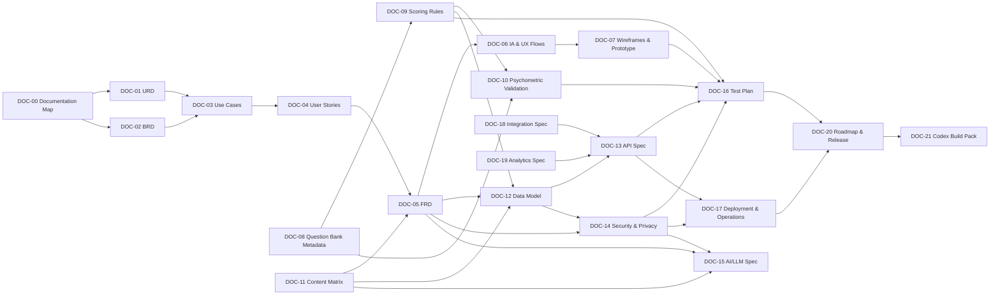
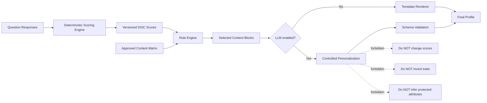
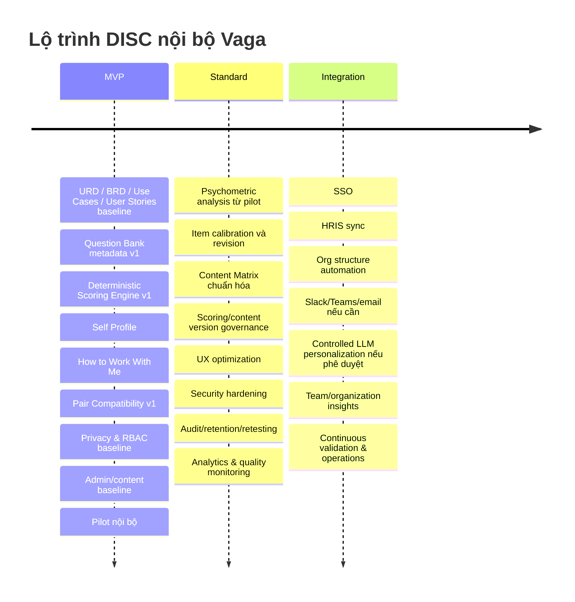
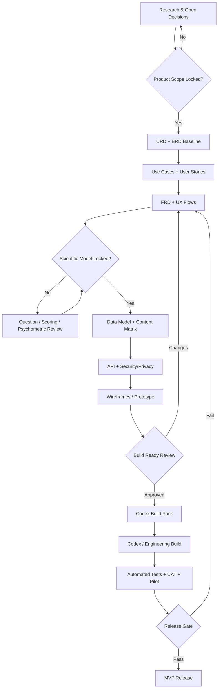

# Deep Research 04: Bộ khung 22 tài liệu Phân tích & Thiết kế (URD, BRD, FRD, UI/UX, API...) cho Codex Build

- **Plan ID**: `plan-2026-10-14T03:00:00Z-vaga-disc-docs`
- **Plan Title**: Bộ tài liệu thiết kế DISC cho Vaga
- **Started At**: `2026-10-14T13:14:25.361808Z`
- **Completed At**: `2026-10-14T13:23:42.291066Z`

## Yêu cầu đầu vào (Prompt)

@Nghiên cứu sâu Xây dựng bộ tài liệu phân tích, thiết kế chi tiết, đầy đủ (URD, BRD, FRD, User case, User Stories, UI/UX... ) để có thể chuyển sang Codex build ứng dụng này. Tạo cấu trúc và khung mục lục các tài liệu trước rồi mới lần lượt viết chi tiết từng tài liệu. Không viết vắn tắt cho đủ số lượng tài liệu, nếu hết dung lượng trong phiên làm việc thì tạm dừng vào báo tôi để tiếp tục vào phiên sau. 

## Kế hoạch nghiên cứu (Deep Research Plan)

- **step-1**: Thu thập tài liệu nguồn lý thuyết và nền tảng pháp lý DISC.
- **step-2**: Phân tích benchmark các nền tảng DISC hàng đầu và UI/UX mẫu.
- **step-3**: Xây dựng khung mục lục URD, BRD, FRD, user stories và use cases.
- **step-4**: Viết chi tiết URD, BRD và FRD theo cấu trúc đã phê duyệt.
- **step-5**: Thiết kế UI/UX wireframes và chuẩn bị tài liệu chuyển cho Codex.

---

# Bộ khung tài liệu Phân tích & Thiết kế sản phẩm DISC nội bộ Vaga để chuyển sang Codex Build

## Executive Summary

Mục tiêu của bộ tài liệu này không phải là tạo thêm một “báo cáo DISC dài”, mà là hình thành **một hệ thống tài liệu có khả năng trở thành nguồn sự thật duy nhất — Single Source of Truth — cho Product, UX, Psychometrics, Content, Engineering, QA và Codex** trong quá trình xây dựng ứng dụng DISC nội bộ Vaga.

Qua nghiên cứu các nền tảng hiện hành, có ba bài học quan trọng cần phản ánh trực tiếp vào kiến trúc tài liệu Vaga.

Thứ nhất, sản phẩm DISC hiện đại không nên dừng ở việc trả về một nhãn D/I/S/C. Everything DiSC Catalyst đưa kết quả vào các tình huống làm việc thực tế thông qua hồ sơ cá nhân, “Your Colleagues”, nhóm, các lời khuyên tương tác và tình huống như feedback; Crystal cung cấp individual, pair, group, conflict, onboarding và meeting reports; Cloverleaf tập trung vào quan hệ giữa người với người và “friction/how to resolve it”. Điều này xác nhận rằng **Self Profile + How to Work With Me + Pair Compatibility** nên là ba đối tượng sản phẩm cấp một của Vaga chứ không phải các phần phụ của báo cáo. citeturn17view1turn17view2turn16view7turn16view8

Thứ hai, không tồn tại một “thuật toán DISC chung” mà Vaga có thể đơn giản sao chép. TTI lưu ý rằng các nhà cung cấp DISC khác nhau về questionnaire, validation method, report và methodology; Everything DiSC hiện dùng thang phản hồi năm mức kết hợp adaptive testing và hệ thống tám scale riêng; Thomas PPA sử dụng một thiết kế khác với 24 câu và thời gian dưới tám phút. Vì vậy Vaga phải quản trị **Question Bank, Scoring Rules, Psychometric Validation và Content Matrix thành bốn tài sản độc lập**, có version và provenance rõ ràng. citeturn17view6turn17view1turn16view9

Thứ ba, ranh giới sử dụng phải được thiết kế ngay trong sản phẩm chứ không chỉ ghi ở cuối Terms of Use. Everything DiSC công khai mô tả công cụ của họ là công cụ phát triển và giao tiếp, không nhằm hiring, selection, promotion hay compensation; TTI cũng cảnh báo DISC đo xu hướng hành vi chứ không phải toàn bộ con người và không có một DISC profile “tốt nhất” cho mọi công việc. Trong khi đó một số nhà cung cấp khác, như Thomas, có sản phẩm được định vị cho cả hiring và development. Với mục tiêu Vaga đã xác định, khuyến nghị là lựa chọn **chính sách nội bộ bảo thủ hơn: DISC Vaga chỉ phục vụ self-awareness, development và collaboration; không được là tiêu chí đơn lẻ cho tuyển dụng, thăng chức, xếp hạng hiệu suất, lương thưởng hoặc chấm dứt hợp đồng.** citeturn16view6turn17view6turn16view9

Về pháp lý tại Việt Nam, Luật Bảo vệ dữ liệu cá nhân số 91/2025/QH15 được Quốc hội ban hành ngày 26/06/2025 và có hiệu lực từ 01/01/2026. Vì hệ thống dự kiến lưu dữ liệu định danh nhân viên, câu trả lời assessment, điểm số và suy luận hành vi, **Security & Privacy Spec phải được coi là tài liệu P0/P1 chứ không phải công việc bổ sung sau khi lập trình xong**; việc xác định chính xác loại dữ liệu, căn cứ xử lý, retention và các nghĩa vụ liên quan cần được luật sư Việt Nam kiểm tra trên thiết kế thực tế. citeturn16view0

Bộ hồ sơ đề xuất gồm **22 tài liệu lõi**, cộng các phụ lục pháp lý, psychometric, consent/privacy và nguồn nghiên cứu. Tổng số trang ước lượng khoảng **262–401 trang nếu xuất đầy đủ thành tài liệu**, nhưng đây không phải mục tiêu về độ dài. Với Codex, nhiều phần nên tồn tại dưới dạng machine-readable như `OpenAPI YAML`, `JSON Schema`, `CSV`, `Mermaid`, test fixtures, Gherkin và design tokens thay vì prose.

**Khuyến nghị quyết định kiến trúc quan trọng nhất:** scoring và classification phải **deterministic, versioned, testable**; LLM nếu được dùng chỉ nên đóng vai trò biến các content block đã được phê duyệt thành ngôn ngữ cá nhân hóa, không nên tự suy đoán điểm DISC hoặc tự phát minh đặc điểm tâm lý.

## Kiến trúc bộ tài liệu và nguyên tắc bằng chứng

Bộ tài liệu nên được tổ chức theo chuỗi truy xuất:

**User Need → Business Requirement → Use Case → User Story → Functional Requirement → UI/API/Data → Test Case → Release.**

Riêng “trái tim” của sản phẩm DISC phải có một chuỗi riêng:

**Construct → Question Item → Response → Scoring Version → DISC Dimensions → Style/Blend → Content Rules → Rendered Insight → Action → Validation Evidence.**

Cấu trúc này quan trọng vì Everything DiSC công bố riêng bằng chứng reliability/validity và mô hình scale; ITC có các hướng dẫn riêng cho test use, scoring/analysis/reporting và adaptation; Standards for Educational and Psychological Testing cũng đặt reliability, validity và fairness vào hệ thống đánh giá chất lượng của test. Do đó không nên trộn “logic tính điểm”, “nội dung tư vấn” và “UI hiển thị” vào một tài liệu duy nhất. citeturn18view0turn15search5turn15search13turn16view4

Đối với phiên bản tiếng Việt, việc “dịch một câu hỏi tiếng Anh cho hay” không đủ để gọi là adaptation hợp lệ. ITC Guidelines for Translating and Adapting Tests tổ chức quá trình adaptation quanh các nhóm vấn đề như pre-condition, test development, confirmation, administration, scoring/interpretation và documentation. Điều này là cơ sở để Vaga tách riêng **Question Bank Metadata** và **Psychometric Validation Protocol**. citeturn20view0

**Sơ đồ phụ thuộc tài liệu đề xuất:**



Đây là **dependency model**, không có nghĩa phải đợi một tài liệu “hoàn thiện 100%” mới bắt đầu tài liệu tiếp theo. Phương pháp phù hợp hơn là baseline P0 → review → freeze interface quan trọng → build → version tiếp theo.

Một nguyên tắc nữa cần khóa từ đầu là **không sao chép questionnaire, wording, scoring algorithm, report text, hình ảnh UI hoặc cách trình bày độc quyền từ các nhà cung cấp thương mại**. Marston có công trình *Emotions of Normal People* xuất bản năm 1928 và là nguồn lịch sử của lý thuyết; nhưng các implementation thương mại hiện đại là các tài sản riêng. Trang nghiên cứu của Everything DiSC chẳng hạn xác nhận sản phẩm và nhãn Everything DiSC® thuộc Wiley/đơn vị liên quan và có thông báo bảo hộ nội dung rõ ràng. Việc xác nhận phạm vi public-domain chính xác của từng bản/ấn bản Marston trong từng jurisdiction phải được ghi vào Legal Appendix thay vì mặc định mọi bản scan hay bản tái bản đều tự do tái sử dụng. citeturn19search0turn19search9turn18view2

## Danh mục tài liệu tổng thể

**Quy ước ưu tiên**

| Mức | Ý nghĩa |
|---|---|
| **P0** | Phải có baseline được duyệt trước khi Codex/Engineering xây phần liên quan |
| **P1** | Phải hoàn thiện trước pilot nội bộ hoặc production |
| **P2** | Phục vụ mở rộng, automation và integration; có thể triển khai sau MVP |
| **Conditional** | Chỉ cần khi Vaga quyết định sử dụng khả năng tương ứng, ví dụ LLM/SSO/HRIS |

**Master Document Register**

| Mã | Tài liệu | Ước lượng | Ưu tiên | Owner chính | Artifact quan trọng ngoài PDF/Doc |
|---|---|---:|---|---|---|
| DOC-00 | Documentation Map & Requirements Traceability | 4–6 trang | P0 | Product Owner / BA Lead | Traceability CSV/XLSX |
| DOC-01 | URD – User Requirements Document | 8–12 | P0 | Product Owner / UX Research | Journey map |
| DOC-02 | BRD – Business Requirements Document | 10–15 | P0 | Product Owner / Business Analyst | Business-rule register |
| DOC-03 | Use Case Specification | 12–20 | P0 | Business Analyst | Use-case diagrams / Mermaid |
| DOC-04 | User Stories & Acceptance Criteria | 15–25 | P0 | Product Owner | Backlog CSV/Jira/Notion format, Gherkin |
| DOC-05 | FRD – Functional Requirements Document | 25–40 | P0 | Product + Solution Architect | Functional state diagrams |
| DOC-06 | Information Architecture & UX Flow Spec | 8–12 | P0 | UX Lead | Sitemap, Mermaid/Figma flows |
| DOC-07 | UI/UX Wireframes & Prototype Specification | 20–30 + prototype | P0 | UX/UI Designer | Figma, design tokens, component list |
| DOC-08 | Question Bank Metadata Specification | 8–12 + data | P0 | Psychometric Lead | CSV/XLSX + JSON Schema |
| DOC-09 | Scoring & Classification Rules | 15–25 | P0 | Psychometric Lead + Tech Lead | Formula spec, pseudocode, golden test vectors |
| DOC-10 | Psychometric Validation Protocol | 15–25 | P0 design / P1 evidence | Psychometric Lead | Statistical analysis plan |
| DOC-11 | Modular Behavioral Content Matrix | 12–20 + database | P0 | Content Lead + Psychometric Lead | CSV/JSON content library |
| DOC-12 | Data Model & Data Dictionary | 15–25 | P0 | Solution/Data Architect | Mermaid ERD, SQL/DBML |
| DOC-13 | API Specification | 10–15 | P0 | Backend Lead / Architect | OpenAPI YAML/JSON |
| DOC-14 | Security & Privacy Specification | 18–25 | P0/P1 | Security & Privacy Lead | Threat model, RBAC matrix, data-flow diagram |
| DOC-15 | AI/LLM Personalization Specification | 10–15 | Conditional | AI Lead / Tech Lead | Prompt schemas, eval dataset, guardrail tests |
| DOC-16 | Master Test & Quality Plan | 15–25 | P0/P1 | QA Lead | Test matrix, automated fixtures |
| DOC-17 | Deployment, DevOps & Operations Plan | 10–15 | P1 | DevOps / Tech Lead | CI/CD, runbooks, rollback plan |
| DOC-18 | SSO/HRIS/Enterprise Integration Spec | 10–15 | P2 / Conditional | Solution Architect | Sequence diagrams, field mapping |
| DOC-19 | Product Analytics & Measurement Spec | 8–12 | P1 | Product/Data Analyst | Event taxonomy/data contract |
| DOC-20 | Product Roadmap & Release Plan | 6–10 | P0 | Product Owner / PM | Release matrix |
| DOC-21 | Codex Build Pack & Engineering Handoff | 8–12 | P0 trước build | Tech Lead | Repo spec, ADRs, fixtures, build instructions |
|  | **Tổng envelope** | **~262–401 trang** |  |  | Không tính source code/Figma/data files |

Không nên dùng số trang này như KPI. Đối với Codex, một `OpenAPI.yaml` chính xác, một JSON Schema rõ ràng và một bộ acceptance test tốt có giá trị triển khai cao hơn hàng chục trang mô tả mơ hồ. OpenAPI được thiết kế chính xác cho việc mô tả HTTP APIs và có thể hỗ trợ hiểu interface, sinh client và testing; JSON Schema cung cấp cấu trúc chuẩn cho việc mô tả và kiểm tra JSON data. citeturn16view2turn16view3

**Vai trò tối thiểu được giả định trong các tài liệu:**

| Role | Trách nhiệm cốt lõi |
|---|---|
| Product Owner | Product outcome, scope, priority, final business decision |
| Business Analyst | Requirement quality, business rules, use cases, traceability |
| Psychometric Lead / I-O Psychologist | Construct, item design, scoring, validation, interpretation boundaries |
| UX Research / UX Design | User journeys, IA, interaction, usability |
| UI Designer | Visual system, components, responsive/accessibility |
| Content Lead | Behavioral content library, editorial consistency, Vietnamese language |
| Solution Architect / Tech Lead | System architecture, data/API boundaries, Codex handoff |
| Backend / Frontend Lead | Technical feasibility and implementation contract |
| Security & Privacy Lead | Access, security controls, privacy engineering |
| Legal Counsel | IP, employment/privacy/legal review |
| QA Lead | Functional, regression, scoring and security test strategy |
| Data Analyst | Pilot analysis, telemetry and psychometric datasets |
| DevOps | CI/CD, environments, monitoring, backup and recovery |
| HR / People Ops | Policy, internal rollout, employee communication and governance |

Một người có thể kiêm nhiều role trong đội nhỏ, nhưng **role accountability vẫn nên được phân biệt trên tài liệu**.

## Khung mục lục chi tiết cho từng tài liệu

Bảng dưới đây là **mục lục cần viết ở giai đoạn tiếp theo**, không phải nội dung hoàn chỉnh của URD/BRD/FRD.

| Tài liệu | Mục tiêu | Khung nội dung cần có | Định dạng đầu ra | Owner |
|---|---|---|---|---|
| **DOC-00 Documentation Map & Traceability** | Điều khiển toàn bộ hệ thống tài liệu và tránh requirement bị thất lạc. | Document registry; version/status; glossary; source-of-truth hierarchy; requirement ID convention; dependency map; traceability `URD → BRD → UC → US → FR → API/UI/Data → Test`; change log; decision log. | Markdown/PDF + XLSX/CSV traceability matrix + Mermaid | BA Lead |
| **DOC-01 URD** | Xác định người dùng thực sự cần gì, độc lập với giải pháp kỹ thuật. | Product context; employee persona; manager/colleague persona; HR/admin persona; jobs-to-be-done; pain points; Self View needs; Public Profile needs; Pair Compatibility needs; privacy expectations; accessibility; user-level success criteria; exclusions. | Document + persona table + journey maps | Product / UX |
| **DOC-02 BRD** | Chuyển nhu cầu người dùng thành mục tiêu và quy tắc kinh doanh. | Business objectives; business scope/non-scope; organizational use policy; stakeholder map; process before/after; business rules; governance; success metrics; risks; assumptions; prohibited uses; approval process. | Document + business rule table + RACI | Product / BA |
| **DOC-03 Use Cases** | Mô tả đầy đủ tương tác Actor–System. | Actor catalog; UC “Take Assessment”; “Resume Assessment”; “View My Profile”; “Edit Sharing Preferences”; “View Colleague”; “Compare A↔B”; “Retake Assessment”; “Admin Manage Content”; “Admin Release Scoring Version”; “Export/Delete/Archive”; error and alternative paths. | Use-case tables + Mermaid UML-like diagrams | BA |
| **DOC-04 User Stories & Acceptance Criteria** | Tạo backlog có thể giao trực tiếp cho development/Codex và QA. | Epics; stories theo role; Given/When/Then acceptance criteria; edge cases; priority; dependencies; source requirement ID; design link; test ID; Definition of Ready/Done. | Backlog spreadsheet/JSON/Jira-compatible + Gherkin | Product Owner |
| **DOC-05 FRD** | Mô tả hệ thống phải làm gì ở cấp chức năng. | Authentication/onboarding; consent; assessment engine; save/resume; scoring; Self Profile; Public Profile; Pair Compare; search people; sharing; admin console; content management; scoring versions; retest; notifications; audit; export/deletion; error states; permission rules; NFR cross-references. | Document + state diagrams + rule tables | Product / Architect |
| **DOC-06 IA & UX Flow** | Xác định cấu trúc thông tin và đường đi người dùng trước khi làm UI chi tiết. | Sitemap; navigation hierarchy; assessment flow; result reveal; Self→Action Plan; employee directory→Public Profile; A→B comparison; admin workflows; empty/loading/error/permission paths; mobile adaptations. | Figma/FigJam + Mermaid flowcharts | UX Lead |
| **DOC-07 UI/UX Wireframes & Prototype** | Biến requirements thành giao diện có thể test trước khi code. | Screen inventory; low/high fidelity wireframes; desktop/mobile; component specification; DISC chart; score visualization; “1-Minute Cheat Sheet”; Do/Don't cards; collaboration cards; feedback/delegation/recognition modules; pair comparison; admin UI; states; accessibility; UX copy IDs. | Figma prototype + image exports + component table + design tokens | UX/UI Lead |
| **DOC-08 Question Bank Metadata** | Quản trị question bank như một scientific asset thay vì một danh sách text. | Item ID; version; Vietnamese statement; construct target; dimension; polarity; response scale; context; wording type; author; source/provenance; copyright/license; reviewer; pilot status; inclusion/exclusion; item statistics placeholders; bias/social-desirability review flags; translation/adaptation history. **Không cần viết câu hỏi trong tài liệu kiến trúc này.** | XLSX/CSV database + JSON Schema + data dictionary | Psychometric Lead |
| **DOC-09 Scoring Rules** | Định nghĩa duy nhất cách response trở thành kết quả DISC. | Measurement assumptions; response coding; item key; reverse items nếu có; missing response; raw dimension scores; normalization; intensity bands; style/blend decision rules; tie/low-differentiation cases; validity/confidence indicators; Natural/Adapted logic nếu được chọn; pair-derived variables; versioning; auditability; worked synthetic examples; golden vectors. | Formula tables + pseudocode + JSON config + unit test vectors | Psychometric + Tech Lead |
| **DOC-10 Psychometric Validation Protocol** | Xác định bằng chứng phải có trước khi Vaga tuyên bố assessment đủ tin cậy cho mục đích nội bộ. | Construct definition; content validity; expert review; cognitive interviews; pilot design; item analysis; reliability; test–retest; structural evidence; convergent/discriminant evidence khi khả thi; response bias; fairness; Vietnamese linguistic/cultural review; subgroup analyses; retest/version equivalence; reporting criteria; release gates. | Research protocol + analysis plan + validation checklist | Psychometric Lead |
| **DOC-11 Content Matrix** | Xây một thư viện nội dung modular thay vì viết hàng trăm report cố định. | Content taxonomy; D/I/S/C; blends; intensity; Self/Public/Pair context; strengths; blind spots; under stress; communication; meeting; conflict; decision; delegation; feedback; recognition; quick wins; habits; block IDs; applicability rules; exclusions; tone; evidence/provenance; version; review status; localization. | Master spreadsheet/database + JSON + JSON Schema | Content + Psychometric |
| **DOC-12 Data Model & Dictionary** | Quy định dữ liệu nào tồn tại, ở đâu và có quan hệ thế nào. | Employee; identity; org unit; assessment session; assessment version; item; response; scoring run; dimension score; profile snapshot; content block; profile render; pair comparison; sharing settings; consent; retest; content version; role; permission; audit event; integration mapping; retention status. | Mermaid ERD + DBML/SQL draft + data dictionary | Data/Solution Architect |
| **DOC-13 API Spec** | Tạo contract ổn định giữa frontend, backend, integrations và Codex. | Authentication; employee/profile APIs; assessment session APIs; response submission; scoring; self/public view; compare endpoint; people search; admin/content/scoring version APIs; consent/privacy endpoints; errors; pagination; idempotency; rate limits; audit; versioning; webhook/event interfaces. | **OpenAPI YAML/JSON** + examples + sequence diagrams | Backend / Architect |
| **DOC-14 Security & Privacy Spec** | Bảo vệ dữ liệu nhân sự và giới hạn cách sử dụng kết quả. | Data inventory/classification; data-flow map; privacy roles; RBAC/ABAC; Self/Public/Admin field visibility; raw response protection; encryption; session/auth; SSO assumptions; audit log; secrets; logging/redaction; retention/deletion; backup; breach workflow; employee rights workflow; consent/preferences; vendor risk; threat model; secure SDLC; legal mapping. | Security document + DFD + RBAC matrix + threat model | Security/Privacy |
| **DOC-15 AI/LLM Personalization Spec** | Chỉ cho AI hoạt động trong phạm vi có thể kiểm soát và audit. | Allowed/not-allowed tasks; approved content retrieval; structured input/output; prompt templates; PII minimization; grounding; hallucination policy; safety filters; model/version registry; quality evaluation; deterministic fallback; human review; audit; cost/latency; vendor processing terms. | JSON output schemas + prompt registry + eval cases + architecture diagram | AI/Tech Lead |
| **DOC-16 Test Plan** | Chứng minh hệ thống thực hiện đúng các requirement và scoring. | Requirement coverage; unit; API; integration; E2E; permission tests; scoring golden tests; content-rule tests; privacy tests; security; accessibility; performance; concurrency; browser/mobile; migration; regression; UAT; psychometric release checks; pilot exit criteria. | Test matrix + automated fixtures + Gherkin/E2E cases | QA Lead |
| **DOC-17 Deployment & Operations** | Đảm bảo hệ thống có thể deploy, rollback và vận hành an toàn. | Dev/staging/prod; branching/release; CI/CD; config/secrets; DB migrations; seed/versioned content; deployment; rollback; backup/restore; monitoring; alerting; uptime target; incident runbook; disaster recovery; log retention. | Architecture diagram + pipeline YAML concept + runbook | DevOps |
| **DOC-18 Integration Spec** | Chuẩn bị cho SSO, HRIS và các công cụ làm việc khi đi vào giai đoạn Integration. | Identity source; employee synchronization; SSO protocol; provisioning/deprovisioning; HRIS mapping; org chart; Slack/Teams/email scenarios nếu có; webhook/event flow; retry; reconciliation; source-of-truth rules; offboarding. | Field mapping + API/sequence diagrams | Architect |
| **DOC-19 Analytics & Measurement** | Đo adoption và giá trị sản phẩm mà không biến DISC thành công cụ giám sát nhân sự. | Event taxonomy; assessment completion; profile usage; colleague view; comparison usage; action-plan engagement; retest; funnel; cohort; content usefulness feedback; data minimization; aggregation; access; retention; prohibited analytics. | Event dictionary + JSON event schemas + dashboard spec | Product/Data |
| **DOC-20 Roadmap & Release Plan** | Kiểm soát scope MVP → Standard → Integration. | Feature matrix; document gates; resource assumptions; dependencies; pilot; release readiness; go/no-go criteria; deprecation/version plan; backlog beyond scope. | Roadmap table + Mermaid timeline | Product Owner |
| **DOC-21 Codex Build Pack** | Chuyển từ “tài liệu để đọc” thành một package mà coding agent có thể triển khai an toàn. | Repo architecture; README hierarchy; product glossary; source-of-truth paths; coding standards; schema locations; API contracts; migrations; fixtures; mock data; test commands; environment variables; security constraints; ADRs; unresolved decisions; tasks sequenced by dependency; Definition of Done. | Repository-ready Markdown/YAML/JSON + ADR templates + task files | Tech Lead |

**DOC-09 và DOC-10 phải được giữ tách biệt.** Scoring Rules mô tả *hệ thống đang tính như thế nào*; Validation Protocol chứng minh *liệu cách tính đó có tạo ra các diễn giải đủ ổn định, hợp lệ và công bằng cho mục đích được công bố hay không*. Everything DiSC, ví dụ, công khai riêng dữ liệu về internal consistency/test–retest và construct structure thay vì coi việc có thuật toán là bằng chứng validity. citeturn18view0turn18view1

**DOC-11 Content Matrix cũng không được xem là “truth về con người”.** Mỗi block nên là một giả thuyết hành vi/phương thức giao tiếp có điều kiện, với ngôn ngữ như “có xu hướng”, “có thể hiệu quả hơn khi”, thay vì “bạn là…”. Everything DiSC mô tả chính mô hình của họ là descriptive chứ không prescriptive; TTI cũng phản đối việc biến một người thành nhãn “High D” để giải thích mọi hành vi. citeturn18view2turn17view6

**Cấu trúc dữ liệu Content Matrix sơ bộ nên được chuẩn hóa theo logic sau, nhưng chưa viết nội dung block ở bước này:**

```text
content_block
├── block_id
├── version
├── language
├── audience
│   ├── SELF_PRIVATE
│   ├── COLLEAGUE_PUBLIC
│   └── PAIR_COMPARE
├── source_dimension
│   ├── D
│   ├── I
│   ├── S
│   └── C
├── blend
│   └── optional: DI / ID / IS / SI / SC / CS / CD / DC ...
├── intensity_band
├── situation
│   ├── strengths
│   ├── blind_spots
│   ├── under_stress
│   ├── direct_message
│   ├── meeting
│   ├── decision
│   ├── conflict
│   ├── delegation
│   ├── feedback
│   ├── recognition
│   ├── quick_win
│   └── habit
├── applicability_rules
├── exclusion_rules
├── evidence_or_rationale
├── copyright_provenance
├── editorial_status
├── psychometric_review_status
└── effective_from / effective_to
```

Cách tổ chức này cho phép cùng một block được tái sử dụng có kiểm soát thay vì viết thủ công `16 styles × 10 situations × 4 counterpart styles × 3 audiences`. Đây là điểm then chốt để tránh “content explosion”.

**Pair Compatibility không nên được lưu như 256 bài report cố định.** Nên tính từ một tập đặc trưng có cấu trúc, ví dụ:

```text
A_DISC_vector
       +
B_DISC_vector
       +
relationship_context
       ↓
pair_rules_engine
       ↓
shared_tendencies
potential_friction
recommended_adjustments
       ↓
approved_content_blocks
       ↓
pair_profile
```

Crystal hiện coi individual, pair và group reports là các sản phẩm riêng, còn Everything DiSC Catalyst cho người dùng làm việc theo cặp trên “Your Colleagues” và tìm cách làm việc hiệu quả hơn với nhau. Vì thế việc tách `pair_insight` thành entity và feature domain riêng là có cơ sở UX rõ ràng. citeturn16view7turn17view2

**Đề xuất ranh giới LLM:**



NIST AI Risk Management Framework có thể được dùng làm nguồn governance nếu Vaga bật AI/LLM; OWASP cũng đã có AI Security Verification Standard dành cho các hệ thống AI. Đây nên là **conditional governance layer**, không phải lý do để biến MVP thành một hệ thống AI phức tạp ngay từ đầu. citeturn11search23turn11search33

Về application security, OWASP ASVS được thiết kế làm cơ sở kiểm tra các technical security controls của web application và hiện cung cấp requirement IDs có version; do đó DOC-14 và DOC-16 nên tham chiếu trực tiếp đến version cụ thể của ASVS thay vì ghi những yêu cầu chung chung như “website phải an toàn”. citeturn16view1

## Phụ lục bắt buộc và thư viện nguồn

Ngoài 22 tài liệu lõi, nên lập một thư mục `/docs/appendices/` với các phụ lục sau.

| Mã | Phụ lục bắt buộc | Nội dung tối thiểu | Owner |
|---|---|---|---|
| APP-A | Research & Evidence Register | Nguồn; URL; publisher; ngày truy cập; claim được hỗ trợ; loại nguồn; mức tin cậy; license/copyright; tài liệu Vaga sử dụng nguồn này | Research / Psychometric |
| APP-B | IP, Copyright & Trademark Register | Marston; commercial DISC brands; questionnaire provenance; wording provenance; trademark; screenshots; icon/assets; license status; legal decision | Legal |
| APP-C | Psychometric Validation Checklist | Content validity; pilot; reliability; test–retest; structure; bias; fairness; adaptation; documentation; release gate | Psychometric |
| APP-D | Assessment Item Review Form | Item writing; clarity; construct alignment; double-barrel; desirability; cultural bias; translation; review outcome | Psychometric |
| APP-E | Consent / Opt-in Templates | Participation; purpose; sharing preferences; optional colleague visibility; optional AI processing where applicable; withdrawal/contact flow | Legal / Privacy |
| APP-F | Privacy Notice Template | Controller/contact; data categories; purposes; recipients; retention; rights/workflow; security contact; policy version | Privacy / Legal |
| APP-G | Appropriate Use & Anti-Stereotyping Policy | Allowed uses; prohibited uses; “DISC is not performance”; no hiring/termination-only decisions; manager guidance; escalation | HR / Legal |
| APP-H | Data Retention & Deletion Schedule | Data entity; purpose; retention; trigger; deletion/anonymization method; exception; owner | Privacy |
| APP-I | RBAC & Information Visibility Matrix | Employee; colleague; manager; HR; facilitator; admin; tech support; raw responses; scores; self content; public content; audit data | Security |
| APP-J | Threat & Abuse Case Register | Unauthorized viewing; manager coercion; profile scraping; exporting raw scores; identity mismatch; LLM leakage; privilege escalation | Security |
| APP-K | Pilot Research Pack | Participant information; pilot consent; survey; interview guide; usability test; feedback rubric; data-analysis plan | Product/Psychometric |
| APP-L | Glossary & Naming Standard | DISC; dimension; score; style; blend; raw score; normalized score; confidence; profile; public/private; assessment version | BA/Psychometric |

**Nguồn bắt buộc nên đưa vào APP-A ngay từ đầu**

| Nhóm | Nguồn | Vai trò trong thiết kế Vaga | URL chính thức/tham khảo |
|---|---|---|---|
| Nền tảng lý thuyết | William Moulton Marston, *Emotions of Normal People*, 1928 | Historical/theoretical provenance | `https://archive.org/details/emotionsofnormal032195mbp` citeturn19search0 |
| DISC research benchmark | Everything DiSC – Science behind DiSC | Scale, reliability/validity benchmark, blends, adaptive assessment | `https://www.discprofile.com/what-is-disc/research-reliability-and-validity` citeturn18view0turn18view2 |
| Interaction UX | Everything DiSC Catalyst | Self, colleague, groups, workplace interaction | `https://www.everythingdisc.com/learning-that-lasts` citeturn17view1 |
| Pair UX | Everything DiSC Workplace | “Your Colleagues”, working in pairs, action planning | `https://www.everythingdisc.com/build-better-relationships` citeturn17view2 |
| Usage guardrail | Everything DiSC Common Language Playbook | Development/communication vs employment-selection boundary | `https://llms.everythingdisc.com/common-language-program` citeturn16view6 |
| Assessment benchmark | Thomas PPA | Alternative DISC implementation; 24-question/short assessment benchmark | `https://www.thomas.co/assessments/personal-profile-analysis-ppa` citeturn16view9 |
| Pair/report benchmark | Crystal | Individual, pair, group, conflict/team interaction patterns | `https://pages.crystalknows.com/` citeturn16view7 |
| API benchmark | Crystal Personality API | Example of separating profile data and communication playbooks into APIs | `https://www.crystalknows.com/pricing` citeturn17view5 |
| Security benchmark | Crystal Trust Center | Example organization of compliance/security documentation | `https://security.crystalknows.com/` citeturn17view4 |
| Team/relationship UX | Cloverleaf | Relationship intelligence, friction resolution, flow-of-work coaching | `https://cloverleaf.me/` citeturn16view8 |
| Behavioral limits | TTI Success Insights | DISC behavioral—not whole-person—interpretation and anti-stereotyping | `https://www.ttisi.com/blog/5-mistakes-consultants-make-disc-profile/` citeturn17view6 |
| Validation benchmark | Extended DISC | Validation/fairness/privacy claims to investigate comparatively | `https://www.extendeddisc.org/company/faq/` citeturn18view3 |
| Test governance | International Test Commission | Guidelines for test use and scoring/reporting governance | `https://www.intestcom.org/page/28` citeturn15search23 |
| Vietnamese adaptation | ITC Guidelines for Translating and Adapting Tests | Framework for cultural/linguistic adaptation | `https://www.intestcom.org/files/guideline_test_adaptation_2ed.pdf` citeturn20view0 |
| Psychometric standard | APA/AERA/NCME – Standards for Educational and Psychological Testing | Reliability, validity, fairness and test governance reference | `https://www.apa.org/science/programs/testing/standards` citeturn16view4 |
| Vietnam privacy | Luật 91/2025/QH15 | Primary legal baseline for personal data processing in Vietnam | `https://chinhphu.vn/?classid=1&docid=214590&pageid=27160&typegroupid=3` citeturn16view0 |
| Web security | OWASP ASVS | Security requirement IDs and verification baseline | `https://owasp.org/projects/asvs` citeturn16view1 |
| API contract | OpenAPI Initiative | Standard API description | `https://www.openapis.org/` citeturn16view2 |
| Data contract | JSON Schema | Machine-readable validation schemas | `https://json-schema.org/specification` citeturn16view3 |
| AI governance nếu dùng | NIST AI RMF | AI risk governance | `https://www.nist.gov/itl/ai-risk-management-framework` citeturn11search23 |

Đối với **hình ảnh/UI benchmark**, nên tham chiếu URL trang gốc trong Figma Research Board thay vì copy asset vào production. Trang Catalyst có các hình minh họa sample profile, “Your Colleagues” và group performance; Cloverleaf có hình minh họa relationship/team coaching; Crystal có report workspace cho Individual/1:1/Group. Những hình này nên được ghi là **visual research reference, not reusable design assets**. citeturn17view1turn16view8turn16view7

Một phần đặc biệt quan trọng của APP-B phải là **IP provenance cho từng item và từng content block**:

| Trường | Ví dụ ý nghĩa |
|---|---|
| `source_type` | ORIGINAL / PUBLIC_DOMAIN_REFERENCE / LICENSED / RESEARCH_INSPIRED |
| `source_reference` | Mã nguồn trong APP-A |
| `author` | Người soạn câu hỏi/nội dung |
| `created_at` | Ngày tạo |
| `reviewed_by` | Psychometric reviewer |
| `copyright_status` | Đã xác minh / Chờ legal review |
| `commercial_similarity_review` | Đã kiểm tra nguy cơ giống proprietary item |
| `license` | Internal Vaga / khác |
| `legal_notes` | Các hạn chế |
| `version` | Phiên bản nội dung |

Việc này cho phép Vaga về sau chứng minh question bank được xây độc lập thay vì chỉ nói rằng “chúng tôi không sao chép”.

## Giả định, điểm chưa xác định và checklist cần xác minh

Ở thời điểm này có nhiều quyết định ảnh hưởng trực tiếp đến URD/BRD/FRD nhưng chưa có dữ liệu. Không nên tự điền giả định thành requirement chính thức.

**Assumption & Open Decision Register**

| ID | Điểm chưa xác định | Ảnh hưởng | Mức cần quyết định |
|---|---|---|---|
| A-01 | **[SỐ_LƯỢNG_NHÂN_SỰ_DỰ_KIẾN]** chưa cung cấp | Capacity, concurrency, licensing, admin UX, pilot size, analytics | Trước Architecture baseline |
| A-02 | Vaga chỉ dùng trong một công ty hay nhiều công ty/đơn vị? | Tenant model, authorization, schema | Trước Data Model |
| A-03 | Có HRIS hiện hữu không? Hệ thống nào? | Employee sync, org structure, join/leave | Trước Integration spec |
| A-04 | Có SSO không? Google Workspace, Microsoft, OAuth/OIDC/SAML hay username/password? | Authentication, offboarding, security | Trước Security/API |
| A-05 | Email công ty có phải primary employee ID không? | Identity architecture | Trước Data Model |
| A-06 | Nhân sự có bắt buộc làm assessment hay tự nguyện? | Consent, HR policy, user trust | Trước BRD/Privacy |
| A-07 | Người dùng có được lựa chọn “ẩn khỏi colleague view” không? | Product logic, culture, consent | Trước FRD |
| A-08 | Manager có quyền xem nhiều hơn đồng nghiệp hay không? | Privacy/RBAC | Trước FRD/Security |
| A-09 | HR/Admin có được xem raw answers không? | Privacy/security risk | Trước Data Model |
| A-10 | Public profile sẽ hiển thị raw D/I/S/C score hay chỉ collaboration guidance? | Privacy/anti-labeling | Trước UI prototype |
| A-11 | Có dùng Natural/Core và Adapted style không? | Questionnaire/scoring/report/data model | Trước Question Bank design |
| A-12 | Chọn Likert, forced-choice hay hình thức khác? | Item design, scoring, psychometrics | Trước Question Bank |
| A-13 | Có tạo 12, 16 hay continuum/blend model khác? | Classification/content matrix | Trước Scoring Rules |
| A-14 | Có norm sample hay dùng score transformation không phụ thuộc norm? | Psychometrics/scoring | Trước scoring finalization |
| A-15 | Retesting chính thức là 6, 12 tháng hay event-based? | Business rules/version history | Trước FRD |
| A-16 | Khi retest, profile cũ có còn xem được không? | Data/versioning | Trước Data Model |
| A-17 | Pair compatibility dùng score đầy đủ hay style/blend? | Scoring/content rules | Trước Pair Engine |
| A-18 | Có LLM ở MVP không? | Architecture, privacy, cost, testing | Trước FRD freeze |
| A-19 | Nếu có LLM, provider/model/data residency nào? | Security/privacy/vendor contract | Trước AI Spec |
| A-20 | Có gửi dữ liệu nhân viên ra ngoài hệ thống Vaga không? | Privacy/legal architecture | Trước vendor selection |
| A-21 | Hosting cloud nào và region nào? | Privacy/security/DevOps | Trước Deployment |
| A-22 | Có Slack/Microsoft Teams integration không? | Phase Integration | Trước Roadmap phase 3 |
| A-23 | Có mobile app hay responsive web only? | UI/API scope | Trước wireframes |
| A-24 | Ngôn ngữ chỉ tiếng Việt hay Việt + Anh? | Item validation/content localization | Trước Content/Question Bank |
| A-25 | Vaga có psychometrician/I-O psychologist tham gia không? | Scientific validity risk | Trước pilot |
| A-26 | Có sample nhân sự đủ cho pilot và validation không? | Statistical evidence | Trước Psychometric Plan |
| A-27 | “Internal use only” có bao gồm candidate/recruitment không? | Ethics/legal/business scope | Cần khóa trong BRD |
| A-28 | Ai có quyền thay đổi scoring configuration? | Governance/security | Trước Admin FRD |
| A-29 | Ai phê duyệt content behavioral blocks? | Content governance | Trước CMS/admin design |
| A-30 | Có cần export PDF/report không? | Copyright, UX, API/storage | Trước FRD |
| A-31 | Retention raw response bao lâu? | Privacy/database | Legal decision |
| A-32 | Nhân viên nghỉ việc: delete/anonymize/archive? | HRIS/privacy | Legal + HR decision |
| A-33 | Có quyền yêu cầu xóa/sửa/hạn chế chia sẻ nội bộ như thế nào? | Privacy workflow | Legal review |
| A-34 | Mức availability/performance cần thiết là gì? | NFR/deployment | Trước architecture |
| A-35 | Codex sẽ build toàn stack hay hỗ trợ team hiện hữu? | Build Pack granularity | Trước engineering handoff |

**Checklist phải đóng trước khi viết URD/BRD/FRD chi tiết**

- [ ] Xác định `[SỐ_LƯỢNG_NHÂN_SỰ_DỰ_KIẾN]`, số phòng ban và tốc độ tăng trưởng.
- [ ] Xác định single-organization hay multi-tenant.
- [ ] Xác định user roles chính thức: Employee, Manager, HR, Facilitator, Admin, Super Admin.
- [ ] Chốt phạm vi **development/collaboration only** hay còn mục đích nào khác.
- [ ] Ghi thành chính sách rằng DISC không được là tiêu chí duy nhất cho tuyển dụng, thăng chức, đánh giá hiệu suất, lương thưởng hoặc chấm dứt hợp đồng.
- [ ] Chốt Self View, Public View và Pair View là ba experience chính thức.
- [ ] Chốt Public Profile có hiển thị điểm số hay chỉ hướng dẫn làm việc.
- [ ] Chốt manager privilege có khác colleague privilege hay không.
- [ ] Chốt quyền truy cập raw answers.
- [ ] Chốt opt-in/opt-out và sharing preference.
- [ ] Chốt SSO, HRIS và source-of-truth nhân sự.
- [ ] Chốt phương pháp questionnaire ở cấp kiến trúc.
- [ ] Chốt có/không Natural vs Adapted.
- [ ] Chốt style/blend taxonomy mà Vaga muốn kiểm định.
- [ ] Có psychometric lead chịu trách nhiệm chính thức.
- [ ] Hoàn thành IP review đối với question bank hiện có.
- [ ] Mỗi câu hỏi phải có provenance trước pilot.
- [ ] Hoàn thành Content Matrix taxonomy trước viết hàng loạt behavioral copy.
- [ ] Định nghĩa scoring engine độc lập với report renderer.
- [ ] Định nghĩa `scoring_version`, `questionnaire_version`, `content_version` riêng biệt.
- [ ] Thiết kế golden scoring test cases trước production.
- [ ] Chốt quy trình retest và historical profile.
- [ ] Chốt thời hạn lưu raw responses.
- [ ] Thực hiện mapping thiết kế với Luật Bảo vệ dữ liệu cá nhân 91/2025/QH15 cùng luật sư Việt Nam. citeturn16view0
- [ ] Chốt consent/privacy notice text trước pilot.
- [ ] Chốt hosting region, backup và disaster-recovery assumptions.
- [ ] Chốt Security baseline và phiên bản OWASP ASVS áp dụng. citeturn16view1
- [ ] Chốt có/không LLM.
- [ ] Nếu dùng LLM, quyết định rõ **LLM không được chấm điểm hoặc tự sửa DISC classification**.
- [ ] Nếu dùng bên thứ ba cho LLM, review data-processing terms trước gửi dữ liệu thật.
- [ ] Chốt event analytics được phép ghi và những dữ liệu tuyệt đối không ghi vào telemetry.
- [ ] Thiết kế pilot với cả usability testing và psychometric evidence.
- [ ] Đặt wording chính thức: “behavioral tendencies/preferences”, không phải “bản chất con người”.
- [ ] Chốt success metrics của MVP trước khi build.

**Checklist cần xác minh sâu ở vòng nghiên cứu tiếp theo**

- [ ] Xác minh phạm vi public-domain theo jurisdiction đối với từng phiên bản/tái bản *Emotions of Normal People* trước khi tái xuất bản nội dung, dù bản gốc được xuất bản năm 1928. citeturn19search0turn19search9
- [ ] Lập trademark register cho `DISC`, `DiSC`, `Everything DiSC®`, tên style thương mại và các thương hiệu benchmark.
- [ ] So sánh bộ câu hỏi Vaga hiện có với các nguồn thương mại để kiểm tra nguy cơ wording similarity.
- [ ] Xác minh tiêu chí psychometric phù hợp với **mục đích development nội bộ**, không áp dụng máy móc tiêu chuẩn dành cho selection.
- [ ] Xác minh sample-size plan sau khi biết quy mô population/pilot; không đặt con số validation tùy tiện trước đó.
- [ ] Kiểm tra bias văn hóa/ngôn ngữ của các câu hỏi tiếng Việt theo quy trình adaptation có tài liệu hóa; ITC nhấn mạnh cả adaptation, administration, scoring/interpretation và documentation chứ không chỉ translation. citeturn20view0
- [ ] Xác minh loại/căn cứ xử lý và các nghĩa vụ cụ thể đối với từng trường dữ liệu DISC dưới Luật 91/2025/QH15 bằng legal review. citeturn16view0
- [ ] Xác minh nghĩa vụ ngoài Việt Nam nếu hosting, processor hoặc người dùng nằm ở jurisdiction khác.
- [ ] Review screenshots/UI của Catalyst, Crystal, Cloverleaf, Extended DISC và Thomas chỉ để benchmark interaction patterns; không tái sử dụng copyrighted assets hoặc proprietary text. citeturn17view1turn16view7turn16view8turn16view9

Một điểm cần đặc biệt tránh là **“validation by familiarity”**: nhân viên đọc report rồi thấy “đúng với mình” không phải bằng chứng psychometric đủ để xác thực assessment. Chính nguồn nghiên cứu Everything DiSC khi nói về mức người dùng đồng ý với profile cũng lưu ý hiệu ứng Forer; do đó Vaga phải tách “user perceived accuracy” khỏi reliability, structural validity và các bằng chứng khác. citeturn18view0

## Lộ trình tài liệu và sản phẩm từ MVP đến Integration

Lộ trình nên triển khai theo ba giai đoạn, nhưng **Psychometrics, Privacy và IP không được hiểu là việc có thể bỏ qua ở MVP**. MVP vẫn cần baseline an toàn; “Standard” là giai đoạn củng cố bằng chứng và governance sau pilot.



| Giai đoạn | Tài liệu phải đạt baseline | Product scope nên nhắm tới | Exit gate trước giai đoạn sau |
|---|---|---|---|
| **MVP** | DOC-00→14, DOC-16, DOC-20, DOC-21; DOC-15 nếu LLM có trong MVP | Assessment; Self View; Public “How to Work With Me”; Pair Compare; consent/sharing; employee search; admin cơ bản | Functional UAT pass; scoring golden tests pass; privacy/RBAC pass; pilot protocol approved; không có IP blocker |
| **Standard** | DOC-10 có pilot evidence; DOC-11 mature; DOC-14/16/17/19 hoàn thiện | Content personalization tốt hơn; retest; versioning; admin governance; usability; product analytics; security hardening | Psychometric review; privacy/legal sign-off; security acceptance; pilot outcome đạt ngưỡng đã xác định trước |
| **Integration** | DOC-18 và các cập nhật API/Data/Security; DOC-15 nếu bật AI | SSO/HRIS; org sync; workflow integrations; optional LLM; team/organizational insights | Integration reconciliation pass; offboarding verified; AI eval nếu dùng; operational readiness |

Everything DiSC Catalyst và Cloverleaf đều cho thấy giá trị sản phẩm nằm ở việc đưa insight trở lại “flow of work” chứ không chỉ hoàn thành một lần assessment; Catalyst nối profile với colleague/team và tình huống công việc, còn Cloverleaf đưa coaching vào Slack/Teams/email. Vì vậy integration là hướng phát triển hợp lý sau khi scoring, content và privacy đã ổn định, nhưng không nên được đưa vào MVP trước khi chứng minh các luồng Self/Public/Pair thực sự hữu ích cho Vaga. citeturn17view1turn16view8

**Document gate cho Codex nên được thiết kế như sau:**



**Định nghĩa “Build Ready” đề xuất cho Vaga:** Codex chỉ nên nhận một feature để triển khai khi feature đó có requirement ID, user story, acceptance criteria, wireframe hoặc UI rule tương ứng, API/data contract nếu cần, permission rule, analytics rule nếu cần và test scenario. Feature liên quan assessment phải bổ sung `questionnaire_version`/`scoring_version`; feature dùng behavioral copy phải chỉ đến `content_block_id` thay vì hard-code hàng loạt văn bản trong source code.

**Định nghĩa “Release Ready” đề xuất:** ngoài functional pass, mọi thay đổi scoring phải chạy lại golden dataset; thay đổi question bank phải đi qua psychometric review; thay đổi quyền truy cập phải có privacy/security regression; thay đổi content phải đi qua editorial + psychometric review; mọi schema/API breaking change phải có migration/version plan.

Cấu trúc này giúp giải quyết một rủi ro đặc biệt của sản phẩm DISC: **code có thể chạy đúng về mặt kỹ thuật nhưng vẫn sai về mặt đo lường, sai về cách diễn giải hoặc sai về quyền riêng tư**. Vì thế Definition of Done của Vaga không thể chỉ là “API trả HTTP 200”.

Kết luận kiến trúc cho giai đoạn chuẩn bị Codex là:

> **Không lấy “DISC profile page” làm trung tâm kiến trúc. Hãy lấy “versioned behavioral evidence system” làm trung tâm:** questionnaire có provenance → scoring có version → psychometric evidence → content block được duyệt → quyền hiển thị → interaction Self/Public/Pair → test/audit.  
>
> Khi chuỗi này được khóa bằng tài liệu và machine-readable contracts, Codex có thể xây nhanh mà vẫn tránh ba rủi ro lớn nhất: **sao chép tài sản thương mại, đưa ra kết luận tâm lý không được kiểm định, và làm lộ/lạm dụng dữ liệu hành vi của nhân viên.**
